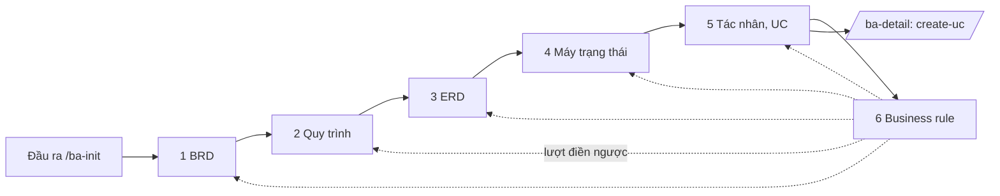

Tham số: $ARGUMENTS
- `--pham-vi <PhamVi>`: phần `{PHẠM VI}` trong tên file (`{LOẠI}_{MÃ DỰ ÁN}_{PHẠM VI}_v00.md`), PascalCase tiếng Việt
  không dấu. Không có → hỏi BA một lần ở bước 1, gợi ý từ phân hệ trong `1-ba-init/0-dau-vao/uc-presales.md`.
- `--lop <lớp>`: chạy lại đúng một lớp. Lớp phía sau phụ thuộc vào nó (bảng đợt, cột "Cần") được nhắc chạy lại.
- `--tiep`: bỏ qua lớp đã có commit `spec(du-an/<lớp>)` trên nhánh, chạy tiếp từ lớp đầu tiên chưa có.
- `--ngu`: BA vắng mặt (skill ba-questioning, sleep-mode.md). Câu chặn vẫn dừng pipeline.

Thiết kế: kit/thiet-ke/thiet-ke-kit.md mục 5, bước 2. Quy trình chung: kit/standards/gate-procedure.md mục 2.
Quy ước nền của sáu lớp: [`2-ba-overview/templates/00_quy_uoc_chung.md`](../../../2-ba-overview/templates/00_quy_uoc_chung.md)
(thứ tự lớp, đặt tên file, khối bắt buộc, hệ mã, dẫn chiếu, điền ngược, cổng trạng thái).

## Version control

Bảng này theo dõi phiên bản của **bộ bảy skill** `ba-overview`, `create-brd`, `create-bp`, `create-erd`,
`create-sm`, `create-ucl`, `create-br`. Template của sáu lớp **không** phát hành kèm skill — skill viết
theo template ở trạng thái ghi dưới đây. Template đổi thì phải soát lại skill tương ứng.

| Phiên bản | Ngày | Người thực hiện | Thay đổi |
|---|---|---|---|
| 1.0 | 27/10/2026 | Claude (soạn), NamLH (chốt) | Phát hành lần đầu (bộ sdlc v3). Thống nhất: `00_quy_uoc_chung.md` và template làm nền, hạt UC theo create-uc, mã UC theo cây WBS ở cột `No`. Câu hỏi mở giữ bảng riêng từng tài liệu; giả định đang làm căn cứ ghi sổ `GD-xxxx`. ERD dẫn mã BR ở cột Nguồn; 🔒 là chặn cứng bất kể nguồn; AI không tự tạo giả định |
| 1.1 | 27/10/2026 | Claude (soạn), NamLH (chốt) | Cổng `Đã duyệt` đòi mọi giả định được dẫn — trực tiếp hoặc kế thừa qua mã — đã chốt; điền ô và lượt điền ngược là sửa không đổi nghĩa; thêm `scripts/kiem_business_layer.py` |
| 1.2 | 27/10/2026 | Claude (soạn), BA PM9 (chốt) | Gộp bộ v3 vào kit PM9: template ở `2-ba-overview/templates/`, sổ giả định `2-ba-overview/assumption_log.md`; giữ khung điều phối của kit (nhánh, agent theo đợt, cổng máy, commit, G0); thứ tự đợt đổi sang 1 → 6 + điền ngược; sơ đồ quy trình giữ BPMN draw.io theo `ba-bpmn` |
| 1.3 | 27/10/2026 | Claude (soạn) | Thêm đợt 5b `--lop cat-cn` cắt chức năng (một CN = một module WBS) theo template `5-actor-usecase/danh_muc_chuc_nang.md`, BA chốt cách chia (chặn); bước 8 gọi skill `ba-gate G0`; báo lại BA gợi ý `/ba-detail CN-01` |

## Sáu lớp

| Thư mục | Lớp | Câu hỏi | Template | Skill lớp |
|---|---|---|---|---|
| `1-brd` | BRD | **Why** — cần giải pháp để làm gì, đo thành công bằng gì | `1-brd/brd.md` | [`create-brd`](../create-brd/SKILL.md) |
| `2-business-process` | Quy trình nghiệp vụ | **How** — việc làm theo bước nào, ai làm, bàn giao ở đâu | `2-business-process/business_process.md` | [`create-bp`](../create-bp/SKILL.md) |
| `3-erd` | ERD | **What** — quản lý những "thứ" gì, liên hệ ra sao | `3-erd/erd.md` | [`create-erd`](../create-erd/SKILL.md) |
| `4-state-machine` | Máy trạng thái | **When** — đối tượng đổi trạng thái ra sao, do sự kiện gì | `4-state-machine/state_machine.md` | [`create-sm`](../create-sm/SKILL.md) |
| `5-actor-usecase` | Tác nhân và use case | **Who** — ai tham gia, làm gì trên hệ thống, quyền tới đâu | `5-actor-usecase/use_case_diagram.md`, `use_case_list.md`, `traceability_matrix.md` | [`create-ucl`](../create-ucl/SKILL.md) |
| `6-business-rules` | Business rule | **Rules** — điều gì bắt buộc, bị cấm, giá trị nào tính từ giá trị nào | `6-business-rules/business_rules.md` | [`create-br`](../create-br/SKILL.md) |

Template nằm dưới `2-ba-overview/templates/`; tài liệu dự án nằm ở `2-ba-overview/<thư mục lớp>/`. Thuật ngữ cấp dự
án ở `du-an/glossary.md`; BRD mục 5 và Quy trình mục 1.1 dẫn thuật ngữ, không định nghĩa lại khác glossary.

## Đọc gì, khi nào

| Khi đang làm | Mở |
|---|---|
| Bất kỳ lớp nào — đặt tên file, khối đầu/cuối, hệ mã, ký hiệu, quy tắc viết | [`00_quy_uoc_chung.md`](../../../2-ba-overview/templates/00_quy_uoc_chung.md) — **nền** |
| Tìm căn cứ, ghi câu hỏi mở, giả định, ba giá trị đặc biệt | [`reference/so-cu-va-gia-dinh.md`](reference/so-cu-va-gia-dinh.md) |
| Phân vân một nội dung thuộc lớp nào | [`reference/ranh-gioi-cac-lop.md`](reference/ranh-gioi-cac-lop.md) |
| Ví dụ minh họa dùng chung cho sáu lớp | [`reference/vi-du-xuyen-suot.md`](reference/vi-du-xuyen-suot.md) |
| Viết xong một lớp, gọi reviewer độc lập | [`reference/review-doc-lap.md`](reference/review-doc-lap.md) |
| Kiểm mã tồn tại, giả định mở, cổng `Đã duyệt`, enum, điều khoản | [`scripts/kiem_business_layer.py`](scripts/kiem_business_layer.py) — `00_quy_uoc_chung.md` mục 12 |

**Thứ bậc khi hai nguồn nói khác nhau:** CLAUDE.md → `kit/standards/` → `00_quy_uoc_chung.md` → template của lớp →
skill của lớp. Skill lớp mâu thuẫn với quy ước hoặc template thì quy ước, template thắng và skill phải sửa.

**Quy ước riêng của kit** (thắng skill lớp khi khác):
- Sơ đồ quy trình (lớp 2) vẽ BPMN 2.0 bằng draw.io theo skill `ba-bpmn`; chỗ template đặt khối Mermaid thì nhúng
  `.drawio.svg`. Máy trạng thái, ERD, use case theo `kit/standards/notation.md`.
- Căn cứ đầu vào `/ba-init` của dự án là `1-ba-init/0-dau-vao/*.md` (dẫn tiếp tới `0-inputs/`), cùng
  `0-inputs/answers-*.md` (câu trả lời của BA).
- Ví dụ trong template và skill (`DA1`, `LichHen`, `QC01`, `BR-B03`, `GD-0047`) là mã minh họa, không chép sang dự án.

## Thứ tự chạy

Chạy đúng thứ tự thư mục **1 → 2 → 3 → 4 → 5 → 6**, rồi một **lượt điền ngược**.

1. Ở lớp 2–5, cột Căn cứ dẫn **thẳng văn bản pháp luật** (`TT79 Đ41.4`), quyết định `D-xx`, quy tắc dùng chung
   `GS-xx`, tham số `CH-xx`, hoặc giả định `GD-xxxx`. Không bịa mã `BR-` trước khi lớp 6 cấp.
2. Lớp 6 gom mọi điều khoản, điểm kiểm soát, `GS-xx`, điều kiện chuyển trạng thái đã xuất hiện ở lớp 2–5 làm
   **ứng viên**, cấp mã `BR-{nhóm}{nn}` và điền cột `Áp tại`.
3. **Lượt điền ngược** — bắt buộc: mỗi chỗ ở lớp 1–5 đang dẫn thẳng điều khoản mà nay đã có BR thì **thêm** mã BR
   kèm tên ngắn trước điều khoản, **không xóa** điều khoản. Danh sách ô và cách ghi Version control:
   `00_quy_uoc_chung.md` mục 10 và skill `create-br` (`reference/gom-ung-vien-va-dien-nguoc.md`). Chạy **sau**
   khi reviewer độc lập của lớp 6 đã chạy và BR đã sửa xong. BR còn ❓ thì chưa điền ngược.

Ngoài lượt điền ngược, vài ô của lớp trước được **lớp ngay sau điền** khi lớp đó chạy — `00_quy_uoc_chung.md`
mục 10. Đây là sửa không đổi nghĩa, nên agent của lớp sau được ghi vào đúng các ô đó của file lớp trước.

## Cổng vào, cổng ra của từng lớp

| Lớp | Cổng vào | Cổng ra — phải đạt trước khi sang lớp sau |
|---|---|---|
| 1 BRD | Bước 1 đã commit, `dau-vao-check` không LỖI | Mọi `OBJ` đo được; mọi `BRQ` có `OBJ` và căn cứ; phạm vi trong/ngoài đã liệt kê; trạng thái ≥ `Chờ review` |
| 2 Quy trình | BRD ≥ `Chờ review` | Mọi `BRQ` có quy trình phủ hoặc ghi vì sao không; bảng bước và sơ đồ khớp số bước; thuật ngữ mục 1.1 đủ; đã điền ô của BRD (mục 10); **BA đã chốt bảng bước** |
| 3 ERD | Quy trình ≥ `Chờ review` | Mọi chứng từ, danh mục, sổ nhắc có thực thể hoặc lý do không lưu; mọi trường trạng thái có enum; đã điền ô của quy trình và BRD |
| 4 Máy trạng thái | ERD ≥ `Chờ review` | Mọi trường `trang_thai` có máy hoặc nằm trong dòng "Không có máy trạng thái"; mã trạng thái khớp enum ERD; đã điền ERD mục 4 `SM mục n` |
| 5 Tác nhân, UC | Quy trình, ERD, máy trạng thái ≥ `Chờ review` | Quy tắc 100% ở `use_case_list` mục 6 đạt hoặc liệt kê đủ chỗ thiếu; mọi dòng UC có `Permission key`; đã điền quy trình mục 10 và BRD mục 12 cột Use case |
| 5b Cắt chức năng | UCL ≥ `Chờ review` | Mỗi CN đúng một module WBS; mỗi UC thuộc đúng một CN; phụ thuộc không vòng; dải ID; mỗi QT ghi CN chạm tới (`gate-check --may G0` phần danh mục không LỖI); **BA đã chốt cách chia** |
| 6 Business rule | Lớp 1–5 ≥ `Chờ review` | Mọi ứng viên đã thành BR hoặc ghi lý do loại; reviewer độc lập đã chạy |
| Điền ngược | Lớp 6 đã qua reviewer, BR đã sửa | Mọi chỗ dẫn điều khoản có BR tương ứng đã mang mã BR; Version control các tài liệu bị sửa đã ghi |

`Chờ review`, `Đã duyệt` theo `00_quy_uoc_chung.md` mục 3.2 và mục 12. Còn `[CẦN BA CHỐT]` thì không được chuyển
`Chờ review`.

## Bảng đợt

Mỗi đợt một agent, phiên mới. `<PV>` là phạm vi, `<MA>` là mã dự án (`du-an/cau-hinh.md`).

| Đợt | `--lop` | Lớp | Agent | Skill lớp | File được ghi | Cần |
| --- | --- | --- | --- | --- | --- | --- |
| 1 | `brd` | `1-brd` | business-analyst | create-brd | `2-ba-overview/1-brd/BRD_<MA>_<PV>_v00.md` | bước 1 |
| 2 | `process` | `2-business-process` | business-analyst | create-bp | `2-ba-overview/2-business-process/QT_<MA>_<PV>_v00.md`, sơ đồ `QT_<MA>_<PV>_<mã QT>.drawio.svg`; ô của BRD theo mục 10 | bước 1 (bản đồ quy trình), brd |
| 3 | `erd` | `3-erd` | data-modeler | create-erd | `2-ba-overview/3-erd/ERD_<MA>_<PV>_v00.md`; ô của QT, BRD theo mục 10 | process |
| 4 | `state` | `4-state-machine` | data-modeler | create-sm | `2-ba-overview/4-state-machine/SM_<MA>_<PV>_v00.md`; ô của ERD theo mục 10 | erd, process |
| 5 | `usecase` | `5-actor-usecase` | usecase-analyst | create-ucl | `2-ba-overview/5-actor-usecase/UCD_<MA>_<PV>_v00.md`, `UCL_…`, `TRACE_…`; ô của QT, BRD theo mục 10 | process, erd, state |
| 5b | `cat-cn` | `5-actor-usecase` | usecase-analyst | template `5-actor-usecase/danh_muc_chuc_nang.md` (mục "Quy tắc chia") | `2-ba-overview/5-actor-usecase/danh-muc-chuc-nang.md` | usecase |
| 6 | `rules` | `6-business-rules` | usecase-analyst | create-br | `2-ba-overview/6-business-rules/BR_<MA>_<PV>_v00.md` | brd, process, erd, state, usecase |
| 7 | `dien-nguoc` | lớp 1–5 | usecase-analyst | create-br (lượt điền ngược) | Các file lớp 1–5 — **chỉ thêm mã BR**, sửa không đổi nghĩa | rules |

- Đợt 4 có điều kiện: ERD không có thực thể nào có vòng đời → bỏ, ghi lý do vào nhật ký điều phối.
- Đợt 2 chi tiết hóa bản đồ quy trình của bước 1 (`1-ba-init/0-dau-vao/ban-do-quy-trinh/ban-do-quy-trinh.md`, BA đã chốt): giữ mã
  `QT-nn`, trigger, kết quả, UC presales của từng QT; thêm bảng bước, gateway, ngoại lệ, D-xx, CH-xx theo template.
  Cần thêm, tách hoặc gộp QT → đề xuất trong báo cáo (không sửa file bước 1); phiên chính hỏi BA, BA đồng ý thì chạy
  `/ba-init --bo-sung` cho bản đồ trước. Bản đồ cấp 0, 1 của bước 1 là sơ đồ tổng, đợt 2 không vẽ lại.
- Mã UC (đợt 5) là mã WBS ở cột `No`: `<MA>.<NỀN TẢNG>.<MODULE>.<CHỨC NĂNG>.<TÍNH NĂNG>`, không tiền tố `UC-`
  (`00_quy_uoc_chung.md` mục 8.2).
- Đợt 5b cắt chức năng cho `/ba-detail`: một CN = một module WBS `<MA>.<NỀN TẢNG>.<MODULE>` của UCL (module trải nhiều
  nền tảng là một CN); CN trên 30 UC → cảnh báo, đề xuất tách module ở UCL (chạy lại đợt 5), không tách CN trong
  module. Ghi QT liên quan, thực thể chính, phụ thuộc CN (không vòng), thứ tự làm, dải ID (CN-01 `101–150`, CN-02
  `151–200`…), nhánh `chuc-nang/CN-xx-<slug>`; mục 2 ghi mỗi QT chạm CN nào. Agent tự kiểm bằng
  `node kit/tools/ba-verify/gate-check.mjs --may G0` (chỉ xem phần danh mục). **BA chốt cách chia, thứ tự (chặn**,
  `--ngu` cũng dừng) trước đợt 6.

## Các bước (phiên chính điều phối)

1. **Nhánh và điều kiện.**
   - `git status` phải sạch; không sạch → dừng, báo BA commit hoặc cất trước.
   - Phải ở nhánh `du-an/khung`. Đã merge tầng dự án mà chạy `--lop` → nhánh mới `du-an/<slug>` từ main
     (kit/standards/git-flow.md).
   - Bước 1 đã commit (`spec(du-an/0-dau-vao)`), có `1-ba-init/0-dau-vao/uc-presales.md`, `phap-ly.md`, `uc-phap-ly.md`,
     `man-presales.md`; `quy-trinh-presales.md` có thì dùng (xem `du-an/agent-notes/_chung.md`). Thiếu → dừng, gợi ý
     `/ba-init`.
   - `node kit/tools/ba-verify/dau-vao-check.mjs` không còn LỖI; còn → dừng, báo BA sửa ở bước 1.
   - Chốt `<PV>` (tham số hoặc hỏi BA). File đích của lớp đã có mà không có `--lop`, `--tiep` → hỏi BA: chạy lại
     lớp nào / dừng. Không ghi đè.
   - Chưa có `2-ba-overview/assumption_log.md` → sao từ `2-ba-overview/templates/assumption_log.md`, thay `{{DỰ ÁN}}`.

2. **Giao agent cho lớp của đợt** (công cụ Agent, `subagent_type` theo bảng đợt). Prompt giao việc gồm:
   - Lớp, file được ghi (chỉ các file ở cột "File được ghi"), template, `00_quy_uoc_chung.md`.
   - Skill phải đọc: `.claude/skills/ba-overview/SKILL.md` (mục Quy ước riêng của kit, Thứ tự chạy, Cổng),
     `.claude/skills/<create-xxx>/SKILL.md` và reference của nó, `.claude/skills/ba-overview/reference/so-cu-va-gia-dinh.md`.
   - Đầu vào: `1-ba-init/0-dau-vao/*.md`, tài liệu của các lớp ở cột "Cần" (đã commit), `2-ba-overview/assumption_log.md`,
     `du-an/glossary.md`, `1-ba-init/open-questions.md`, `du-an/open-questions.md`, `du-an/agent-notes/_chung.md`.
   - Viết theo template: giữ mọi heading, xóa mọi chú thích `<!-- … -->`, thay dòng ví dụ minh họa bằng nội dung dự án.
   - Căn cứ theo bốn bước của `so-cu-va-gia-dinh.md`. Không có căn cứ → ❓ `[CẦN BA CHỐT] <phát biểu>` và một dòng ở
     **bảng câu hỏi của chính tài liệu** (`Q-B01`, `Q-P01`…) kèm đề xuất mặc định. **Không tự tạo `GD-xxxx`**, không
     ghi `assumption_log.md`. Không tự điền con số: con số không có nguồn là ❓ kèm `CH-xx`.
   - Phát hiện ngoài phạm vi lớp (vd cần sửa bước 1, thuật ngữ mới): mã giữ chỗ `[PH-T<n>]`, **đề xuất** trong báo cáo.
     Không ghi `du-an/glossary.md`, `du-an/open-questions.md`, `du-an/trace.csv`.
   - Trước khi báo xong: tự soát theo checklist của skill lớp; `python3 .claude/skills/ba-overview/scripts/kiem_business_layer.py 2-ba-overview`
     sửa hết lỗi Chặn của file mình; `node kit/tools/ba-verify/check-all.mjs`, sửa LỖI thuộc file của mình; đợt 2 thêm
     `bpmn_lint.py` theo skill ba-bpmn.
   - Ghi mỗi lần gọi agent vào `du-an/reports/dieu-phoi/du-an-khung.md` (agent, việc, file, kết quả, số vòng sửa).

3. **Review độc lập** (bắt buộc, mọi đợt 1–6): một agent mới, theo `reference/review-doc-lap.md`, chỉ nhận đường dẫn.
   Gửi phát hiện cho agent của đợt sửa (SendMessage nếu phiên còn, không thì phiên mới) hoặc ghi lý do không sửa.
   Sửa nhiều → review lại. Đợt 7 không cần review riêng, nhưng chạy lại script kiểm.

4. **Gộp đề xuất** (phiên chính ghi):
   - `du-an/glossary.md`: thuật ngữ mới, gộp trùng.
   - `du-an/open-questions.md`: PH (mục 3, bước `2`) và câu hỏi không thuộc riêng tài liệu nào; cấp số tuần tự tiếp
     theo số lớn nhất ở cả `1-ba-init/open-questions.md` và `du-an/open-questions.md`. Câu hỏi của từng tài liệu ở lại
     bảng câu hỏi của tài liệu đó.
   - `du-an/trace.csv`: mỗi ID mới cấp ở sổ dự án một dòng (kit/standards/id-convention.md mục "trace.csv").
   - Thay mã giữ chỗ trong file của agent bằng mã thật.
   - Đề xuất sửa lớp trước (thay đổi **có nghĩa**): gửi lại agent của lớp đó, chạy lại cổng máy, commit riêng
     `spec(du-an/<lớp>): bổ sung theo <lớp sau>`; tài liệu bị sửa tăng `vNN`, về `Chờ review`.

5. **Cổng máy:** `kiem_business_layer.py 2-ba-overview` và `node kit/tools/ba-verify/check-all.mjs`. Còn LỖI → gửi
   nguyên văn cho agent của file đó sửa, chạy lại, tối đa 2 lần. LỖI ở file phiên chính ghi → phiên chính sửa. Hết
   2 lần còn LỖI → dừng, báo BA.

6. **Hỏi BA** (ba-questioning, chế độ xác nhận; chỉ điều agent không tự quyết):
   - Mọi ❓ `[CẦN BA CHỐT]` của đợt, kèm đề xuất mặc định. Với mỗi câu BA chọn: **chốt** (agent sửa thân tài liệu,
     dòng `Q-…` ghi ✅), **chấp nhận tạm** (phiên chính ghi dòng `GD-xxxx` vào `2-ba-overview/assumption_log.md` theo
     lời BA, ghi người chốt; agent đổi ❓ thành `GD-xxxx` bôi đỏ, dòng `Q-…` ghi *→ GD-xxxx*), hoặc **để mở** (giữ ❓
     kèm mã `Q-…`). Còn `[CẦN BA CHỐT]` thì tài liệu chưa được chuyển `Chờ review`.
   - Sau đợt 1: phạm vi trong và ngoài, mục tiêu, bên liên quan agent đã dựng.
   - Sau đợt 2 (**chặn**, `--ngu` cũng dừng): bảng bước, tác nhân từng bước, chuyển giao giữa quy trình. BA đổi →
     gửi lại agent đợt 2, chạy lại cổng máy, hỏi lại. Chưa chốt thì không sang đợt 3.
   - Sau đợt 5b (**chặn**, `--ngu` cũng dừng): cách chia CN, phụ thuộc, thứ tự làm, dải ID. BA chốt → agent ghi
     **BA chốt dd/mm/yyyy** ở Version control của danh mục. Chưa chốt thì không sang đợt 6.
   - Mỗi đợt: mâu thuẫn nguồn (ghi đủ phương án, chặn G0).
   Câu trả lời ghi `0-inputs/answers-<YYYY-MM-DD>.md`; gửi lại agent áp vào; chạy lại cổng máy.

7. **Commit** mỗi lớp một commit trên `du-an/khung` (kit/standards/git-flow.md), gồm file của lớp, ô đã điền ở lớp
   trước, sổ giả định và các file gộp: `spec(du-an/1-brd): brd`, `spec(du-an/2-business-process): quy trình nghiệp vụ`,
   `spec(du-an/3-erd): erd`, `spec(du-an/4-state-machine): máy trạng thái`, `spec(du-an/5-actor-usecase): actor, use case`,
   `spec(du-an/cat-cn): danh mục chức năng`, `spec(du-an/6-business-rules): business rule`,
   `spec(du-an/dien-nguoc): gắn mã BR vào lớp 1–5`.
   Rồi sang đợt kế tiếp (về bước 2).

8. **Gate G0** sau đợt 7: gọi skill `ba-gate` với `G0` (thêm `--ngu` nếu có). Skill kiểm khóa, cổng máy
   `gate-check --may G0`, bốn reviewer, vòng sửa, ghi `du-an/G0.md`, đặt `dat-G0`, commit hồ sơ. KHÔNG ĐẠT → dừng, báo
   BA danh sách lỗi Chặn còn lại. Không push, không mở PR: tầng dự án merge một lần sau G0 (`/ba-pr du-an`; kit chưa có lệnh này — BA mở PR
   tay theo kit/standards/git-flow.md, hoặc /ba-detail tạo nhánh CN từ `du-an/khung`).

`--lop <lớp>`: làm bước 1, giao lại đúng lớp đó (bước 2–7), liệt kê lớp phía sau có cột "Cần" chứa nó để BA quyết có
chạy lại không. Chạy lại `rules` thì phải chạy lại `dien-nguoc`. G0 (nếu đã chạy) mất hiệu lực.

## Nguyên tắc chung cho sáu lớp

1. **Mỗi loại thông tin có đúng một lớp sở hữu.** Lớp khác chỉ dẫn mã kèm tên ngắn, không chép lại nội dung
   (`reference/ranh-gioi-cac-lop.md`).
2. **Business layer không mô tả giải pháp.** Không màn hình, nút, route, API, câu thông báo — việc của `/ba-detail`.
   Riêng ERD được dùng tên bảng, tên trường, mã enum vì là nguồn duy nhất về mã kỹ thuật.
3. **Không chỗ nào thiếu căn cứ mà không ai biết.** Mỗi chỗ cần căn cứ có một trong bốn: mã lớp đã chốt, điều khoản
   tài liệu, `GD-xxxx`, hoặc ❓ kèm mã câu hỏi. Trống trơn là lỗi.
4. **AI không tự chốt.** AI viết đề xuất, ghi câu hỏi, đánh dấu ❓ và `[CẦN BA CHỐT]`. Mọi ô ghi **BA chốt dd/mm/yyyy**,
   mọi giả định mới vào sổ, mọi quyết định `D-xx` đều do người ký.
5. **Ví dụ trong skill là minh họa**, không chép sang tài liệu dự án.

## Không được làm
- Không sửa gì trong `0-inputs/` (trừ `0-inputs/answers-*.md`), không sửa `2-ba-overview/templates/` (template).
- Không giao hai agent cùng sửa một file cùng lúc; không chạy đợt sau khi đợt trước chưa commit.
- Không sang đợt 3 khi BA chưa chốt quy trình của đợt 2. Không đổi danh sách QT ở đợt 2 (đổi ở bước 1, `--bo-sung`).
- Không cấp mã `BR-` trước đợt 6; không bỏ đợt 7.
- Không tự điền con số; không chọn hộ khi nguồn mâu thuẫn; agent không tự tạo `GD-xxxx`.

## Báo lại BA
Sau mỗi đợt một dòng: lớp, file, số mục chính (OBJ, BRQ / QT, bước / thực thể / máy trạng thái / tác nhân, UC / CN /
BR), số ❓ và `Q-…` mới, số GD BA đã tạo, kết quả review độc lập, cổng máy, commit. Cuối lệnh: tổng hợp sáu lớp và
danh mục chức năng, câu hỏi còn chờ BA (theo cột "Chặn gate"), giả định còn `Đang mở`, trạng thái G0 (đường dẫn
`du-an/G0.md`). Gợi ý bước tiếp: G0 ĐẠT → `/ba-pr du-an`, rồi `/ba-detail CN-01` (CN có thứ tự làm 1 trong danh mục);
G0 KHÔNG ĐẠT → sửa theo hồ sơ, `/ba-gate G0`.
