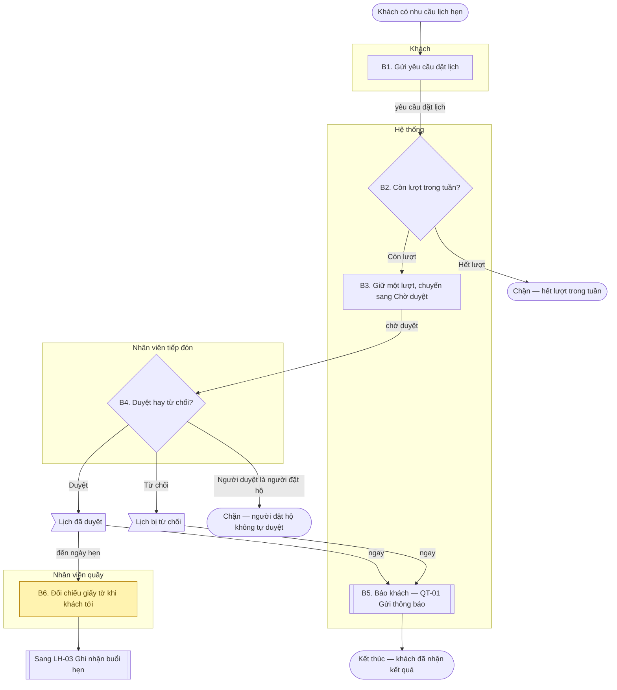

# Bóc bước và vẽ sơ đồ

Phần tra cứu của skill [`create-bp`](../SKILL.md). Đọc phần lõi trước. File này trả lời ba việc: bóc **bước** từ văn bản pháp luật và tài liệu khảo sát,
đánh số sao cho bảng bước và sơ đồ là **một**, và vẽ sơ đồ bằng ký hiệu BPMN trong Mermaid. Mã, tên, con số và điều khoản trong ví dụ là **mã minh họa** của
[`vi-du-xuyen-suot.md`](../../ba-overview/reference/vi-du-xuyen-suot.md), kể cả quy chế `QC01` — không chép sang tài liệu dự án. Mã không có trong bảng mã chuẩn (mục 3 của file đó) — như `D-03`, `GS-02`, `QT-01`, `LH-03` — là **mã minh họa riêng của skill**, không trùng nghĩa với mã nào của bảng.

## 1. Bóc bước từ văn bản pháp luật

Văn bản pháp luật không viết theo trình tự việc làm; nó viết theo điều khoản. Bóc bước là đọc từng điều khoản và hỏi: **ai phải làm gì, trước hay sau việc nào, với kết
quả gì**. Làm lần lượt:

1. Gạch dưới mọi **động từ nghĩa vụ** (*phải, có trách nhiệm, được, không được, trước khi, sau khi, trong thời hạn*) và **chủ thể** của nó.
2. Mỗi cặp *chủ thể + nghĩa vụ* là một **bước ứng viên**. Chủ thể trong văn bản thường là chức danh; tên tác nhân người lấy đúng chữ **BRD mục 4**, chức danh khác của văn bản ghi ở cột Căn cứ, lệch nghĩa thì `Q-P…`.
3. Xếp các ứng viên theo thứ tự thời gian, dựa vào *trước khi, sau khi, trong … ngày*. Điều khoản không nói thứ tự thì thứ tự là một lựa chọn của dự án: ghi `D-xx`.
4. Tìm **điều kiện rẽ**: *trường hợp…, nếu…, đối với…* — mỗi điều kiện là một cổng và một nhánh, và nhánh *không đạt* quan trọng ngang nhánh đạt.
5. Tìm **kết quả** và **người nhận**: nghĩa vụ "lập", "báo cáo", "gửi" sinh ra chứng từ và một lần **bàn giao**.
6. Chọn **sự kiện kích hoạt** — việc đầu tiên mà chưa cần ai làm gì, và **kết quả cuối** — điều mà khi xảy ra thì quy trình xong.

Bảng đọc tín hiệu trong văn bản:

| Tín hiệu trong văn bản | Thành gì trong tài liệu | Ví dụ minh họa |
|---|---|---|
| *X phải lập / gửi / duyệt Y* | Một bước, tác nhân X, đối tượng Y; chứng từ Y nếu là "lập" | *"Nhân viên tiếp đón duyệt yêu cầu"* → bước 4 |
| *trước khi / sau khi / trong thời hạn n ngày* | Thứ tự các bước; hoặc điểm kiểm soát loại Ngăn chặn; thời hạn là `CH-xx` và là chỉ số theo dõi | *"duyệt trước ngày hẹn"* (`QC01 Đ6.1`) → bước 4, không chép số |
| *không được / cấm* | Điểm kiểm soát (Ngăn chặn hoặc Tách nhiệm), hoặc nhánh Chặn ở cổng | *"không được đặt quá 2 lịch hẹn mỗi tuần"* → cổng B2, `CH-01` |
| *tối đa, tối thiểu, ít nhất, không quá* + con số | Con số cấu hình thì `CH-xx`; luật định cứng thì ghi số kèm biên và điều khoản | `CH-01` |
| *được … khi …* | Trường hợp biên kiểu **Cho phép kèm điều kiện** | *"được cấp thêm lượt khi Giám đốc trung tâm đồng ý"* |
| *trường hợp … thì …* | Cổng và nhánh; nhánh ít gặp thì một dòng ở bảng trường hợp biên | *"hủy trước giờ hẹn ít nhất `CH-02` giờ thì trả lượt"* |
| Định nghĩa ("… là …") | Thuật ngữ mục 1.1, không phải bước | *lịch hẹn* |
| Cách tính, làm tròn, tuần tính từ ngày nào | `GS-xx` | *tuần tính từ thứ Hai* |
| Mẫu biểu kèm văn bản | Chứng từ mục 8.1 | *Mẫu MH-01* |
| Điều khoản tổ chức, thẩm quyền chung ("trung tâm chịu trách nhiệm…") | Mục 2 hoặc Chủ quy trình; không thành bước | — |

Ví dụ bóc từ một đoạn **trích giả định** của `QC01` (minh họa):

> Điều 5. Lịch hẹn. 1. Mỗi khách đặt tối đa 2 lịch hẹn mỗi tuần. 2. Mỗi lịch hẹn tối đa 3 người.
> Điều 6. Duyệt lịch. 1. Lịch phải được nhân viên tiếp đón duyệt trước ngày hẹn. 3. Nhân viên tiếp đón không được duyệt lịch do chính mình đặt hộ khách.
> Điều 7. Hủy lịch. 2. Khách hủy lịch trước giờ hẹn ít nhất 24 giờ thì lượt được trả lại; trung tâm được quy định thời hạn dài hơn.

| Điều khoản | Bóc thành | Ở đâu trong tài liệu |
|---|---|---|
| Đ5.1 "tối đa 2 lịch hẹn mỗi tuần" | Cổng kiểm còn lượt; nhánh Chặn khi hết lượt; số là `CH-01` | LH-01 bước 2; điểm kiểm soát Ngăn chặn; mục 6 |
| Đ5.2 "mỗi lần tối đa 3 người" | Luật định cứng: ghi số kèm biên và điều khoản ở nơi dùng (cột Căn cứ bước 1, một dòng Chặn ở bảng biên), **không** thành `CH-xx`; lớp 3 ghi thành ràng buộc nội tại của số người. Chưa rõ cứng hay cấu hình thì `CH-` đề xuất và `Q-P` | LH-01 bước 1; bảng biên; mục 11.3 nếu chưa rõ |
| Đ6.1 "phải được duyệt trước ngày hẹn" | Bước duyệt của nhân viên tiếp đón; thứ tự (duyệt rồi mới đến hẹn) | LH-01 bước 4 |
| Đ6.3 "không được duyệt lịch do chính mình đặt hộ" | Điểm kiểm soát loại Tách nhiệm ở bước duyệt; một cặp ở dòng Tách nhiệm của mục 2 | LH-01 bước 4; mục 2; mục 9 |
| Đ7.2 "hủy trước giờ hẹn ít nhất 24 giờ thì trả lượt" | Một quy trình riêng `LH-02` khi là nghiệp vụ riêng trong BRD (kể cả chỉ một bước người cộng một bước hệ thống), nếu không thì một nhánh của `LH-01`; "24 giờ" là sàn luật của `CH-02`, "thời hạn dài hơn" là phần cấu hình được | LH-02; mục 6 |
| (không điều khoản nào nói ai báo kết quả cho khách) | Bước 5 do dự án chọn: `D-xx` ở trạng thái đề xuất, kèm `❓ Q-P…` | Mục 4; mục 11.3 |

Điều khoản **không** sinh bước cũng ghi nhận: một văn bản đã rà toàn văn thì ở mục 1 ghi *đã rà toàn văn, không sinh quy trình — vì …*, để người sau khỏi rà lại.

## 2. Bóc bước từ khảo sát hiện trạng

Khảo sát, biên bản phỏng vấn, sơ đồ hoặc sổ giấy hiện có cho biết **việc thực sự được làm thế nào**, kể cả những thứ văn bản không nói. Văn bản pháp luật nói việc **phải** thế nào. Hai nguồn
khác nhau về nghĩa vụ thì văn bản thắng và ghi mâu thuẫn vào `Q-P`; hiện trạng ghi lại là cách làm.

Ép từng bước hiện trạng qua sáu câu hỏi. Câu nào có đáp án *khác luồng thuận* thì ra một nhánh hoặc một dòng ở bảng trường hợp biên:

| Câu hỏi | Nếu có đáp án thì ghi thành |
|---|---|
| Ai chuyển việc cho ai, bằng gì (giấy, điện thoại, hệ thống)? | **Bàn giao**: cạnh qua làn ở sơ đồ, nhãn là cái được chuyển; chứng từ ở cột Chứng từ |
| Giữa hai việc có phải chờ gì không (chờ ký, chờ ngày, chờ bên ngoài)? | **Khoảng chờ**: nhãn trên cạnh (*"chờ duyệt"*); nếu hết hạn thì là `N-xx` |
| Nếu người nhận không đồng ý, thiếu giấy tờ, không có mặt thì sao? | **Nhánh không đạt**: cạnh ra khỏi cổng, nhánh Chặn hoặc quay lại |
| Nếu hệ thống hiện tại hỏng, hết giờ, hoặc người làm vắng thì họ làm gì? | **Đường vòng thủ công**: dòng ở bảng biên (Cho phép kèm điều kiện, ví dụ nhập bù trong thời hạn `CH-xx`), hoặc bước 🟡 nếu việc đó vẫn làm ngoài hệ thống |
| Có ca nào nhân viên tiếp đón làm tắt, ghi sổ riêng, dùng bảng tính riêng không? | Hỏi người chốt đây là **nghiệp vụ hợp lệ** hay **thói quen cần bỏ**. Chưa trả lời: `Q-P`, **không tự bỏ** |
| Việc này xảy ra bao nhiêu lần một ngày, một tháng? | Tần suất ở bảng thông tin; chỉ số theo dõi |

Việc hiện có làm tay và hệ thống mới **không** thay thế thì là bước 🟡; việc hiện có làm tay mà hệ thống mới sẽ làm thay thì là bước thường. Ranh giới là phạm vi trong BRD: nếu BRD chưa nói thì ❓ và `Q-P`,
AI không tự quyết.

Luật chung của cả hai nguồn: **không chỉ luồng thuận**. Một quy trình mà mọi cổng chỉ có cạnh *đạt* là quy trình chưa bóc xong — đúng điều mà bài giới thiệu 6 lớp nhấn mạnh: *trình tự các bước không chỉ luồng thuận, điểm bàn giao giữa các bên, ngoại lệ và đường vòng thủ công hiện có*.

## 3. Hạt của một bước

**Một bước = một tác nhân + một động từ + một đối tượng.** Bảng dưới là phép thử gộp và tách:

| Tình huống | Kết luận |
|---|---|
| "Nhân viên tiếp đón kiểm tra hồ sơ và ký duyệt" | **Hai bước**: kiểm tra và duyệt — hai động từ; thường mang hai điểm kiểm soát khác nhau |
| "Khách hoặc người đại diện gửi yêu cầu" | **Một bước**, hai tác nhân cùng làm *một* việc: ghi cả hai ở mục 2, ô Tác nhân của bảng bước ghi tác nhân thực hiện đúng; hai tác nhân làm hai việc khác nhau thì hai bước |
| "Hệ thống kiểm còn lượt và kiểm số người đi cùng" | Nếu hai điều kiện cho **hai kết quả chặn khác nhau** (hết lượt / vượt số người) thì **hai bước**. Cùng một căn cứ, cùng một kết quả chặn thì một bước |
| "Hệ thống ghi nhận, rồi gửi thông báo" | Hai bước nếu thông báo là quy trình khác (`QT-01`), hoặc nếu có thể chạy tách giờ. Cùng một lần thì ghi nhận ở bước ghi, thông báo ở bước sau |
| Chờ nhân viên tiếp đón duyệt | **Không** là bước; là khoảng chờ trên cạnh giữa hai bước |
| Mở màn hình, bấm nút, chọn dòng | **Không** là bước của quy trình — giải pháp. Nằm bên trong một bước "người làm trên hệ thống" và thuộc UC |
| Một bước phải có ít nhất một **kết quả quan sát được** | Nếu bước không để lại chứng từ, trạng thái đổi, hoặc thông tin chuyển đi thì nó chỉ là thao tác nội bộ của bước khác: gộp |
| Hệ thống giữ lượt và chuyển yêu cầu sang Chờ duyệt (`LH-01` bước 3) | **Một bước** — hai việc là một lần ghi trong cùng giao dịch, không chạy tách được và cho một kết quả quan sát (lịch ở Chờ duyệt, lượt đã giữ). Gộp theo tiêu chí này là lựa chọn của skill; hai việc có thể chạy tách giờ thì tách |

Mỗi bước nêu trạng thái đích của đối tượng bằng **tên tiếng Việt** (*"Giữ một lượt, chuyển yêu cầu sang Chờ duyệt"*) để lớp 4 đọc được sự kiện gây chuyển. Không ghi mã trạng thái — mã nằm ở ERD.

## 4. Quy tắc đánh số: bảng và sơ đồ là một

| Quy tắc | Nghĩa |
|---|---|
| Mỗi số bước ↔ đúng một nút | Bước `3` ở bảng ↔ nút `B3` ở sơ đồ, và **chỉ một** nút. Bước 🟡 `6` ↔ nút `B6` (tô vàng) |
| Mọi nút có người làm đều mang số | Hoạt động, cổng quyết định, lời gọi quy trình con giữa chừng: đều là bước, đều có số |
| Chỉ năm loại nút **không số** | Sự kiện bắt đầu `S0`, sự kiện kết thúc, nhánh chặn `X1`, kết quả con `R1` của bước ngay trước (hình cờ, không phải hình sự kiện), bước giao sang quy trình khác `E1` |
| Số liên tục, tăng theo thứ tự đọc bảng | Bước thuộc nhánh đánh số tiếp, không dùng `3a`, `3.1`. Bước chỉ xảy ra ở một nhánh ghi điều kiện ở đầu cột Hành động (*"Khi từ chối: …"*) |
| Nhãn nút chép tên hành động | `B1["B1. Gửi yêu cầu đặt lịch"]`: số, dấu chấm, rồi hành động ngắn đúng ý cột Hành động. Không chép toàn văn |
| Mỗi **cổng** có đủ cạnh ra | Một cổng quyết định có tối thiểu hai cạnh, mỗi cạnh một nhãn điều kiện, các điều kiện loại trừ nhau và đủ |
| Cạnh đi qua làn khác có nhãn | Nhãn là cái được **bàn giao** (*"yêu cầu đặt lịch"*) hoặc **khoảng chờ** (*"chờ duyệt"*); khoảng chờ **không** có nút riêng |
| Sửa bảng thì sửa sơ đồ trong cùng lần | Thêm, xóa, đổi số một bước là thao tác trên **cả hai**; reviewer đối chiếu từng số |

## 5. Ký hiệu BPMN trong Mermaid

> **Quy ước của kit:** sơ đồ vẽ bằng draw.io theo skill [`ba-bpmn`](../../ba-bpmn/SKILL.md), không dùng Mermaid — xem ghi chú
> "Quy ước riêng của kit" ở [`SKILL.md`](../SKILL.md). Bảng dưới giữ để đối chiếu phần tử BPMN; quy tắc đánh số nút vẫn áp dụng.

Dùng `flowchart TD`. Nhãn có dấu chấm, dấu gạch ngang, ngoặc phải đặt trong ngoặc kép.

| Phần tử BPMN | Mermaid | Dùng khi |
|---|---|---|
| Sự kiện bắt đầu, kết thúc | `S0(["…"])` | Mở và đóng quy trình; nhánh Chặn kết thúc cũng dùng. Sự kiện kết thúc **không có cạnh ra** |
| Hoạt động (Task) | `B1["B1. …"]` | Một bước có người hoặc hệ thống làm |
| Cổng rẽ nhánh (Gateway) | `B2{"B2. …?"}` | Bước kiểm hoặc quyết định; cạnh ra có nhãn điều kiện |
| Gọi quy trình khác (Call Activity) | `B4[["B4. …"]]` hoặc `E1[["Sang LH-03"]]` | **Có số:** lời gọi **giữa chừng** — đúng nghĩa Call Activity, quy trình con xong rồi luồng tiếp tục. **Không số:** giao việc rồi hết phần của quy trình này — dùng lệch nghĩa Call Activity (lựa chọn của skill, vì template chỉ có ký hiệu này); đọc là quy trình đích bắt đầu theo dòng `Đầu ra kích hoạt` |
| Kết quả con | `R1>"Lịch đã duyệt"]` | Kết quả của bước ngay trước, có cạnh đi tiếp. Dùng hình cờ vì hình sự kiện `([…])` là bắt đầu hoặc kết thúc và không có luồng ra |
| Làn trách nhiệm (Lane) | `subgraph L1["Tên tác nhân"]` … `end` | Có từ hai tác nhân; mỗi làn một tác nhân đúng chữ ở mục 2 |
| Bước ngoài phạm vi 🟡 | `classDef ngoai fill:#FFF3B0,stroke:#B8860B,color:#5A4500` và `class B5 ngoai` | Chỉ nút ứng với dòng 🟡 của bảng |
| Hai việc song song | Hai cạnh ra từ cùng một nút kết quả, mỗi cạnh nhãn rõ | Việc độc lập về thời gian, ví dụ báo ngay và chờ tới ngày hẹn. Mermaid không có cổng song song nên dùng cách này; template chỉ liệt kê năm ký hiệu |

Quy ước thêm: đúng **một** sự kiện bắt đầu cho mỗi **Kích hoạt** (nhiều kích hoạt thì nhiều nút bắt đầu, mỗi cái dòng riêng ở bảng thông tin). Quy trình bắt đầu bởi hẹn giờ vẫn dùng `S0`, nhãn ghi thời điểm: `S0(["Đến giờ chạy nhắc lịch — N-01"])`. Mỗi đường đi của sơ đồ đều phải **kết thúc** ở một sự kiện kết thúc, nhánh Chặn, hoặc giao sang quy trình khác; không để nút cụt.

## 6. Ví dụ hoàn chỉnh: `LH-01 Đặt và duyệt lịch hẹn` (minh họa)

Quy trình có bốn tác nhân, một cổng kiểm lượt có nhánh chặn, một cổng duyệt có nhánh chặn tách nhiệm, một lời gọi giữa chừng sang quy trình chung, một bước 🟡, và một bước giao sang quy trình sau. Các bước khớp `LH-01` ở [`vi-du-xuyen-suot.md`](../../ba-overview/reference/vi-du-xuyen-suot.md). `QT-01 Gửi thông báo`, `LH-03 Ghi nhận buổi hẹn`, `D-02`, `Q-P05` là **mã minh họa riêng của skill**.

| Bước | Tác nhân | Hành động | Căn cứ | Chứng từ |
|---|---|---|---|---|
| 1 | Khách | Gửi yêu cầu đặt lịch: dịch vụ cần hẹn, ngày hẹn, số người đi cùng | `D-01 Chỉ nhận đặt lịch trực tuyến` · `QC01 Đ5.2 Tối đa 3 người mỗi lần` | Yêu cầu lịch hẹn — *không có mẫu* |
| 2 | Hệ thống | **Kiểm còn lượt** của khách trong tuần của ngày hẹn | `QC01 Đ5.1 Tối đa 2 lịch hẹn mỗi tuần` · `CH-01 Số lịch hẹn mỗi tuần` · `GS-01 Tuần tính từ thứ Hai, giờ Việt Nam` | — |
| 3 | Hệ thống | Giữ một lượt, chuyển yêu cầu sang Chờ duyệt | `QC01 Đ5.1 Tối đa 2 lịch hẹn mỗi tuần` · `CH-01 Số lịch hẹn mỗi tuần` | — |
| 4 | Nhân viên tiếp đón | **Duyệt hoặc từ chối** yêu cầu đặt lịch, trước ngày hẹn | `QC01 Đ6.1 Duyệt trước ngày hẹn` · `QC01 Đ6.3 Người đặt hộ không tự duyệt` | Quyết định duyệt lịch hẹn — *không có mẫu* |
| 5 | Hệ thống | Báo kết quả cho khách, theo `QT-01 Gửi thông báo` | `D-02` (mã minh họa riêng của skill) | — |
| 🟡 6 | Nhân viên quầy | Đối chiếu giấy tờ của khách khi tới trung tâm | ngoài phạm vi theo BRD (`Q-P05` chờ xác nhận) | — |

*Bước 2–3 chạy cùng request với bước 1; khoảng chờ nằm giữa bước 3 và bước 4.*

Điều ví dụ này minh họa, đối chiếu từng ý với quy tắc ở mục 4 và 5:

| Điểm | Ở đâu |
|---|---|
| Luồng chính từ sự kiện kích hoạt tới kết quả | `S0 → B1 → B2 → B3 → B4 → R1 → B5 → E0` |
| **Nhánh chặn**: cổng có cạnh *không đạt*, kết thúc không số | `B2 → X1` và `B4 → X2`; bảng trường hợp biên phải có dòng cho từng tình huống |
| Bước kiểm là cổng, bước làm là chữ nhật | `B2`, `B4` hình thoi; `B1`, `B3`, `B6` chữ nhật |
| **Kết quả con** không số của bước ngay trước, hình cờ vì còn cạnh đi tiếp | `R1`, `R2` nối ra từ `B4` |
| **Gọi quy trình khác** giữa chừng — có số vì luồng còn tiếp | `B5` hình subroutine, căn cứ `QT-01` |
| **Gọi quy trình khác** để giao việc — không số | `E1` ở cuối `B6` |
| **Làn** theo tác nhân, đúng tên ở mục 2 | bốn `subgraph` |
| Bàn giao và khoảng chờ nằm trên cạnh qua làn | `B1 → B2` nhãn *yêu cầu đặt lịch*; `B3 → B4` nhãn *chờ duyệt*; `R1 → B6` nhãn *đến ngày hẹn* |
| Hai việc song song từ cùng kết quả | `R1` đi `B5` ngay và đi `B6` khi đến ngày |
| Bước 🟡 tô vàng bằng `classDef` | `B6`; dòng 🟡 ở bảng có `` cùng màu |

Bảng trường hợp biên đi kèm — mỗi dòng là một tình huống kiểm thử được (minh họa; `GS-02`, `D-03` là mã minh họa riêng của skill):

| Tình huống | Xử lý |
|---|---|
| Khách còn đúng một lượt trong tuần, khách gửi yêu cầu | **Cho phép** — giữ lượt cuối, lượt còn lại về 0 — `QC01 Đ5.1` |
| Khách đã dùng đủ `CH-01` lượt, khách gửi thêm yêu cầu cho cùng tuần | **Chặn** — không tạo lịch, không đổi lượt — `QC01 Đ5.1` |
| Hai khách gửi yêu cầu gần như cùng lúc cho lượt cuối | **Chặn** yêu cầu nhận sau — yêu cầu nhận trước giữ lượt, yêu cầu sau bị chặn như dòng trên — `GS-02 Giữ lượt theo thứ tự nhận` |
| Chủ nhật 23:59 gửi yêu cầu cho thứ Hai tuần sau, người đó đã dùng đủ `CH-01` lượt của tuần sau | **Chặn** — lượt tính vào tuần của ngày hẹn, đúng biên tuần — `GS-01 Tuần tính từ thứ Hai, giờ Việt Nam` |
| Khách khai 4 người đi cùng | **Chặn** — không tạo lịch — `QC01 Đ5.2` |
| Nhân viên tiếp đón từ chối yêu cầu | **Cho phép kèm điều kiện** — chỉ khi nêu lý do — `D-03 Từ chối phải có lý do` |
| Nhân viên tiếp đón đặt hộ yêu cầu rồi duyệt chính yêu cầu đó | **Chặn** — người duyệt phải khác người lập — `QC01 Đ6.3` |
| Số lượt đã dùng ở sổ lệch số lịch hẹn trong tuần | **Cảnh báo** — hệ thống ghi nhận và báo nhân viên tiếp đón, không tự sửa — `N-03 Đối soát quỹ lượt` |
| Khách hủy lịch ở Chờ duyệt hoặc Đã duyệt | **Chuyển quy trình** — sang `LH-02 Hủy lịch hẹn` — `QC01 Đ7.2` |

Điểm kiểm soát đi kèm:

> **Điểm kiểm soát bắt buộc:** hệ thống không cho giữ lượt khi khách đã dùng đủ `CH-01` lượt trong tuần (B2) · người đặt hộ yêu cầu không được tự duyệt yêu cầu đó (B4).

## 7. Khi nào tách quy trình con

Tách một đoạn ra thành quy trình con khi đoạn đó thỏa ít nhất **hai** trong bốn dấu hiệu, và **không** tách chỉ để làm bảng ngắn lại:

| Dấu hiệu | Ví dụ minh họa |
|---|---|
| Có **chủ** hoặc **sự kiện kích hoạt** riêng | Khách hủy lịch là một sự kiện khác với gửi yêu cầu |
| Được **gọi từ hai quy trình trở lên** | Gửi thông báo dùng cho cả LH-01 và LH-02 |
| Có **kết quả nghiệp vụ** riêng, đo được riêng | Lịch được hủy và lượt được trả lại |
| **Chạy lệch tần suất** với quy trình cha | Quy trình cha 1 lần mỗi yêu cầu, đoạn con 2 lịch hẹn mỗi tuần |

Rồi chọn cách đặt mã:

| Kết quả | Mã |
|---|---|
| Đoạn con **chỉ tồn tại như phần hoặc biến thể** của quy trình cha, kích hoạt từ cha | Hậu tố chữ của cha: `LH-01B` (gốc không hậu tố; con bắt đầu từ `B`). Đặt ngay sau cha, bảng thông tin và bảng bước riêng, bước đánh số lại từ 1; cha gọi bằng nút `[[ ]]` |
| Đoạn con **sống độc lập**, có kích hoạt riêng không do cha | Mã mới `LH-02`, cùng domain |
| Đoạn con dùng cho **từ hai domain** trở lên, không dính dữ liệu riêng một domain | Quy trình chung `QT-nn`, đặc tả trong tài liệu quy trình chung; tài liệu domain chỉ nối vào |

Bỏ một quy trình con thì mã hậu tố không dùng lại (mục "Mã và tên" của phần lõi).
