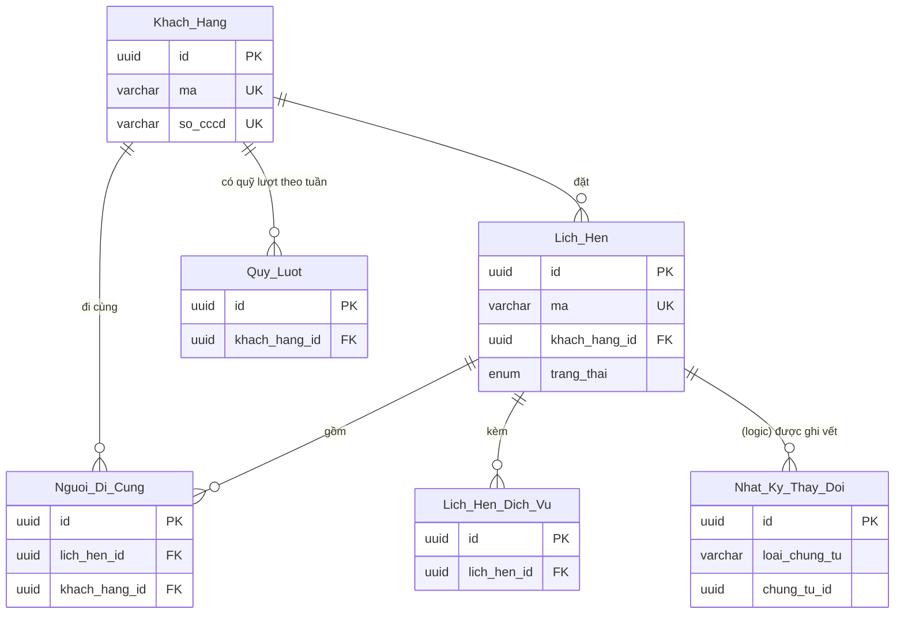

# Thực thể và quan hệ

Phần tra cứu của skill [`create-erd`](../SKILL.md). Đọc phần lõi trước. Mã và tên trong ví dụ là **mã minh họa** của [thế giới xuyên suốt](../../ba-overview/reference/vi-du-xuyen-suot.md); những thực thể thêm vào cho đủ loại (như `Lich_Hen_Dich_Vu`) đánh dấu *giả định minh họa*. Mã không có trong bảng mã chuẩn của thế giới xuyên suốt là **mã minh họa riêng của skill**.

## 1. Bóc thực thể từ quy trình

ERD không tự nghĩ ra thực thể; nó **đọc** từ quy trình. Đi qua từng chỗ dưới đây theo thứ tự, mỗi chỗ cho ra một loại ứng viên khác nhau.

| Chỗ trong quy trình | Cho ra | Cách xử lý |
|---|---|---|
| Mục 1.1 Thuật ngữ, cột `Thuật ngữ` và `Định nghĩa` | Lớp 2 để cột `Thực thể ERD` ở `chờ lớp 3`, nên ERD **tự bóc**: thuật ngữ chỉ một thứ có định danh, có vòng đời là ứng viên. Thuật ngữ chỉ giá trị tính toán thường là Δ hoặc enum | Chạy phép thử mục 2 dưới đây, đưa vào mục 2 của ERD, rồi **điền ngược** cột `Thực thể ERD` của quy trình: tên bảng thật, hoặc `—` cho khái niệm tính toán. Thuật ngữ mà quy trình dùng như thứ có mã, có lịch sử nhưng không qua được phép thử thì ghi `Q-E` — quy trình thiếu |
| Mục 3 Bảng dữ liệu trục, cột `Bảng` và `Ai ghi` | Thực thể cốt lõi (sổ cái, tồn, ví); cột `Ai ghi` thành cột `Quy trình ghi` | Chép tên bảng và mã quy trình; đối chiếu hai chiều |
| Mục 3 Loại biến động | Giá trị enum của sổ (`loai_bien_dong`) và dấu cộng trừ | Mỗi loại một mã enum ở danh mục; dấu và quy trình giữ ở quy trình, ERD chỉ dẫn |
| Mục 3 Các loại khóa | **Không** thực thể. Khóa "suy ra từ dữ liệu, không lưu cờ riêng" | Ghi vào dòng "Không lưu cờ" ở mục 1 của ERD |
| Mục 3.1 Quy tắc dùng chung `GS-xx` | Quy tắc về tiền, làm tròn, múi giờ, đồng thời | Vào mục 1 (quy ước chung) và cột Ràng buộc; `row_version` nếu có `GS-xx` về khóa lạc quan |
| Mục 6 Tham số `CH-xx` | Thực thể Cấu hình, nếu tham số đổi được mà không phát hành lại | Một thực thể `Tham_So` (tên minh họa), một dòng một tham số. Tham số cố định trong mã nguồn thì không vào ERD |
| Mục 5 Tác vụ nền `N-xx` | Có thể cần nơi ghi dấu mốc (lần chạy cuối, trạng thái chạy) | Nếu quy trình không nêu mà tác vụ cần: 🧪 và `E-xx` |
| Mục 8 Bảng tổng hợp chứng từ (8.1, 8.2, 8.3) | **Chứng từ**, và Dòng chứng từ khi mẫu có bảng kê | Mỗi chứng từ một thực thể; **nội dung bắt buộc** ở 8.2 thành cột bắt buộc; chứng từ nội bộ 8.3 cũng vào nếu hệ thống lưu |
| Động từ ghi trong bước quy trình: "lập", "ghi sổ", "tạo", "lưu" | Thực thể đích của động từ | Mỗi động từ ghi có đối tượng nằm trong ERD; không có thì quy trình thiếu hoặc ERD thiếu |
| Mục 4 Quyết định `D-xx` | Thường là lý do của một cột, một khóa, một ràng buộc | Dẫn `D-xx` ở cột Nguồn |
| Mục 9 Điểm kiểm soát | Ứng viên `R-xx` hoặc ràng buộc cột | Xét ở [`rang-buoc-va-dan-xuat.md`](rang-buoc-va-dan-xuat.md) |

Cổng ra của lớp 3 đòi **mọi chứng từ, danh mục, sổ nhắc trong quy trình có thực thể hoặc có lý do không lưu**. Lý do không lưu có **chỗ cố định**: bảng *Không lưu* ở cuối mục 2 của ERD (bổ sung của skill, template chưa có — T16 ở `dien-tung-muc.md`), mỗi dòng gồm thứ được nhắc, nơi quy trình nhắc, lý do, và `D-xx` hoặc `GS-xx`. Ví dụ: *"Báo cáo thống kê tuần — truy vấn trên `Lich_Hen`, không lưu"*. Mục 6 chỉ dành cho thực thể của bản vẽ gốc, không dùng cho việc này.

## 2. Phép thử: thực thể, thuộc tính, quan hệ, giá trị dẫn xuất

Với mỗi ứng viên, hỏi **theo thứ tự** và dừng ở câu đầu tiên cho kết luận.

| # | Câu hỏi | Nếu có | Nếu không |
|---|---|---|---|
| 1 | Tính ra được từ dữ liệu đã có, bằng công thức, không cần ai nhập thêm? | **Δ** — ghi công thức, không lưu. **Ngoại lệ:** cần một bản ghi tổng hợp để khóa hoặc giữ chỗ — xem ca `Quy_Luot.da_dung` dưới đây và mục 8 | Hỏi tiếp |
| 2 | Là một câu trả lời cố định có tên trong một danh sách ngắn (loại, trạng thái, mức)? | **Enum** ở một cột, nằm ở danh mục enum. Danh sách do quản trị thêm bớt được thì là **Danh mục** (thực thể) | Hỏi tiếp |
| 3 | Có định danh riêng — phân biệt được hai cá thể cùng loại — và nhiều hơn một thuộc tính của riêng nó? | Hỏi tiếp | **Thuộc tính** của thực thể chứa nó |
| 4 | Có vòng đời — một sự kiện nghiệp vụ sinh ra nó, một quy trình hoặc tác vụ ghi nó? | Hỏi tiếp | Thường là thuộc tính hoặc Δ; nếu vẫn thấy cần lưu thì `Q-E` hỏi vì sao |
| 5 | Một thực thể cha có **nhiều** giá trị này cùng lúc (nhiều dòng, nhiều lần)? | **Thực thể con** (Dòng chứng từ hoặc Danh mục con), nối bằng khóa ngoại. **Không** cột lặp `muc_1`, `muc_2` | Thuộc tính đơn trị của thực thể cha |
| 6 | Thuộc tính mô tả **một cặp** hai thực thể, không riêng bên nào ("có mặt?" thuộc lần điểm danh, không thuộc khách hay lịch hẹn)? | **Thuộc tính của quan hệ** → bảng nối thành thực thể (mục 5 dưới đây) | Thuộc tính của một thực thể |
| 7 | Là màn hình, nút, báo cáo, biểu mẫu in? | **Không** nằm ở ERD. Mẫu in có dữ liệu cố định thì dữ liệu đó là cột của Chứng từ | — |

Hai ca hay nhầm:

| Ca | Kết luận |
|---|---|
| "Cờ" `da_dung_het_luot` trong `Quy_Luot` | Câu 1: suy từ `da_dung` và `CH-01` → Δ, không lưu cờ |
| `Quy_Luot.da_dung` — số lượt đã dùng của một khách trong một tuần | Câu 1 cho Δ (đếm `Lich_Hen`), nhưng áp **ngoại lệ**: giữ lượt phải khóa một dòng, mà số lượt còn lại (Δ) không phải là dòng nào để khóa. Lưu `da_dung` như phi chuẩn hóa có chủ đích, kèm `R-01` đối soát; số lượt còn lại vẫn là Δ |
| `so_nguoi` trong `Lich_Hen` khi **có** bảng `Lich_Hen_Nguoi_Di` liệt kê từng người | Câu 1: đếm bảng con → Δ. Nhưng khi hệ thống **chỉ ghi số người**, không ghi danh tính, thì không tính ra được: `so_nguoi` là thuộc tính lưu. Thế giới xuyên suốt rơi vào trường hợp sau |

## 3. Grain và sáu loại thực thể

**Grain** là nghĩa của một dòng, nói bằng **một câu**. Cách viết: *"Mỗi dòng là một {{gì}} của một {{ai/cái gì}} trong một {{kỳ/lần}}."* Thiếu một phần là dấu hiệu thiếu cột định danh — ví dụ `Quy_Luot` "một dòng là lượt đã dùng của một khách" thiếu "trong một tuần", nên không biết bảng có một dòng hay nhiều dòng mỗi khách.

Sáu loại — mỗi thực thể thuộc **đúng một**:

| Loại | Là gì | Cách nhận biết | Tính chất thường kèm | Ví dụ minh họa |
|---|---|---|---|---|
| **Danh mục** | Đối tượng bền, được chọn từ danh sách khi lập chứng từ; nhiều bản ghi khác trỏ tới | Có người tạo ở màn quản trị, ít đổi, tên dùng làm nhãn chọn | Xóa mềm; UK nghiệp vụ theo phạm vi; ít khi có `row_version` | `Khach_Hang` |
| **Chứng từ** | Bản ghi một sự kiện nghiệp vụ có người lập, có thời điểm, thường có mẫu hoặc mã số | Xuất hiện ở quy trình mục 8; có trạng thái; "lập", "gửi", "duyệt" áp lên nó | `trang_thai` → SM; `row_version`; hủy bằng trạng thái, không xóa mềm | `Lich_Hen` (có duyệt, hủy) |
| **Dòng chứng từ** | Các dòng con của một chứng từ, không tồn tại khi chứng từ không tồn tại | Mẫu chứng từ có bảng kê (dịch vụ, người, món đồ); khóa ngoại tới cha là `*` | `id` riêng hoặc khóa tổ hợp với cha; thường không có người ghi riêng ngoài người ghi cha | `Lich_Hen_Dich_Vu` — một dòng là một dịch vụ khách chọn trong một lịch hẹn *(giả định minh họa)* |
| **Sổ ghi thêm** | Sổ biến động hoặc số dư theo kỳ, chỉ do quy trình ghi, không ai nhập tay | Tên có chữ sổ, tồn, ví, quỹ; có "nguyên tắc bảo toàn" ở quy trình mục 3; cần đối soát | Chỉ thêm dòng hoặc cộng dồn; **luôn kèm `R-xx` Đối soát**; không xóa | `Quy_Luot` — một dòng là lượt **đã dùng** của một khách trong một tuần |
| **Cấu hình** | Tham số do quản trị đặt, đổi được không cần phát hành lại | Có mã `CH-xx` ở quy trình mục 6 | Một dòng một tham số hoặc một bộ tham số theo phạm vi; có người sửa và thời điểm sửa | `Tham_So` (tên minh họa) — `CH-01` số lượt mỗi tuần |
| **Nhật ký** | Vết sự kiện: ai, làm gì, lúc nào, giá trị trước và sau | Điểm kiểm soát loại Phát hiện ở quy trình mục 9, hoặc NFR lưu vết ở BRD, yêu cầu ghi vết; phục vụ kiểm toán | Chỉ thêm, **không sửa**; xóa chỉ khi hết thời hạn lưu riêng của nhật ký. Giá trị cũ của dữ liệu cá nhân xử lý theo [`rang-buoc-va-dan-xuat.md`](rang-buoc-va-dan-xuat.md) mục 6. Thường có khóa ngoại đa hình (loại, id) | `Nhat_Ky_Thay_Doi` |

Khi một thực thể đứng giữa hai loại: hỏi *ai ghi nó, và ghi bằng cách nào*. Người lập từng bản ghi là Chứng từ hoặc Danh mục; quy trình tự ghi theo biến động là Sổ; chỉ ghi vết là Nhật ký. Hai loại đều đúng thì thực thể đang gộp hai grain — tách ra.

## 4. Quan hệ và bản số Crow's Foot

**Quan hệ** là liên hệ nghiệp vụ giữa hai thực thể, gọi được bằng một động từ. Ở dạng bảng, quan hệ là một **khóa ngoại** ở phía "nhiều". **Bản số** là số lượng tối thiểu và tối đa của mỗi đầu.

| Ký hiệu Mermaid | Đầu bên trái đọc là | Đầu bên phải đọc là |
|---|---|---|
| `\|\|` | Đúng một | Đúng một (viết `\|\|` ở bên phải cũng vậy) |
| `\|o` (trái) · `o\|` (phải) | Không hoặc một | Không hoặc một |
| `}o` (trái) · `o{` (phải) | Không hoặc nhiều | Không hoặc nhiều |
| `}\|` (trái) · `\|{` (phải) | Một hoặc nhiều | Một hoặc nhiều |

Các cặp thường dùng: `||--o{` một — không hoặc nhiều; `||--|{` một — một hoặc nhiều; `||--||` một — một; `|o--o|` không hoặc một — không hoặc một. Skill chỉ dùng đường liền `--`, đúng như ví dụ của template. Trong Mermaid, `--` nghĩa chuẩn là quan hệ *identifying* và `..` là *non-identifying*; **không** dùng `..` với nghĩa "liên kết logic" vì đó là nghĩa riêng, lệch chuẩn. Tham chiếu logic (ngoài phân hệ, khóa ngoại đa hình), nơi không có khóa ngoại cơ sở dữ liệu thật, vẫn vẽ bằng `--` và nhận biết bằng nhãn bắt đầu `(logic)`: `"(logic) được ghi vết"` — lựa chọn của skill.

**Đọc hai chiều.** Mỗi dòng quan hệ đọc **hai lần**, một lần từ mỗi đầu, và hai câu đều phải đúng với nghiệp vụ.

```text
Khach_Hang ||--o{ Lich_Hen : "đặt"
  Chiều trái → phải: Một Khách hàng đặt không hoặc nhiều Lịch hẹn.
  Chiều phải → trái: Một Lịch hẹn thuộc đúng một Khách hàng.
```

Nhãn là **động từ tiếng Việt, đọc từ trái sang phải**. Nhãn danh từ ("thông tin", "liên quan") không đọc được hai chiều.

**Chọn bản số.** Cho mỗi đầu hỏi hai câu: *tối thiểu bao nhiêu*, *tối đa bao nhiêu*.

| Câu hỏi về đầu X | Trả lời | Ký hiệu đầu X |
|---|---|---|
| Một bản ghi phía bên kia có phải trỏ tới X không, và đúng một X? | Bắt buộc, một | `\|\|` |
| Có thể chưa trỏ tới X, nhưng nếu có thì một X? | Tùy chọn, một | `o\|` hoặc `\|o` |
| Có thể có nhiều X, kể cả chưa có? | Không hoặc nhiều | `o{` hoặc `}o` |
| Phải có ít nhất một X? | Một hoặc nhiều | `\|{` hoặc `}\|` |

**Bản số phải khớp từ điển.** Khóa ngoại có `*` ở mục 4 thì đầu "một" ở phía cha là `||`; khóa ngoại không `*` (hoặc `◐`) thì `|o`. Lệch là lỗi mà reviewer sẽ bắt. Bản số "một hoặc nhiều" (`|{`) **không** thể ép bằng khóa ngoại — chỉ ràng buộc liên bảng kiểm được, nên mỗi `|{` ở phía con cần một `R-xx` hoặc ghi rõ là nghiệp vụ mong đợi chứ không ép ở cột.

`||--||` (một — một) thường là dấu hiệu hai bảng nên gộp, trừ khi tách để phân quyền, để tách dữ liệu nhạy cảm, hoặc một phần chỉ tồn tại ở một giai đoạn. Ghi lý do ở đoạn mô tả bảng.

## 5. Bảng nối N–N và khi nào nó thành thực thể

Quan hệ N–N (một khách đi cùng nhiều lịch hẹn, một lịch hẹn có nhiều người đi cùng) không biểu diễn trực tiếp được; cần một **bảng nối** giữa hai bên, và sơ đồ có hai quan hệ `||--o{` đi vào bảng nối. Bảng nối có hai dạng:

| Dạng | Dấu hiệu | Xử lý |
|---|---|---|
| **Bảng nối thuần** | Chỉ có hai khóa ngoại, không có thuộc tính riêng, không vòng đời | Vẫn là một bảng ở mục 2 (loại Danh mục), có khóa tổ hợp `UK(a_id, b_id)`; không cần mô tả dài |
| **Bảng nối thành thực thể** | Có thuộc tính **của chính quan hệ** ("có mặt?" thuộc lần điểm danh, "đã đến chưa" thuộc cặp khách – lịch hẹn), hoặc có vòng đời (duyệt, thu hồi, hết hạn), hoặc được dòng khác trỏ tới | Đặt tên theo **sự kiện hoặc quan hệ** chứ không theo hai bên: `Nguoi_Di_Cung` chứ không phải `Khach_Hang_Lich_Hen`. Có grain, loại, quy trình ghi như thực thể khác |

Thuộc tính của chính quan hệ là chỗ hay bị gán nhầm: nhét `da_den` vào `Khach_Hang` thì một khách đi cùng hai lịch hẹn, đến một và vắng một, phải sửa đi sửa lại; nhét vào `Lich_Hen` thì sai ngược. Hỏi **"giá trị này đổi khi đổi bên nào?"** — nó đổi khi đổi *cặp*, nên thuộc về cặp.

## 6. Ví dụ hoàn chỉnh (minh họa)

Một nhóm "A. Lịch hẹn" của thế giới ví dụ. Khối thuộc tính chỉ có khóa và cột trạng thái (đúng yêu cầu mục 3 của template); phần còn lại ở mục 4.



Cách đọc vài dòng: `Khach_Hang ||--o{ Lich_Hen : "đặt"` — một khách đặt không hoặc nhiều lịch hẹn; một lịch hẹn thuộc đúng một khách. `Lich_Hen ||--o{ Nhat_Ky_Thay_Doi : "(logic) được ghi vết"` — nhãn `(logic)` vì nhật ký trỏ tới lịch hẹn bằng khóa đa hình (`loai_chung_tu`, `chung_tu_id`) chứ không có khóa ngoại thật; ánh xạ ở mục 5.2.

Hai lưu ý khi vẽ. Thực thể của nhóm khác chỉ hiện `id PK`; thực thể của phân hệ khác (*Ngoài*) chỉ hiện khi có đường nối tới nó, và nối bằng đường có nhãn `(logic)`. Mermaid không có ký hiệu riêng cho `◐`, `Δ`, bản số "một hoặc nhiều ép cứng" — những điều đó ở mục 4 và mục 5.

## 7. Thực thể ngoài, tham chiếu logic và chụp

Thực thể của phân hệ khác (ví dụ người dùng, đơn vị) **không** được ERD này định nghĩa lại. Cách dùng:

| Việc | Cách làm |
|---|---|
| Nhắc tới thực thể ngoài | Một dòng ở bảng "Thực thể tham chiếu ngoài" mục 2; trong sơ đồ vẽ *Ngoài* chỉ với `id PK` và đường nối có nhãn `(logic)` |
| Cột trỏ sang thực thể ngoài | Kiểu `uuid` (không `FK →`), mô tả *"tham chiếu logic tới `Nguoi_Dung` (Hệ thống CRM)"*, **không** có khóa ngoại cơ sở dữ liệu |
| Dữ liệu cần để **quyết định** hoặc để chứng từ đọc được về sau | **Chụp** vào chứng từ lúc ghi: thêm cột (`ten_nhan_vien_duyet`), ghi `chụp` ở mô tả và nguồn gốc ở cột Nguồn. Chụp là phi chuẩn hóa có chủ đích, lý do cố định: *chứng từ không đổi nghĩa khi phân hệ kia sửa* |
| Dữ liệu chỉ để hiển thị | Không chụp: truy vấn khi đọc |

## 8. 3NF và phi chuẩn hóa có chủ đích

Dạng chuẩn 3 là mức tối thiểu: mỗi cột phụ thuộc vào **khóa, toàn bộ khóa, và chỉ khóa**. Ba lỗi hay gặp và cách sửa:

| Lỗi | Ví dụ | Sửa |
|---|---|---|
| Cột lặp thay vì dòng con | `dich_vu_1`, `dich_vu_2` trong `Lich_Hen` | Bảng con `Lich_Hen_Dich_Vu`, một dòng một món |
| Cột phụ thuộc cột không khóa | `Lich_Hen` có cả `khach_hang_id` và `ho_ten_khach_hang` — tên suy từ id | Bỏ cột tên; truy vấn từ `Khach_Hang` |
| Thuộc tính của cặp đặt ở một bên | `da_den` nằm trong `Khach_Hang` | Chuyển sang bảng nối `Nguoi_Di_Cung` (mục 5) |

**Phi chuẩn hóa chỉ hợp lệ khi có lý do bằng văn bản.** Có ba lý do được chấp nhận, mỗi lý do kèm cách đảm bảo:

| Kiểu | Lý do | Điều kiện đi kèm |
|---|---|---|
| **Chụp** từ thực thể khác | Chứng từ phải giữ nguyên nghĩa khi nguồn đổi; hoặc nguồn ở phân hệ khác | Ghi `chụp` ở Mô tả, nguồn gốc ở Nguồn |
| **Tổng hợp lưu sẵn** | Cần một bản ghi tổng hợp để **khóa hoặc giữ chỗ** khi nhiều yêu cầu đến cùng lúc (`Quy_Luot.da_dung`: có một dòng để khóa khi giữ lượt) | Ghi lý do ở đoạn mô tả bảng; **bắt buộc `R-xx` loại Đối soát** và tác vụ kiểm; nêu ai cập nhật |
| **Sao chép khóa phạm vi** | Cột phạm vi (`trung_tam_id`) đặt ở cả dòng con để lọc quyền nhanh | Ghi ở mục 1 thành quy ước chung, không lặp ở từng bảng |

Cột phi chuẩn hóa không rơi vào ba kiểu trên, hoặc rơi vào mà thiếu điều kiện đi kèm, là lỗi 3NF mà reviewer bắt. Lý do **hiệu năng** không đủ: hiệu năng thuộc thiết kế vật lý (index, bảng tổng hợp kỹ thuật), không thuộc mức logical.
