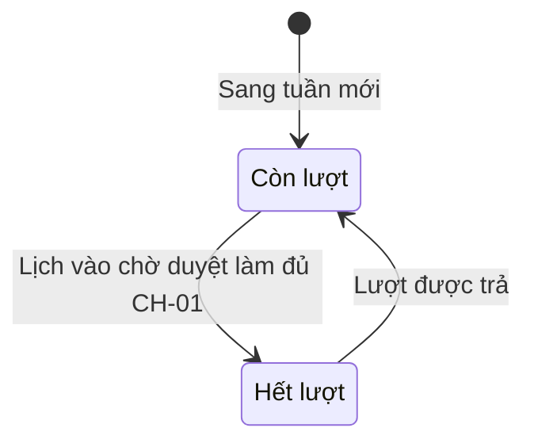
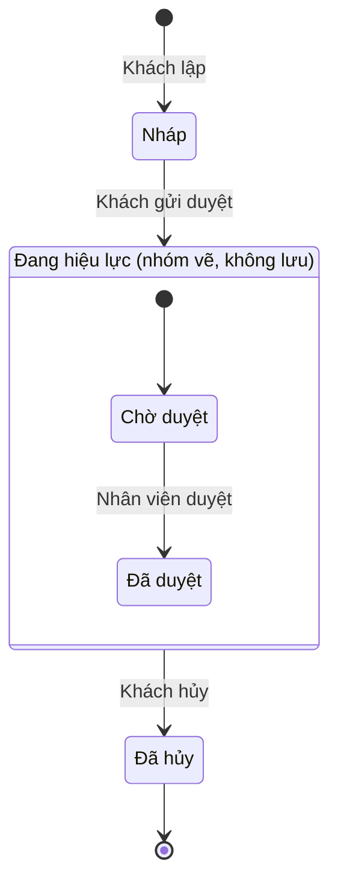
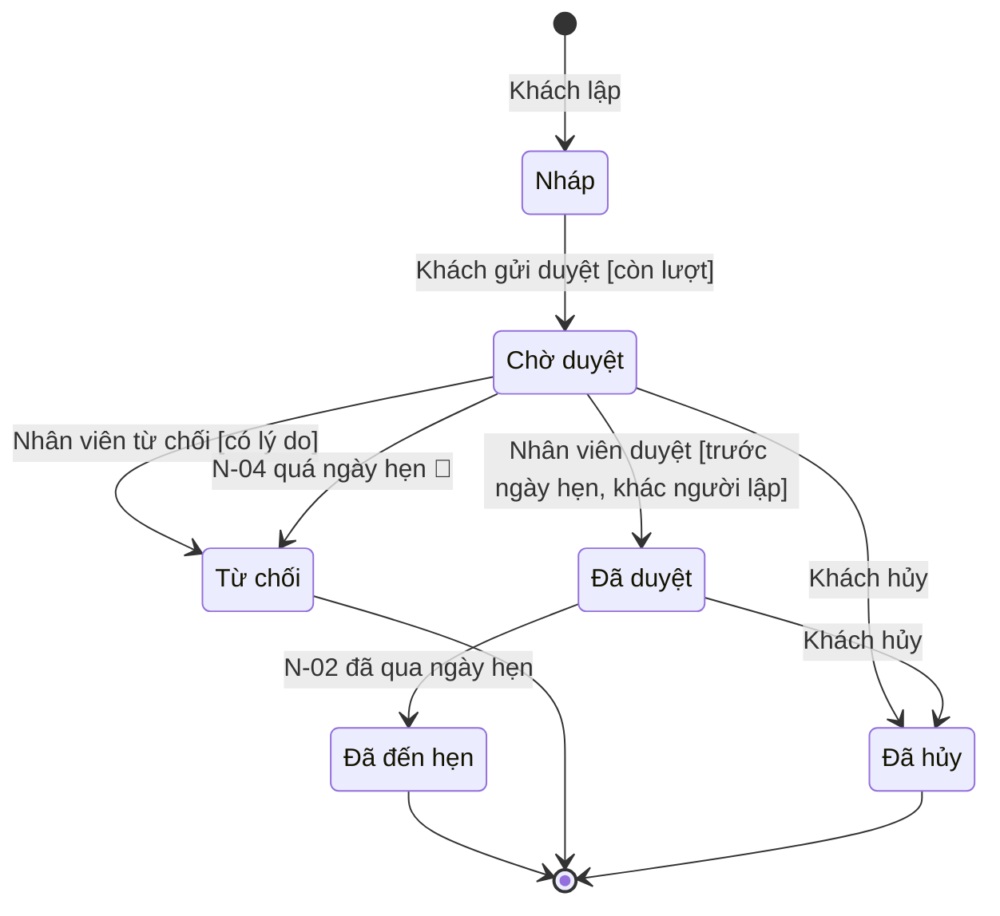

# Bóc trạng thái và chuyển, viết một dòng chuyển

Phần tra cứu của skill [`create-sm`](../SKILL.md). Dùng khi đang dựng bảng trạng thái, bảng chuyển, sơ đồ.
Mọi ví dụ là **mã minh họa** của thế giới [`vi-du-xuyen-suot.md`](../../ba-overview/reference/vi-du-xuyen-suot.md),
khớp bảng mã chuẩn mục 3 và bảng chuyển chuẩn mục 4 của file đó. Mã ngoài bảng — `N-04`, `S-02`, `D-05`,
`Thong_Bao_Nhac`, `Dot_Hen_Tap_The`, `OPEN`, `CLOSED`, `AVAILABLE`, `EXHAUSTED` — là **mã minh họa riêng của skill**,
không trùng nghĩa với mã nào của bảng.

## 1. Bóc trạng thái từ ERD và quy trình

Trạng thái **không bịa ra từ quy trình**: tập mã đến từ ERD, nghĩa đến từ quy trình. Đi theo thứ tự:

| Bước | Làm gì | Ra gì |
|---|---|---|
| 1 | Mở ERD mục 4, tìm mọi trường `trang_thai` và mọi dòng "Giá trị dẫn xuất Δ"; mở mục 5.3 | Danh sách thực thể ứng viên và **tập mã enum** của từng thực thể |
| 2 | Với mỗi thực thể, chọn: có máy hay vào dòng **Không có máy trạng thái** (ba điều kiện ở phần lõi) | Mục 1.3 |
| 3 | Mở quy trình, tìm các bước có chứng từ ở cột `Chứng từ` và các cụm động từ làm đổi chứng từ: *lập, gửi, duyệt, từ chối, trả về, hủy, đóng, hoàn thành, mở lại* | Tập **bước gây chuyển** |
| 4 | Gán tên Việt và nghĩa từng mã enum từ chính cụm trong quy trình ("Chờ duyệt" từ bước "gửi duyệt") | Cột `Hiển thị` và `Nghĩa` |
| 5 | Mã nào có ở ERD mà không bước quy trình nào sinh ra nó, hoặc bước quy trình nói tới một trạng thái ERD không có | Ghi 🧪 hoặc câu hỏi `S-xx` — **không** sửa ERD hay quy trình ở đây |
| 6 | Đánh dấu ■ cho trạng thái không có chuyển ra, rồi hỏi "lỡ sai thì làm gì". Trạng thái còn chuyển ra (như `APPROVED`: còn hoàn thành và hủy) **không** phải ■ | Với mỗi ■: làm lại bằng bản ghi mới (`SM-05`). Muốn ■ có ngoại lệ thì ghi theo mục 5 |

Mỗi mã enum ERD phải xuất hiện đúng một lần ở bảng trạng thái. Thiếu là SM sót; thừa là SM bịa — cả hai đều
ghi `S-xx` về ERD rồi mới đóng.

## 2. Bóc chuyển trạng thái

Mỗi chuyển có đúng một **sự kiện**. Tìm sự kiện ở năm nơi, theo thứ tự:

| Nơi tìm | Gặp gì | Thành dòng nào |
|---|---|---|
| Bước quy trình do người làm, có chứng từ | `LH-01 bước 4` Nhân viên duyệt hoặc từ chối | 👤 — một dòng cho **mỗi kết quả** (duyệt, từ chối là hai dòng) |
| Bước quy trình do hệ thống làm, **cùng request** với bước người ngay trước | `LH-01` bước 2 kiểm lượt, bước 3 giữ lượt và chuyển sang chờ duyệt — cùng request với bước 1 | **Không** thành chuyển riêng. Chuyển là 👤 của tác nhân bước người, dẫn cả dải bước `LH-01 bước 1–3`; kết quả kiểm là `Điều kiện`, giữ lượt và báo tin là `Hệ quả`. Quy tắc 👤/⚙️ ở [`ranh-gioi-cac-lop.md`](../../ba-overview/reference/ranh-gioi-cac-lop.md) mục 2 |
| Bước quy trình do hệ thống làm, **tự chạy** theo lịch hoặc sự kiện | Bước báo khách sau khi duyệt (không có người đang thao tác) | Là `Hệ quả` của chuyển trước; nếu bước **tự đổi trạng thái** thì ⚙️ dẫn `N-xx` hoặc sự kiện |
| Quy trình mục 5 — tác vụ nền `N-xx` | `N-01` nhắc lịch hôm trước, `N-02` chốt lịch đã qua ngày hẹn | ⚙️ nếu tác vụ **đổi trạng thái** (`N-02`: `APPROVED → COMPLETED`); nếu chỉ nhắc (`N-01`) thì vào mục "Sự kiện ngoài" với `Tác động = Chỉ nhắc` |
| Quy trình mục 5.1 — sự kiện từ hệ thống ngoài | 🔗 Hệ thống CRM báo khách bị đưa vào danh sách hạn chế | 🔗 nếu đổi trạng thái; nếu chặn thì thành `Điều kiện` |
| Thời gian: `CH-xx` có đơn vị thời gian, văn bản quy định hạn | Quá ngày hẹn mà chưa duyệt | ⚙️ gắn `N-xx` thực hiện, đánh 🧪 nếu quy trình chưa nêu, kèm `S-xx` |

Hai nơi không phải nguồn của chuyển, dù hay bị nhầm: **bước màn hình** (nút, popup — không thuộc business
layer) và **thông báo** (là `Hệ quả`, không phải sự kiện).

Với mỗi chuyển, trả lời ba câu rồi mới viết dòng: **Ai hoặc cái gì** kích hoạt? **Điều gì phải đúng** thì
cho phép (dẫn được tới BR, GS, văn bản không)? **Cái gì thay đổi theo** (ghi sổ khác, khóa sửa, nhật ký)?

## 3. Viết một dòng chuyển đúng

Dòng chuyển theo UML `sự kiện [điều kiện] / hành động`: sự kiện ở cột `Ai — sự kiện`, điều kiện canh ở
cột `Điều kiện`, hành động ở cột `Hệ quả`.

| Cột | Viết thế này | Đừng viết thế này |
|---|---|---|
| Từ → Đến | `` `PENDING_APPROVAL` → `APPROVED` `` | `` `PENDING` → `APPROVED` `` (mã lệch ERD) · `Chờ duyệt → Đã duyệt hoặc Từ chối` (hai đích) |
| Tên trạng thái | `Chờ duyệt → Đã duyệt` | `Pending → Approved` |
| Ai — sự kiện, 👤 | `👤 Nhân viên tiếp đón — LH-01 bước 4` · `👤 Khách — LH-01 bước 1–3` (dải bước khi bước hệ thống cùng request) | `Admin duyệt` (vai trò không có ở quy trình) · `👤 Người dùng` (không rõ vai nào) · `Duyệt hoặc từ chối` (hai sự kiện một dòng) · `khác người lập` hay `có lý do` (đó là điều kiện, không phải sự kiện) |
| Ai — sự kiện, ⚙️ | `⚙️ N-02 chốt lịch đã qua ngày hẹn` | `Hệ thống tự động` (không nói tự động bởi cái gì) |
| Điều kiện | `BR-A01 Tối đa CH-01 lịch hẹn mỗi tuần · QC01 Đ5.1` (sau lớp 6) · `QC01 Đ5.1` (trước lớp 6) | `Mỗi khách chỉ được đặt một lịch hẹn mỗi tuần` (phát biểu lại) · `Tối đa 2 lịch hẹn` (số trần) · `Khi nút Duyệt được bật` (UI) |
| Điều kiện, tách nhiệm và bắt buộc lý do | Mọi điều kiện của chuyển nằm **cùng một cột Điều kiện**: `Trước ngày hẹn — QC01 Đ6.1 · người duyệt khác người lập — QC01 Đ6.3` (sau lớp 6 thêm `BR-A04 Người đặt hộ không tự duyệt`); `Bắt buộc lý do — SM-06` | Đặt "khác người lập" hay "bắt buộc lý do" ở cột `Ai — sự kiện` |
| Điều kiện, chặn hay rẽ nhánh | Điều kiện chỉ quyết **chuyển có xảy ra hay không**: hủy luôn được khi lịch ở một trong hai trạng thái nguồn | `Trước 24 giờ thì trả lượt` ở cột Điều kiện — đó là nhánh hệ quả, xem mục 4 |
| Điều kiện, kiểm lại | `**Kiểm lại** khách chưa nằm trong danh sách hạn chế` (minh họa riêng của skill) | Kiểm lại một điều kiện mà bước trước đã giữ chỗ cho (xem dưới bảng) |
| Hệ quả | `Trong một giao dịch: trả lượt ở Quy_Luot (R-01); báo khách` | `Cập nhật DB` · `Hiển thị thông báo thành công` |

`**Kiểm lại**` chỉ dùng khi điều kiện là thứ **không được khóa hay giữ chỗ** lúc chuyển trước và có thể đổi
trong khoảng chờ. Máy Lịch hẹn không dùng nó cho lượt: lúc gửi, hệ thống kiểm còn lượt **và giữ lượt** trong cùng
giao dịch, `R-01` đã đếm lịch ở `PENDING_APPROVAL`, nên lúc duyệt lượt luôn còn — kiểm lại là điều kiện không bao
giờ đúng. Điều kiện của duyệt là điều kiện **mới** của bước duyệt (trước ngày hẹn, khác người lập). Điều kiện
kiểm lại nằm trong cùng bước ghi với chuyển (`SM-04`).

**Một dòng hay nhiều dòng khi cùng sự kiện, nhiều nguồn:** gộp thành một dòng (`` `PENDING_APPROVAL`, `APPROVED` → `CANCELLED` ``) khi
sự kiện, điều kiện và hệ quả giống nhau; testcase vẫn tính mỗi nguồn một lần, sơ đồ vẫn một mũi tên mỗi nguồn.
Hệ quả **khác nhau** giữa các nguồn thì tách dòng. Hệ quả rẽ hai nhánh vì cùng một quy tắc tính lúc chuyển
(trả lượt hay ghi `huy_muon`, theo `BR-A03`) thì **giữ một dòng** và ghi cả hai nhánh ở cột `Hệ quả`.

## 4. Hệ quả "trong một giao dịch"

`SM-08`: chuyển kéo theo ghi sổ khác thì mọi thứ chạy **trong một giao dịch** — hoặc cùng xảy ra, hoặc cùng
không. Cột `Hệ quả` phải liệt kê **đủ** phần kéo theo, vì dev code theo cột này và QC viết testcase theo cột
này.

| Phần hệ quả | Nằm trong giao dịch? | Cách ghi |
|---|---|---|
| Đổi `trang_thai` của chính đối tượng, kèm phiên bản bản ghi | Có, mặc định (`SM-04`) | Không cần ghi lại |
| Dòng nhật ký `SM-03` | Có — mặc định ở **mọi** chuyển, tuy là bảng khác | Không ghi, trừ khi khác thường. **Không tính** là "ghi ra ngoài bản ghi chính" ở quy tắc kiểm bên dưới |
| Ghi sổ, cập nhật bảng khác theo `GS-xx`, `R-xx` | **Có** | `Trong một giao dịch: giữ một lượt ở Quy_Luot (R-01)` |
| Rẽ nhánh theo một quy tắc tính lúc chuyển | Có, nhánh nào cũng nằm trong giao dịch | `Trong một giao dịch: trả lượt nếu hủy trước CH-02 giờ, ngược lại ghi huy_muon = đúng — BR-A03` |
| Khóa sửa của đối tượng | Có | `Khóa sửa` |
| Gửi thông báo, gọi hệ thống ngoài | **Không** — làm sau khi ghi thành công; ghi thất bại thì không chuyển và không gửi; gửi thất bại không hoàn tác chuyển | Ghi sau dấu `;`: `…; báo khách` |
| Không kéo theo gì ngoài nhật ký `SM-03` | — | `Không ghi sổ`, hoặc nói rõ cái không làm: `Không giữ lượt` |

Hai quy tắc kiểm: (1) mỗi ô `Hệ quả` bắt đầu `Trong một giao dịch:` **khi và chỉ khi** nó ghi vào chỗ nào đó
ngoài bản ghi chính **và ngoài nhật ký `SM-03`**; (2) mỗi đẳng thức `R-xx` của ERD mà chuyển này làm đổi vế thì
`R-xx` phải xuất hiện ở ô này. Chuyển 👤 ứng với **một bước ghi** của UC ở lớp 5 — giao dịch ở đây chính là bước
ghi đó. `Không ghi sổ` chỉ có nghĩa *không ghi sổ nào ngoài nhật ký `SM-03`* — chuyển `→ DRAFT` vẫn có dòng nhật
ký.

## 5. Chuyển do hết thời gian và ngoại lệ của ■

**Hết thời gian** là một dạng ⚙️: không ai bấm gì mà trạng thái vẫn phải đổi. Mỗi chuyển loại này ghi đủ
ba thứ — hạn (dẫn `CH-xx` hoặc trường ngày của ERD như `Lich_Hen.ngay_hen`, không số trần), tác vụ thực hiện (`N-xx`), và đích (thường một ■ hoặc về trạng
thái trước). Trạng thái nào **đứng chờ một người** (như `PENDING_APPROVAL`) mà không có hạn thì phải trả lời
một câu hỏi: nó được phép treo mãi không? Nếu không phải *chấp nhận treo*, ghi ❓ `S-xx` kèm đề xuất
mặc định.

**Ngoại lệ của ■.** ■ là trạng thái **không có chuyển ra** — theo UML, FinalState không có chuyển ra, và
`X --> [*]` là chuyển hoàn tất (completion transition) về điểm cuối. `SM-05` cho phép ngoại lệ, nhưng trạng thái
có ngoại lệ **không được vẽ `--> [*]`** (nếu không, sơ đồ vừa nói "kết thúc" vừa có đường ra). Cách ghi: một dòng
riêng ở bảng chuyển, cột `Điều kiện` nêu lý do ngoại lệ, dòng ghi chú dưới bảng viết *ngoại lệ của `SM-05`*; sơ
đồ vẽ mũi tên ra kèm nhãn `ngoại lệ SM-05` và **không** vẽ `--> [*]` cho trạng thái đó. Không ghi được lý do thì
mũi tên đó không được có. Hầu hết trường hợp nên bỏ ■ thay vì xin ngoại lệ: trạng thái còn chuyển ra là trạng
thái thường (như `APPROVED` ở ví dụ mục 8, còn hoàn thành và hủy).

## 6. Máy dẫn xuất Δ và máy "Lưu, suy từ bảng con"

**Máy Δ** thay bảng chuyển bằng bảng `Trạng thái · Công thức suy ra · Đổi khi` và vẫn vẽ sơ đồ. Mã của giá
trị Δ lấy từ dòng "Giá trị dẫn xuất Δ" của ERD (`SM-02`: không có cột nào lưu). **Máy Δ vẫn có bảng trạng thái**
(`Mã · Hiển thị · Nghĩa`) nhưng **bỏ cột `Sửa được`** — không ai sửa được một trạng thái không lưu (lựa chọn của
skill). Công thức viết theo `R-01` của ví dụ xuyên suốt: `Quy_Luot.da_dung` là số `Lich_Hen` trong tuần ở
`PENDING_APPROVAL`, `APPROVED`, `COMPLETED`, cộng số `Lich_Hen` ở `CANCELLED` có `huy_muon` = đúng; số lượt còn
lại = `CH-01` − `da_dung`. `Đổi khi` liệt kê **chuyển làm `da_dung` đổi và đưa giá trị Δ sang trạng thái này**, không
phải mọi chuyển của máy `Lich_Hen`: `PENDING_APPROVAL → APPROVED` và `APPROVED → COMPLETED` không đổi `da_dung`;
hủy muộn (ghi `huy_muon`) cũng không đổi. Ví dụ (minh họa; giả sử ERD đặt mã `AVAILABLE`, `EXHAUSTED` cho
`Quy_Luot` — hai mã minh họa riêng của skill):

| Mã | Hiển thị | Nghĩa |
|---|---|---|
| `AVAILABLE` | Còn lượt | Khách còn ít nhất một lượt trong tuần |
| `EXHAUSTED` | Hết lượt | Đã dùng đủ `CH-01` lượt trong tuần |

| Trạng thái | Công thức suy ra | Đổi khi |
|---|---|---|
| `AVAILABLE` Còn lượt | `CH-01 − Quy_Luot.da_dung > 0`, với `da_dung` theo `R-01` | Sang tuần mới (`GS-01`) · có chuyển **trả lượt** làm `da_dung` giảm: `PENDING_APPROVAL → REJECTED`, hủy sớm `→ CANCELLED` (`BR-A03`) |
| `EXHAUSTED` Hết lượt | `CH-01 − Quy_Luot.da_dung ≤ 0` | `DRAFT → PENDING_APPROVAL` ở SM mục 2 làm `da_dung` đạt `CH-01` |

Máy Δ **không có 👤**: không ai đặt trạng thái; việc của người nằm ở máy lưu mà trạng thái Δ suy ra từ đó.
Vì vậy máy Δ không đòi UC phủ; nó đòi **công thức khớp với `R-xx` ở ERD**.

**Máy "Lưu, suy từ bảng con"** có trường `trang_thai` ở bảng cha nhưng không ai đặt tay. Bảng chuyển viết
bình thường, mọi dòng là ⚙️, sự kiện là *bảng con đổi*, điều kiện **dẫn** ERD mục 5.3 (không chép lại thứ tự
xét). Ví dụ một dòng (minh họa, giả sử ERD có đợt hẹn tập thể cuối tuần `Dot_Hen_Tap_The` với các `Lich_Hen` con):

| Từ → Đến | Tên trạng thái | Ai — sự kiện | Điều kiện | Hệ quả |
|---|---|---|---|---|
| `OPEN` → `CLOSED` | Đang mở → Đã đóng | ⚙️ Lịch hẹn con đổi trạng thái | ERD mục 5.3: mọi `Lich_Hen` con đã ở trạng thái ■ | Trong một giao dịch: ghi `trang_thai` của đợt |

## 7. Trạng thái lồng (Harel)

Mặc định vẽ **máy phẳng**. Chỉ lồng khi thỏa **cả hai**:

| Điều kiện | Ý nghĩa |
|---|---|
| Có ít nhất một chuyển mà **mọi** trạng thái con đều có, với cùng sự kiện, điều kiện, hệ quả và đích | Ví dụ: khách hủy được ở cả `PENDING_APPROVAL` và `APPROVED`, cùng sang `CANCELLED` — một mũi tên từ cha thay hai mũi tên |
| Mọi trạng thái con vẫn có **mã trong enum ERD** | Cha có thể không có mã ERD: đó là **nhóm vẽ, không lưu**; đặt tên khác dạng enum và ghi ở bảng trạng thái là *nhóm* |

**Thiếu một trong hai thì làm phẳng.** Id của nhóm (`ACTIVE_GROUP` ở ví dụ dưới) không phải enum ERD, nên được
miễn khỏi quy tắc "mã đúng enum ERD" và "mỗi enum đúng một lần" — chỉ các trạng thái con chịu hai quy tắc đó. Lồng
chỉ là cách **vẽ**: bảng chuyển và ma trận vẫn liệt kê chuyển **theo từng trạng thái con** (mũi tên từ cha thành
một dòng cho mỗi con, hoặc một dòng gộp nhiều nguồn như mục 3), vì testcase và quyền ứng với từng con. Minh họa
phần nhóm của máy Lịch hẹn, rút gọn (bỏ `COMPLETED`, `REJECTED`):

Bảng chuyển đi kèm vẫn phủ hai nguồn của hủy: `PENDING_APPROVAL` và `APPROVED` → `CANCELLED`.

## 8. Ví dụ hoàn chỉnh — máy Lịch hẹn (minh họa)

Bảng chuyển dựng đúng theo bảng chuyển chuẩn ở
[`vi-du-xuyen-suot.md`](../../ba-overview/reference/vi-du-xuyen-suot.md) mục 4, thêm **một** dòng 🧪 để minh họa
chuyển do hết thời gian: hệ thống từ chối lịch chờ duyệt quá ngày hẹn. Giả định của ví dụ: quy trình `LH-01`
chưa nêu việc này, nên dòng đó đánh 🧪 kèm `S-01`; tác vụ thực hiện là `N-04` — **mã minh họa riêng của
skill** (`N-02` đã có nghĩa cố định: chốt lịch đã qua ngày hẹn). Chuyển hủy dẫn `LH-02`; theo bảng chuẩn, hủy của
khách không đòi lý do — ngoại lệ của `SM-06` (ví dụ này coi đó là ngoại lệ).

**Lịch hẹn — `Lich_Hen`** — Lưu

*Lịch hẹn đi từ nháp qua chờ duyệt, được duyệt rồi hoàn thành sau ngày hẹn; có hai trạng thái cuối khác là từ
chối và hủy. Nhân viên quyết duyệt hay từ chối (`D-05`, BA chốt 27/10/2026).*

| Mã | Hiển thị | Nghĩa | Sửa được |
|---|---|---|:-:|
| `DRAFT` | Nháp | Đã nhập, chưa gửi; chưa giữ lượt | ✅ |
| `PENDING_APPROVAL` | Chờ duyệt | Đã gửi, chờ nhân viên quyết; lượt đang giữ | — |
| `APPROVED` | Đã duyệt | Đã duyệt; lượt vẫn giữ; còn hai đường ra: hoàn thành khi qua ngày hẹn, hoặc khách hủy | — |
| `COMPLETED` ■ | Đã đến hẹn | Đã qua ngày hẹn và được hệ thống chốt; không còn thao tác nào | — |
| `REJECTED` ■ 🧪 | Từ chối | Nhân viên từ chối, hoặc hệ thống từ chối do quá ngày hẹn (🧪); lượt được trả | — |
| `CANCELLED` ■ | Đã hủy | Khách đã hủy; lượt được trả hay ghi `huy_muon` theo `BR-A03` | — |

| Từ → Đến | Tên trạng thái | Ai — sự kiện | Điều kiện | Hệ quả |
|---|---|---|---|---|
| → `DRAFT` | → Nháp | 👤 Khách — LH-01 bước 1 (lập nháp) | n/a | Không giữ lượt |
| `DRAFT` → `PENDING_APPROVAL` | Nháp → Chờ duyệt | 👤 Khách — LH-01 bước 1–3 | Còn lượt trong tuần của ngày hẹn: `QC01 Đ5.1` | Trong một giao dịch: giữ một lượt ở `Quy_Luot` (R-01) |
| `PENDING_APPROVAL` → `APPROVED` | Chờ duyệt → Đã duyệt | 👤 Nhân viên tiếp đón — LH-01 bước 4 | Trước ngày hẹn: `QC01 Đ6.1` · người duyệt khác người lập: `QC01 Đ6.3`. **Không** kiểm lại lượt: lượt đã giữ từ lúc gửi | Báo khách |
| `PENDING_APPROVAL` → `REJECTED` | Chờ duyệt → Từ chối | 👤 Nhân viên tiếp đón — LH-01 bước 4 | Bắt buộc lý do: `SM-06` | Trong một giao dịch: trả lượt ở `Quy_Luot` (R-01); báo khách |
| `PENDING_APPROVAL` → `REJECTED` 🧪 | Chờ duyệt → Từ chối | ⚙️ N-04 quá ngày hẹn mà chưa duyệt (**đề xuất**, ❓ S-01) | Đã qua ngày hẹn: `QC01 Đ6.1` | Như dòng từ chối; lý do ghi *quá hạn*; báo khách |
| `PENDING_APPROVAL`, `APPROVED` → `CANCELLED` | Chờ duyệt, Đã duyệt → Đã hủy | 👤 Khách — LH-02 | Lịch đang ở một trong hai trạng thái nguồn | Trong một giao dịch: trả lượt nếu hủy trước `CH-02` giờ, ngược lại ghi `huy_muon` = đúng — theo `BR-A03` (R-01); báo khách |
| `APPROVED` → `COMPLETED` | Đã duyệt → Đã đến hẹn | ⚙️ N-02 chốt lịch đã qua ngày hẹn | Đã qua ngày hẹn | Không ghi sổ |

`N-01` nhắc lịch hôm trước ngày hẹn (giờ chạy theo `CH-03`); chỉ nhắc, không tự chuyển. Duyệt **không** kiểm lại
lượt: điều kiện "còn lượt" nằm ở chuyển `DRAFT → PENDING_APPROVAL` và lượt được giữ ngay ở hệ quả của chuyển đó.
Ví dụ này không có ngoại lệ `SM-05`: mọi ■ (`COMPLETED`, `REJECTED`, `CANCELLED`) không có chuyển ra.

**Cấm:** `DRAFT` → `APPROVED` không qua chờ duyệt · `REJECTED`, `CANCELLED` hoặc `COMPLETED` → bất kỳ trạng thái
nào · `APPROVED` → `PENDING_APPROVAL` hoặc `REJECTED` (duyệt lại, từ chối sau khi duyệt) · nhân viên tự duyệt lịch
do mình lập · `PENDING_APPROVAL` → `DRAFT` (ví dụ này không có đường trả về).

### Kiểm sơ đồ với bảng

| Kiểm | Kết quả ở ví dụ |
|---|---|
| Mỗi mũi tên của sơ đồ có trong bảng chuyển, đúng nhãn; dòng gộp nhiều nguồn ứng với một mũi tên mỗi nguồn | 7 dòng, 8 mũi tên (kể cả `[*] → DRAFT`; dòng hủy gộp hai nguồn) |
| Chỉ **một** mũi tên từ `[*]` | `[*] → DRAFT` (UML cho tối đa một chuyển ra từ trạng thái đầu của mỗi vùng) |
| Mỗi mã enum ERD có ở bảng trạng thái, sơ đồ, bảng chuyển | 6 mã |
| Mỗi trạng thái không phải ■ có mũi tên ra | `DRAFT`, `PENDING_APPROVAL`, `APPROVED` có |
| Mỗi ■ không có mũi tên ra khác `--> [*]`, hoặc có ngoại lệ ghi ở bảng và **không** vẽ `--> [*]` | `COMPLETED`, `REJECTED`, `CANCELLED` không có chuyển ra; không có ngoại lệ |
| Mỗi 🧪 có `S-xx` | S-01 cho hết hạn |
| Mỗi chuyển 👤 có UC phủ ở lớp 5 | Báo lớp 5: lưu nháp, gửi duyệt, duyệt, từ chối, hủy |
