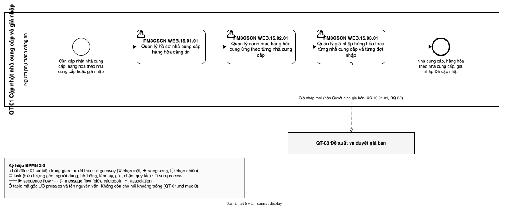

# QT-01 Cập nhật nhà cung cấp và giá nhập — luồng UC
| Bản đồ | Số UC | Chỗ nối khoảng trống | Cập nhật | Trạng thái |
| --- | --- | --- | --- | --- |
| [../../ban-do-quy-trinh.md](../../ban-do-quy-trinh.md) | 3 | 0 | 2026-10-29 | draft |

File của **một** quy trình trong bản đồ quy trình dựng ngược. Đặt trong thư mục `cap-2/QT-01-ncc-gia-nhap/` của
`1-ba-init/0-dau-vao/ban-do-quy-trinh/` (cấp 2 của bản đồ), cùng đặc tả và sơ đồ BPMN của quy trình đó. File tổng
`ban-do-quy-trinh.md` giữ danh sách QT (mục 1), chuyển giao, hệ thống ngoài, đối chiếu và sơ đồ tổng; file này giữ phần
**bên trong** quy trình: các UC presales xảy ra theo thứ tự nào, nối với nhau ra sao, chỗ nào hở. Khái niệm (quy trình,
trigger, kết quả, chỗ nối, khoảng trống…) định nghĩa ở file tổng.

Để làm gì: đọc một quy trình mà không phải lật cả bản đồ; BA duyệt từng quy trình; `/ba-overview` đợt 3 lấy luồng UC
này làm khung để viết bảng bước của QT-01.

## 1. Thông tin quy trình
| Mã | Tên | Trigger | Kết quả | Actor chính | Đối tượng nghiệp vụ | Điều khoản |
| --- | --- | --- | --- | --- | --- | --- |
| QT-01 | Cập nhật nhà cung cấp và giá nhập | Cần cập nhật nhà cung cấp, hàng hóa theo nhà cung cấp hoặc giá nhập | Hồ sơ nhà cung cấp, danh mục hàng hóa theo nhà cung cấp, giá nhập Đã cập nhật (có lịch sử thay đổi); giá nhập mới chuyển sang QT-03 qua hộp "Quyết định giá bán" thuộc UC `PM3CSCN.WEB.10.01.01` [SRC: 0-inputs/answers-2026-10-29.md, RQ-52] | Người phụ trách căng tin | Nhà cung cấp; Đợt giá nhập; Dòng giá nhập | `TT79-2026/Đ41.K4` |

- Chép nguyên từ dòng QT-01 ở mục 1 của file tổng.

## 2. Ghép luồng UC
| QT | Thứ tự | UC presales | Actor | Đầu vào | Đầu ra | Nối tới | Chỗ nối | PH | Nguồn |
| --- | --- | --- | --- | --- | --- | --- | --- | --- | --- |
| QT-01 | 1 | `PM3CSCN.WEB.15.01.01` | (ô trống trong tệp gốc); người phụ trách căng tin theo Q-001 | Nhu cầu thêm, sửa, ngừng hợp tác nhà cung cấp | Hồ sơ nhà cung cấp đang hoạt động hoặc ngừng hợp tác, có lịch sử thay đổi | `PM3CSCN.WEB.15.02.01` | khớp | — | [SRC: 1-ba-init/0-dau-vao/quy-trinh-presales.md, QP-02.03, QP-02.07]; [SRC: 0-inputs/answers-2026-10-28.md, RQ-20] |
| QT-01 | 2 | `PM3CSCN.WEB.15.02.01` | (ô trống trong tệp gốc); người phụ trách căng tin theo Q-001 | Nhà cung cấp đang hoạt động | Danh mục hàng hóa cung ứng của nhà cung cấp | `PM3CSCN.WEB.15.03.01` | khớp | — | [SRC: 1-ba-init/0-dau-vao/quy-trinh-presales.md, QP-02.04]; [SRC: 0-inputs/answers-2026-10-28.md, RQ-16] |
| QT-01 | 3 | `PM3CSCN.WEB.15.03.01` | (ô trống trong tệp gốc); người phụ trách căng tin theo Q-001 | Mặt hàng thuộc danh mục của nhà cung cấp; số hiệu căn cứ, tệp căn cứ của đợt giá nhập (MP-004) | Đợt giá nhập, dòng giá nhập Khai trước, Hiện hành hoặc Hết hiệu lực (MP-001, MP-002) | — | khớp | — | [SRC: 1-ba-init/0-dau-vao/quy-trinh-presales.md, QP-02.05]; [SRC: 1-ba-init/0-dau-vao/man-presales.md, MP-001, MP-002, MP-003, MP-004] |

- Thứ tự theo phụ thuộc của đối tượng: hàng hóa "theo từng nhà cung cấp" cần nhà cung cấp có trước; dòng giá nhập là giá
  của "một mặt hàng của một nhà cung cấp" (glossary "Dòng giá nhập"); phiếu nhập kho chỉ chọn nhà cung cấp đang hoạt
  động và mặt hàng thuộc danh mục của nhà cung cấp đó [SRC: 0-inputs/answers-2026-10-28.md, RQ-16]. Quy trình presales
  QP-02 vẽ ba việc này là ba nhánh rẽ của cổng "Cập nhật gì?" (QP-02.02), không có thứ tự; không có điều khoản `thủ tục`.
  Luồng màn presales chỉ có màn giá nhập (MP-004 → MP-001), không trái thứ tự trên.
- Đã soát bốn câu ở chỗ nối `khớp`:
  - `15.01.01` → `15.02.01`: ai chuyển cho ai — cùng người phụ trách căng tin làm cả hai UC (Q-001); trong hay ngoài hệ thống —
    trong hệ thống, QP-02.03 và QP-02.04 cùng lane Người phụ trách căng tin, hệ thống lưu lịch sử (QP-02.07); actor không có UC —
    không có, hồ sơ nhà cung cấp không cần duyệt (RQ-20); đầu ra không UC nào nhận — `15.02.01` nhận nhà cung cấp đang
    hoạt động.
  - `15.02.01` → `15.03.01`: ai chuyển cho ai — cùng người phụ trách căng tin (Q-001); trong hay ngoài hệ thống — trong hệ thống
    (QP-02.04, QP-02.05); actor không có UC — không có, bảng giá nhập không cần duyệt (RQ-20); đầu ra không UC nào nhận —
    `15.03.01` nhận mặt hàng của nhà cung cấp (MP-004 bảng "Mặt hàng và giá nhập").
  - `15.03.01` → QT-03 (`PM3CSCN.WEB.10.01.01`): ai chuyển cho ai — cùng người phụ trách căng tin; khi lưu đợt giá nhập (MP-004)
    hoặc dòng giá nhập đã sửa (MP-003), hộp "Quyết định giá bán" tự sinh hoặc cho chọn tạo đề xuất giá bán; trong hay
    ngoài hệ thống — trong hệ thống; actor không có UC — không có; đầu ra không UC nào nhận — hộp "Quyết định giá bán"
    thuộc UC `PM3CSCN.WEB.10.01.01` Quản lý danh mục hàng hóa căng tin của QT-03 [SRC: 0-inputs/answers-2026-10-29.md,
    RQ-52]. Chỗ nối trước đây là khoảng trống PH-017 (Q-017); Q-017 đã quyết, PH-017 trong sổ vẫn mở, bước 2 đóng.
- UC tra cứu `PM3CSCN.WEB.15.01.02`, `PM3CSCN.WEB.15.02.02`, `PM3CSCN.WEB.15.03.02` chỉ đọc dữ liệu của quy trình này,
  ghi ở file tổng mục 6.1.

## 3. Khoảng trống ở chỗ nối
| PH | Giữa | Câu hỏi | Mô tả | Nguồn |
| --- | --- | --- | --- | --- |

- Không còn khoảng trống: chỗ nối `15.03.01` → QT-03 (PH-017) đã trả lời được bằng RQ-52, xem mục 2.

## 4. Sơ đồ
Sơ đồ BPMN luồng UC của quy trình, theo skill ba-bpmn: pool là QT-01, lane là actor; mỗi UC presales ở mục 2 là một
task mang nhãn `<mã gốc> <tên UC>`; mũi tên theo cột "Nối tới"; không còn chỗ nối `khoảng trống`;
QT-03 là pool thu gọn nhận message flow "Giá nhập mới" (hộp "Quyết định giá bán", UC `PM3CSCN.WEB.10.01.01`). Tệp: `QT-01.bpmn.json` (đặc tả), `QT-01.drawio.svg` (sơ đồ).

Nguồn: QT-01.drawio.svg

