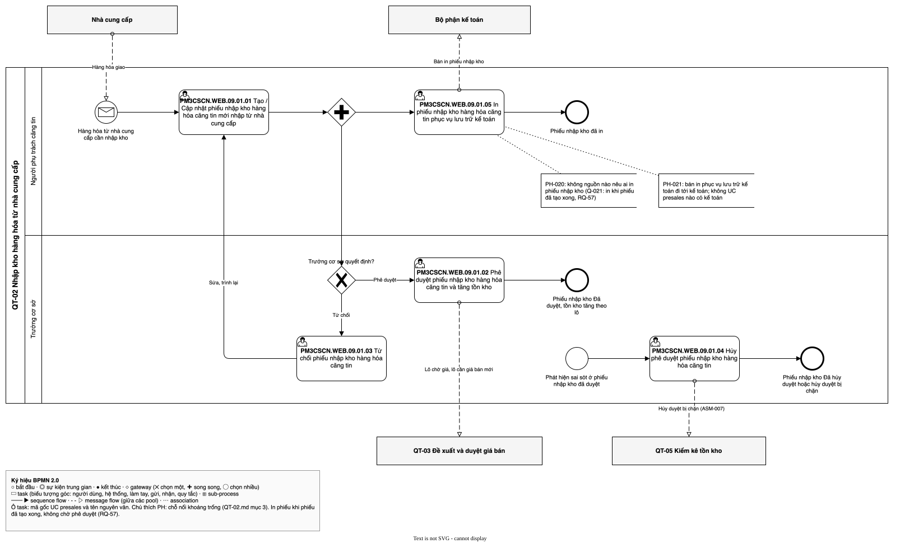

# QT-02 Nhập kho hàng hóa từ nhà cung cấp — luồng UC
| Bản đồ | Số UC | Chỗ nối khoảng trống | Cập nhật | Trạng thái |
| --- | --- | --- | --- | --- |
| [../../ban-do-quy-trinh.md](../../ban-do-quy-trinh.md) | 5 | 2 | 2026-10-29 | draft |

File của **một** quy trình trong bản đồ quy trình dựng ngược. Đặt trong thư mục `cap-2/QT-02-nhap-kho/` của
`1-ba-init/0-dau-vao/ban-do-quy-trinh/` (cấp 2 của bản đồ), cùng đặc tả và sơ đồ BPMN của quy trình đó. File tổng
`ban-do-quy-trinh.md` giữ danh sách QT (mục 1), chuyển giao, hệ thống ngoài, đối chiếu và sơ đồ tổng; file này giữ phần
**bên trong** quy trình: các UC presales xảy ra theo thứ tự nào, nối với nhau ra sao, chỗ nào hở. Khái niệm (quy trình,
trigger, kết quả, chỗ nối, khoảng trống…) định nghĩa ở file tổng.

Để làm gì: đọc một quy trình mà không phải lật cả bản đồ; BA duyệt từng quy trình; `/ba-overview` đợt 3 lấy luồng UC
này làm khung để viết bảng bước của QT-02.

## 1. Thông tin quy trình
| Mã | Tên | Trigger | Kết quả | Actor chính | Đối tượng nghiệp vụ | Điều khoản |
| --- | --- | --- | --- | --- | --- | --- |
| QT-02 | Nhập kho hàng hóa từ nhà cung cấp | Hàng hóa từ nhà cung cấp cần nhập kho (kể cả khi người phụ trách căng tin chọn nhập kho sau cảnh báo của QT-06) | Phiếu nhập kho Đã duyệt (lô bán giá hiện hành, lô chờ giá hoặc lô chờ duyệt giá mới), Đã hủy hoặc Đã hủy duyệt; hủy duyệt bị chặn thì xử lý qua QT-05 | Người phụ trách căng tin; Trưởng cơ sở | Phiếu nhập kho; Lô | — |

- Chép nguyên từ dòng QT-02 ở mục 1 của file tổng. Không điều khoản nào trong `0-inputs/phap-ly/` điều chỉnh phiếu
  nhập kho (Q-019).

## 2. Ghép luồng UC
| QT | Thứ tự | UC presales | Actor | Đầu vào | Đầu ra | Nối tới | Chỗ nối | PH | Nguồn |
| --- | --- | --- | --- | --- | --- | --- | --- | --- | --- |
| QT-02 | 1 | `PM3CSCN.WEB.09.01.01` | (ô trống trong tệp gốc); người phụ trách căng tin theo Q-001 | Hàng hóa từ nhà cung cấp cần nhập kho; nhà cung cấp đang hoạt động, mặt hàng của nhà cung cấp, giá nhập mặc định từ bảng giá nhập | Phiếu nhập kho tạo xong (kho, nhà cung cấp, mặt hàng, lô, hạn sử dụng, giá nhập), trình duyệt | `PM3CSCN.WEB.09.01.05`; `PM3CSCN.WEB.09.01.02`; `PM3CSCN.WEB.09.01.03` | khoảng trống | [PH-020] | [SRC: 1-ba-init/0-dau-vao/quy-trinh-presales.md, QP-03.01, QP-03.02, QP-03.03]; [SRC: 0-inputs/answers-2026-10-28.md, RQ-05, RQ-14, RQ-16]; [SRC: 0-inputs/answers-2026-10-29.md, RQ-57] |
| QT-02 | 2 | `PM3CSCN.WEB.09.01.05` | (ô trống trong tệp gốc); Q-001 không nêu người in, chưa rõ [PH-020] | Phiếu nhập kho đã tạo xong, không chờ phê duyệt | Bản in phiếu nhập kho phục vụ lưu trữ kế toán | — | khoảng trống | [PH-021] | [SRC: 1-ba-init/0-dau-vao/uc-presales.md, `PM3CSCN.WEB.09.01.05`]; [SRC: 0-inputs/answers-2026-10-29.md, RQ-57] |
| QT-02 | 3 | `PM3CSCN.WEB.09.01.02` | (ô trống trong tệp gốc); Trưởng cơ sở theo Q-001 | Phiếu nhập kho chờ duyệt | Phiếu nhập kho Đã duyệt; tồn kho tăng theo lô | — | khớp | — | [SRC: 1-ba-init/0-dau-vao/quy-trinh-presales.md, QP-03.04, QP-03.05, QP-03.06]; [SRC: 0-inputs/answers-2026-10-28.md, RQ-05] |
| QT-02 | 4 | `PM3CSCN.WEB.09.01.03` | (ô trống trong tệp gốc); Trưởng cơ sở theo Q-001 | Phiếu nhập kho chờ duyệt | Phiếu nhập kho bị từ chối, có lý do, trả về người lập | `PM3CSCN.WEB.09.01.01` | khớp | — | [SRC: 1-ba-init/0-dau-vao/quy-trinh-presales.md, QP-03.05]; [SRC: 0-inputs/answers-2026-10-28.md, RQ-34] |
| QT-02 | 5 | `PM3CSCN.WEB.09.01.04` | (ô trống trong tệp gốc); Trưởng cơ sở theo Q-001 | Phiếu nhập kho Đã duyệt (đầu ra của `09.01.02`) có sai sót; khởi động bằng sự kiện riêng "Phát hiện sai sót ở phiếu nhập kho đã duyệt" | Phiếu nhập kho Đã hủy duyệt, tồn kho giảm theo các lô của phiếu, phiếu đóng hẳn; hoặc hủy duyệt bị chặn khi tồn hiện tại của một dòng nhỏ hơn số đã nhập, xử lý qua kiểm kê (QT-05) | — | khớp | — | [SRC: 1-ba-init/0-dau-vao/quy-trinh-presales.md, QP-03.17 → QP-03.23]; [SRC: 0-inputs/answers-2026-10-28.md, RQ-09, RQ-38, RQ-40] |

- Thứ tự theo quy trình presales QP-03 (không có điều khoản `thủ tục`, Q-019): lập phiếu, duyệt hoặc từ chối; hủy phê duyệt
  là luồng riêng khởi động khi phát hiện sai sót (QP-03.17). In phiếu (`09.01.05`) làm được khi phiếu đã tạo xong, không
  chờ phê duyệt, chạy song song với trình duyệt [SRC: 0-inputs/answers-2026-10-29.md, RQ-57] (thay ASM-009 "in khi Đã
  duyệt", nay sai). Prototype không có màn phiếu nhập kho (man-presales.md mục 4), không có
  luồng màn để đối chiếu.
- Đã soát bốn câu ở chỗ nối `khớp`:
  - `09.01.01` → `09.01.02`, `09.01.03` (nhánh trình duyệt; nhánh in phiếu là khoảng trống [PH-020]): ai chuyển cho ai — người phụ trách căng tin trình phiếu, Trưởng cơ sở duyệt (QP-03.03
    "Trình phiếu?" [Có] → QP-03.04; RQ-05); trong hay ngoài hệ thống — trong hệ thống, QP-03.04 là bước trên hệ thống ở
    lane Trưởng cơ sở; actor không có UC — không có, duyệt một cấp (RQ-05); đầu ra không UC nào nhận — `09.01.02` và
    `09.01.03` nhận phiếu chờ duyệt.
  - `09.01.03` → `09.01.01`: ai chuyển cho ai — phiếu bị từ chối trả về người lập (RQ-34); trong hay ngoài hệ thống —
    trong hệ thống (QP-03.05 [Không, ghi lý do] → QP-03.02); actor không có UC — không có; đầu ra không UC nào nhận —
    `09.01.01` "Tạo / Cập nhật" nhận phiếu để sửa và trình lại.
  - `09.01.02` (cuối luồng duyệt): ai chuyển cho ai — Trưởng cơ sở duyệt, hệ thống tăng tồn kho theo lô (QP-03.06);
    trong hay ngoài hệ thống — trong hệ thống; actor không có UC — không có; đầu ra không UC nào nhận — "Phiếu nhập kho
    Đã duyệt" là kết quả; lô chờ giá, lô cần giá bán mới chuyển sang QT-03 (file tổng mục 3).
  - `09.01.04` (cuối luồng hủy phê duyệt): ai chuyển cho ai — Trưởng cơ sở là người duyệt và người hủy duyệt (RQ-40);
    trong hay ngoài hệ thống — trong hệ thống, hệ thống kiểm tồn và giảm tồn (QP-03.19, QP-03.21); actor không có UC —
    không có; đầu ra không UC nào nhận — "Phiếu nhập kho Đã hủy duyệt" là kết quả cuối; nhánh bị chặn chuyển sang QT-05
    (file tổng mục 3, [ASM-007]).
- Sau phê duyệt, hệ thống so giá nhập với giá bán hiện hành và chuyển lô chờ giá, lô cần giá bán mới sang QT-03
  (QP-03.07 → QP-03.15): ghi ở file tổng mục 3; việc người phụ trách căng tin chọn có đề xuất giá bán mới cho lô (QP-03.10) không
  có UC presales [PH-022].

## 3. Khoảng trống ở chỗ nối
| PH | Giữa | Câu hỏi | Mô tả | Nguồn |
| --- | --- | --- | --- | --- |
| [PH-020] | `PM3CSCN.WEB.09.01.01` → `PM3CSCN.WEB.09.01.05` | ai chuyển cho ai | `09.01.01` kết thúc ở "Phiếu nhập kho tạo xong"; `09.01.05` bắt đầu ở "In phiếu nhập kho". Phiếu được in khi đã tạo xong, không chờ phê duyệt (Q-021 đã quyết, RQ-57); không nguồn nào nêu ai in phiếu (Q-001 chỉ nêu người lập, người duyệt; BA chưa trả lời người in); QP-03 không có bước in | [SRC: 1-ba-init/0-dau-vao/uc-presales.md, `PM3CSCN.WEB.09.01.01`, `PM3CSCN.WEB.09.01.05`]; [SRC: 0-inputs/answers-2026-10-29.md, RQ-57]; [SRC: 1-ba-init/open-questions.md, Q-001] |
| [PH-021] | `PM3CSCN.WEB.09.01.05` → (bộ phận kế toán) | actor không có UC | `09.01.05` tạo bản in "phục vụ lưu trữ kế toán". Kế toán nhận, lưu bản in ngoài phần mềm; không UC presales nào có actor kế toán, không nguồn nào nêu cách giao bản in, ký, lưu (BA chưa trả lời). Mẫu chứng từ do dự án tự thiết kế (Q-009, RQ-60) | [SRC: 1-ba-init/0-dau-vao/uc-presales.md, `PM3CSCN.WEB.09.01.05`]; [SRC: 0-inputs/answers-2026-10-29.md, RQ-60] |

## 4. Sơ đồ
Sơ đồ BPMN luồng UC của quy trình, theo skill ba-bpmn: pool là QT-02, lane là actor; mỗi UC presales ở mục 2 là một
task mang nhãn `<mã gốc> <tên UC>`; mũi tên theo cột "Nối tới"; gateway song song sau `09.01.01` tách in phiếu và trình
duyệt (RQ-57); gateway "Trưởng cơ sở quyết định?" tách phê duyệt và từ chối; chỗ nối `khoảng trống` gắn annotation ghi mã PH. Nhà cung cấp, bộ phận kế toán, QT-03, QT-05 là pool thu gọn
nối bằng message flow. Tệp: `QT-02.bpmn.json` (đặc tả), `QT-02.drawio.svg` (sơ đồ).

Nguồn: QT-02.drawio.svg

