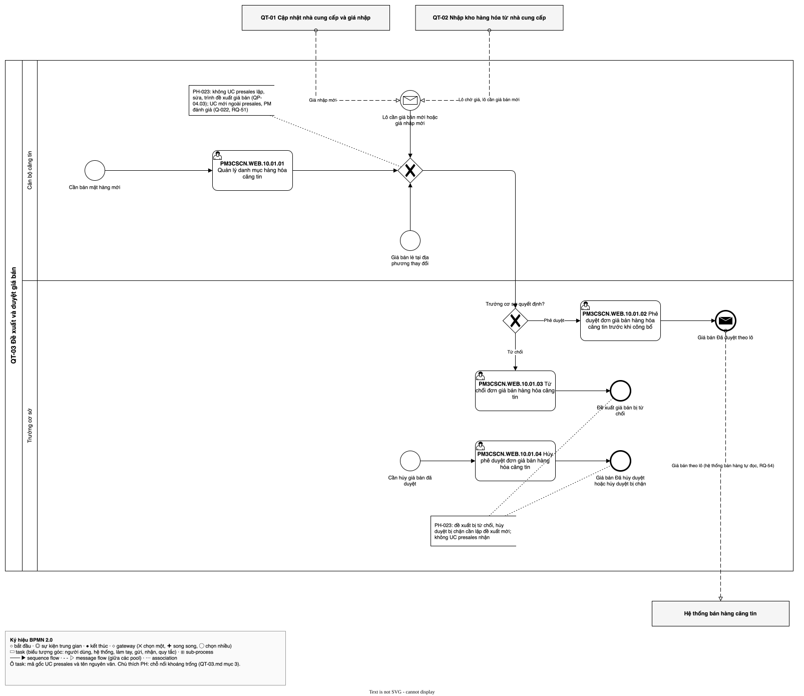

# QT-03 Đề xuất và duyệt giá bán — luồng UC
| Bản đồ | Số UC | Chỗ nối khoảng trống | Cập nhật | Trạng thái |
| --- | --- | --- | --- | --- |
| [../../ban-do-quy-trinh.md](../../ban-do-quy-trinh.md) | 4 | 3 | 2026-10-29 | draft |

File của **một** quy trình trong bản đồ quy trình dựng ngược. Đặt trong thư mục `cap-2/QT-03-gia-ban/` của
`1-ba-init/0-dau-vao/ban-do-quy-trinh/` (cấp 2 của bản đồ), cùng đặc tả và sơ đồ BPMN của quy trình đó. File tổng
`ban-do-quy-trinh.md` giữ danh sách QT (mục 1), chuyển giao, hệ thống ngoài, đối chiếu và sơ đồ tổng; file này giữ phần
**bên trong** quy trình: các UC presales xảy ra theo thứ tự nào, nối với nhau ra sao, chỗ nào hở. Khái niệm (quy trình,
trigger, kết quả, chỗ nối, khoảng trống…) định nghĩa ở file tổng.

Để làm gì: đọc một quy trình mà không phải lật cả bản đồ; BA duyệt từng quy trình; `/ba-overview` đợt 3 lấy luồng UC
này làm khung để viết bảng bước của QT-03.

## 1. Thông tin quy trình
| Mã | Tên | Trigger | Kết quả | Actor chính | Đối tượng nghiệp vụ | Điều khoản |
| --- | --- | --- | --- | --- | --- | --- |
| QT-03 | Đề xuất và duyệt giá bán | Cần bán mặt hàng mới; lô cần giá bán mới hoặc lô chờ giá (QT-02); giá nhập mới (QT-01, qua hộp "Quyết định giá bán" của UC `PM3CSCN.WEB.10.01.01`, RQ-52); hoặc giá bán lẻ tại địa phương thay đổi | Giá bán Có hiệu lực theo lô, Đề xuất giá bán Đã hủy hoặc Giá bán Đã hủy duyệt | Cán bộ căng tin; Trưởng cơ sở | Đề xuất giá bán; Giá bán; Lô | `TT79-2026/Đ41.K4`; `TT79-2026/Đ16.K1`; `TT79-2026/Đ16.K2`; `TT79-2026/Đ16.K3`; `TT79-2026/Đ16.K4`; `TT79-2026/Đ16.K5`; `TT79-2026/Đ16.K6`; `TT79-2026/Đ16.K7`; `TT79-2026/Đ16.K8` |

- Chép nguyên từ dòng QT-03 ở mục 1 của file tổng.

## 2. Ghép luồng UC
| QT | Thứ tự | UC presales | Actor | Đầu vào | Đầu ra | Nối tới | Chỗ nối | PH | Nguồn |
| --- | --- | --- | --- | --- | --- | --- | --- | --- | --- |
| QT-03 | 1 | `PM3CSCN.WEB.10.01.01` | (ô trống trong tệp gốc); cán bộ căng tin theo Q-001 | Cần bán mặt hàng mới | Mặt hàng có trong danh mục hàng hóa căng tin, chưa có giá bán duyệt (thêm mặt hàng không cần duyệt) | `PM3CSCN.WEB.10.01.02`; `PM3CSCN.WEB.10.01.03` | khoảng trống | [PH-023] | [SRC: 1-ba-init/0-dau-vao/quy-trinh-presales.md, QP-04.01, QP-04.02]; [SRC: 0-inputs/answers-2026-10-28.md, RQ-17, RQ-24] |
| QT-03 | 2 | `PM3CSCN.WEB.10.01.02` | (ô trống trong tệp gốc); Trưởng cơ sở theo Q-001 | Đề xuất giá bán chờ duyệt (lô áp dụng, ngày hiệu lực, giá nhập, chi phí hợp lý tính bên ngoài hệ thống **<u>GD-0001</u>**, giá bán lẻ tại địa phương) | Giá bán Đã duyệt theo lô; đến ngày hiệu lực thì áp cho lô, mở bán lô chờ giá, Giá bán Có hiệu lực; Hệ thống bán hàng căng tin tự đọc giá bán theo lô | — | khớp | — | [SRC: 1-ba-init/0-dau-vao/quy-trinh-presales.md, QP-04.05 → QP-04.10]; [SRC: 1-ba-init/0-dau-vao/uc-phap-ly.md, `TT79-2026/Đ41.K4` ↔ `PM3CSCN.WEB.10.01.02`]; [SRC: 0-inputs/answers-2026-10-28.md, RQ-08, RQ-21, RQ-23, RQ-24] |
| QT-03 | 3 | `PM3CSCN.WEB.10.01.03` | (ô trống trong tệp gốc); Trưởng cơ sở theo Q-001 | Đề xuất giá bán chờ duyệt | Đề xuất giá bán bị từ chối, có lý do, trả về người lập | — | khoảng trống | [PH-023] | [SRC: 1-ba-init/0-dau-vao/quy-trinh-presales.md, QP-04.06]; [SRC: 0-inputs/answers-2026-10-28.md, RQ-34] |
| QT-03 | 4 | `PM3CSCN.WEB.10.01.04` | (ô trống trong tệp gốc); Trưởng cơ sở theo Q-001 | Giá bán Đã duyệt (đầu ra của `10.01.02`) chưa tới ngày hiệu lực; khởi động bằng sự kiện riêng "Cần hủy giá bán đã duyệt" | Giá bán Đã hủy duyệt, đóng hẳn; hoặc hủy duyệt bị chặn khi đã tới ngày hiệu lực, phải lập đề xuất giá mới; lô chờ giá tiếp tục bị giữ | — | khoảng trống | [PH-023] | [SRC: 1-ba-init/0-dau-vao/quy-trinh-presales.md, QP-04.14 → QP-04.19]; [SRC: 0-inputs/answers-2026-10-28.md, RQ-35, RQ-38, RQ-40, RQ-41] |

- Thứ tự theo điều khoản: giá bán "phải được Trưởng cơ sở cai nghiện ma túy duyệt sau khi trừ chi phí hợp lý, nhưng
  không được cao hơn giá bán lẻ tại địa phương đối với hàng hóa cùng loại" — `PL:TT79-2026/Đ41.K4` (loại điều kiện,
  không phải `thủ tục`): có giá đề xuất trước, Trưởng cơ sở duyệt sau. Chất cấm, đồ vật cấm `PL:TT79-2026/Đ16.K1`…`K8`
  được loại trừ khi Trưởng cơ sở duyệt giá đầu của mặt hàng [SRC: 0-inputs/answers-2026-10-28.md, RQ-24]. Chi phí hợp lý
  tính bên ngoài hệ thống; người dùng nhập giá bán sao cho giá bán lớn hơn hoặc bằng giá nhập **<u>GD-0001</u>** (Q-005, Q-006). Rồi theo
  QP-04. Prototype không có màn giá bán (man-presales.md mục 4), không có luồng màn để đối chiếu; trình tự luật không
  khác luồng màn.
- Ba chỗ nối `khoảng trống` cùng do việc lập, sửa, trình đề xuất giá bán (QP-04.03) không có UC presales [PH-023].
  Hộp "Quyết định giá bán" khi lưu giá nhập thuộc UC `10.01.01` [SRC: 0-inputs/answers-2026-10-29.md, RQ-52], chỉ phủ
  trường hợp đề xuất sinh từ giá nhập; lập, sửa, trình đề xuất nói chung là UC mới ngoài danh sách presales, PM đánh
  giá (Q-022 đã quyết B) [SRC: 0-inputs/answers-2026-10-29.md, RQ-51].
- Đã soát bốn câu ở chỗ nối `khớp` `10.01.02` (cuối luồng duyệt): ai chuyển cho ai — hệ thống ghi giá bán Đã duyệt
  theo lô, đến ngày hiệu lực áp cho lô (QP-04.07 → QP-04.09); trong hay ngoài hệ thống — trong hệ thống; actor không có
  UC — không có; đầu ra không UC nào nhận — Hệ thống bán hàng căng tin tự đọc dữ liệu kho, phần mềm kho không có UC tích
  hợp riêng (Q-015 đã quyết B) [SRC: 0-inputs/answers-2026-10-29.md, RQ-54]. Chỗ nối trước đây là khoảng trống PH-015;
  PH-015 trong sổ vẫn mở, bước 2 đóng.

## 3. Khoảng trống ở chỗ nối
| PH | Giữa | Câu hỏi | Mô tả | Nguồn |
| --- | --- | --- | --- | --- |
| [PH-023] | `PM3CSCN.WEB.10.01.01` → `PM3CSCN.WEB.10.01.02`, `PM3CSCN.WEB.10.01.03` | ai chuyển cho ai | `10.01.01` kết thúc ở "mặt hàng có trong danh mục"; `10.01.02`, `10.01.03` bắt đầu ở "đề xuất giá bán chờ duyệt". Cán bộ căng tin lập, sửa, trình đề xuất giá bán (QP-04.03, QP-04.04; RQ-08, RQ-23) nhưng không UC presales nào làm việc đó. Các trigger từ QT-01, QT-02 và "giá bán lẻ tại địa phương thay đổi" cũng đi vào việc này. Q-022 đã quyết B: UC mới ngoài danh sách presales, PM đánh giá [SRC: 0-inputs/answers-2026-10-29.md, RQ-51]; hộp "Quyết định giá bán" thuộc `10.01.01` chỉ cho đề xuất sinh từ giá nhập (RQ-52) | [SRC: 1-ba-init/0-dau-vao/quy-trinh-presales.md, QP-04.03, QP-04.04, QP-04.12, QP-04.13]; [SRC: 0-inputs/answers-2026-10-28.md, RQ-08, RQ-23] |
| [PH-023] | `PM3CSCN.WEB.10.01.03` → (sửa đề xuất) | đầu ra không UC nào nhận | Đề xuất bị từ chối trả về người lập để sửa và trình lại, hoặc người lập hủy (RQ-34; QP-04.06 [Không, ghi lý do] → QP-04.03; QP-04.11 "Đề xuất giá bán Đã hủy"). Không UC presales nào nhận đề xuất bị từ chối | [SRC: 1-ba-init/0-dau-vao/quy-trinh-presales.md, QP-04.06, QP-04.11]; [SRC: 0-inputs/answers-2026-10-28.md, RQ-34] |
| [PH-023] | `PM3CSCN.WEB.10.01.04` → (lập đề xuất mới) | đầu ra không UC nào nhận | Hủy duyệt bị chặn khi giá đã tới ngày hiệu lực thì phải "lập đề xuất giá mới" (QP-04.19); không UC presales nào lập đề xuất giá bán | [SRC: 1-ba-init/0-dau-vao/quy-trinh-presales.md, QP-04.17, QP-04.19]; [SRC: 0-inputs/answers-2026-10-28.md, RQ-35] |

## 4. Sơ đồ
Sơ đồ BPMN luồng UC của quy trình, theo skill ba-bpmn: pool là QT-03, lane là actor; mỗi UC presales ở mục 2 là một
task mang nhãn `<mã gốc> <tên UC>`; mũi tên theo cột "Nối tới"; cổng gộp gom ba trigger trước gateway "Trưởng cơ sở
quyết định?"; chỗ nối `khoảng trống` gắn annotation ghi mã PH. QT-01, QT-02, Hệ thống bán hàng căng tin là pool thu
gọn nối bằng message flow. Tệp: `QT-03.bpmn.json` (đặc tả), `QT-03.drawio.svg` (sơ đồ).

Nguồn: QT-03.drawio.svg

