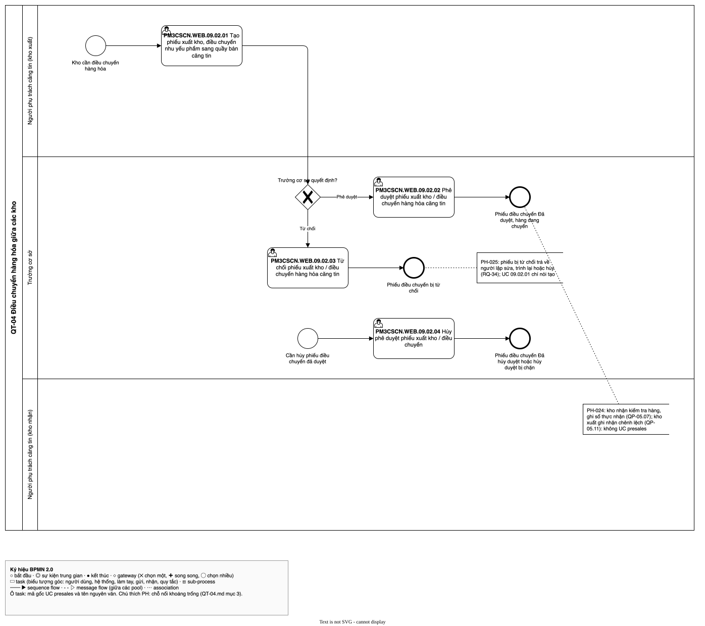

# QT-04 Điều chuyển hàng hóa giữa các kho — luồng UC
| Bản đồ | Số UC | Chỗ nối khoảng trống | Cập nhật | Trạng thái |
| --- | --- | --- | --- | --- |
| [../../ban-do-quy-trinh.md](../../ban-do-quy-trinh.md) | 4 | 2 | 2026-10-29 | draft |

File của **một** quy trình trong bản đồ quy trình dựng ngược. Đặt trong thư mục `cap-2/QT-04-dieu-chuyen-kho/` của
`1-ba-init/0-dau-vao/ban-do-quy-trinh/` (cấp 2 của bản đồ), cùng đặc tả và sơ đồ BPMN của quy trình đó. File tổng
`ban-do-quy-trinh.md` giữ danh sách QT (mục 1), chuyển giao, hệ thống ngoài, đối chiếu và sơ đồ tổng; file này giữ phần
**bên trong** quy trình: các UC presales xảy ra theo thứ tự nào, nối với nhau ra sao, chỗ nào hở. Khái niệm (quy trình,
trigger, kết quả, chỗ nối, khoảng trống…) định nghĩa ở file tổng.

Để làm gì: đọc một quy trình mà không phải lật cả bản đồ; BA duyệt từng quy trình; `/ba-overview` đợt 3 lấy luồng UC
này làm khung để viết bảng bước của QT-04.

## 1. Thông tin quy trình
| Mã | Tên | Trigger | Kết quả | Actor chính | Đối tượng nghiệp vụ | Điều khoản |
| --- | --- | --- | --- | --- | --- | --- |
| QT-04 | Điều chuyển hàng hóa giữa các kho | Kho cần điều chuyển hàng hóa (kể cả khi cán bộ căng tin chọn điều chuyển sau cảnh báo của QT-06) | Phiếu điều chuyển Hoàn thành, Hoàn thành có chênh lệch, Đã hủy hoặc Đã hủy duyệt | Cán bộ căng tin (kho xuất); Trưởng cơ sở; Cán bộ căng tin (kho nhận) | Phiếu điều chuyển; Hàng đang chuyển; Lô | — |

- Chép nguyên từ dòng QT-04 ở mục 1 của file tổng. Không điều khoản nào điều chỉnh phiếu điều chuyển (Q-019). Mô hình
  nhiều kho ngang hàng, không có kho tổng [SRC: 0-inputs/answers-2026-10-28.md, RQ-01].

## 2. Ghép luồng UC
| QT | Thứ tự | UC presales | Actor | Đầu vào | Đầu ra | Nối tới | Chỗ nối | PH | Nguồn |
| --- | --- | --- | --- | --- | --- | --- | --- | --- | --- |
| QT-04 | 1 | `PM3CSCN.WEB.09.02.01` | (ô trống trong tệp gốc); cán bộ căng tin kho xuất theo Q-001 | Kho cần điều chuyển hàng hóa | Phiếu điều chuyển trình duyệt (kho xuất, kho nhận, lô, số lượng) | `PM3CSCN.WEB.09.02.02`; `PM3CSCN.WEB.09.02.03` | khớp | — | [SRC: 1-ba-init/0-dau-vao/quy-trinh-presales.md, QP-05.01, QP-05.02, QP-05.03]; [SRC: 0-inputs/answers-2026-10-28.md, RQ-15] |
| QT-04 | 2 | `PM3CSCN.WEB.09.02.02` | (ô trống trong tệp gốc); Trưởng cơ sở theo Q-001 | Phiếu điều chuyển chờ duyệt | Phiếu điều chuyển Đã duyệt; tồn kho xuất bị trừ, hàng ở trạng thái đang chuyển | — | khoảng trống | [PH-024] | [SRC: 1-ba-init/0-dau-vao/quy-trinh-presales.md, QP-05.04, QP-05.05, QP-05.06]; [SRC: 0-inputs/answers-2026-10-28.md, RQ-06, RQ-15] |
| QT-04 | 3 | `PM3CSCN.WEB.09.02.03` | (ô trống trong tệp gốc); Trưởng cơ sở theo Q-001 | Phiếu điều chuyển chờ duyệt | Phiếu điều chuyển bị từ chối, có lý do, trả về người lập | — | khoảng trống | [PH-025] | [SRC: 1-ba-init/0-dau-vao/quy-trinh-presales.md, QP-05.05]; [SRC: 0-inputs/answers-2026-10-28.md, RQ-34] |
| QT-04 | 4 | `PM3CSCN.WEB.09.02.04` | (ô trống trong tệp gốc); Trưởng cơ sở theo Q-001 | Phiếu điều chuyển Đã duyệt (đầu ra của `09.02.02`), kho nhận chưa xác nhận thực nhận; khởi động bằng sự kiện riêng "Cần hủy phiếu điều chuyển đã duyệt" | Phiếu điều chuyển Đã hủy duyệt, cộng trả tồn kho xuất, bỏ hàng đang chuyển, phiếu đóng hẳn; hoặc hủy duyệt bị chặn khi kho nhận đã xác nhận | — | khớp | — | [SRC: 1-ba-init/0-dau-vao/quy-trinh-presales.md, QP-05.15 → QP-05.21]; [SRC: 0-inputs/answers-2026-10-28.md, RQ-35, RQ-38, RQ-40] |

- Thứ tự theo quy trình presales QP-05 (không có điều khoản `thủ tục`, Q-019). Prototype không có màn phiếu điều
  chuyển (man-presales.md mục 4).
- Đã soát bốn câu ở chỗ nối `khớp`:
  - `09.02.01` → `09.02.02`, `09.02.03`: ai chuyển cho ai — cán bộ căng tin kho xuất trình phiếu, Trưởng cơ sở duyệt
    (QP-05.03 [Có] → QP-05.04; RQ-15); trong hay ngoài hệ thống — trong hệ thống; actor không có UC — không có; đầu ra
    không UC nào nhận — `09.02.02`, `09.02.03` nhận phiếu chờ duyệt.
  - `09.02.04` (cuối luồng hủy phê duyệt): ai chuyển cho ai — Trưởng cơ sở là người duyệt và người hủy duyệt (RQ-40);
    trong hay ngoài hệ thống — trong hệ thống, hệ thống kiểm kho nhận chưa xác nhận và cộng trả tồn (QP-05.17, QP-05.19);
    actor không có UC — không có; đầu ra không UC nào nhận — "Phiếu điều chuyển Đã hủy duyệt" là kết quả cuối.

## 3. Khoảng trống ở chỗ nối
| PH | Giữa | Câu hỏi | Mô tả | Nguồn |
| --- | --- | --- | --- | --- |
| [PH-024] | `PM3CSCN.WEB.09.02.02` → (xác nhận thực nhận) | đầu ra không UC nào nhận | `09.02.02` kết thúc ở "phiếu Đã duyệt, hàng đang chuyển". Cán bộ căng tin kho nhận kiểm tra hàng, ghi số lượng thực nhận để cộng tồn kho nhận (QP-05.07, QP-05.08); thực nhận thiếu thì cán bộ căng tin kho xuất ghi nhận chênh lệch, cộng trả tồn kho xuất (QP-05.11, QP-05.12). Q-001 ghi cán bộ căng tin "xác nhận thực nhận" nhưng không UC presales nào làm hai việc này | [SRC: 1-ba-init/0-dau-vao/quy-trinh-presales.md, QP-05.07 → QP-05.13]; [SRC: 0-inputs/answers-2026-10-28.md, RQ-06, RQ-26, RQ-29]; [SRC: 1-ba-init/open-questions.md, Q-001] |
| [PH-025] | `PM3CSCN.WEB.09.02.03` → `PM3CSCN.WEB.09.02.01` | đầu ra không UC nào nhận | Phiếu bị từ chối trả về người lập để sửa và trình lại, hoặc người lập hủy phiếu (RQ-34; QP-05.05 [Không, ghi lý do] → QP-05.02 "Lập hoặc sửa phiếu điều chuyển"; QP-05.14 "Phiếu điều chuyển Đã hủy"). UC `09.02.01` chỉ ghi "Tạo phiếu xuất kho, điều chuyển…", không có cập nhật, hủy (khác `PM3CSCN.WEB.09.01.01` "Tạo / Cập nhật") | [SRC: 1-ba-init/0-dau-vao/uc-presales.md, `PM3CSCN.WEB.09.02.01`]; [SRC: 1-ba-init/0-dau-vao/quy-trinh-presales.md, QP-05.02, QP-05.05, QP-05.14] |

## 4. Sơ đồ
Sơ đồ BPMN luồng UC của quy trình, theo skill ba-bpmn: pool là QT-04, lane là actor; mỗi UC presales ở mục 2 là một
task mang nhãn `<mã gốc> <tên UC>`; mũi tên theo cột "Nối tới"; gateway "Trưởng cơ sở quyết định?" tách phê duyệt và
từ chối; chỗ nối `khoảng trống` gắn annotation ghi mã PH. Lane "Cán bộ căng tin (kho nhận)" không có UC, chỉ có
annotation [PH-024]. Tệp: `QT-04.bpmn.json` (đặc tả), `QT-04.drawio.svg` (sơ đồ).

Nguồn: QT-04.drawio.svg

