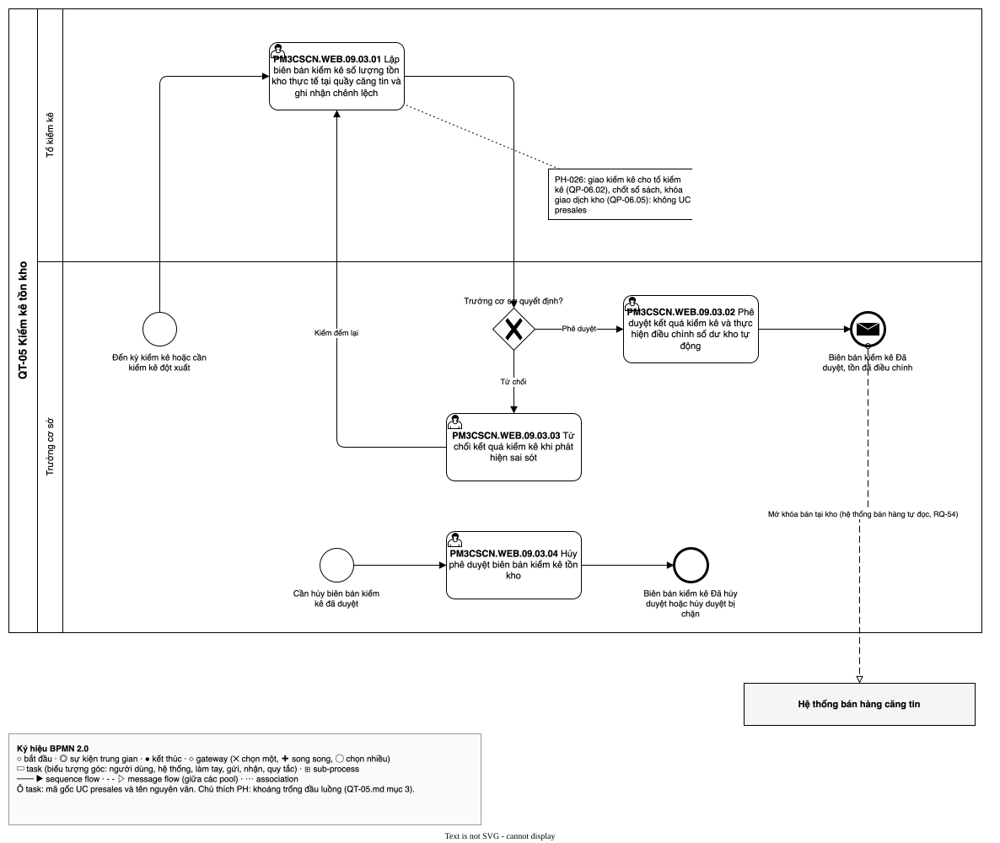

# QT-05 Kiểm kê tồn kho — luồng UC
| Bản đồ | Số UC | Chỗ nối khoảng trống | Cập nhật | Trạng thái |
| --- | --- | --- | --- | --- |
| [../../ban-do-quy-trinh.md](../../ban-do-quy-trinh.md) | 4 | 0 | 2026-10-29 | draft |

File của **một** quy trình trong bản đồ quy trình dựng ngược. Đặt trong thư mục `cap-2/QT-05-kiem-ke/` của
`1-ba-init/0-dau-vao/ban-do-quy-trinh/` (cấp 2 của bản đồ), cùng đặc tả và sơ đồ BPMN của quy trình đó. File tổng
`ban-do-quy-trinh.md` giữ danh sách QT (mục 1), chuyển giao, hệ thống ngoài, đối chiếu và sơ đồ tổng; file này giữ phần
**bên trong** quy trình: các UC presales xảy ra theo thứ tự nào, nối với nhau ra sao, chỗ nào hở. Khái niệm (quy trình,
trigger, kết quả, chỗ nối, khoảng trống…) định nghĩa ở file tổng.

Để làm gì: đọc một quy trình mà không phải lật cả bản đồ; BA duyệt từng quy trình; `/ba-overview` đợt 3 lấy luồng UC
này làm khung để viết bảng bước của QT-05.

## 1. Thông tin quy trình
| Mã | Tên | Trigger | Kết quả | Actor chính | Đối tượng nghiệp vụ | Điều khoản |
| --- | --- | --- | --- | --- | --- | --- |
| QT-05 | Kiểm kê tồn kho | Đến kỳ kiểm kê (chu kỳ do cán bộ quyết định) hoặc cần kiểm kê đột xuất, kể cả khi hủy duyệt phiếu nhập kho bị chặn (QT-02) hoặc người phụ trách căng tin đề nghị sau cảnh báo (QT-06) | Biên bản kiểm kê Đã duyệt (tồn đã điều chỉnh, kho mở khóa), Biên bản kiểm kê Đã hủy duyệt, hoặc chưa kiểm kê được do còn phiếu dở dang | Trưởng cơ sở; Tổ kiểm kê | Biên bản kiểm kê; Tồn kho theo lô | — |

- Chép nguyên từ dòng QT-05 ở mục 1 của file tổng. Không điều khoản nào điều chỉnh kiểm kê kho căng tin (Q-019).

## 2. Ghép luồng UC
| QT | Thứ tự | UC presales | Actor | Đầu vào | Đầu ra | Nối tới | Chỗ nối | PH | Nguồn |
| --- | --- | --- | --- | --- | --- | --- | --- | --- | --- |
| QT-05 | 1 | `PM3CSCN.WEB.09.03.01` | (ô trống trong tệp gốc); tổ kiểm kê theo Q-001 | Kho được Trưởng cơ sở giao kiểm kê, số sách đã chốt theo lô, giao dịch kho bị khóa (không UC nào tạo đầu vào này, xem mục 3 [PH-026]) | Biên bản kiểm kê (số thực tế, lý do chênh lệch) trình duyệt; hệ thống tính chênh lệch so với số sách | `PM3CSCN.WEB.09.03.02`; `PM3CSCN.WEB.09.03.03` | khớp | — | [SRC: 1-ba-init/0-dau-vao/quy-trinh-presales.md, QP-06.06, QP-06.07, QP-06.08]; [SRC: 0-inputs/answers-2026-10-28.md, RQ-07] |
| QT-05 | 2 | `PM3CSCN.WEB.09.03.02` | (ô trống trong tệp gốc); Trưởng cơ sở theo Q-001 | Biên bản kiểm kê chờ duyệt | Biên bản kiểm kê Đã duyệt; tồn kho điều chỉnh theo số thực tế; kho mở khóa | — | khớp | — | [SRC: 1-ba-init/0-dau-vao/quy-trinh-presales.md, QP-06.09, QP-06.10, QP-06.11]; [SRC: 0-inputs/answers-2026-10-28.md, RQ-07, RQ-12] |
| QT-05 | 3 | `PM3CSCN.WEB.09.03.03` | (ô trống trong tệp gốc); Trưởng cơ sở theo Q-001 | Biên bản kiểm kê chờ duyệt | Biên bản kiểm kê bị từ chối, có lý do; tổ kiểm kê đếm lại | `PM3CSCN.WEB.09.03.01` | khớp | — | [SRC: 1-ba-init/0-dau-vao/quy-trinh-presales.md, QP-06.10]; [SRC: 0-inputs/answers-2026-10-28.md, RQ-34] |
| QT-05 | 4 | `PM3CSCN.WEB.09.03.04` | (ô trống trong tệp gốc); Trưởng cơ sở theo Q-001 | Biên bản kiểm kê Đã duyệt (đầu ra của `09.03.02`), kho chưa có giao dịch mới sau kiểm kê; khởi động bằng sự kiện riêng "Cần hủy biên bản kiểm kê đã duyệt" | Biên bản kiểm kê Đã hủy duyệt, đảo điều chỉnh tồn kho, biên bản đóng hẳn; hoặc hủy duyệt bị chặn khi kho đã có giao dịch mới | — | khớp | — | [SRC: 1-ba-init/0-dau-vao/quy-trinh-presales.md, QP-06.14 → QP-06.20]; [SRC: 0-inputs/answers-2026-10-28.md, RQ-35, RQ-38, RQ-40] |

- Thứ tự theo quy trình presales QP-06 (không có điều khoản `thủ tục`, Q-019). Prototype không có màn kiểm kê
  (man-presales.md mục 4).
- Mục 2 không còn chỗ nối `khoảng trống`; quy trình còn một khoảng trống ở **đầu luồng** (trigger → UC đầu tiên),
  ghi ở mục 3 [PH-026]; không tính vào cột "Chỗ nối khoảng trống" vì không là chỗ nối giữa hai UC.
- Đã soát bốn câu ở chỗ nối `khớp`:
  - `09.03.01` → `09.03.02`, `09.03.03`: ai chuyển cho ai — tổ kiểm kê lập biên bản, Trưởng cơ sở duyệt (QP-06.07 →
    QP-06.09; RQ-07); trong hay ngoài hệ thống — trong hệ thống, hệ thống tính chênh lệch (QP-06.08); actor không có UC —
    không có, người chứng kiến, kế toán là thành viên tổ kiểm kê (RQ-07); đầu ra không UC nào nhận — `09.03.02`,
    `09.03.03` nhận biên bản chờ duyệt.
  - `09.03.03` → `09.03.01`: ai chuyển cho ai — biên bản bị từ chối trả về tổ kiểm kê đếm lại (RQ-34); trong hay ngoài
    hệ thống — trong hệ thống (QP-06.10 [Không, kiểm đếm lại] → QP-06.06); actor không có UC — không có; đầu ra không
    UC nào nhận — `09.03.01` nhận để lập lại biên bản.
  - `09.03.02` (cuối luồng duyệt): ai chuyển cho ai — hệ thống điều chỉnh tồn, mở khóa kho (QP-06.11); trong hay ngoài
    hệ thống — trong hệ thống; actor không có UC — không có; đầu ra không UC nào nhận — Hệ thống bán hàng căng tin tự
    đọc trạng thái khóa, mở khóa kho từ dữ liệu kho, phần mềm kho không có UC tích hợp riêng (Q-015 đã quyết B)
    [SRC: 0-inputs/answers-2026-10-29.md, RQ-54]. Chỗ nối trước đây là khoảng trống PH-015; PH-015 trong sổ vẫn mở,
    bước 2 đóng.
  - `09.03.04` (cuối luồng hủy phê duyệt): ai chuyển cho ai — Trưởng cơ sở là người duyệt và người hủy duyệt (RQ-40);
    trong hay ngoài hệ thống — trong hệ thống, hệ thống kiểm giao dịch mới và đảo điều chỉnh (QP-06.16, QP-06.18); actor
    không có UC — không có; đầu ra không UC nào nhận — "Biên bản kiểm kê Đã hủy duyệt" là kết quả cuối.

## 3. Khoảng trống ở chỗ nối
| PH | Giữa | Câu hỏi | Mô tả | Nguồn |
| --- | --- | --- | --- | --- |
| [PH-026] | (trigger QT-05) → `PM3CSCN.WEB.09.03.01` | actor không có UC | `09.03.01` bắt đầu ở "kho được giao kiểm kê, số sách đã chốt". Trưởng cơ sở giao kiểm kê kho cho tổ kiểm kê (QP-06.02; RQ-07), hệ thống chặn khi kho còn phiếu dở dang (QP-06.03, QP-06.04; RQ-39), chốt số sách theo lô và khóa giao dịch kho (QP-06.05; RQ-12). Trưởng cơ sở làm việc giao kiểm kê mà không UC presales nào có việc này | [SRC: 1-ba-init/0-dau-vao/quy-trinh-presales.md, QP-06.01 → QP-06.05, QP-06.13]; [SRC: 0-inputs/answers-2026-10-28.md, RQ-07, RQ-12, RQ-39] |

## 4. Sơ đồ
Sơ đồ BPMN luồng UC của quy trình, theo skill ba-bpmn: pool là QT-05, lane là actor; mỗi UC presales ở mục 2 là một
task mang nhãn `<mã gốc> <tên UC>`; mũi tên theo cột "Nối tới"; gateway "Trưởng cơ sở quyết định?" tách phê duyệt và
từ chối; khoảng trống đầu luồng gắn annotation ghi mã PH. Hệ thống bán hàng căng tin là pool thu gọn nối bằng message
flow (hệ thống bán hàng tự đọc dữ liệu kho, RQ-54). Tệp: `QT-05.bpmn.json` (đặc tả), `QT-05.drawio.svg` (sơ đồ).

Nguồn: QT-05.drawio.svg

