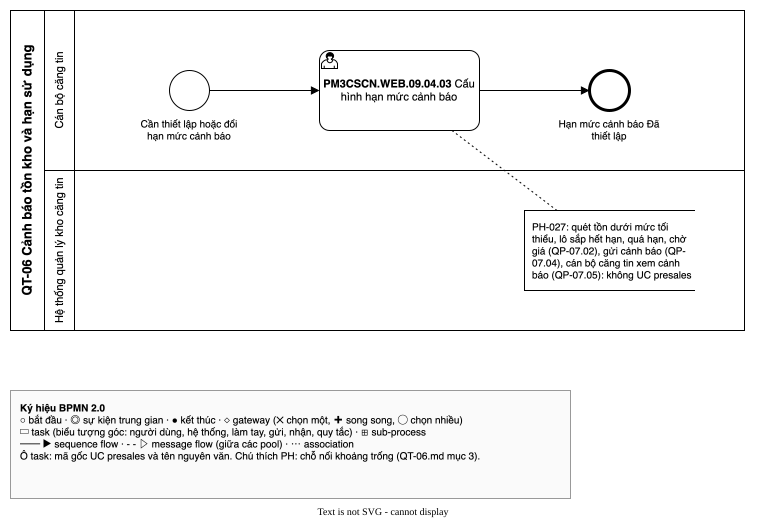

# QT-06 Cảnh báo tồn kho và hạn sử dụng — luồng UC
| Bản đồ | Số UC | Chỗ nối khoảng trống | Cập nhật | Trạng thái |
| --- | --- | --- | --- | --- |
| [../../ban-do-quy-trinh.md](../../ban-do-quy-trinh.md) | 1 | 1 | 2026-10-29 | draft |

File của **một** quy trình trong bản đồ quy trình dựng ngược. Đặt trong thư mục `cap-2/QT-06-canh-bao-ton-kho/` của
`1-ba-init/0-dau-vao/ban-do-quy-trinh/` (cấp 2 của bản đồ), cùng đặc tả và sơ đồ BPMN của quy trình đó. File tổng
`ban-do-quy-trinh.md` giữ danh sách QT (mục 1), chuyển giao, hệ thống ngoài, đối chiếu và sơ đồ tổng; file này giữ phần
**bên trong** quy trình: các UC presales xảy ra theo thứ tự nào, nối với nhau ra sao, chỗ nào hở. Khái niệm (quy trình,
trigger, kết quả, chỗ nối, khoảng trống…) định nghĩa ở file tổng.

Để làm gì: đọc một quy trình mà không phải lật cả bản đồ; BA duyệt từng quy trình; `/ba-overview` đợt 3 lấy luồng UC
này làm khung để viết bảng bước của QT-06.

## 1. Thông tin quy trình
| Mã | Tên | Trigger | Kết quả | Actor chính | Đối tượng nghiệp vụ | Điều khoản |
| --- | --- | --- | --- | --- | --- | --- |
| QT-06 | Cảnh báo tồn kho và hạn sử dụng | Đến giờ quét hằng ngày (00:00 hằng ngày **<u>GD-0003</u>**, RQ-61) hoặc tồn kho theo lô giảm sau giao dịch, theo hạn mức cảnh báo cán bộ căng tin đã thiết lập | Cảnh báo Đã xem (cán bộ căng tin chọn nhập kho, điều chuyển hoặc đề nghị kiểm kê) hoặc không có cảnh báo | Hệ thống quản lý kho căng tin; Cán bộ căng tin | Hạn mức cảnh báo; Cảnh báo; Lô | — |

- Chép nguyên từ dòng QT-06 ở mục 1 của file tổng. Nhóm `PM3CSCN.WEB.09.04` thuộc báo giá (Q-002 đã quyết) [SRC: 0-inputs/answers-2026-10-29.md, RQ-50].

## 2. Ghép luồng UC
| QT | Thứ tự | UC presales | Actor | Đầu vào | Đầu ra | Nối tới | Chỗ nối | PH | Nguồn |
| --- | --- | --- | --- | --- | --- | --- | --- | --- | --- |
| QT-06 | 1 | `PM3CSCN.WEB.09.04.03` | (ô trống trong tệp gốc); cán bộ căng tin theo Q-001 | Kho, mặt hàng của kho | Hạn mức cảnh báo đã thiết lập: tồn tối thiểu theo kho × mặt hàng, số ngày cảnh báo sắp hết hạn N theo kho (giá trị [CẦN XÁC NHẬN]); có lịch sử thay đổi, không duyệt | — | khoảng trống | [PH-027] | [SRC: 1-ba-init/0-dau-vao/quy-trinh-presales.md, QP-02.06]; [SRC: 0-inputs/answers-2026-10-28.md, RQ-28, RQ-31, RQ-33] |

- Quy trình chỉ có một UC presales; UC này thiết lập tham số cho việc quét (QP-07.02 "theo tồn tối thiểu, số ngày N
  của kho"). Thứ tự theo QP-07; không có điều khoản, không có màn.

## 3. Khoảng trống ở chỗ nối
| PH | Giữa | Câu hỏi | Mô tả | Nguồn |
| --- | --- | --- | --- | --- |
| [PH-027] | `PM3CSCN.WEB.09.04.03` → (quét, gửi, xem cảnh báo) | đầu ra không UC nào nhận | Hạn mức cảnh báo là đầu vào của việc hệ thống quét tồn dưới mức tối thiểu, lô sắp hết hạn, quá hạn, chờ giá (QP-07.02), gửi cảnh báo cho cán bộ căng tin (QP-07.04); cán bộ căng tin xem cảnh báo, chọn hướng xử lý (QP-07.05). Không UC presales nào làm ba việc này | [SRC: 1-ba-init/0-dau-vao/quy-trinh-presales.md, QP-07.01 → QP-07.08]; [SRC: 0-inputs/answers-2026-10-28.md, RQ-27, RQ-28, RQ-30, RQ-41, RQ-42] |

## 4. Sơ đồ
Sơ đồ BPMN luồng UC của quy trình, theo skill ba-bpmn: pool là QT-06, lane là actor; UC presales duy nhất là task
mang nhãn `<mã gốc> <tên UC>`; chỗ nối `khoảng trống` gắn annotation ghi mã PH ở lane hệ thống (việc quét, gửi cảnh báo
không có UC nên không vẽ thành task). Tệp: `QT-06.bpmn.json` (đặc tả), `QT-06.drawio.svg` (sơ đồ).

Nguồn: QT-06.drawio.svg

