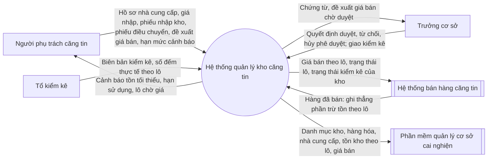

# BRD — Quản lý kho căng tin · Kho, hàng hóa và giá bán, nhà cung cấp

> **8 mục tiêu nghiệp vụ, 30 yêu cầu nghiệp vụ, 10 bên liên quan** của phần mềm quản lý kho căng tin dùng chung cho nhiều cơ sở cai nghiện ma túy công lập (ba phân hệ presales: kho căng tin; danh mục hàng hóa và giá bán; nhà cung cấp hàng hóa căng tin), dựng từ văn bản pháp luật (TT79, NĐ163), 31 UC presales, prototype presales, quy trình presales và câu trả lời của BA (RQ-01 → RQ-159).
> Mỗi yêu cầu nghiệp vụ `BRQ-xx` gắn **một mục tiêu** `OBJ-xx`, **một căn cứ** và **tiêu chí chấp nhận** kiểm chứng được.
> Chi tiết luồng ở [Quy trình nghiệp vụ](../2-business-process/), ràng buộc ở [Business rule](../6-business-rules/). BRD **không** đặc tả màn hình và dữ liệu.
> Đọc: căn cứ pháp lý ghi dạng `TT79 Đ41.4` (viết tắt ở mục 16); `PS:<mã>` là UC presales (mục 3); `RQ-nn` là câu trả lời của BA (mục 16); giả định của sổ bôi đỏ; `ASM-nn` (hai chữ số) là giả định của BRD ở mục 10, khác `ASM-00n` của sổ bước 1; câu hỏi và quyết định của BA ở mục 14; `chờ lớp n` là ô lớp sau điền; mã ⊘ là mã đã bỏ, không dùng lại.

## Thông tin tài liệu

| Mục | Nội dung |
|---|---|
| Mã tài liệu | `BRD_PM3CSCN_QuanLyKhoCangTin` |
| Dự án · Phân hệ | Quản lý kho căng tin (mã dự án PM3CSCN, nền tảng WEB — RQ-69) · Ba phân hệ presales: QUẢN LÝ KHO CĂNG TIN; CẤU HÌNH NGHIỆP VỤ HỆ THỐNG (danh mục hàng hóa và giá bán căng tin); QUẢN LÝ NHÀ CUNG CẤP HÀNG HÓA CĂNG TIN — một bộ tài liệu cho cả ba (RQ-70) |
| Khách hàng · Đơn vị sử dụng | Các cơ sở cai nghiện ma túy công lập ("Cơ sở cai nghiện công lập" — RQ-71, RQ-92); một bản cài đặt phục vụ nhiều cơ sở (RQ-151) · Mỗi cơ sở: Trưởng cơ sở, người phụ trách căng tin, tổ kiểm kê; dữ liệu riêng từng cơ sở (RQ-152) |
| Phiên bản · Trạng thái | v01 · Chờ review |
| Người soạn · Người review · Người duyệt | phongnq12 — BA (AI hỗ trợ soạn) · chưa chốt (BA lead) · Đại diện khách hàng ký duyệt BRD — SH-10 (RQ-78) |
| Mức mật | Nội bộ |

## Version control

| Tên version | Ngày cập nhật | PIC | Mô tả |
| :--- | :--- | :--- | :--- |
| v00 | 2026-10-29 | phongnq12 | - Khởi tạo tài liệu (/ba-overview đợt 1, lớp BRD). - Sửa theo review độc lập vòng 1: tách BRQ-05, BRQ-16, BRQ-17, BRQ-20 (thêm BRQ-26 → BRQ-29); BRQ-24 viết lại thành nhu cầu của cơ sở; chuyển điều kiện, công thức, tham số sang dẫn RQ, GD và giao lớp 2, 6; thêm Q-B15 → Q-B24, RK-06. - BA chốt 29/10/2026: áp câu trả lời Q-B01 → Q-B24 (RQ-72 → RQ-95). Bỏ OBJ-07 (khách không đặt đích, RQ-76), BRQ-22 chuyển sang OBJ-06. Thêm P-08, OBJ-09, BRQ-30 (TT79 Đ5.1.a, RQ-91), SH-10 (RQ-78), TH-03 (RQ-79), Q-B25. Q-B12 chấp nhận tạm → **<u>GD-0006</u>**. - BA chốt 29/10/2026: Q-B25 chấp nhận tạm → **<u>GD-0007</u>** (RQ-96); thay dẫn tạm TT79 Đ5 bằng mã điều khoản Đ5.K1.a, Đ5.K2, Đ52.K4 sau /ba-init --bo-sung; dẫn PH-032. Không còn câu chờ BA chốt, chuyển Chờ review. - Sửa theo review độc lập vòng 2 (về Nháp trong lúc sửa): BA chốt 29/10/2026 RQ-98 (phiếu nhập kho đầu kỳ), RQ-99 → **<u>GD-0008</u>**, RQ-100 (chỉ kiểm TT79 Đ16 khi duyệt giá đầu, thêm RK-08), RQ-101 (mốc, tần suất đồng bộ giao SRS). Tách BRQ-31 khỏi BRQ-23; gắn lại OBJ cho BRQ-09, BRQ-16, BRQ-21, BRQ-27; thêm Q-B26 → Q-B32, RK-08, RK-09. Chỉ còn ô chưa chốt (BA/PM), chuyển lại Chờ review. - BA chốt 29/10/2026: Q-B26 → Q-B32 (RQ-102 → RQ-108); RQ-109: bỏ OBJ-09, BRQ-30 chuyển thành CON-05; RQ-110 (chặn lập, duyệt phiếu ở kho đang kiểm kê); RQ-111 (số thực nhận không lớn hơn số xuất); RQ-112 (thông tin bắt buộc của đề xuất giá bán). - Sửa theo review độc lập vòng 3: thêm NFR-09, Q-B33 → Q-B35; tiêu chí BRQ-01, 04, 05, 06, 13, 16, 17, 25, 29 viết lại theo kết quả nghiệp vụ. - BA chốt 29/10/2026: Q-B33 → Q-B35 (RQ-113 → RQ-115). Thêm P-09, OBJ-10 cho BRQ-14, 17, 25, 26; BRQ-22 ghi là nhu cầu vận hành (P-05); NFR-09 ưu tiên M; vận hành song song quản lý ngoài hệ thống. - Điền từ QT_PM3CSCN_QuanLyKhoCangTin_v00, không đổi nghĩa: mục 6.2 cột Quy trình, Tài liệu chi tiết; mục 12 cột Quy trình. - Điền từ ERD_PM3CSCN_QuanLyKhoCangTin_v00, không đổi nghĩa: mục 9 NFR-02 cột Căn cứ dẫn ERD mục 9 Dữ liệu nhạy cảm. |
| **v01 (hiện tại)** | **2026-10-29** | phongnq12 | - Bổ sung theo lớp 3 (ERD), thay đổi có nghĩa: một bản cài đặt phục vụ nhiều cơ sở, dữ liệu riêng từng cơ sở (mục 1.1, 3, 4, NFR-04, NFR-10, RK-10); dữ liệu cá nhân thành viên tổ kiểm kê, nhật ký trước/sau (NFR-02 · **<u>GD-0006</u>** · **<u>GD-0007</u>**); đối soát tồn kho với sổ biến động hằng ngày (BRQ-13); Q-B36. - BA chốt 29/10/2026: RQ-151, RQ-152, RQ-153, RQ-154, RQ-158, RQ-159. |

## Phê duyệt

| Vai trò | Họ tên | Ngày | Ý kiến |
|---|---|---|---|
| BA soạn | | | |
| Đại diện khách hàng — người tài trợ dự án | | | |
| Product owner | | | |
| Tech lead | | | |

---

## 1. Bối cảnh và vấn đề nghiệp vụ

### 1.1. Bối cảnh

Khách hàng là các cơ sở cai nghiện ma túy công lập (RQ-71); một bản cài đặt phục vụ nhiều cơ sở (RQ-151). Mọi dữ liệu — kho, mặt hàng, nhà cung cấp, giá nhập, giá bán, chứng từ — thuộc riêng một cơ sở, mã duy nhất trong cơ sở; người dùng chỉ thấy dữ liệu cơ sở mình (RQ-152). Các mô tả dưới đây áp cho từng cơ sở. Cơ sở tổ chức hoạt động căng tin để bán lương thực, thực phẩm và đồ dùng sinh hoạt thiết yếu cho người cai nghiện ma túy; giá bán phải được Trưởng cơ sở duyệt và không được cao hơn giá bán lẻ tại địa phương đối với hàng hóa cùng loại (TT79 Đ41.4). Người cai nghiện ma túy mua hàng tại căng tin bằng tiền lưu ký (NĐ163 Đ120.3). Việc sử dụng tiền trong căng tin thực hiện qua Hệ thống bán hàng căng tin (TT79 Đ41.7); bán hàng nằm ngoài phạm vi dự án, Hệ thống bán hàng căng tin tự đọc dữ liệu kho (RQ-03, RQ-54).

Phía kho: cơ sở có nhiều kho ngang hàng, mỗi kho tự nhập hàng từ nhà cung cấp và điều chuyển qua lại, không có `kho tổng` (RQ-01). Hàng ra khỏi kho chỉ bằng điều chuyển hoặc bán; hàng hết hạn, hư hỏng ghi giảm qua kiểm kê (RQ-02). Tồn kho theo lô và hạn sử dụng (RQ-14); giá bán gắn theo lô, cùng một lô cùng giá ở mọi kho (RQ-21). Ba vai trò làm việc với kho: người phụ trách căng tin, Trưởng cơ sở, tổ kiểm kê (Q-001, RQ-66). Người phụ trách căng tin được phân công theo từng kho; một người được phụ trách nhiều kho (RQ-95). Cơ sở hiện quản lý kho căng tin bằng sổ (RQ-72). Khách đã đặt 31 UC presales trong ba phân hệ (mục 3).

Quy mô — số cơ sở dùng chung bản cài đặt; số kho, số mặt hàng, số nhà cung cấp, số người dùng của mỗi cơ sở: tùy từng cơ sở, không cố định (RQ-75, RQ-151).

### 1.2. Vấn đề và cơ hội

| # | Vấn đề hoặc cơ hội | Bằng chứng — số liệu, khảo sát, feedback | Hệ quả nếu không giải quyết |
|---|---|---|---|
| P-01 | Giá bán tại căng tin phải được Trưởng cơ sở duyệt và không được cao hơn giá bán lẻ tại địa phương; cơ sở cần chứng minh được mỗi giá đang áp dụng đã qua duyệt | TT79 Đ41.4: "Giá bán lương thực, thực phẩm và các loại hàng hóa phải được Trưởng cơ sở cai nghiện ma túy duyệt sau khi trừ chi phí hợp lý, nhưng không được cao hơn giá bán lẻ tại địa phương đối với hàng hóa cùng loại". Khách đặt UC duyệt, từ chối, hủy phê duyệt giá bán (`PS:PM3CSCN.WEB.10.01.02`, `PS:PM3CSCN.WEB.10.01.03`, `PS:PM3CSCN.WEB.10.01.04`, tên ở mục 3) | Cơ sở vi phạm TT79 Đ41.4: hàng bán với giá chưa duyệt hoặc vượt giá bán lẻ tại địa phương; người cai nghiện ma túy trả giá cao hơn mức cho phép |
| P-02 | Hàng căng tin nhập từ nhà cung cấp có thể thuộc danh mục chất cấm, đồ vật cấm đưa vào cơ sở | TT79 Đ16.1–Đ16.8 liệt kê 8 khoản chất cấm, đồ vật cấm (vũ khí; chất ma túy, thuốc chữa bệnh; chất cháy; rượu, bia, thuốc lá; đồ dùng bằng kim loại, sành, sứ, thủy tinh; thiết bị thu phát; ấn phẩm cấm; công cụ đánh bạc). BA xác nhận Trưởng cơ sở loại đồ vật cấm khi duyệt giá đầu của mặt hàng (RQ-24); chỉ kiểm ở khâu này, không kiểm ở khâu nhập kho (RQ-100) | Chất cấm, đồ vật cấm được bán cho người cai nghiện ma túy qua căng tin, vi phạm TT79 Đ16; hàng có thể đã vào kho trước khi duyệt giá đầu — rủi ro BA chấp nhận (RQ-100, RK-08) |
| P-03 | Hàng căng tin có hạn sử dụng theo lô; lô quá hạn không được bán, lô sắp hết hạn cần được xử lý trước | RQ-14 (tồn theo lô, hạn sử dụng, cảnh báo sắp hết hạn); RQ-30 (lô quá hạn không bán, ghi giảm qua kiểm kê) | Người cai nghiện ma túy mua phải hàng quá hạn; hàng quá hạn nằm trong tồn kho mà không ghi giảm |
| P-04 | Tồn kho nằm ở nhiều kho ngang hàng và thay đổi qua nhập kho, điều chuyển, kiểm kê, bán; mỗi lần thay đổi cần chứng từ có người lập, người duyệt | Khách đặt 13 UC lập, duyệt, từ chối, hủy phê duyệt, in phiếu nhập kho, phiếu điều chuyển, biên bản kiểm kê (mục 3, nhóm Nhập kho, Điều chuyển, Kiểm kê); RQ-01, RQ-05, RQ-06, RQ-07 | Số tồn trên sổ lệch số thực tế mà không truy được chứng từ, người lập, người duyệt |
| P-05 | Kho hết một mặt hàng trước khi người phụ trách căng tin biết tồn đã xuống thấp | Khách đặt UC cấu hình hạn mức cảnh báo (`PS:PM3CSCN.WEB.09.04.03`); RQ-28 (tồn tối thiểu theo kho × mặt hàng, dưới mức thì báo) | Căng tin không có hàng thiết yếu để bán cho người cai nghiện ma túy |
| P-06 | Giá nhập đổi theo nhà cung cấp và đợt nhập; giá bán đã duyệt có thể thấp hơn giá nhập của lô mới | Khách đặt UC giá nhập theo nhà cung cấp và đợt nhập (`PS:PM3CSCN.WEB.15.03.01`); prototype giá nhập MP-001…MP-004; RQ-04, RQ-11 | Lô bị bán dưới giá nhập; cơ sở bù lỗ phần chênh lệch giá |
| P-07 | Việc bán hàng tại căng tin cần giá bán theo lô, trạng thái lô và trạng thái kiểm kê của kho do kho quản lý để bán đúng giá, đúng lô | TT79 Đ41.7: "Việc sử dụng tiền trong căng tin được thực hiện qua hệ thống bán hàng căng tin … bảo đảm minh bạch, thuận tiện trong quản lý giao dịch"; RQ-03, RQ-19, RQ-54 | Bán sai giá, trừ tồn sai lô, bán từ kho đang kiểm kê |
| P-08 | Phần mềm quản lý cơ sở cai nghiện phải được kết nối, đồng bộ với cơ sở dữ liệu quốc gia; phần mềm kho căng tin là một phần của hệ thống quản lý cơ sở cai nghiện thông minh | TT79 Đ5.1.a: "Phần mềm quản lý cơ sở cai nghiện được kết nối, đồng bộ với cơ sở dữ liệu quốc gia về dân cư; cơ sở dữ liệu người nghiện ma túy và người bị quản lý sau cai nghiện ma túy"; TT79 Đ5.2 ("bảo đảm tính công khai, minh bạch, thống nhất"); BA xác nhận phần mềm kho thuộc hệ thống này, phải kết nối (RQ-91) | Dữ liệu kho căng tin tách rời hệ thống quản lý cơ sở cai nghiện, trái TT79 Đ5.1.a |
| P-09 | Chứng từ kho, giá bán, nhà cung cấp cần truy lại được khi kiểm tra, đối chiếu; chứng từ bị từ chối phải có lý do và kết thúc rõ ràng | Khách đặt 8 UC tìm kiếm, xem chi tiết, kết xuất và UC in phiếu nhập kho phục vụ lưu trữ kế toán (mục 3); RQ-34 (từ chối bắt buộc ghi lý do); BA chốt thêm mục tiêu truy lại chứng từ (RQ-113) | Không chứng minh được giá, chứng từ đã duyệt khi kiểm tra; không đối chiếu được với kế toán |

Bằng chứng ở bảng trên là văn bản pháp luật, UC presales, prototype và câu trả lời của BA; cơ sở hiện quản lý bằng sổ, không có số đo mức độ của từng vấn đề; BA chốt bỏ qua số liệu hiện tại (RQ-72). P-05 không có OBJ đo được: khách không đặt đích cho số lần hết hàng (RQ-76); BRQ-22 đáp ứng P-05 như một nhu cầu vận hành, không gắn OBJ (RQ-113). P-08 không có OBJ: nghĩa vụ kết nối, đồng bộ là ràng buộc CON-05 · **<u>GD-0007</u>** (RQ-109).

### 1.3. Căn cứ pháp lý và chính sách

| Văn bản | Số hiệu · ngày | Hiệu lực | Vai trò với dự án |
|---|---|---|---|
| Thông tư 79/2026/TT-BCA (TT79), tệp chính | 79/2026/TT-BCA · 05/06/2026 | Từ 01/07/2026 (TT79 Đ51.1); còn hiệu lực | **Nguồn chính** — Đ41.4 (`PL:TT79-2026/Đ41.K4`: duyệt giá bán, trần giá bán lẻ tại địa phương); Đ16.1–Đ16.8 (`PL:TT79-2026/Đ16.K1`…`K8`: chất cấm, đồ vật cấm); Đ41.7 (`PL:TT79-2026/Đ41.K7`: hệ thống bán hàng căng tin). Đ6.2 (`PL:TT79-2026/Đ6.K2`, vị trí việc làm "căng tin"): đã rà, không sinh BRQ — chỉ nêu vị trí việc làm, dùng cho thuật ngữ. Đ5.1.a (`PL:TT79-2026/Đ5.K1.a`: phần mềm quản lý cơ sở cai nghiện kết nối, đồng bộ cơ sở dữ liệu quốc gia) — sinh ràng buộc CON-05 · **<u>GD-0007</u>** (RQ-91, RQ-109). Đ5.2 (`PL:TT79-2026/Đ5.K2`): đã rà, áp dụng chung, không sinh BRQ riêng — nêu nguyên tắc triển khai cả hệ thống quản lý cơ sở cai nghiện thông minh, không riêng kho căng tin (`1-ba-init/0-dau-vao/uc-phap-ly.md` mục 3). Đ52.4 (`PL:TT79-2026/Đ52.K4`): ngoài phần mềm — điều kiện cơ sở vật chất của cơ sở (uc-phap-ly.md mục 3). Đ5.1.b (trang thiết bị công nghệ phục vụ cai nghiện, giám sát): đã xét, không lấy — hạ tầng thiết bị, không phải dữ liệu kho căng tin. BA xác nhận áp dụng (RQ-48) |
| Nghị định 163/2026/NĐ-CP (NĐ163), tệp chính | 163/2026/NĐ-CP · 15/05/2026 (tệp chính để trống số và ngày; lấy theo tệp phụ lục, BA xác nhận bản chính thức — RQ-62) | Từ 01/07/2026 (NĐ163 Đ150.1); còn hiệu lực | **Nguồn tham khảo** — Đ120.3 (`PL:NĐ163-2026/Đ120.K3`: tiền lưu ký dùng mua hàng tại căng tin). Không sinh BRQ riêng: BA chốt Đ120.3 và TT79 Đ41.4 cùng nghĩa, không phân loại nhóm hàng (RQ-49). BA xác nhận áp dụng (RQ-48) |
| Danh mục phụ lục kèm NĐ163 | 163/2026/NĐ-CP · 15/05/2026 | Theo NĐ163 | Đã rà toàn văn, không sinh yêu cầu — danh mục tên phụ lục, không có nội dung căng tin (RQ-48) |
| Phụ lục I NĐ163 | 163/2026/NĐ-CP · 15/05/2026 | Theo NĐ163 | Đã rà toàn văn, không sinh yêu cầu — mẫu văn bản giám sát điện tử (RQ-48) |
| Phụ lục II NĐ163 | 163/2026/NĐ-CP · 15/05/2026 | Theo NĐ163 | Đã rà toàn văn, không sinh yêu cầu — Mẫu số 09 là phiếu nhập, xuất kho chất ma túy, không phải hàng căng tin (RQ-48) |
| Phụ lục III NĐ163 | 163/2026/NĐ-CP · 15/05/2026 | Theo NĐ163 | Đã rà toàn văn, không sinh yêu cầu — biểu mẫu quản lý người sử dụng trái phép chất ma túy (RQ-48) |
| Phụ lục IV NĐ163 | 163/2026/NĐ-CP · 15/05/2026 | Theo NĐ163 | Đã rà toàn văn, không sinh yêu cầu — trang thiết bị tối thiểu phục vụ cai nghiện (RQ-48) |
| Phụ lục V NĐ163 | 163/2026/NĐ-CP · 15/05/2026 | Theo NĐ163 | Đã rà toàn văn, không sinh yêu cầu — mẫu văn bản cai nghiện, quản lý sau cai nghiện (RQ-48) |
| Luật Phòng, chống ma túy 120/2025/QH15 (L120) | 120/2025/QH15 · 10/12/2025 | Từ 01/07/2026 (L120 Đ55.1); còn hiệu lực | Đã rà toàn văn, không sinh yêu cầu — không có điều khoản về căng tin, kho, hàng hóa bán cho người cai nghiện; nội dung căng tin do TT79 hướng dẫn (RQ-48) |
| Nghị định 166/2026/NĐ-CP (NĐ166) | 166/2026/NĐ-CP · 15/05/2026 | Từ 01/07/2026 (NĐ166 Đ9.1); còn hiệu lực | Đã rà toàn văn, không sinh yêu cầu — chỉ quy định hồ sơ, trình tự xác định tình trạng nghiện (RQ-48) |
| Phụ lục I TT79 | 79/2026/TT-BCA · 05/06/2026 | Theo TT79 | Đã rà toàn văn, không sinh yêu cầu — danh mục mẫu văn bản công tác cai nghiện (RQ-48) |
| Phụ lục I Mẫu số 01 TT79 | 79/2026/TT-BCA · 05/06/2026 (theo Phụ lục I) | Theo TT79 | Đã rà toàn văn, không sinh yêu cầu — hồ sơ người cai nghiện tự nguyện (RQ-48) |
| Phụ lục I Mẫu số 02 TT79 | 79/2026/TT-BCA · 05/06/2026 (theo Phụ lục I) | Theo TT79 | Đã rà toàn văn, không sinh yêu cầu — bệnh án điều trị cắt cơn (RQ-48) |
| Phụ lục I Mẫu số 03 → 08 TT79 | 79/2026/TT-BCA · 05/06/2026 (theo Phụ lục I) | Theo TT79 | Đã rà toàn văn, không sinh yêu cầu — Mẫu số 07 sổ thăm gặp, gửi tiền lưu ký thuộc lưu ký (ngoài phạm vi, RQ-03); các mẫu khác về đánh giá, khen thưởng, kỷ luật, liên lạc (RQ-48) |
| Phụ lục II TT79 | 79/2026/TT-BCA · 05/06/2026 | Theo TT79 | Đã rà toàn văn, không sinh yêu cầu — thời gian biểu hằng ngày (RQ-48) |
| Phụ lục III TT79 | 79/2026/TT-BCA · 05/06/2026 | Theo TT79 | Đã rà toàn văn, không sinh yêu cầu — tiêu chí, thang điểm đánh giá, xếp loại (RQ-48) |
| Phụ lục IV TT79 | 79/2026/TT-BCA · 05/06/2026 | Theo TT79 | Đã rà toàn văn, không sinh yêu cầu — trang phục người lao động hợp đồng (RQ-48) |
| Phụ lục V TT79 | 79/2026/TT-BCA · 05/06/2026 | Theo TT79 | Đã rà toàn văn, không sinh yêu cầu — trang phục người cai nghiện (RQ-48) |

**Kết luận rà soát** — Chỉ TT79 (tệp chính) sinh yêu cầu; NĐ163 (tệp chính) là nguồn tham khảo. Các văn bản còn lại *đã rà toàn văn, không sinh yêu cầu*, lý do ở cột cuối, theo danh mục pháp lý bước 1 (`1-ba-init/0-dau-vao/phap-ly.md` mục 1) và BA xác nhận (RQ-48). Trong TT79, NĐ163 đã xét mà không lấy: TT79 Đ40, Đ41.1, Đ41.2, Đ41.3, Đ41.5, Đ41.6, Đ41.8 (tiền lưu ký, sổ mua hàng, hạn chế mua hàng — thuộc bán hàng, lưu ký, ngoài phạm vi theo RQ-03); TT79 Đ17, Đ18 (thu giữ, xử lý đồ vật cấm — việc của cơ sở, không phải nghiệp vụ kho căng tin); TT79 Đ41.4 đoạn 2 (mua hộ khi cơ sở không có căng tin — **<u>GD-0004</u>**, mục 15 TH-01); NĐ163 Đ113 (đồ dùng cấp phát theo chế độ, không qua kho căng tin — RQ-65); NĐ163 Đ118.1.b (chi phí hợp lý của lao động trị liệu — **<u>GD-0001</u>**). TT79 Đ5.1.a sinh ràng buộc: Đ5.1.a nêu "Phần mềm quản lý cơ sở cai nghiện được kết nối, đồng bộ với cơ sở dữ liệu quốc gia về dân cư; cơ sở dữ liệu người nghiện ma túy …", Đ5.2 yêu cầu triển khai "bảo đảm tính công khai, minh bạch, thống nhất", TT79 Đ52.4 cho thực hiện "sau khi các cơ sở cai nghiện ma túy công lập bảo đảm điều kiện về cơ sở vật chất, trang thiết bị"; BA xác nhận phần mềm kho căng tin thuộc hệ thống này, phải kết nối cơ sở dữ liệu quốc gia (RQ-91), BA chốt ghi thành ràng buộc (RQ-109) — P-08, CON-05 · **<u>GD-0007</u>**; Đ5.2 áp dụng chung, không sinh BRQ riêng. Các điều còn lại của TT79 đã rà, không sinh yêu cầu, gồm Đ9–Đ13 (chức năng phần mềm quản lý cơ sở theo từng giai đoạn cai nghiện: tiếp nhận, điều trị cắt cơn, giáo dục, lao động trị liệu, tái hòa nhập — dữ liệu người cai nghiện, không về kho căng tin) và Đ40.6 (phần mềm quản lý lưu ký — lưu ký ngoài phạm vi, RQ-03). Tệp `TT79/Thông tư số 79 - PDF.zip` trùng nội dung các tệp docx của TT79, không rà riêng. Chứng từ kho, nhà cung cấp là nghiệp vụ nội bộ, không có văn bản điều chỉnh (RQ-55, RQ-56); cơ sở không có quy chế, nội quy riêng về căng tin, kho (RQ-63).

---

## 2. Mục tiêu nghiệp vụ

Mã đã bỏ, không dùng lại: OBJ-07 ⊘ (RQ-76), OBJ-09 ⊘ (RQ-109) — giữ dòng trong bảng để không dùng lại mã.

| Mã | Mục tiêu | Chỉ số đo — KPI | Hiện tại | Mục tiêu | Thời hạn | Vấn đề giải quyết |
|---|---|---|---|---|---|---|
| OBJ-01 | Mọi hàng hóa bán tại căng tin mang giá bán đã được Trưởng cơ sở duyệt | Số lượng hàng bán ra trong kỳ thuộc lô có giá bán đã duyệt, có hiệu lực tại ngày bán ÷ tổng số lượng hàng bán ra trong kỳ; lấy từ ghi nhận hàng đã bán (hệ thống bán hàng ghi thẳng phần trừ tồn theo lô — RQ-86) và lịch sử duyệt giá bán | Không có số đo — hiện quản lý bằng sổ, bỏ qua số liệu hiện tại (RQ-72) | 100% — TT79 Đ41.4 ("phải được Trưởng cơ sở cai nghiện ma túy duyệt") | Từ ngày vận hành chính thức; đo hằng tháng (RQ-73) | P-01, P-07 |
| OBJ-02 | Không giá bán nào được duyệt cao hơn giá bán lẻ tại địa phương của hàng hóa cùng loại | Số đề xuất giá bán được duyệt trong kỳ có giá bán > giá bán lẻ tại địa phương ghi trên đề xuất | Không có số đo — hiện quản lý bằng sổ, bỏ qua số liệu hiện tại (RQ-72) | 0 đề xuất — TT79 Đ41.4 ("không được cao hơn giá bán lẻ tại địa phương") | Từ ngày vận hành chính thức; đo hằng tháng (RQ-73) | P-01 |
| OBJ-03 | Không mặt hàng nào thuộc danh mục chất cấm, đồ vật cấm có giá bán được duyệt | Số mặt hàng thuộc TT79 Đ16.1–Đ16.8 có giá bán đã duyệt, đếm khi rà danh mục hàng hóa căng tin | Không có số đo — hiện quản lý bằng sổ, bỏ qua số liệu hiện tại (RQ-72) | 0 mặt hàng — TT79 Đ16 ("cấm đưa vào cơ sở"); RQ-24 · RQ-100 (chỉ kiểm khi duyệt giá đầu) · **<u>GD-0002</u>** (bao bì chưa xét) | Từ ngày vận hành chính thức; đo hằng tháng (RQ-73) | P-02 |
| OBJ-04 | Mỗi kỳ kiểm kê ghi nhận được số thực tế đối chiếu với số trên hệ thống theo lô | Số kỳ kiểm kê đã duyệt có biên bản ghi, cho mọi lô của kho, số thực đếm, số sách và chênh lệch ÷ tổng số kỳ kiểm kê đã duyệt | Không có số đo — hiện quản lý bằng sổ, bỏ qua số liệu hiện tại (RQ-72) | 100% (diễn giải từ RQ-74: "Có ghi nhận số kiểm kê thực tế đối chiếu với số hệ thống") | Mỗi kỳ kiểm kê kể từ ngày vận hành chính thức (RQ-73; kiểm kê định kỳ và đột xuất — RQ-28; chu kỳ do cơ sở quyết định — RQ-31) | P-04 |
| OBJ-05 | Không lô hàng quá hạn sử dụng nào được bán | Số lượng hàng bán ra trong kỳ thuộc lô đã quá hạn sử dụng tại ngày bán | Không có số đo — hiện quản lý bằng sổ, bỏ qua số liệu hiện tại (RQ-72) | 0 — RQ-30 ("Không bán") | Từ ngày vận hành chính thức; đo hằng tháng (RQ-73) | P-03, P-07 |
| OBJ-06 | Mọi thay đổi tồn kho có chứng từ đã được duyệt hoặc giao dịch bán làm căn cứ | Số lần tồn kho thay đổi trong kỳ không gắn với phiếu nhập kho đã duyệt, phiếu điều chuyển đã duyệt, biên bản kiểm kê đã duyệt, ghi nhận chênh lệch điều chuyển của kho xuất (BRQ-27), hủy phê duyệt hợp lệ của các chứng từ đó, hoặc hàng đã bán | Không có số đo — hiện quản lý bằng sổ, bỏ qua số liệu hiện tại (RQ-72) | 0 — RQ-02, RQ-03, RQ-05, RQ-06, RQ-07, RQ-35 | Từ ngày vận hành chính thức; đo hằng tháng (RQ-73) | P-04 |
| OBJ-07 | ⊘ Đã bỏ, không dùng lại: "Giảm số lần kho hết hàng" — khách không đặt đích (RQ-76); BRQ-22 chuyển sang OBJ-06 | n/a — mã đã bỏ | n/a — mã đã bỏ | n/a — mã đã bỏ | n/a — mã đã bỏ | P-05 (không còn OBJ riêng, xem mục 1.2) |
| OBJ-08 | Không lô hàng nào được bán với giá bán thấp hơn giá nhập của lô | Số lô có hàng bán ra trong kỳ với giá bán < giá nhập của lô | Không có số đo — hiện quản lý bằng sổ, bỏ qua số liệu hiện tại (RQ-72) | 0 lô — **<u>GD-0001</u>** (giá bán ≥ giá nhập); RQ-11, RQ-13 | Từ ngày vận hành chính thức; đo hằng tháng (RQ-73) | P-06 |
| OBJ-09 | ⊘ Đã bỏ, không dùng lại: "Dữ liệu kho căng tin được kết nối, đồng bộ" — BA chốt chuyển thành ràng buộc CON-05 (RQ-109) | n/a — mã đã bỏ | n/a — mã đã bỏ | n/a — mã đã bỏ | n/a — mã đã bỏ | P-08 (đáp ứng bằng CON-05, xem mục 1.2) |
| OBJ-10 | Mọi chứng từ kho, giá bán truy lại được khi kiểm tra | Số chứng từ kho (phiếu nhập kho, phiếu điều chuyển, biên bản kiểm kê), đề xuất giá bán, giá bán được yêu cầu khi kiểm tra, đối chiếu trong tháng mà truy lại được bản ghi và nội dung ÷ tổng số được yêu cầu | Không có số đo — hiện quản lý bằng sổ, bỏ qua số liệu hiện tại (RQ-72) | 100% — RQ-113 | Từ ngày vận hành chính thức; đo hằng tháng (RQ-73) | P-09 |

---

## 3. Phạm vi

**Trong phạm vi:** Nhà cung cấp và giá nhập · Danh mục hàng hóa và giá bán · Nhập kho · Điều chuyển · Kiểm kê · Kho và cảnh báo · Tra cứu, kết xuất · Kết nối, đồng bộ dữ liệu. Phạm vi áp cho nhiều cơ sở dùng chung một bản cài đặt, dữ liệu tách theo cơ sở (RQ-151, RQ-152; NFR-10). Căn cứ: 31 UC presales của báo giá, gồm cả nhóm Quản lý kho "Bổ sung thêm" (RQ-50); 6 việc ngoài danh sách UC presales là UC mới, PM đánh giá so với báo giá (RQ-51, Q-022); 1 việc ngoài danh sách phát hiện thêm ở lớp này (xem tồn kho hiện tại — UC mới, RQ-88, PH-031); kết nối, đồng bộ dữ liệu theo TT79 Đ5.1.a — ràng buộc CON-05 · **<u>GD-0007</u>** (RQ-91, RQ-109).

**Đối chiếu với UC presales** — mỗi UC presales (`1-ba-init/0-dau-vao/uc-presales.md`, tên chép nguyên văn) thuộc một nhóm trong phạm vi và có BRQ phủ:

| Mã UC presales (`PS:`) | Tên (nguyên văn) | Nhóm trong phạm vi | BRQ phủ |
|---|---|---|---|
| `PM3CSCN.WEB.09.01.01` | `Tạo / Cập nhật phiếu nhập kho hàng hóa căng tin mới nhập từ nhà cung cấp` | Nhập kho | BRQ-10, BRQ-12, BRQ-13 |
| `PM3CSCN.WEB.09.01.02` | `Phê duyệt phiếu nhập kho hàng hóa căng tin và tăng tồn kho` | Nhập kho | BRQ-05, BRQ-13 |
| `PM3CSCN.WEB.09.01.03` | `Từ chối phiếu nhập kho hàng hóa căng tin` | Nhập kho | BRQ-05, BRQ-26 |
| `PM3CSCN.WEB.09.01.04` | `Hủy phê duyệt phiếu nhập kho hàng hóa căng tin` | Nhập kho | BRQ-06 |
| `PM3CSCN.WEB.09.01.05` | `In phiếu nhập kho hàng hóa căng tin phục vụ lưu trữ kế toán` | Nhập kho | BRQ-14 |
| `PM3CSCN.WEB.09.01.06` | `Quản lý tìm kiếm, xem chi tiết và kết xuất danh sách phiếu nhập kho căng tin` | Tra cứu, kết xuất | BRQ-25 |
| `PM3CSCN.WEB.09.02.01` | `Tạo phiếu xuất kho, điều chuyển nhu yếu phẩm sang quầy bán căng tin` | Điều chuyển | BRQ-15 |
| `PM3CSCN.WEB.09.02.02` | `Phê duyệt phiếu xuất kho / điều chuyển hàng hóa căng tin` | Điều chuyển | BRQ-05, BRQ-13 |
| `PM3CSCN.WEB.09.02.03` | `Từ chối phiếu xuất kho / điều chuyển hàng hóa căng tin` | Điều chuyển | BRQ-05, BRQ-26 |
| `PM3CSCN.WEB.09.02.04` | `Hủy phê duyệt phiếu xuất kho / điều chuyển` | Điều chuyển | BRQ-06 |
| `PM3CSCN.WEB.09.02.05` | `Quản lý tìm kiếm, xem chi tiết và kết xuất danh sách phiếu xuất kho, điều chuyển` | Tra cứu, kết xuất | BRQ-25 |
| `PM3CSCN.WEB.09.03.01` | `Lập biên bản kiểm kê số lượng tồn kho thực tế tại quầy căng tin và ghi nhận chênh lệch` | Kiểm kê | BRQ-19 |
| `PM3CSCN.WEB.09.03.02` | `Phê duyệt kết quả kiểm kê và thực hiện điều chỉnh số dư kho tự động` | Kiểm kê | BRQ-05, BRQ-13 |
| `PM3CSCN.WEB.09.03.03` | `Từ chối kết quả kiểm kê khi phát hiện sai sót` | Kiểm kê | BRQ-05, BRQ-26, BRQ-28 |
| `PM3CSCN.WEB.09.03.04` | `Hủy phê duyệt biên bản kiểm kê tồn kho` | Kiểm kê | BRQ-06 |
| `PM3CSCN.WEB.09.03.05` | `Quản lý tìm kiếm, xem chi tiết và kết xuất biên bản kiểm kê kho căng tin` | Tra cứu, kết xuất | BRQ-25 |
| `PM3CSCN.WEB.09.04.01` | `Xem/Tìm kiếm danh sách kho` | Kho và cảnh báo | BRQ-21 |
| `PM3CSCN.WEB.09.04.02` | `Thêm/Sửa/Xóa kho` | Kho và cảnh báo | BRQ-21 |
| `PM3CSCN.WEB.09.04.03` | `Cấu hình hạn mức cảnh báo` | Kho và cảnh báo | BRQ-22, BRQ-23 |
| `PM3CSCN.WEB.09.04.04` | `Theo dõi lịch sử Nhập/Điều chuyển kho` | Tra cứu, kết xuất | BRQ-25 |
| `PM3CSCN.WEB.10.01.01` | `Quản lý danh mục hàng hóa căng tin` | Danh mục hàng hóa và giá bán | BRQ-08, BRQ-02 (việc tạo đề xuất giá bán khi lưu giá nhập thuộc UC này — RQ-52) |
| `PM3CSCN.WEB.10.01.02` | `Phê duyệt đơn giá bán hàng hóa căng tin trước khi công bố` | Danh mục hàng hóa và giá bán | BRQ-03, BRQ-05, BRQ-07 |
| `PM3CSCN.WEB.10.01.03` | `Từ chối đơn giá bán hàng hóa căng tin` | Danh mục hàng hóa và giá bán | BRQ-05, BRQ-26 |
| `PM3CSCN.WEB.10.01.04` | `Hủy phê duyệt đơn giá bán hàng hóa căng tin` | Danh mục hàng hóa và giá bán | BRQ-06 |
| `PM3CSCN.WEB.10.01.05` | `Quản lý tìm kiếm, xem chi tiết và kết xuất danh mục hàng hóa và lịch sử thay đổi giá` | Tra cứu, kết xuất | BRQ-25 |
| `PM3CSCN.WEB.15.01.01` | `Quản lý hồ sơ nhà cung cấp hàng hóa căng tin` | Nhà cung cấp và giá nhập | BRQ-09 |
| `PM3CSCN.WEB.15.01.02` | `Tra cứu và kết xuất danh sách nhà cung cấp hàng hóa căng tin` | Tra cứu, kết xuất | BRQ-25 |
| `PM3CSCN.WEB.15.02.01` | `Quản lý danh mục hàng hóa cung ứng theo từng nhà cung cấp` | Nhà cung cấp và giá nhập | BRQ-09 |
| `PM3CSCN.WEB.15.02.02` | `Tra cứu và kết xuất danh mục hàng hóa theo nhà cung cấp` | Tra cứu, kết xuất | BRQ-25 |
| `PM3CSCN.WEB.15.03.01` | `Quản lý giá nhập hàng hóa theo từng nhà cung cấp và từng đợt nhập` | Nhà cung cấp và giá nhập | BRQ-11 |
| `PM3CSCN.WEB.15.03.02` | `Tra cứu và kết xuất lịch sử giá nhập theo nhà cung cấp` | Tra cứu, kết xuất | BRQ-25 |

Tên UC `PM3CSCN.WEB.09.02.01` ghi "sang quầy bán căng tin"; BA xác nhận mô hình nhiều kho ngang hàng, không có `kho tổng` (RQ-01) — BRQ-15 viết theo RQ-01, tên UC giữ nguyên văn.

**Việc ngoài danh sách UC presales** — có trong quy trình presales, câu trả lời của BA hoặc prototype nhưng không UC presales nào làm. Cờ phạm vi: **cần PM đánh giá** so với báo giá (RQ-51, Q-022; việc (7) theo RQ-88; việc (8) theo RQ-91); BRD không kết luận phát sinh:

| Việc | Căn cứ | BRQ |
|---|---|---|
| (1) Lập, sửa, trình, hủy đề xuất giá bán | RQ-08, RQ-23, RQ-34; PH-023 | BRQ-02 |
| (2) Chọn có đề xuất giá bán mới cho lô sau khi phiếu nhập kho được duyệt | RQ-22, RQ-25; PH-022 | BRQ-02 |
| (3) Kho nhận xác nhận số thực nhận, kho xuất ghi nhận chênh lệch | RQ-06, RQ-26, RQ-29; PH-024 | BRQ-16, BRQ-27 |
| (4) Sửa, hủy phiếu điều chuyển bị từ chối | RQ-34; PH-025 | BRQ-17 |
| (5) Giao kiểm kê, chốt số sách, khóa giao dịch kho | RQ-07, RQ-12, RQ-39; PH-026 | BRQ-18, BRQ-20, BRQ-29 |
| (6) Quét, gửi, xem cảnh báo | RQ-27, RQ-41, RQ-42; PH-027 | BRQ-22, BRQ-23, BRQ-31 |
| (7) Xem tồn kho hiện tại theo kho, mặt hàng, lô — UC `PM3CSCN.WEB.09.04.04` chỉ theo dõi lịch sử nhập, điều chuyển; menu prototype có mục "Tồn kho" chưa có màn (PH-018) | RQ-14; RQ-88 (UC mới ngoài danh sách presales); PH-018; PH-031 | BRQ-12 |
| (8) Kết nối, đồng bộ dữ liệu kho căng tin với hệ thống quản lý cơ sở cai nghiện thông minh, cơ sở dữ liệu quốc gia | TT79 Đ5.1.a; RQ-91; RQ-109; PH-032 (điều khoản chưa có UC presales) | CON-05 Đồng bộ dữ liệu kho với phần mềm quản lý cơ sở cai nghiện · **<u>GD-0007</u>** |

**Ngoài phạm vi:**

| Nội dung | Lý do | Xử lý ở đâu |
|---|---|---|
| Bán hàng cho người cai nghiện ma túy (giao dịch bán, thu tiền tại căng tin) | BA xác nhận ngoài phạm vi (RQ-03); việc sử dụng tiền trong căng tin thực hiện qua hệ thống bán hàng căng tin (TT79 Đ41.7) | Hệ thống bán hàng căng tin |
| Tích hợp riêng giữa phần mềm kho và Hệ thống bán hàng căng tin (UC tích hợp) | BA chốt Hệ thống bán hàng căng tin tự đọc dữ liệu kho, phần mềm kho không có UC tích hợp riêng (RQ-54, Q-015) | Hệ thống bán hàng căng tin tự đọc dữ liệu kho (`ASM-02` Hệ thống bán hàng căng tin tự đọc dữ liệu kho, giả định BRD mục 10) |
| Quản lý tiền lưu ký, sổ mua hàng, hạn chế mua hàng của người cai nghiện ma túy | Thuộc bán hàng, lưu ký (TT79 Đ40, Đ41.1–Đ41.3, Đ41.5, Đ41.6, Đ41.8); ngoài phạm vi theo RQ-03 | Nghiệp vụ lưu ký của cơ sở theo TT79 Đ40, ngoài hệ thống này |
| Phiếu đặt hàng hóa từ đơn hàng (tập hợp nhu cầu hằng tuần, mua hộ qua đơn vị cung ứng khi cơ sở không có căng tin) | Ngoài phạm vi lần này — **<u>GD-0004</u>** (RQ-64, Q-011) | Tạm hoãn TH-01 (mục 15) |
| Đồ dùng sinh hoạt cấp phát theo chế độ (NĐ163 Đ113) | Không quản lý qua kho căng tin (RQ-65, Q-012) | Cơ sở cấp phát theo chế độ NĐ163 Đ113, ngoài hệ thống này |
| Tính các khoản chi phí hợp lý | Chi phí hợp lý tính bên ngoài hệ thống; hệ thống không định nghĩa, không tính các khoản — **<u>GD-0001</u>** (RQ-53) | Người phụ trách căng tin tính ngoài hệ thống |
| Phân loại nhóm hàng theo TT79 Đ41.4, NĐ163 Đ120.3 | BA chốt không phân loại nhóm hàng (RQ-49, Q-007) | Trưởng cơ sở kiểm khi duyệt giá bán đầu tiên của mặt hàng (RQ-24) |
| Xuất kho khác ngoài điều chuyển (trả nhà cung cấp, xuất hủy) | Chỉ có điều chuyển (RQ-02) | Hàng hết hạn, hư hỏng ghi giảm qua kiểm kê (BRQ-13) |
| Xét bao bì hàng ăn uống (lon kim loại, chai thủy tinh) là đồ vật cấm | BA tạm bỏ qua — **<u>GD-0002</u>** (RQ-59, Q-008) | Tạm hoãn TH-02 (mục 15); Trưởng cơ sở kiểm khi duyệt giá đầu |
| Thu giữ, xử lý chất cấm, đồ vật cấm (TT79 Đ17, Đ18) | Không thuộc nghiệp vụ kho căng tin (`1-ba-init/0-dau-vao/phap-ly.md` mục 2, ghi chú) | Cơ sở xử lý theo TT79 Đ17, Đ18, ngoài hệ thống |
| Kế toán thao tác trên hệ thống (xem, kết xuất) | Kế toán là người dùng hệ thống nhưng phạm vi hiện tại chưa sử dụng (RQ-79) | Tạm hoãn TH-03 (mục 15); bản in phiếu nhập kho chuyển cho kế toán ngoài hệ thống |
| Quản lý giờ bán của căng tin | Cơ sở không quản lý giờ bán (RQ-82) | Cơ sở tự tổ chức giờ bán, ngoài hệ thống (RQ-82) |
| Theo dõi giá bán lẻ tại địa phương để ràng buộc giá bán đang hiệu lực | Tạm thời không theo dõi (RQ-89) | Người phụ trách căng tin chủ động lập đề xuất giá bán mới kèm chứng từ giá bán lẻ tại địa phương mới (BRQ-02) |

**Giai đoạn:** Một giai đoạn gồm mọi nhóm trong phạm vi — BA chốt tất cả thuộc một giai đoạn (RQ-77), dù sheet UC presales tên "WBS (Tổng hợp P1 + P2)".

### 3.1. Sơ đồ ngữ cảnh

Kế toán là người dùng hệ thống nhưng phạm vi hiện tại chưa sử dụng (RQ-79); bản in phiếu nhập kho chuyển cho kế toán ngoài hệ thống, nên kế toán không có trên sơ đồ. Hệ thống bán hàng căng tin ghi thẳng phần trừ tồn theo lô vào tồn kho (RQ-86). Dữ liệu kho đồng bộ với phần mềm quản lý cơ sở cai nghiện của cơ sở; phần mềm đó là đầu mối kết nối cơ sở dữ liệu quốc gia, nên cơ sở dữ liệu quốc gia không có trên sơ đồ (CON-05 Đồng bộ dữ liệu kho với phần mềm quản lý cơ sở cai nghiện · **<u>GD-0007</u>**). Nhà cung cấp, Bộ Công an, Chính phủ, người cai nghiện ma túy không trao đổi thông tin trực tiếp với hệ thống nên không có trên sơ đồ.

### 3.2. Hệ thống liên quan

| Hệ thống | Chủ sở hữu | Chiều | Dữ liệu trao đổi | Nguồn sự thật của |
|---|---|---|---|---|
| Hệ thống bán hàng căng tin | Cơ sở cai nghiện ma túy công lập sở hữu, vận hành; đầu mối là người phụ trách căng tin (RQ-80; PH-030) | Hai chiều | Ra: giá bán đã duyệt theo lô, tồn kho theo lô, hạn sử dụng, lô chờ giá, trạng thái kiểm kê của kho; hệ thống bán hàng tự đọc (RQ-54, RQ-12, RQ-19). Vào: hệ thống bán hàng ghi thẳng phần trừ tồn theo lô của hàng đã bán vào tồn kho (RQ-03, RQ-86) | Giao dịch bán hàng và việc sử dụng tiền trong căng tin — TT79 Đ41.7. Giá bán theo lô, tồn kho theo lô do hệ thống quản lý kho căng tin làm nguồn sự thật (RQ-21, RQ-54) |
| Phần mềm quản lý cơ sở cai nghiện (thuộc hệ thống quản lý cơ sở cai nghiện thông minh; đầu mối kết nối cơ sở dữ liệu quốc gia về dân cư, cơ sở dữ liệu người nghiện ma túy — TT79 Đ5.1.a) | Cơ sở cai nghiện ma túy công lập (RQ-102) | Ra | Danh mục kho, hàng hóa, nhà cung cấp, tồn kho theo lô, giá bán; không gửi dữ liệu cá nhân (NFR-02 · **<u>GD-0006</u>**) — TT79 Đ5.1.a, RQ-91, **<u>GD-0007</u>** | Dữ liệu dân cư, dữ liệu người nghiện ma túy (qua cơ sở dữ liệu quốc gia) — TT79 Đ5.1.a |

---

## 4. Bên liên quan

| Mã | Bên liên quan | Thuộc | Quan tâm chính | Ảnh hưởng | Mức quan tâm | Vai trò trong dự án |
|---|---|---|---|---|---|---|
| SH-01 | Trưởng cơ sở | Từng cơ sở cai nghiện ma túy công lập dùng hệ thống — nội bộ của cơ sở (RQ-151) | Giá bán được duyệt đúng TT79 Đ41.4; mọi chứng từ làm đổi tồn kho chỉ có hiệu lực sau khi mình duyệt; loại đồ vật cấm khi duyệt giá đầu — TT79 Đ41.4, RQ-05, RQ-07, RQ-15, RQ-24, RQ-40. Đại diện khách hàng ký duyệt BRD là SH-10 (RQ-78). Mỗi cơ sở có Trưởng cơ sở riêng, chỉ quyết định trên dữ liệu cơ sở mình (RQ-152) | Cao | Cao | Duyệt · Dùng |
| SH-02 | Người phụ trách căng tin | Từng cơ sở — nội bộ (RQ-151) | Lập phiếu nhập kho, phiếu điều chuyển, đề xuất giá bán; quản lý danh mục hàng hóa, nhà cung cấp, giá nhập, kho, hạn mức cảnh báo; biết sớm hàng sắp hết, sắp hết hạn — Q-001, RQ-32, RQ-33, RQ-66. Phân công theo từng kho, một người phụ trách được nhiều kho (RQ-95) | Thấp | Cao | Dùng |
| SH-03 | Tổ kiểm kê | Từng cơ sở — nội bộ, do Trưởng cơ sở của cơ sở đó giao (người phụ trách căng tin, kế toán, người chứng kiến) | Đếm tồn thực tế theo lô, lập biên bản kiểm kê ghi chênh lệch so với số sách — RQ-07 | Thấp | Cao | Dùng |
| SH-04 | Người cai nghiện ma túy | Bên bị ảnh hưởng — không thao tác hệ thống kho | Mua hàng thiết yếu tại căng tin bằng tiền lưu ký với giá đã duyệt, không cao hơn giá bán lẻ tại địa phương; không mua phải hàng quá hạn — NĐ163 Đ120.3, TT79 Đ41.4, RQ-30 | Thấp | Cao | Được thông báo |
| SH-05 | Bộ Công an | Cơ quan quản lý nhà nước — bên ngoài | Cơ quan ban hành TT79: duyệt giá bán, trần giá bán lẻ tại địa phương, chất cấm, đồ vật cấm, hệ thống bán hàng căng tin — TT79 Đ41.4, Đ41.7, Đ16 | Cao | Thấp | Được thông báo |
| SH-06 | Chính phủ | Cơ quan quản lý nhà nước — bên ngoài | Cơ quan ban hành NĐ163: tiền lưu ký dùng mua hàng tại căng tin — NĐ163 Đ120.3; không sinh BRQ riêng (RQ-49) | Thấp | Thấp | Được thông báo |
| SH-07 | Bộ phận kế toán | Cơ sở — nội bộ | Nhận bản in phiếu nhập kho phục vụ lưu trữ kế toán (`PS:PM3CSCN.WEB.09.01.05`, RQ-57); kế toán là thành viên tổ kiểm kê (RQ-07). Kế toán là người dùng hệ thống nhưng phạm vi hiện tại chưa sử dụng (RQ-79, TH-03) | Thấp | Thấp | Được thông báo |
| SH-08 | Nhà cung cấp | Bên ngoài | Giao hàng hóa để nhập kho; hồ sơ, danh mục hàng hóa, giá nhập do người phụ trách căng tin cập nhật, không duyệt — RQ-16, RQ-20 | Thấp | Thấp | Được thông báo |
| SH-09 | Chủ sở hữu Hệ thống bán hàng căng tin | Cơ sở cai nghiện ma túy công lập — nội bộ; đầu mối là người phụ trách căng tin (RQ-80) | Đọc giá bán theo lô, tồn kho theo lô, trạng thái kiểm kê để bán; ghi thẳng phần trừ tồn theo lô khi bán — RQ-19, RQ-54, RQ-86. Ảnh hưởng Cao vì OBJ-01, OBJ-05 phụ thuộc việc đọc, ghi đúng dữ liệu kho; mức quan tâm chưa có nguồn, chấm Thấp | Cao | Thấp | Tư vấn |
| SH-10 | Đại diện khách hàng ký duyệt BRD | Cơ sở cai nghiện ma túy công lập — nội bộ | Duyệt BRD và các sản phẩm tài liệu; ký hợp đồng, duyệt kinh phí, Product owner — RQ-78, RQ-102 (chỉ ghi vai trò, không ghi họ tên) | Cao | Cao | Duyệt |

Đại diện khách hàng ký duyệt BRD (SH-10) đồng thời là bên ký hợp đồng, bên duyệt kinh phí và Product owner; cơ sở sở hữu Phần mềm quản lý cơ sở cai nghiện; cơ quan kiểm tra hoạt động căng tin thêm thành SH khi khách cho tên (RQ-102). Khi nhiều cơ sở dùng chung một bản cài đặt (RQ-151): đại diện khách hàng là của từng cơ sở hay của đơn vị cấp trên, và có đơn vị vận hành bản cài đặt chung không: chưa chốt (BA) — Q-B36.

### 4.1. Ma trận RACI cho sản phẩm tài liệu

| Hạng mục | SH-10 Đại diện khách hàng ký duyệt BRD | SH-02 Người phụ trách căng tin | BA | Dev lead |
|:-:|:-:|:-:|:-:|:-:|
| Chốt mục tiêu và KPI | A | C | R | I |
| Chốt phạm vi | A | C | R | C |
| Chốt quy trình | A | C | R | C |
| Chốt business rule | A | C | R | C |
| Xác nhận danh sách tác nhân | A | C | R | I |
| Nghiệm thu nghiệp vụ | A | R | C | I |

R thực hiện · A chịu trách nhiệm cuối · C được hỏi ý kiến · I được thông báo.

Người chịu trách nhiệm cuối phía khách là đại diện khách hàng ký duyệt BRD (RQ-78).

---

## 5. Thuật ngữ

Định nghĩa theo `du-an/glossary.md`; bảng này chỉ tóm tắt thuật ngữ dùng trong BRD, không định nghĩa khác glossary.

| Thuật ngữ | Định nghĩa | Căn cứ |
|---|---|---|
| **Trưởng cơ sở** | Trưởng cơ sở cai nghiện ma túy; người duyệt giá bán; trong dự án duyệt, từ chối, hủy phê duyệt phiếu nhập kho, phiếu điều chuyển, biên bản kiểm kê, đề xuất giá bán | `du-an/glossary.md`; TT79 Đ41.4; RQ-40 |
| **Người phụ trách căng tin** | Một vai trò: lập phiếu nhập kho, phiếu điều chuyển, xác nhận thực nhận; quản lý danh mục hàng hóa, giá, nhà cung cấp, kho | `du-an/glossary.md`; RQ-32, RQ-66 |
| **Tổ kiểm kê** | Nhóm do Trưởng cơ sở giao (người phụ trách căng tin, kế toán, người chứng kiến) đếm tồn kho thực tế và lập biên bản kiểm kê | `du-an/glossary.md`; RQ-07 |
| **Người cai nghiện ma túy** | Người mua hàng tại căng tin bằng tiền lưu ký | `du-an/glossary.md`; TT79 Đ41.4 |
| **Tiền lưu ký** | Tiền của người cai nghiện ma túy do cơ sở quản lý, dùng mua hàng hóa thiết yếu tại căng tin | `du-an/glossary.md`; NĐ163 Đ120.3 |
| **Nhà cung cấp** | Đơn vị bán hàng hóa cho cơ sở; có hồ sơ, danh mục hàng hóa cung ứng, bảng giá nhập | `du-an/glossary.md`; `PS:PM3CSCN.WEB.15.01.01` |
| **Hệ thống quản lý kho căng tin** | Phần mềm của dự án | `du-an/glossary.md` |
| **Hệ thống bán hàng căng tin** | Hệ thống thực hiện việc sử dụng tiền trong căng tin; ngoài phạm vi dự án, đọc dữ liệu kho và trừ tồn khi bán | `du-an/glossary.md`; TT79 Đ41.7; RQ-03, RQ-54 |
| **Kho** | Nơi giữ hàng hóa căng tin; các kho ngang hàng, tự nhập từ nhà cung cấp và điều chuyển qua lại | `du-an/glossary.md`; RQ-01 |
| **Lô** | Phần hàng hóa của một mặt hàng nhập cùng một phiếu nhập kho, có số lô, hạn sử dụng; tồn kho, điều chuyển, kiểm kê, giá bán theo lô | `du-an/glossary.md`; RQ-14, RQ-21 |
| **Lô chờ giá** | Lô bị giữ, không được bán, chờ giá bán mới được duyệt | `du-an/glossary.md`; RQ-11, RQ-13, RQ-41 |
| **Giá nhập** | Giá nhà cung cấp bán hàng hóa cho cơ sở, theo từng nhà cung cấp và từng đợt nhập | `du-an/glossary.md`; RQ-04 |
| **Giá bán** | Giá bán hàng hóa tại căng tin do Trưởng cơ sở duyệt, gắn theo lô, cùng một lô cùng giá ở mọi kho | `du-an/glossary.md`; TT79 Đ41.4; RQ-21 |
| **Giá bán hiện hành** | Giá bán đã duyệt mới nhất của mặt hàng; lô mới nhập không đề xuất giá mới nhận giá này | `du-an/glossary.md`; RQ-21, RQ-22, RQ-25, RQ-87 |
| **Đề xuất giá bán** | Đề nghị giá bán do người phụ trách căng tin lập, kèm giá nhập, chi phí hợp lý, giá bán lẻ tại địa phương; ghi các lô áp dụng và ngày hiệu lực; Trưởng cơ sở duyệt | `du-an/glossary.md`; RQ-08, RQ-23 |
| **Giá bán lẻ tại địa phương** | Mức trần của giá bán căng tin, so với hàng hóa cùng loại | `du-an/glossary.md`; TT79 Đ41.4 |
| **Chi phí hợp lý** | Khoản được tính khi duyệt giá bán căng tin; tính bên ngoài hệ thống | `du-an/glossary.md`; TT79 Đ41.4; **<u>GD-0001</u>** |
| **Đồ vật cấm, chất cấm** | Các thứ cấm đưa vào cơ sở cai nghiện ma túy, liệt kê ở 8 khoản. Mặt hàng mới thêm vào danh mục hàng hóa căng tin không cần duyệt; Trưởng cơ sở loại đồ vật cấm khi duyệt giá đầu của mặt hàng; mặt hàng chưa có giá duyệt thì không bán được | `du-an/glossary.md`; TT79 Đ16.1–Đ16.8; RQ-17, RQ-24 |
| **Phiếu nhập kho** | Chứng từ ghi hàng hóa nhập từ một nhà cung cấp vào một kho, ghi số lô, hạn sử dụng; duyệt xong tăng tồn kho | `du-an/glossary.md`; RQ-05, RQ-14 |
| **Phiếu điều chuyển** | Chứng từ chuyển hàng hóa từ kho xuất sang kho nhận; duyệt xong trừ tồn kho xuất, kho nhận xác nhận số thực nhận thì cộng tồn kho nhận | `du-an/glossary.md`; RQ-06 |
| **Hàng đang chuyển** | Hàng đã trừ khỏi tồn kho xuất khi phiếu điều chuyển được duyệt, chưa được kho nhận xác nhận | `du-an/glossary.md`; RQ-06 |
| **Biên bản kiểm kê** | Chứng từ ghi số lượng tồn kho thực tế và chênh lệch so với số sách; Trưởng cơ sở duyệt thì số dư kho được điều chỉnh | `du-an/glossary.md`; RQ-07 |
| **Hạn mức cảnh báo** | Tồn tối thiểu theo kho × mặt hàng và số ngày cảnh báo sắp hết hạn N theo kho; người phụ trách căng tin thiết lập | `du-an/glossary.md`; RQ-28, RQ-31, RQ-33 |
| **Hủy phê duyệt** | Trưởng cơ sở rút lại phê duyệt một chứng từ đã duyệt khi đủ điều kiện; chứng từ sau khi hủy phê duyệt đóng hẳn | `du-an/glossary.md`; RQ-35, RQ-38, RQ-40 |
| **Số sách** | Số tồn kho theo lô mà hệ thống ghi nhận, chốt tại thời điểm bắt đầu kiểm kê để so với số đếm thực tế (đề xuất thêm glossary) | RQ-07, RQ-12 |
| **FEFO** | Trừ tồn khi bán theo lô có hạn sử dụng gần nhất trước (đề xuất thêm glossary) | RQ-19 |

---

## 6. Mô hình nghiệp vụ

### 6.1. Hiện trạng — As-Is

Cơ sở hiện quản lý kho căng tin bằng sổ; không có số liệu hiện trạng, cán bộ cập nhật số liệu sau khi có phần mềm (RQ-72). Không có mẫu chứng từ pháp lý (PH-006); mẫu chứng từ kho do dự án tự thiết kế (RQ-60).

Điều đã biết từ đầu vào: nghĩa vụ duyệt giá bán, trần giá bán lẻ tại địa phương, loại chất cấm, đồ vật cấm có hiệu lực từ 01/07/2026 (TT79 Đ41.4, Đ16, Đ51.1) — P-01, P-02. Cơ sở có nhiều kho ngang hàng (RQ-01), không có quy chế, nội quy riêng về căng tin, kho (RQ-63). Bản đồ quy trình bước 1 dựng ngược từ UC presales và quy trình presales, không phải hiện trạng (`1-ba-init/0-dau-vao/ban-do-quy-trinh/ban-do-quy-trinh.md`).

### 6.2. Mong muốn — To-Be

| Nhóm quy trình | Quy trình | Thay đổi so với hiện trạng | Tài liệu chi tiết |
|---|---|---|---|
| Nhà cung cấp và giá nhập | QT-01 Cập nhật nhà cung cấp và giá nhập | Hồ sơ nhà cung cấp, danh mục hàng hóa theo nhà cung cấp, giá nhập theo đợt có lịch sử thay đổi, làm căn cứ cho phiếu nhập kho và đề xuất giá bán (BRQ-09, BRQ-10, BRQ-11) | `../2-business-process/QT_PM3CSCN_QuanLyKhoCangTin_v00.md` |
| Nhập kho | QT-02 Nhập kho hàng hóa từ nhà cung cấp | Tồn kho chỉ tăng khi Trưởng cơ sở duyệt phiếu nhập kho; mỗi lô có số lô, hạn sử dụng; lô có giá nhập cao hơn giá bán hiện hành bị giữ tới khi giá mới được duyệt (BRQ-04, BRQ-12, BRQ-13) | `../2-business-process/QT_PM3CSCN_QuanLyKhoCangTin_v00.md` |
| Danh mục hàng hóa và giá bán | QT-03 Đề xuất và duyệt giá bán | Giá bán gắn theo lô, chỉ có hiệu lực sau khi Trưởng cơ sở duyệt, không vượt giá bán lẻ tại địa phương, không thấp hơn giá nhập; mặt hàng thuộc TT79 Đ16 không được duyệt giá (BRQ-01, BRQ-02, BRQ-03, BRQ-07 · **<u>GD-0002</u>**) | `../2-business-process/QT_PM3CSCN_QuanLyKhoCangTin_v00.md` |
| Điều chuyển | QT-04 Điều chuyển hàng hóa giữa các kho | Hàng chuyển giữa các kho ngang hàng bằng phiếu điều chuyển được duyệt; kho nhận xác nhận số thực nhận, kho xuất ghi nhận chênh lệch (BRQ-15, BRQ-16, BRQ-27) | `../2-business-process/QT_PM3CSCN_QuanLyKhoCangTin_v00.md` |
| Kiểm kê | QT-05 Kiểm kê tồn kho | Trưởng cơ sở giao kiểm kê; số sách chốt khi bắt đầu; kho không có giao dịch trong lúc kiểm kê; điều chỉnh tồn chỉ sau khi biên bản được duyệt (BRQ-18, BRQ-19, BRQ-20, BRQ-29) | `../2-business-process/QT_PM3CSCN_QuanLyKhoCangTin_v00.md` |
| Kho và cảnh báo | QT-06 Cảnh báo tồn kho và hạn sử dụng | Người phụ trách căng tin được cảnh báo tồn dưới mức tối thiểu, lô sắp hết hạn, quá hạn, lô chờ giá (BRQ-21, BRQ-22, BRQ-23, BRQ-31) | `../2-business-process/QT_PM3CSCN_QuanLyKhoCangTin_v00.md` |
| Kết nối, đồng bộ dữ liệu | Không có quy trình riêng — tác vụ nền N-02 Đồng bộ dữ liệu kho với phần mềm quản lý cơ sở cai nghiện (QT mục 5; D-01 BA chốt 29/10/2026 — RQ-131) · **<u>GD-0007</u>** | Dữ liệu kho (danh mục kho, hàng hóa, nhà cung cấp, tồn kho theo lô, giá bán) được đồng bộ sang phần mềm quản lý cơ sở cai nghiện của cơ sở (CON-05 Đồng bộ dữ liệu kho với phần mềm quản lý cơ sở cai nghiện · **<u>GD-0007</u>**) | `../2-business-process/QT_PM3CSCN_QuanLyKhoCangTin_v00.md` |
| Tra cứu, kết xuất | Không có quy trình riêng — 8 UC nhóm Tra cứu, kết xuất (mục 3) chỉ đọc dữ liệu của QT-01 → QT-05 (bản đồ quy trình bước 1, mục 6.1; QT mục 1 Ngoài phạm vi) | Chứng từ, danh mục, lịch sử tìm và kết xuất được (BRQ-25) | `../2-business-process/QT_PM3CSCN_QuanLyKhoCangTin_v00.md` |

Cột "Thay đổi so với hiện trạng" ghi trạng thái đích; hiện trạng là quản lý bằng sổ (RQ-72), mọi thay đổi trên là thay sổ bằng chứng từ có duyệt trên hệ thống.

---

## 7. Yêu cầu nghiệp vụ

| Mã | Yêu cầu | Lý do | Mục tiêu | Căn cứ | Ưu tiên | Tiêu chí chấp nhận | Bên đề xuất |
|---|---|---|---|---|:-:|---|---|
| BRQ-01 | Cơ sở chỉ được bán hàng hóa của một lô khi lô đó có giá bán đã được Trưởng cơ sở duyệt và đang có hiệu lực | Thiếu thì vi phạm nghĩa vụ duyệt giá bán (P-01). Phần kho kiểm được là dữ liệu trạng thái giá của lô (BRQ-24); việc dừng bán lô thuộc Hệ thống bán hàng căng tin (`ASM-02` Hệ thống bán hàng căng tin tự đọc dữ liệu kho) | OBJ-01 | TT79 Đ41.4 · RQ-21 (giá theo lô) · RQ-24 (mặt hàng chưa có giá duyệt thì không bán được) · RQ-25 (lô mới bán ngay giá hiện hành) · `ASM-02` Hệ thống bán hàng căng tin tự đọc dữ liệu kho | M | Given một lô chưa có giá bán được duyệt có hiệu lực tại ngày bán (mặt hàng chưa từng có giá duyệt, hoặc lô chờ giá) · Then dữ liệu kho cung cấp cho việc bán ghi lô đó chưa có giá bán có hiệu lực (BRQ-24). Lô mới nhập không bị giữ nhận giá bán hiện hành (RQ-87) và có giá bán có hiệu lực ngay (RQ-25). Việc dừng bán lô thuộc `ASM-02` Hệ thống bán hàng căng tin tự đọc dữ liệu kho | SH-05 |
| BRQ-02 | Người phụ trách căng tin phải trình Trưởng cơ sở đề xuất giá bán ghi đủ mặt hàng, lô, giá bán đề xuất, giá bán lẻ tại địa phương kèm chứng từ và ngày hiệu lực | Trưởng cơ sở cần đủ căn cứ để duyệt theo TT79 Đ41.4 (P-01). Giá nhập của lô được tham chiếu tự động, chi phí hợp lý không bắt buộc (RQ-112). Việc lập, sửa, trình, hủy đề xuất và chọn đề xuất cho lô sau nhập là UC mới ngoài danh sách presales, PM đánh giá (Q-022) | OBJ-02 | RQ-08 · RQ-22 · RQ-23 · RQ-25 · RQ-52 · RQ-89 · RQ-90 · RQ-112 · TT79 Đ41.4 | M | 100% đề xuất giá bán được trình có đủ năm thông tin bắt buộc: mặt hàng, lô, giá bán đề xuất, giá bán lẻ tại địa phương kèm chứng từ, ngày hiệu lực; đề xuất thiếu một thông tin không được trình | SH-01 |
| BRQ-03 | Trưởng cơ sở không được duyệt giá bán cao hơn giá bán lẻ tại địa phương của hàng hóa cùng loại | Nghĩa vụ trần giá (P-01). Cơ sở không theo dõi giá bán lẻ tại địa phương để ràng buộc giá đang hiệu lực; khi giá bán lẻ thay đổi, người phụ trách căng tin chủ động lập đề xuất mới kèm chứng từ (RQ-89). Không có trường hợp giá bán lẻ tại địa phương thấp hơn giá nhập; giá bán ≥ giá nhập và ≤ giá bán lẻ tại địa phương (**<u>GD-0008</u>**) | OBJ-02 | TT79 Đ41.4 · **<u>GD-0008</u>** | M | Given đề xuất giá bán có giá bán > giá bán lẻ tại địa phương ghi trên đề xuất · When Trưởng cơ sở xét đề xuất · Then đề xuất không được duyệt; 0 giá bán đã duyệt vượt giá bán lẻ tại địa phương ghi trên đề xuất của nó | SH-05 |
| BRQ-04 | Cơ sở không được bán một lô với giá bán thấp hơn giá nhập của lô đó | Giữ giá bán ≥ giá nhập theo cách hiểu TT79 Đ41.4 BA đã chốt (P-06); giá bán đồng thời ≤ giá bán lẻ tại địa phương (**<u>GD-0008</u>**). Phần kho kiểm được là trạng thái lô chờ giá (BRQ-24); việc dừng bán thuộc `ASM-02` Hệ thống bán hàng căng tin tự đọc dữ liệu kho | OBJ-08 | **<u>GD-0001</u>** · RQ-11 · RQ-13 · RQ-41 · RQ-90 · **<u>GD-0008</u>** · `ASM-02` Hệ thống bán hàng căng tin tự đọc dữ liệu kho | M | Given lô có giá nhập > giá bán hiện hành của mặt hàng · Then nhập kho lô đó không bị chặn (RQ-90); dữ liệu kho cung cấp cho việc bán ghi lô không có giá bán có hiệu lực (BRQ-24) cho tới khi một giá bán ≥ giá nhập của lô được duyệt. Việc dừng bán lô thuộc `ASM-02` Hệ thống bán hàng căng tin tự đọc dữ liệu kho | SH-01 |
| BRQ-05 | Trưởng cơ sở phải ra quyết định duyệt hoặc từ chối đối với mọi phiếu nhập kho, phiếu điều chuyển, biên bản kiểm kê và đề xuất giá bán được trình | Chứng từ chỉ có hiệu lực khi người có thẩm quyền duyệt (P-01, P-04). Giữ gộp bốn loại chứng từ vì cùng một nghĩa vụ, cùng người quyết, cùng tiêu chí | OBJ-06 | RQ-05 · RQ-07 · RQ-08 · RQ-15 · TT79 Đ41.4 (giá bán) · `PS:PM3CSCN.WEB.09.01.02`, `PS:PM3CSCN.WEB.09.01.03`, `PS:PM3CSCN.WEB.09.02.02`, `PS:PM3CSCN.WEB.09.02.03`, `PS:PM3CSCN.WEB.09.03.02`, `PS:PM3CSCN.WEB.09.03.03`, `PS:PM3CSCN.WEB.10.01.02`, `PS:PM3CSCN.WEB.10.01.03` (tên ở mục 3) | M | Given chứng từ đã trình · When Trưởng cơ sở duyệt · Then phiếu nhập kho: tồn kho nhập tăng; phiếu điều chuyển: tồn kho xuất giảm, hàng thành hàng đang chuyển (RQ-06); biên bản kiểm kê: tồn kho được điều chỉnh theo số thực đếm; đề xuất giá bán: giá có hiệu lực từ ngày hiệu lực ghi trên đề xuất (RQ-23, RQ-25); mỗi quyết định ghi người duyệt, thời điểm. When Trưởng cơ sở từ chối · Then tồn kho và giá không đổi. Không đặt thời hạn xét (RQ-90) | SH-01 |
| BRQ-06 | Trưởng cơ sở phải hủy phê duyệt được phiếu nhập kho, phiếu điều chuyển, biên bản kiểm kê và giá bán đã duyệt khi chứng từ còn đủ điều kiện hủy phê duyệt | Sửa sai chứng từ đã duyệt mà chưa bị dùng. Đường vòng khi thiếu: ghi điều chỉnh qua kiểm kê (RQ-09), nên ưu tiên S. Điều kiện hủy phê duyệt của từng loại chứng từ theo RQ-09, RQ-35 — chờ lớp 6 | OBJ-06 | RQ-09 · RQ-35 · RQ-38 · RQ-40 · `PS:PM3CSCN.WEB.09.01.04`, `PS:PM3CSCN.WEB.09.02.04`, `PS:PM3CSCN.WEB.09.03.04`, `PS:PM3CSCN.WEB.10.01.04` (tên ở mục 3) · ASM-007 (hủy phê duyệt phiếu nhập kho bị chặn thì Trưởng cơ sở giao kiểm kê đột xuất; giả định sổ bước 1, đang mở) | S | Given chứng từ đã duyệt còn đủ điều kiện hủy phê duyệt (điều kiện — chờ lớp 6) · When Trưởng cơ sở hủy phê duyệt · Then tồn kho hoặc giá trở về như trước khi duyệt và chứng từ không dùng lại được (RQ-38). Không đủ điều kiện thì tồn kho và giá không đổi | SH-01 |
| BRQ-07 | Mặt hàng thuộc chất cấm, đồ vật cấm theo TT79 Đ16.1–Đ16.8 không được có giá bán được duyệt | Chặn chất cấm, đồ vật cấm được bán qua căng tin (P-02); mặt hàng chưa có giá duyệt thì không bán được (RQ-24). Phạm vi kiểm là khâu duyệt giá đầu, không kiểm ở khâu nhập kho; BA chấp nhận rủi ro hàng vào kho trước khi duyệt giá (RQ-100, RK-08) | OBJ-03 | TT79 Đ16.1–Đ16.8 · RQ-24 · RQ-49 · **<u>GD-0002</u>** (bao bì chưa xét) · ASM-006 (hàng căng tin thuộc diện "đưa vào cơ sở", sổ bước 1, đã xác nhận — RQ-24, RQ-100) · RQ-100 | M | Rà danh mục hàng hóa căng tin: 0 mặt hàng thuộc TT79 Đ16.1–Đ16.8 có giá bán đã duyệt | SH-05 |
| BRQ-08 | Cơ sở phải có một danh mục hàng hóa căng tin dùng chung cho giá bán, nhà cung cấp, nhập kho, điều chuyển và kiểm kê | Mọi chứng từ cần chỉ đúng một mặt hàng để đối chiếu tồn và giá (P-04). Người phụ trách căng tin thêm mặt hàng không cần duyệt, chỉ giá bán phải duyệt (RQ-17) | OBJ-06 | `PS:PM3CSCN.WEB.10.01.01` Quản lý danh mục hàng hóa căng tin · RQ-17 | M | 100% mặt hàng trên phiếu nhập kho, phiếu điều chuyển, biên bản kiểm kê, đề xuất giá bán và danh mục hàng hóa theo nhà cung cấp thuộc danh mục hàng hóa căng tin | SH-02 |
| BRQ-09 | Cơ sở phải lưu hồ sơ nhà cung cấp và danh mục hàng hóa mà mỗi nhà cung cấp cung ứng | Căn cứ để mỗi phiếu nhập kho truy được về nhà cung cấp và mặt hàng cung ứng (BRQ-10, P-04, P-06). Nghiệp vụ nội bộ, không duyệt (RQ-20, RQ-56). Lịch sử thay đổi theo NFR-07. Gắn OBJ-06 vì nguồn hàng của mọi lần nhập kho truy về đây | OBJ-06 | `PS:PM3CSCN.WEB.15.01.01` Quản lý hồ sơ nhà cung cấp · `PS:PM3CSCN.WEB.15.02.01` Quản lý danh mục hàng hóa cung ứng theo nhà cung cấp · RQ-20 · RQ-56 | M | Mỗi nhà cung cấp có hồ sơ và danh mục hàng hóa cung ứng; mọi nhà cung cấp, mặt hàng ghi trên phiếu nhập kho có trong hồ sơ, danh mục này | SH-02 |
| BRQ-10 | Mỗi phiếu nhập kho phải truy được về một nhà cung cấp có hồ sơ và về danh mục hàng hóa cung ứng của nhà cung cấp đó | Hàng nhập phải có nguồn cung đã biết (P-04, P-06). Mọi phiếu nhập kho, kể cả phiếu nhập kho đầu kỳ (RQ-98), bắt buộc có nhà cung cấp (RQ-105). Điều kiện chọn nhà cung cấp, mặt hàng, giá nhập mặc định theo RQ-16 — chờ lớp 6 | OBJ-06 | RQ-16 · RQ-105 · `PS:PM3CSCN.WEB.09.01.01` Tạo, cập nhật phiếu nhập kho | M | Với mọi phiếu nhập kho: phiếu ghi một nhà cung cấp có hồ sơ (BRQ-09) và mọi mặt hàng trên phiếu có trong danh mục hàng hóa cung ứng của nhà cung cấp đó tại ngày lập phiếu | SH-02 |
| BRQ-11 | Cơ sở phải lưu giá nhập theo nhà cung cấp, mặt hàng và đợt nhập | Giá nhập là căn cứ so giá bán ≥ giá nhập (P-06). Giá nhập trên phiếu nhập kho lấy mặc định từ bảng giá nhập, sửa được theo thực tế đợt nhập (RQ-16). Lịch sử thay đổi theo NFR-07 | OBJ-08 | `PS:PM3CSCN.WEB.15.03.01` Quản lý giá nhập theo nhà cung cấp và đợt nhập · RQ-04 · RQ-16 · RQ-20 · MP-001 · MP-004 · ASM-003 (MP-001, MP-002 thuộc UC tra cứu lịch sử giá nhập, giả định sổ bước 1, đang mở) | M | Với mọi mặt hàng của một nhà cung cấp, xem được giá nhập của từng đợt; giá nhập của mỗi lô truy được về phiếu nhập kho | SH-02 |
| BRQ-12 | Cơ sở phải theo dõi tồn kho theo từng kho, mặt hàng và lô; mỗi lô có số lô và hạn sử dụng ghi từ phiếu nhập kho | Căn cứ để bán theo hạn sử dụng, cảnh báo hết hạn, kiểm kê theo lô (P-03). Việc xem tồn kho hiện tại là UC mới ngoài danh sách presales (RQ-88, PH-031), cần PM đánh giá. Hàng đang tồn khi bắt đầu vận hành vào sổ bằng phiếu nhập kho đầu kỳ, nên mọi lô truy về phiếu nhập kho (RQ-98) | OBJ-05 | RQ-01 · RQ-14 · `PS:PM3CSCN.WEB.09.01.01` Tạo, cập nhật phiếu nhập kho · RQ-98 | M | 100% lô trong tồn kho có số lô, hạn sử dụng; tồn của một mặt hàng xem được theo từng kho và từng lô | SH-02 |
| BRQ-13 | Tồn kho chỉ được thay đổi bởi phiếu nhập kho đã duyệt, phiếu điều chuyển đã duyệt (kho nhận khi xác nhận thực nhận), ghi nhận chênh lệch điều chuyển của kho xuất (BRQ-27), biên bản kiểm kê đã duyệt, hủy phê duyệt hợp lệ của các chứng từ đó (BRQ-06), hoặc hàng đã bán qua Hệ thống bán hàng căng tin | Mọi biến động tồn có chứng từ, có người chịu trách nhiệm (P-04). Hàng hết hạn, hư hỏng ghi giảm qua kiểm kê, không có loại xuất kho khác (RQ-02, RQ-30). Tồn kho được đối soát hằng ngày với sổ biến động tồn; lệch thì cảnh báo, không tự sửa (RQ-154) — tác vụ nền chờ lớp 2. Hệ thống bán hàng căng tin ghi biến động tồn cùng giao dịch và không làm tồn âm (RQ-153) | OBJ-06 | RQ-02 · RQ-03 · RQ-05 · RQ-06 · RQ-07 · RQ-30 · RQ-35 · `PS:PM3CSCN.WEB.09.01.02`, `PS:PM3CSCN.WEB.09.02.02`, `PS:PM3CSCN.WEB.09.03.02` (tên ở mục 3) · RQ-29 · RQ-153 · RQ-154 | M | Đối chiếu mọi lần thay đổi tồn kho trong một kỳ: 100% truy được về một căn cứ nêu ở cột Yêu cầu | SH-01 |
| BRQ-14 | Cơ sở phải có bản in phiếu nhập kho từ khi phiếu được lập xong, phục vụ lưu trữ kế toán | Lưu trữ kế toán (P-04). Đường vòng khi thiếu: kế toán đối chiếu trên danh sách kết xuất (BRQ-25), nên ưu tiên S | OBJ-10 | `PS:PM3CSCN.WEB.09.01.05` In phiếu nhập kho phục vụ lưu trữ kế toán · RQ-57 (in sau khi tạo xong phiếu) · RQ-60 (mẫu do dự án tự thiết kế) | S | Given phiếu nhập kho đã lập xong, ở bất kỳ trạng thái nào sau đó · When in phiếu · Then được một bản giấy theo mẫu chứng từ kho của dự án (CON-03 Mẫu chứng từ kho do dự án tự thiết kế) có đủ mọi dòng hàng của phiếu | SH-07 |
| BRQ-15 | Cơ sở phải chuyển được hàng hóa giữa các kho ngang hàng bằng phiếu điều chuyển | Mô hình nhiều kho ngang hàng, điều chuyển là cách xuất kho duy nhất ngoài bán (P-04) | OBJ-06 | RQ-01 · RQ-02 · RQ-15 · `PS:PM3CSCN.WEB.09.02.01` Tạo phiếu điều chuyển | M | Mỗi lần hàng rời một kho sang kho khác có một phiếu điều chuyển ghi kho xuất, kho nhận, mặt hàng, lô, số lượng | SH-02 |
| BRQ-16 | Người phụ trách căng tin của kho nhận phải xác nhận số lượng thực nhận của mỗi phiếu điều chuyển đã duyệt | Tồn kho nhận phải là số thực có, không phải số xuất (P-04). UC mới ngoài danh sách presales, PM đánh giá (Q-022). Số thực nhận không được lớn hơn số xuất; phần thừa xử lý qua kiểm kê kế tiếp của kho nhận (RQ-111) — chờ lớp 6. Gắn OBJ-06: xác nhận thực nhận là một căn cứ làm đổi tồn (BRQ-13) | OBJ-06 | RQ-06 · RQ-26 · RQ-111 | M | Given phiếu điều chuyển đã duyệt · When kho nhận xác nhận số thực nhận · Then tồn kho nhận tăng đúng số thực nhận | SH-02 |
| BRQ-17 | Người lập phải sửa và trình lại, hoặc hủy, phiếu nhập kho, phiếu điều chuyển, đề xuất giá bán bị Trưởng cơ sở từ chối | Chứng từ bị từ chối không được bỏ dở (P-04). Đường vòng khi thiếu: lập chứng từ mới, nên ưu tiên S. Sửa, hủy phiếu điều chuyển bị từ chối là UC mới ngoài danh sách presales (Q-022) | OBJ-10 | RQ-34 | S | Given chứng từ bị từ chối · Then chứng từ kết thúc bằng một trong hai kết quả: được sửa và trình lại, hoặc bị hủy và không có hiệu lực | SH-02 |
| BRQ-18 | Trưởng cơ sở phải giao được kiểm kê định kỳ hoặc đột xuất cho tổ kiểm kê | Kiểm kê là cách duy nhất đưa tồn sổ về khớp thực tế (P-04). UC mới ngoài danh sách presales, PM đánh giá (Q-022). Chu kỳ kiểm kê do cơ sở quyết định (RQ-31) | OBJ-04 | RQ-07 · RQ-28 · RQ-31 | M | Mỗi biên bản kiểm kê gắn với một lần giao kiểm kê của Trưởng cơ sở ghi kho và tổ kiểm kê | SH-01 |
| BRQ-19 | Tổ kiểm kê phải lập biên bản kiểm kê ghi số lượng thực tế theo kho, mặt hàng, lô và chênh lệch so với số sách | Căn cứ điều chỉnh tồn và đo OBJ-04 (P-04). Cách tính chênh lệch — chờ lớp 2 | OBJ-04 | RQ-07 · RQ-14 · `PS:PM3CSCN.WEB.09.03.01` Lập biên bản kiểm kê | M | Mỗi biên bản kiểm kê có, cho từng lô đang có trên sổ của kho: số sách, số thực đếm và chênh lệch | SH-01 |
| BRQ-20 | Số sách của một kho phải được chốt tại thời điểm bắt đầu kiểm kê | Số đếm chỉ so được với số sách đứng yên (P-04). Chốt số sách là UC mới ngoài danh sách presales (Q-022). Điều kiện được giao kiểm kê (kho không còn phiếu dở dang) theo RQ-39 — chờ lớp 6 | OBJ-04 | RQ-12 · RQ-39 | M | Given kho bắt đầu kiểm kê · Then biên bản kiểm kê mang số sách của từng lô tại đúng thời điểm bắt đầu; số sách trên biên bản không đổi cho tới khi biên bản được duyệt | SH-01 |
| BRQ-21 | Cơ sở phải quản lý danh sách các kho ngang hàng, không có `kho tổng` | Mọi chứng từ, tồn kho, hạn mức gắn với một kho (P-04). Gắn OBJ-06 vì mỗi thay đổi tồn kho đối chiếu theo kho | OBJ-06 | RQ-01 · RQ-33 · `PS:PM3CSCN.WEB.09.04.01` Xem, tìm kiếm danh sách kho · `PS:PM3CSCN.WEB.09.04.02` Thêm, sửa, xóa kho | M | Mọi phiếu nhập kho, phiếu điều chuyển, biên bản kiểm kê, hạn mức cảnh báo ghi một kho có trong danh sách kho; phiếu điều chuyển lập được giữa hai kho bất kỳ trong danh sách mà không qua kho trung gian | SH-02 |
| BRQ-22 | Người phụ trách căng tin phải được cảnh báo khi tồn của một mặt hàng tại một kho xuống dưới tồn tối thiểu đã thiết lập cho kho × mặt hàng đó | Biết trước khi hết hàng (P-05). Đường vòng khi thiếu: xem tồn kho định kỳ, nên ưu tiên S. Quét, gửi, xem cảnh báo là UC mới ngoài danh sách presales (Q-022). Lúc kiểm tồn tối thiểu theo RQ-42 — chờ lớp 2 | n/a — nhu cầu vận hành của SH-02 (P-05), không có OBJ đo được: khách không đặt đích (RQ-76, RQ-113) | `PS:PM3CSCN.WEB.09.04.03` Cấu hình hạn mức cảnh báo · RQ-28 · RQ-33 · RQ-42 | S | Given tồn tối thiểu của kho × mặt hàng đã thiết lập · When một giao dịch làm tồn của mặt hàng tại kho đó xuống dưới mức tối thiểu · Then sau khi giao dịch được ghi nhận, người phụ trách căng tin phụ trách kho đó (RQ-95) có một cảnh báo ghi kho, mặt hàng, tồn hiện tại, tồn tối thiểu | SH-02 |
| BRQ-23 | Người phụ trách căng tin phải được cảnh báo về lô sắp hết hạn và lô quá hạn | Xử lý lô trước khi quá hạn, ghi giảm lô quá hạn qua kiểm kê (P-03). Ưu tiên S vì lô quá hạn đã không được bán (BRQ-24, `ASM-02` Hệ thống bán hàng căng tin tự đọc dữ liệu kho). Ngưỡng N ngày theo kho (RQ-31), lịch quét (**<u>GD-0003</u>**) — chờ lớp 2 | OBJ-05 | RQ-14 · RQ-27 · RQ-30 · RQ-31 · RQ-42 | S | Given lô đến ngưỡng sắp hết hạn của kho hoặc lô đã quá hạn · When lần quét cảnh báo kế tiếp chạy · Then người phụ trách căng tin phụ trách kho đó (RQ-95) có cảnh báo cho lô; lô quá hạn không đổi trạng thái, chỉ được cảnh báo (RQ-30) | SH-02 |
| BRQ-24 | Cơ sở phải cung cấp cho việc bán hàng tại căng tin giá bán đã duyệt của từng lô, trạng thái lô (chờ giá, quá hạn) và trạng thái kiểm kê của từng kho | Bán đúng giá, đúng lô theo dữ liệu kho (P-07); việc sử dụng tiền trong căng tin thực hiện qua hệ thống bán hàng căng tin (TT79 Đ41.7). Việc bán theo FEFO, bỏ qua lô chờ giá, lô quá hạn, kho đang kiểm kê là việc của Hệ thống bán hàng căng tin (`ASM-02` Hệ thống bán hàng căng tin tự đọc dữ liệu kho, giả định BRD mục 10; NFR-06) | OBJ-01 | RQ-54 · RQ-12 · RQ-21 · RQ-30 | M | Given bất kỳ lô nào đang có trong tồn kho · Then dữ liệu kho cho biết lô đó có giá bán đã duyệt có hiệu lực (kèm giá) hay chưa, có đang chờ giá không, đã quá hạn chưa; và cho biết kho chứa lô có đang kiểm kê không | SH-01 |
| BRQ-25 | Cơ sở phải truy lại được chứng từ kho, giá bán và lịch sử giá, nhà cung cấp và giá nhập khi kiểm tra, đối chiếu | Truy lại chứng từ, giá khi kiểm tra, đối chiếu (P-04). Đường vòng khi thiếu: xem từng chứng từ, nên ưu tiên S. Cách tìm, xem, kết xuất theo 8 UC tra cứu (mục 3) và quyền theo vai trò — chờ lớp 5; kế toán chưa dùng hệ thống trong phạm vi này (RQ-79) | OBJ-10 | `PS:PM3CSCN.WEB.09.01.06`, `PS:PM3CSCN.WEB.09.02.05`, `PS:PM3CSCN.WEB.09.03.05`, `PS:PM3CSCN.WEB.09.04.04`, `PS:PM3CSCN.WEB.10.01.05`, `PS:PM3CSCN.WEB.15.01.02`, `PS:PM3CSCN.WEB.15.02.02`, `PS:PM3CSCN.WEB.15.03.02` (tên ở mục 3) · MP-001 · MP-002 · ASM-003 (MP-001, MP-002 thuộc UC tra cứu lịch sử giá nhập, giả định sổ bước 1, đang mở) | S | Với mọi chứng từ kho, giá bán, nhà cung cấp, giá nhập đã ghi nhận: người có vai trò được giao truy lại được bản ghi và nội dung của nó | SH-01 |
| BRQ-26 | Mọi quyết định từ chối của Trưởng cơ sở đối với chứng từ kho và đề xuất giá bán phải kèm lý do | Người lập biết sửa gì (P-04); BA xác nhận lý do là bắt buộc | OBJ-10 | RQ-34 · `PS:PM3CSCN.WEB.09.01.03`, `PS:PM3CSCN.WEB.09.02.03`, `PS:PM3CSCN.WEB.09.03.03`, `PS:PM3CSCN.WEB.10.01.03` (tên ở mục 3) | M | Given Trưởng cơ sở từ chối một chứng từ · When không ghi lý do · Then quyết định từ chối không được ghi nhận; 100% quyết định từ chối đã ghi nhận có lý do | SH-01 |
| BRQ-27 | Người phụ trách căng tin của kho xuất phải ghi nhận phần chênh lệch giữa số xuất và số thực nhận của phiếu điều chuyển | Phần chênh lệch không được mất khỏi sổ (P-04). UC mới ngoài danh sách presales (Q-022). Cách xử lý phần chênh lệch theo RQ-29 — chờ lớp 6; không có trường hợp số thực nhận lớn hơn số xuất (RQ-111). Gắn OBJ-06: ghi nhận chênh lệch là một căn cứ làm đổi tồn (BRQ-13) | OBJ-06 | RQ-06 · RQ-26 · RQ-29 · RQ-111 | M | Given phiếu điều chuyển có số thực nhận nhỏ hơn số xuất · When kho xuất ghi nhận chênh lệch · Then phần chênh lệch quay về tồn kho xuất theo lô; tổng (tồn kho nhận tăng + phần quay về kho xuất) bằng số xuất | SH-02 |
| BRQ-28 | Tổ kiểm kê phải đếm lại khi biên bản kiểm kê bị Trưởng cơ sở từ chối | Biên bản sai không được dùng điều chỉnh tồn (P-04). Đường vòng khi thiếu: giao kiểm kê mới, nên ưu tiên S | OBJ-04 | RQ-34 · `PS:PM3CSCN.WEB.09.03.03` Từ chối kết quả kiểm kê | S | Given biên bản kiểm kê bị từ chối · Then biên bản có lần đếm lại của tổ kiểm kê được trình lại; tồn kho không đổi theo biên bản bị từ chối | SH-01 |
| BRQ-29 | Kho đang kiểm kê không được có phiếu nhập kho, phiếu điều chuyển (xuất hoặc nhận) nào được lập hoặc duyệt từ khi bắt đầu kiểm kê tới khi biên bản kiểm kê được duyệt | Số đếm thực tế mới so được với số sách (P-04). Khóa giao dịch kho là UC mới ngoài danh sách presales (Q-022). Kho cung cấp trạng thái kiểm kê cho việc bán (BRQ-24); việc dừng bán thuộc `ASM-02` Hệ thống bán hàng căng tin tự đọc dữ liệu kho. Chi tiết quy tắc — chờ lớp 6 | OBJ-04 | RQ-12 · RQ-110 · `ASM-02` Hệ thống bán hàng căng tin tự đọc dữ liệu kho | M | Given kho đã bắt đầu kiểm kê · When lập hoặc duyệt phiếu nhập kho, phiếu điều chuyển có kho đó là kho nhập, kho xuất hoặc kho nhận · Then không thực hiện được cho tới khi biên bản kiểm kê của kho được duyệt; dữ liệu kho cung cấp cho việc bán ghi kho đang kiểm kê (BRQ-24) | SH-01 |
| BRQ-30 | ⊘ Đã bỏ, không dùng lại — chuyển thành ràng buộc CON-05 (RQ-109) | n/a — mã đã bỏ | n/a — mã đã bỏ | RQ-109 | n/a | n/a — mã đã bỏ | n/a |
| BRQ-31 | Người phụ trách căng tin phải được cảnh báo về lô chờ giá | Lô chờ giá chỉ được bán khi có đề xuất giá bán ≥ giá nhập được duyệt (P-06); cảnh báo để lập đề xuất, kể cả khi đề xuất bị hủy hoặc bị hủy phê duyệt. Tách từ BRQ-23 vì phục vụ OBJ-08 | OBJ-08 | RQ-11 · RQ-13 · RQ-41 · RQ-42 · RQ-108 | S | Given một lô đang là lô chờ giá · When lần quét cảnh báo kế tiếp chạy · Then người phụ trách căng tin phụ trách kho chứa lô có cảnh báo cho lô đó cho tới khi lô có giá bán được duyệt | SH-02 |

Mã đã bỏ, không dùng lại: BRQ-30 ⊘ (RQ-109). Cột Ưu tiên BA đã đồng ý: BRQ-01 → BRQ-29 theo RQ-85, BRQ-31 là S theo RQ-108. M cho nghĩa vụ pháp luật và luồng chứng từ chính; S cho việc có đường vòng, đường vòng ghi ở cột Lý do. BRQ-14, 17, 25, 26 gắn OBJ-10; BRQ-22 là nhu cầu vận hành, không gắn OBJ (RQ-113).

---

## 8. Chính sách và quy tắc nghiệp vụ

| Nhóm quy tắc | Số quy tắc | Căn cứ chính | Tài liệu chi tiết |
|---|---:|---|---|
| chờ lớp 6 | chờ lớp 6 | TT79 Đ41.4 · TT79 Đ16.1–Đ16.8 · TT79 Đ41.7 · TT79 Đ5.1.a | chờ lớp 6 |

---

## 9. Yêu cầu phi chức năng mức nghiệp vụ

| Mã | Nhóm ISO 25010 | Yêu cầu | Căn cứ | Ưu tiên |
|---|---|---|---|:-:|
| NFR-01 | Bảo mật — Security | Chỉ Trưởng cơ sở được duyệt, từ chối, hủy phê duyệt phiếu nhập kho, phiếu điều chuyển, biên bản kiểm kê và đề xuất giá bán; người dùng khác không thực hiện được các quyết định này | TT79 Đ41.4 · RQ-05 · RQ-07 · RQ-15 · RQ-40 | M |
| NFR-02 | Bảo mật — Security | Dữ liệu kho căng tin không chứa thông tin cá nhân của người cai nghiện ma túy; dữ liệu đồng bộ sang phần mềm quản lý cơ sở cai nghiện không gồm dữ liệu cá nhân. Họ tên, điện thoại người liên hệ trong hồ sơ nhà cung cấp và họ tên thành viên tổ kiểm kê là dữ liệu cá nhân cơ bản: chỉ Trưởng cơ sở, người phụ trách căng tin được xem, không được đồng bộ đi; nhật ký thay đổi lưu giá trị trước, sau của các dữ liệu này với cùng giới hạn xem; giữ không thời hạn tới khi khách chốt | **<u>GD-0007</u>** · RQ-104 · RQ-158 · RQ-159 · **<u>GD-0006</u>** · RQ-03 (bán hàng ngoài phạm vi, suy ra kho không giữ dữ liệu người mua) · ERD_PM3CSCN_QuanLyKhoCangTin mục 9 Dữ liệu nhạy cảm (`Nha_Cung_Cap.ho_ten_nguoi_lien_he`, `Nha_Cung_Cap.dien_thoai_nguoi_lien_he`, `Thanh_Vien_Kiem_Ke.ho_ten`, `Nhat_Ky_Thay_Doi.noi_dung`) | M |
| NFR-03 | Tin cậy — Reliability | Giá bán theo lô, trạng thái lô, tồn kho theo lô, trạng thái kiểm kê sẵn có để Hệ thống bán hàng căng tin đọc ở mọi thời điểm; con số kỹ thuật do SRS chi tiết hóa | RQ-106 · RQ-82 · RQ-54 | S |
| NFR-04 | Hiệu năng — Performance efficiency | Một bản cài đặt phục vụ nhiều cơ sở (RQ-151); không đặt mức hiệu năng theo một quy mô cố định: số cơ sở, kho, mặt hàng, nhà cung cấp, người dùng tùy từng cơ sở; con số kỹ thuật do SRS chi tiết hóa | RQ-75 · RQ-151 | n/a |
| NFR-05 | `Dễ dùng` — Interaction capability | n/a — BA xác nhận chưa có đòi hỏi về khả năng sử dụng ở mức nghiệp vụ | RQ-94 | n/a |
| NFR-06 | Tương thích — Compatibility | Giá bán theo lô, tồn kho theo lô, hạn sử dụng, lô chờ giá và trạng thái kiểm kê mà Hệ thống bán hàng căng tin đọc trùng với dữ liệu kho tại thời điểm đọc | RQ-12 · RQ-19 · RQ-54 | M |
| NFR-07 | Lưu trữ, kiểm toán | Mỗi thay đổi hồ sơ nhà cung cấp, danh mục hàng hóa theo nhà cung cấp, giá nhập, kho, hạn mức cảnh báo và giá bán để lại bản ghi lịch sử xem lại được | RQ-20 · RQ-33 · `PS:PM3CSCN.WEB.10.01.05` (lịch sử thay đổi giá) · MP-002 | M |
| NFR-08 | Lưu trữ, kiểm toán | Chứng từ kho, đề xuất giá bán đã hủy hoặc đã hủy phê duyệt được giữ lại ở trạng thái đóng, không dùng lại; giữ không thời hạn | RQ-38 · **<u>GD-0006</u>** | M |
| NFR-09 | Lưu trữ, kiểm toán | Mỗi lần trừ tồn do bán ghi được lô, số lượng, thời điểm và mã giao dịch bán, để đo OBJ-01, OBJ-05, OBJ-06 | RQ-86 · RQ-115 | M |
| NFR-10 | Bảo mật — Security | Mỗi cơ sở chỉ thấy và chỉ thao tác trên dữ liệu của cơ sở mình (kho, mặt hàng, nhà cung cấp, giá nhập, giá bán, chứng từ); mã của các dữ liệu này duy nhất trong cơ sở. Kiểm: người dùng của cơ sở A không tìm thấy, không xem, không sửa được bản ghi nào của cơ sở B | RQ-151 · RQ-152 | M |

---

## 10. Ràng buộc, giả định, phụ thuộc

| Loại | Mã | Nội dung | Ảnh hưởng nếu sai |
|---|---|---|---|
| Ràng buộc | CON-01 | Phần mềm chạy trên nền tảng WEB — RQ-69 | Đổi nền tảng thì mã UC WBS và phạm vi báo giá đổi |
| Ràng buộc | CON-02 | Văn bản áp dụng chỉ là tệp chính TT79 và tệp chính NĐ163; L120, NĐ166, các phụ lục, mẫu không áp dụng — RQ-48 | Có văn bản khác áp dụng (chế độ kế toán, quy định mua sắm) thì phải rà lại mục 1.3 và bổ sung BRQ |
| Ràng buộc | CON-03 | Không văn bản nào có mẫu phiếu nhập kho, phiếu điều chuyển, biên bản kiểm kê; mẫu chứng từ kho do dự án tự thiết kế — RQ-60, PH-006 | Khách đưa mẫu bắt buộc sau này thì bản in phiếu nhập kho (BRQ-14) và dữ liệu chứng từ ở lớp 3 phải đổi |
| Ràng buộc | CON-04 | Phạm vi là 31 UC presales; 8 việc ngoài danh sách UC presales (mục 3): 6 việc của Q-022 là UC mới, PM đánh giá (RQ-51); xem tồn kho hiện tại là UC mới (RQ-88); kết nối, đồng bộ theo TT79 Đ5.1.a là CON-05 · **<u>GD-0007</u>** (RQ-91, RQ-109, PH-032) | PM đánh giá một việc là phát sinh không làm thì BRQ, ràng buộc đáp ứng việc đó (mục 3: BRQ-02, BRQ-12, BRQ-16, BRQ-17, BRQ-18, BRQ-20, BRQ-22, BRQ-23, BRQ-27, BRQ-29, BRQ-31, CON-05) đổi ưu tiên hoặc ra ngoài phạm vi |
| Ràng buộc | CON-05 | Kho căng tin phải đồng bộ danh mục kho, hàng hóa, nhà cung cấp, tồn kho theo lô và giá bán với phần mềm quản lý cơ sở cai nghiện của cơ sở, đầu mối kết nối cơ sở dữ liệu quốc gia; không gửi dữ liệu cá nhân (NFR-02 · **<u>GD-0006</u>**); trong phạm vi, nhóm quy trình chờ lớp 2 — TT79 Đ5.1.a · RQ-91 · RQ-109 · **<u>GD-0007</u>**. Mốc triển khai (TT79 Đ52.4), độ trễ, tần suất: chưa chốt (PM + khách) — RQ-101, SRS chi tiết hóa | Phần mềm kho tách rời hệ thống quản lý cơ sở cai nghiện thông minh, trái TT79 Đ5.1.a |
| Giả định | `ASM-01` | Cơ sở có tổ chức hoạt động căng tin — khách là cơ sở cai nghiện ma túy công lập (RQ-71) và đặt 31 UC quản lý kho căng tin (mục 3); trường hợp không có căng tin (TT79 Đ41.4 đoạn 2) ngoài phạm vi lần này theo **<u>GD-0004</u>** | Sai thì cần nghiệp vụ phiếu đặt hàng hóa từ đơn hàng (TH-01) |
| Giả định | `ASM-02` | Hệ thống bán hàng căng tin tự đọc giá bán, trạng thái lô, tồn kho theo lô và trạng thái kiểm kê của kho; trừ tồn theo FEFO, bỏ qua lô chờ giá, lô quá hạn, kho đang kiểm kê, và ghi thẳng phần trừ tồn theo lô vào tồn kho — RQ-12, RQ-19, RQ-30, RQ-54, RQ-86; cơ sở sở hữu, vận hành hệ thống này, đầu mối là người phụ trách căng tin (RQ-80) | Sai thì OBJ-01, OBJ-05 không đạt; cần tích hợp riêng, hiện ngoài phạm vi (RQ-54) |
| Giả định | `ASM-03` | Chi phí hợp lý tính bên ngoài hệ thống; người dùng nhập giá bán lớn hơn hoặc bằng giá nhập — **<u>GD-0001</u>** | Sai (chi phí hợp lý là mức trần, phương án B của Q-005) thì BRQ-03, BRQ-04 và OBJ-08 phải đổi |
| Giả định | `ASM-04` | Bao bì hàng ăn uống (lon kim loại, chai thủy tinh) chưa xét là đồ vật cấm; Trưởng cơ sở kiểm khi duyệt giá đầu — **<u>GD-0002</u>** | Sai thì BRQ-07 thêm điều kiện về bao bì, danh mục hàng hóa phải rà lại |
| Phụ thuộc | DEP-01 | Trưởng cơ sở (SH-01) duyệt mẫu chứng từ kho do dự án thiết kế — RQ-60, RQ-93, RQ-107; không đặt hạn (RQ-93) | Chưa duyệt thì BRQ-14 chưa nghiệm thu được (RK-09) |

Tên ngắn dùng khi dẫn mã của mục này ở lớp khác:

| Mã | Tên ngắn |
|---|---|
| CON-01 | Nền tảng WEB |
| CON-02 | Văn bản áp dụng chỉ là TT79, NĐ163 |
| CON-03 | Mẫu chứng từ kho do dự án tự thiết kế |
| CON-04 | Phạm vi 31 UC presales, việc ngoài danh sách PM đánh giá |
| CON-05 | Đồng bộ dữ liệu kho với phần mềm quản lý cơ sở cai nghiện · **<u>GD-0007</u>** |
| `ASM-01` | Cơ sở có tổ chức hoạt động căng tin |
| `ASM-02` | Hệ thống bán hàng căng tin tự đọc dữ liệu kho |
| `ASM-03` | Chi phí hợp lý tính ngoài hệ thống · **<u>GD-0001</u>** |
| `ASM-04` | Bao bì chưa xét là đồ vật cấm · **<u>GD-0002</u>** |
| DEP-01 | Khách duyệt mẫu chứng từ kho |

---

## 11. Tiêu chí thành công và chuyển đổi

| Hạng mục | Nội dung | Người chịu trách nhiệm |
|---|---|---|
| Tiêu chí nghiệm thu nghiệp vụ | Lúc bàn giao: mọi BRQ ưu tiên M đạt tiêu chí chấp nhận ở mục 7. Sau vận hành: OBJ-01 → OBJ-06, OBJ-08, OBJ-10 đạt giá trị đích ở mục 2 theo cột Thời hạn | SH-10 |
| Chuyển đổi dữ liệu | Người phụ trách căng tin nhập danh mục hàng hóa, nhà cung cấp, giá nhập, kho (RQ-81). Hàng đang tồn khi bắt đầu vận hành được lập phiếu nhập kho đầu kỳ ghi số lô, hạn sử dụng, giá nhập, Trưởng cơ sở duyệt; phiếu đầu kỳ cũng bắt buộc có nhà cung cấp (RQ-105); mọi lô truy về phiếu nhập kho (RQ-98, thay cách lấy tồn đầu kỳ qua kiểm kê ở RQ-81). Giá bán đang áp dụng trình Trưởng cơ sở duyệt lại (RQ-81) | SH-01, SH-02 |
| Đào tạo | Đội dự án đào tạo vận hành sau khi phát triển; người học là SH-01, SH-02, SH-03 (RQ-84, RQ-103) | Đội dự án (RQ-103) |
| Vận hành song song | Có chạy song song với sổ quản lý hiện tại (RQ-103); việc quản lý sổ và đối chiếu sổ với hệ thống làm bên ngoài, không theo dõi trên hệ thống (RQ-114) | Cơ sở (RQ-114) |

---

## 12. Truy vết

| Mục tiêu | Yêu cầu nghiệp vụ | Quy trình | Business rule | Use case |
|---|---|---|---|---|
| OBJ-01 | BRQ-01 | QT-02 Nhập kho hàng hóa từ nhà cung cấp · QT-03 Đề xuất và duyệt giá bán | chờ lớp 6 | chờ lớp 5 |
| OBJ-01 | BRQ-24 | QT-02 Nhập kho hàng hóa từ nhà cung cấp · QT-03 Đề xuất và duyệt giá bán · QT-05 Kiểm kê tồn kho (dữ liệu Hệ thống bán hàng căng tin tự đọc) | chờ lớp 6 | chờ lớp 5 |
| OBJ-02 | BRQ-02 | QT-01 Cập nhật nhà cung cấp và giá nhập · QT-02 Nhập kho hàng hóa từ nhà cung cấp · QT-03 Đề xuất và duyệt giá bán | chờ lớp 6 | chờ lớp 5 |
| OBJ-02 | BRQ-03 | QT-03 Đề xuất và duyệt giá bán | chờ lớp 6 | chờ lớp 5 |
| OBJ-03 · **<u>GD-0002</u>** | BRQ-07 | QT-03 Đề xuất và duyệt giá bán | chờ lớp 6 | chờ lớp 5 |
| OBJ-06 | BRQ-16 | QT-04 Điều chuyển hàng hóa giữa các kho | chờ lớp 6 | chờ lớp 5 |
| OBJ-04 | BRQ-18 | QT-05 Kiểm kê tồn kho | chờ lớp 6 | chờ lớp 5 |
| OBJ-04 | BRQ-19 | QT-05 Kiểm kê tồn kho | chờ lớp 6 | chờ lớp 5 |
| OBJ-04 | BRQ-20 | QT-05 Kiểm kê tồn kho | chờ lớp 6 | chờ lớp 5 |
| OBJ-06 | BRQ-21 | Không có quy trình riêng — danh mục kho dùng chung (bản đồ quy trình bước 1 mục 6.1); kho dùng ở QT-02, QT-04, QT-05, QT-06 | chờ lớp 6 | chờ lớp 5 |
| OBJ-06 | BRQ-27 | QT-04 Điều chuyển hàng hóa giữa các kho | chờ lớp 6 | chờ lớp 5 |
| OBJ-04 | BRQ-28 | QT-05 Kiểm kê tồn kho | chờ lớp 6 | chờ lớp 5 |
| OBJ-04 | BRQ-29 | QT-05 Kiểm kê tồn kho · QT-02 Nhập kho hàng hóa từ nhà cung cấp · QT-04 Điều chuyển hàng hóa giữa các kho | chờ lớp 6 | chờ lớp 5 |
| OBJ-05 | BRQ-12 | QT-02 Nhập kho hàng hóa từ nhà cung cấp (ghi lô); xem tồn kho hiện tại là tra cứu, không quy trình (RQ-88) | chờ lớp 6 | chờ lớp 5 |
| OBJ-05 | BRQ-23 | QT-06 Cảnh báo tồn kho và hạn sử dụng | chờ lớp 6 | chờ lớp 5 |
| OBJ-06 | BRQ-05 | QT-02 · QT-03 · QT-04 · QT-05 | chờ lớp 6 | chờ lớp 5 |
| OBJ-06 | BRQ-06 | QT-02 · QT-03 · QT-04 · QT-05 | chờ lớp 6 | chờ lớp 5 |
| OBJ-06 | BRQ-08 | QT-03 Đề xuất và duyệt giá bán · QT-01 Cập nhật nhà cung cấp và giá nhập | chờ lớp 6 | chờ lớp 5 |
| OBJ-06 | BRQ-10 | QT-02 Nhập kho hàng hóa từ nhà cung cấp | chờ lớp 6 | chờ lớp 5 |
| OBJ-06 | BRQ-13 | QT-02 · QT-04 · QT-05 · trừ tồn do bán (QT mục 5.1) | chờ lớp 6 | chờ lớp 5 |
| OBJ-10 | BRQ-14 | QT-02 Nhập kho hàng hóa từ nhà cung cấp | chờ lớp 6 | chờ lớp 5 |
| OBJ-06 | BRQ-15 | QT-04 Điều chuyển hàng hóa giữa các kho | chờ lớp 6 | chờ lớp 5 |
| OBJ-10 | BRQ-17 | QT-02 · QT-03 · QT-04 | chờ lớp 6 | chờ lớp 5 |
| OBJ-10 | BRQ-25 | Không có quy trình riêng — 8 UC tra cứu chỉ đọc dữ liệu (bản đồ quy trình bước 1 mục 6.1) | chờ lớp 6 | chờ lớp 5 |
| n/a — nhu cầu vận hành (P-05, RQ-113) | BRQ-22 | QT-06 Cảnh báo tồn kho và hạn sử dụng | chờ lớp 6 | chờ lớp 5 |
| OBJ-10 | BRQ-26 | QT-02 · QT-03 · QT-04 · QT-05 | chờ lớp 6 | chờ lớp 5 |
| OBJ-08 | BRQ-04 | QT-02 Nhập kho hàng hóa từ nhà cung cấp · QT-03 Đề xuất và duyệt giá bán | chờ lớp 6 | chờ lớp 5 |
| OBJ-06 | BRQ-09 | QT-01 Cập nhật nhà cung cấp và giá nhập | chờ lớp 6 | chờ lớp 5 |
| OBJ-08 | BRQ-11 | QT-01 Cập nhật nhà cung cấp và giá nhập | chờ lớp 6 | chờ lớp 5 |
| OBJ-08 | BRQ-31 | QT-02 Nhập kho hàng hóa từ nhà cung cấp · QT-06 Cảnh báo tồn kho và hạn sử dụng | chờ lớp 6 | chờ lớp 5 |
| n/a — OBJ-09 ⊘ | BRQ-30 ⊘ (thành CON-05 · **<u>GD-0007</u>**) | n/a | n/a | n/a |

---

## 13. Rủi ro còn lại

| Mã | Rủi ro | Căn cứ bị ảnh hưởng | Khả năng | Tác động | Biện pháp | Cần khách xác nhận văn bản |
|---|---|---|:-:|:-:|---|:-:|
| RK-01 | Cơ quan kiểm tra hiểu "sau khi trừ chi phí hợp lý" của TT79 Đ41.4 là mức trần giá bán (phương án B của Q-005), khác cách hiểu BA đã chốt; giá đã duyệt theo BRQ-04 có thể bị coi là vi phạm | `ASM-03` Chi phí hợp lý tính ngoài hệ thống · **<u>GD-0001</u>** · BRQ-03 · BRQ-04 · OBJ-08 | T | C | Xin khách (pháp chế) xác nhận bằng văn bản cách hiểu **<u>GD-0001</u>** trước khi chốt lớp 6 | Có |
| RK-02 | Khách coi lon kim loại, chai thủy tinh là đồ vật cấm theo TT79 Đ16.5; mặt hàng đã có giá duyệt phải bị loại | `ASM-04` Bao bì chưa xét là đồ vật cấm · **<u>GD-0002</u>** · BRQ-07 · OBJ-03 | TB | TB | Hỏi khách trước khi chốt lớp 6; giữ TH-02 | Có |
| RK-03 | Hệ thống bán hàng căng tin đọc sai giá bán, trạng thái lô, trạng thái kiểm kê, hoặc ghi sai phần trừ tồn theo lô | `ASM-02` Hệ thống bán hàng căng tin tự đọc dữ liệu kho · BRQ-24 · NFR-06 · OBJ-01 · OBJ-05 | TB | C | Người phụ trách căng tin là đầu mối với Hệ thống bán hàng căng tin (RQ-80); ghi chuyển giao ở quy trình lớp 2 | Không |
| RK-04 | PM đánh giá một phần trong các việc ngoài danh sách UC presales là phát sinh không làm; luồng điều chuyển, kiểm kê, giá bán bị hở | CON-04 Phạm vi 31 UC presales, việc ngoài danh sách PM đánh giá · BRQ-02 · BRQ-12 · BRQ-16 · BRQ-17 · BRQ-18 · BRQ-20 · BRQ-22 · BRQ-23 · BRQ-27 · BRQ-29 · BRQ-31 · CON-05 · **<u>GD-0007</u>** | TB | C | PM đánh giá trước khi chốt lớp 2 (Q-022, Q-B17) | Không |
| RK-05 · **<u>GD-0007</u>** | Kế toán là người dùng nhưng chưa dùng trong phạm vi này (RQ-79); khi mở phạm vi cho kế toán, danh sách tác nhân và quyền ở lớp 5 phải bổ sung | SH-07 · BRQ-14 · BRQ-25 · TH-03 | TB | T | Giữ TH-03; lớp 5 ghi vai trò kế toán là tác nhân giai đoạn sau | Không |
| RK-06 | Hệ thống bán hàng căng tin ghi thẳng vào tồn kho (RQ-86), không qua chứng từ của kho; ghi sai lô hoặc sai số lượng làm tồn trên sổ lệch thực tế | BRQ-13 · OBJ-01 · OBJ-04 · OBJ-05 · OBJ-06 · `ASM-02` Hệ thống bán hàng căng tin tự đọc dữ liệu kho | TB | C | Kiểm kê định kỳ, đột xuất phát hiện lệch (BRQ-18, BRQ-19); lớp 2 ghi chuyển giao, lớp 3 ghi thực thể nhận phần trừ tồn | Không |
| RK-07 | Khách hoặc cơ quan quản lý đòi đồng bộ dữ liệu khác, hoặc kết nối thẳng cơ sở dữ liệu quốc gia, khác giả định tạm **<u>GD-0007</u>**; phạm vi CON-05 tăng | CON-05 Đồng bộ dữ liệu kho với phần mềm quản lý cơ sở cai nghiện · P-08 · **<u>GD-0007</u>** | TB | C | Xin khách chốt **<u>GD-0007</u>** trước lớp 3 | Có |
| RK-08 | Chất cấm, đồ vật cấm vào kho (nhập kho, điều chuyển) trước khi Trưởng cơ sở duyệt giá đầu; chỉ bị chặn ở khâu bán | P-02 · OBJ-03 · BRQ-07 | TB | C | BA chấp nhận rủi ro (RQ-100); xin khách xác nhận bằng văn bản | Có |
| RK-09 | Mẫu chứng từ kho không có hạn duyệt (RQ-93); BRQ-14 chưa có mốc nghiệm thu mẫu | DEP-01 · BRQ-14 · CON-03 | TB | TB | Trưởng cơ sở duyệt mẫu (RQ-107); đưa mốc duyệt mẫu vào kế hoạch dự án | Không |
| RK-10 | Dữ liệu của một cơ sở lộ sang cơ sở khác khi dùng chung một bản cài đặt; vai trò đơn vị vận hành bản cài đặt chung chưa rõ | NFR-10 · NFR-02 · SH-10 | T | C | NFR-10 kiểm ở nghiệm thu; chốt Q-B36 trước lớp 5 | Có |

## 14. Câu hỏi cần chốt

| Mã | Câu hỏi | Kịch bản | Đề xuất mặc định | Người chốt | Quyết định |
|---|---|---|---|---|---|
| Q-B01 | Hiện cơ sở quản lý kho căng tin, giá bán và chứng từ bằng cách nào (sổ giấy, bảng tính, phần mềm khác)? Có số liệu nào làm giá trị "Hiện tại" của OBJ-01 → OBJ-08 không? | OBJ-01 cần biết hiện có bao nhiêu phần trăm hàng bán ra mang giá đã duyệt; mục 6.1 trống vì không có mô tả hiện trạng | BA khảo sát hiện trạng với người phụ trách căng tin và Trưởng cơ sở; chỉ số nào không có số liệu thì ghi "chưa đo", lấy số đo của kỳ đầu tiên sau vận hành làm giá trị hiện tại | BA + khách | ✅ 29/10/2026: hiện quản lý bằng sổ; bỏ qua số liệu hiện tại, cán bộ cập nhật sau (RQ-72) |
| Q-B02 | Ngày vận hành chính thức là ngày nào và kỳ đo của các OBJ là bao lâu? | Cùng là OBJ-05 "0 lô quá hạn bị bán": đo theo tháng hay theo quý cho kết quả đạt, không đạt khác nhau | Mốc 0 là ngày vận hành chính thức do PM, khách chốt; kỳ đo hằng tháng cho OBJ-01, 02, 03, 05, 06, 07, 08; OBJ-04 đo theo kỳ kiểm kê | PM + khách | ✅ 29/10/2026: theo đề xuất (RQ-73) |
| Q-B03 | Đích của OBJ-04 (tỷ lệ dòng lô có chênh lệch kiểm kê) là bao nhiêu? | Kỳ kiểm kê có một số dòng lô lệch: đạt hay không đạt tùy đích | Khách cho số đích; không có số trước khi chuyển Chờ review thì rút OBJ-04 khỏi mục 2, giữ thành chỉ số theo dõi | BA + khách | ✅ 29/10/2026: đích là có ghi nhận số kiểm kê thực tế đối chiếu số hệ thống; OBJ-04 viết lại, đích 100% kỳ kiểm kê (RQ-74) |
| Q-B04 | Quy mô: bao nhiêu kho, mặt hàng, nhà cung cấp, người dùng, chứng từ mỗi tháng? | NFR-04 hiệu năng và mục 1.1 không có số | Khách cung cấp số hiện tại; trước khi có, NFR-04 giữ chưa chốt, SRS chi tiết hóa sau | BA + khách | ✅ 29/10/2026: tùy từng cơ sở, không cố định (RQ-75) |
| Q-B05 | Đích của OBJ-07 (số lượt kho × mặt hàng hết hàng trong kỳ) là bao nhiêu? | Một kỳ có vài lượt hết hàng: đạt hay không đạt tùy đích | Khách cho số đích; không có số trước khi chuyển Chờ review thì rút OBJ-07 khỏi mục 2, giữ BRQ-22 gắn OBJ-06 | BA + khách | ✅ 29/10/2026: tùy mong muốn khách hàng, không có số; áp đề xuất: bỏ OBJ-07, BRQ-22 gắn OBJ-06 (RQ-76) |
| Q-B06 | Sheet UC presales ghi "Tổng hợp P1 + P2": UC nào thuộc giai đoạn 1, UC nào thuộc giai đoạn 2? | Nếu tra cứu, kết xuất thuộc P2 thì BRQ-25 ra khỏi nghiệm thu lần 1 | Cả 31 UC presales và các việc ngoài danh sách thuộc một giai đoạn | PM | ✅ 29/10/2026: tất cả thuộc một giai đoạn (RQ-77) |
| Q-B07 | Ai là đại diện khách hàng ký duyệt BRD, người tài trợ dự án, product owner? Ai ký hợp đồng, ai duyệt kinh phí dự án, cơ quan nào kiểm tra hoạt động căng tin của cơ sở? RACI ở mục 4.1 có đúng không? | Bảng Phê duyệt cần tên người có thẩm quyền; RACI đang đặt Trưởng cơ sở là A ở mọi hàng; mục 4 chưa có bên ký hợp đồng, bên duyệt kinh phí, cơ quan kiểm tra | Trưởng cơ sở (SH-01) là đại diện khách hàng, người tài trợ, product owner, bên ký hợp đồng và duyệt kinh phí; cơ quan kiểm tra thêm thành SH khi khách cho tên; RACI như mục 4.1 | BA + khách | ✅ một phần 29/10/2026: đại diện khách hàng ký duyệt BRD, chỉ ghi vai trò — SH-10 (RQ-78); phần còn lại → Q-B26 |
| Q-B08 | Kế toán có là người dùng hệ thống (xem, kết xuất chứng từ, giá nhập) không? Bản in phiếu nhập kho tới kế toán thế nào? Ai được tìm, xem, kết xuất ở BRQ-25? | Prototype có vai "Kế toán" chỉ xem, xuất Excel giá nhập (`0-inputs/presales/prototype/README.md`, mục "Tài khoản demo"), nhưng Q-001 không có kế toán; PH-021 còn mở | Kế toán là người dùng chỉ xem, kết xuất; người phụ trách căng tin in và chuyển bản giấy cho kế toán ngoài hệ thống; Trưởng cơ sở, người phụ trách căng tin, kế toán được tìm, xem, kết xuất | BA + khách | ✅ 29/10/2026: kế toán là người dùng nhưng phạm vi hiện tại chưa sử dụng — TH-03 (RQ-79) |
| Q-B09 | Đơn vị nào sở hữu, vận hành Hệ thống bán hàng căng tin và ai là đầu mối cam kết đọc dữ liệu kho? | RQ-54 chốt hệ thống bán hàng tự đọc dữ liệu kho, nhưng không ai được ghi là chịu trách nhiệm | Hệ thống bán hàng căng tin thuộc cơ sở, Trưởng cơ sở chỉ định đầu mối; ghi thành DEP khi có tên và hạn | BA + khách | ✅ 29/10/2026: cơ sở sở hữu, vận hành; người phụ trách căng tin là đầu mối (RQ-80) |
| Q-B10 | Khi bắt đầu vận hành, dữ liệu nào mang sang và ai xác nhận số đúng? | Ngày đầu vận hành kho đã có hàng: không có tồn đầu kỳ theo lô thì không bán được (BRQ-01, BRQ-12) | Người phụ trách căng tin nhập danh mục hàng hóa, nhà cung cấp, giá nhập, kho; tồn đầu kỳ theo lô lấy từ một kỳ kiểm kê đầu tiên do Trưởng cơ sở duyệt; giá bán đang áp dụng trình Trưởng cơ sở duyệt lại | BA + khách | ✅ 29/10/2026: theo đề xuất (RQ-81); phần tồn đầu kỳ thay bởi RQ-98 |
| Q-B11 | Căng tin mở bán những giờ nào, và dữ liệu kho phải sẵn có cho Hệ thống bán hàng căng tin trong khung giờ nào? | NFR-03 không kiểm được khi không biết giờ mở bán | Dữ liệu kho sẵn có trong mọi giờ căng tin mở bán theo lịch khách cung cấp | BA + khách | ✅ 29/10/2026: không quản lý giờ bán (RQ-82) |
| Q-B12 | Chứng từ kho, đề xuất giá bán phải lưu trữ bao lâu? | NFR-08: chứng từ đã đóng giữ bao lâu thì được lưu trữ ngoài hệ thống | Theo quy định lưu trữ kế toán mà khách cung cấp; trước khi có, giữ không thời hạn | BA + khách | → **<u>GD-0006</u>** (RQ-83): tạm giữ không thời hạn |
| Q-B13 | Kế hoạch đào tạo và có vận hành song song với cách làm hiện tại không? | Mục 11 chưa có người chịu trách nhiệm, mốc | Đào tạo SH-01, SH-02, SH-03 trước ngày vận hành chính thức; không chạy song song | PM + khách | ✅ một phần 29/10/2026: đào tạo vận hành sau khi phát triển (RQ-84); người chịu trách nhiệm đào tạo, vận hành song song → Q-B27 |
| Q-B14 | Ưu tiên MoSCoW ở mục 7 (22 M, 7 S) có đúng không? | Nếu chỉ còn nửa nguồn lực, BRQ ưu tiên S làm sau | Giữ như mục 7: M cho nghĩa vụ pháp luật và luồng chứng từ chính; S cho BRQ-06, BRQ-14, BRQ-17, BRQ-22, BRQ-23, BRQ-25, BRQ-28 | BA + khách | ✅ 29/10/2026: đồng ý; áp cho BRQ-01 → BRQ-29: 22 M, 7 S (RQ-85); BRQ-30, BRQ-31 → Q-B32 |
| Q-B15 | Hàng đã bán qua Hệ thống bán hàng căng tin làm giảm tồn kho theo lô bằng cách nào? A: hệ thống bán hàng ghi thẳng vào tồn kho của phần mềm kho; B: phần mềm kho nhận số đã bán từ hệ thống bán hàng (theo từng giao dịch hoặc theo đợt) rồi tự trừ tồn; C: cách khác | RQ-03 ghi "trừ tồn kho khi bán", RQ-54 chỉ chốt chiều hệ thống bán hàng đọc dữ liệu kho và "không có UC tích hợp riêng"; nếu không ai ghi nhận thì tồn không giảm khi bán | A — hệ thống bán hàng ghi thẳng phần trừ tồn theo lô vào dữ liệu kho, khớp RQ-54 (phần mềm kho không có UC nhận); ghi chuyển giao ở lớp 2 | BA + khách | ✅ 29/10/2026: A — hệ thống bán hàng ghi thẳng vào tồn kho (RQ-86) |
| Q-B16 | "Giá bán hiện hành" của một mặt hàng là giá nào khi các lô đang tồn có giá khác nhau (giá gắn theo lô — RQ-21)? | Mặt hàng có lô A giá cũ, lô B giá mới đã duyệt; nhập lô C không đề xuất giá mới (RQ-22): lô C nhận giá của A hay B? | Giá bán hiện hành là giá bán đã duyệt, đang có hiệu lực, có ngày hiệu lực gần nhất của mặt hàng | BA | ✅ 29/10/2026: lô mới nhận giá đã duyệt mới nhất của mặt hàng (RQ-87) |
| Q-B17 | Xem tồn kho hiện tại theo kho, mặt hàng, lô thuộc UC presales nào, hay là UC mới? | `PM3CSCN.WEB.09.04.04` chỉ theo dõi lịch sử nhập, điều chuyển; menu prototype có mục "Tồn kho" chưa có màn (PH-018); không xem được tồn thì BRQ-12 không kiểm được | UC mới ngoài danh sách UC presales, cờ cần PM đánh giá như 6 việc của Q-022 | PM | ✅ 29/10/2026: UC mới ngoài danh sách presales, PH-031 (RQ-88) |
| Q-B18 | Khi giá bán lẻ tại địa phương giảm xuống dưới giá bán đang có hiệu lực, cơ sở có phải rà lại và đề xuất giá mới cho các lô đang tồn không? Ai rà, trong thời hạn nào? | Quy trình presales có sự kiện "Giá bán lẻ địa phương thay đổi" dẫn tới đề xuất giá bán (`1-ba-init/0-dau-vao/quy-trinh-presales.md`); TT79 Đ41.4 cấm giá bán cao hơn giá bán lẻ tại địa phương, không nói thời điểm so | Có: người phụ trách căng tin lập đề xuất giá mới cho các lô bị ảnh hưởng khi biết giá bán lẻ giảm; thời hạn [CẦN XÁC NHẬN] | BA + khách | ✅ 29/10/2026: tạm không theo dõi giá bán lẻ tại địa phương để ràng buộc giá đang hiệu lực; người phụ trách căng tin chủ động lập đề xuất mới kèm chứng từ (RQ-89) |
| Q-B19 | Trưởng cơ sở phải xét chứng từ, đề xuất giá bán được trình trong thời hạn bao lâu? | Phiếu nhập kho chờ duyệt nhiều ngày: hàng đã ở kho nhưng chưa tính tồn, chưa bán được | Không đặt thời hạn trong hệ thống; chứng từ chờ xét được liệt kê cho Trưởng cơ sở tới khi có quyết định | BA + khách | ✅ 29/10/2026: không đặt thời hạn; kèm bốn làm rõ áp vào BRQ-02, BRQ-04 (RQ-90) |
| Q-B20 | Phần mềm kho căng tin có là một phần của hệ thống quản lý cơ sở cai nghiện thông minh (TT79 Đ5.1.a, Đ5.2) và có phải kết nối cơ sở dữ liệu quốc gia (TT79 Đ5.1.a) không? | Nếu có, phạm vi thêm kết nối, đồng bộ dữ liệu và yêu cầu công khai, minh bạch theo TT79 Đ5.2; TT79 Đ52.4 cho thực hiện sau khi cơ sở đủ điều kiện | Không: phần mềm kho căng tin độc lập, không lưu dữ liệu người cai nghiện (NFR-02), không kết nối cơ sở dữ liệu quốc gia; TT79 Đ5.1.a, Đ5.2 ghi "đã rà, không sinh yêu cầu" | BA + khách | ✅ 29/10/2026: có — sinh P-08, OBJ-09, BRQ-30; chi tiết kết nối hỏi tiếp Q-B25 (RQ-91) |
| Q-B21 | Tên đơn vị cụ thể của khách hàng là gì? | Mục Thông tin tài liệu, bảng Phê duyệt cần tên đơn vị | PM lấy từ hợp đồng hoặc hồ sơ chào giá | PM | ✅ 29/10/2026: "Cơ sở cai nghiện công lập" (RQ-92) |
| Q-B22 | Ai bên khách duyệt mẫu chứng từ kho do dự án thiết kế, hạn duyệt khi nào? | DEP-01 chưa có người chịu trách nhiệm và hạn; BRQ-14 chưa nghiệm thu được | Trưởng cơ sở duyệt mẫu trước khi chốt lớp 3 (ERD) | PM + khách | ✅ 29/10/2026: cán bộ tại cơ sở duyệt, không có hạn (RQ-93) |
| Q-B23 | Có đòi hỏi về khả năng sử dụng ở mức nghiệp vụ không (ví dụ người dùng tự làm được sau đào tạo)? | NFR-05 không có nội dung | Không có đòi hỏi riêng ngoài kế hoạch đào tạo ở Q-B13; NFR-05 ghi n/a | BA + khách | ✅ 29/10/2026: chưa có đòi hỏi; NFR-05 n/a (RQ-94) |
| Q-B24 | Người phụ trách căng tin được phân công theo từng kho hay phụ trách chung mọi kho? | Cảnh báo tồn tối thiểu (BRQ-22), xác nhận thực nhận (BRQ-16), ghi nhận chênh lệch (BRQ-27) gửi tới ai; RQ-06, RQ-15 nói "kho xuất", "kho nhận", RQ-32 gộp thành một vai trò | Phân công theo từng kho; một người được phụ trách nhiều kho | BA + khách | ✅ 29/10/2026: theo từng kho; một người phụ trách được nhiều kho (RQ-95) |
| Q-B25 | Dữ liệu kho căng tin nào phải kết nối, đồng bộ trong hệ thống quản lý cơ sở cai nghiện thông minh, đồng bộ tới đâu (phần mềm quản lý cơ sở cai nghiện, cơ sở dữ liệu quốc gia về dân cư, cơ sở dữ liệu người nghiện ma túy), đơn vị nào quản lý nơi nhận, và mốc cơ sở bảo đảm điều kiện triển khai (TT79 Đ52.4)? | BA chốt phải kết nối (RQ-91) nhưng TT79 Đ5.1.a chỉ nói phần mềm quản lý cơ sở cai nghiện kết nối cơ sở dữ liệu quốc gia; dữ liệu kho không chứa thông tin cá nhân người cai nghiện (NFR-02), nên chưa biết đồng bộ dữ liệu nào | Dữ liệu kho (danh mục kho, hàng hóa, nhà cung cấp, tồn kho theo lô, giá bán) đồng bộ với phần mềm quản lý cơ sở cai nghiện của cơ sở; phần mềm đó là đầu mối kết nối cơ sở dữ liệu quốc gia; không gửi dữ liệu cá nhân; cách kết nối do SRS chi tiết hóa | BA + khách | → **<u>GD-0007</u>** (RQ-96): chấp nhận tạm đề xuất mặc định |
| Q-B26 | Ai là bên ký hợp đồng, bên duyệt kinh phí dự án, cơ quan kiểm tra hoạt động căng tin của cơ sở, chủ sở hữu Phần mềm quản lý cơ sở cai nghiện, và Product owner? | RQ-78 chỉ chốt vai trò đại diện khách hàng ký duyệt BRD; bảng Phê duyệt có dòng Product owner; mục 3.2 chưa có chủ sở hữu Phần mềm quản lý cơ sở cai nghiện | Đại diện khách hàng (SH-10) là bên ký hợp đồng, duyệt kinh phí và Product owner; cơ sở cai nghiện sở hữu Phần mềm quản lý cơ sở cai nghiện; cơ quan kiểm tra thêm thành SH khi khách cho tên | BA + khách | ✅ 29/10/2026: đồng ý đề xuất (RQ-102) |
| Q-B27 | Ai chịu trách nhiệm đào tạo, và có vận hành song song với sổ hiện tại không? | RQ-84 chỉ chốt thời điểm đào tạo (sau khi phát triển) | Đội dự án đào tạo SH-01, SH-02, SH-03 sau khi phát triển; không chạy song song, sổ dừng từ ngày vận hành chính thức | PM + khách | ✅ 29/10/2026: đội dự án đào tạo; có vận hành song song, thời gian song song → Q-B33 (RQ-103) |
| Q-B28 | Hồ sơ nhà cung cấp có thông tin cá nhân của người đại diện, người liên hệ (họ tên, số điện thoại) không? Nếu có, ai được xem và có loại khỏi dữ liệu đồng bộ không? | NFR-02 chỉ nói dữ liệu người cai nghiện; BRQ-30 đồng bộ danh mục nhà cung cấp | Có họ tên, số điện thoại người liên hệ; chỉ Trưởng cơ sở, người phụ trách căng tin được xem; không đồng bộ sang phần mềm quản lý cơ sở cai nghiện | BA + khách | ✅ 29/10/2026: đồng ý đề xuất (RQ-104) |
| Q-B29 | Phiếu nhập kho đầu kỳ (RQ-98) có phải ghi nhà cung cấp không, khi hàng đang tồn không rõ nhà cung cấp? | BRQ-10 đòi mọi phiếu nhập kho truy về một nhà cung cấp có hồ sơ | Ghi nhà cung cấp nếu biết; không biết thì ghi phiếu là "nhập đầu kỳ", miễn điều kiện nhà cung cấp của BRQ-10 | BA | ✅ 29/10/2026: không xử lý riêng đầu kỳ; mọi phiếu nhập kho bắt buộc có nhà cung cấp (RQ-105) |
| Q-B30 | Dữ liệu kho phải sẵn có cho Hệ thống bán hàng căng tin ở mức nào (mọi thời điểm, hay khung giờ nào)? | RQ-82 chỉ nói không quản lý giờ bán; NFR-03 chưa kiểm được | Sẵn có mọi thời điểm; con số kỹ thuật do SRS chi tiết hóa | BA | ✅ 29/10/2026: mọi thời điểm (RQ-106) |
| Q-B31 | "Cán bộ tại cơ sở" duyệt mẫu chứng từ kho (RQ-93) là Trưởng cơ sở, người phụ trách căng tin hay cán bộ khác? | DEP-01 cần một SH chịu trách nhiệm | Trưởng cơ sở (SH-01) | BA + khách | ✅ 29/10/2026: Trưởng cơ sở (RQ-107) |
| Q-B32 | Ưu tiên của BRQ-30 (đồng bộ dữ liệu với phần mềm quản lý cơ sở cai nghiện) và BRQ-31 (cảnh báo lô chờ giá)? | Hai BRQ thêm sau khi BA đồng ý MoSCoW (RQ-85) | BRQ-30: M (nghĩa vụ TT79 Đ5.1.a); BRQ-31: S (lô chờ giá đã không được bán) | BA | ✅ 29/10/2026: BRQ-30 M, BRQ-31 S (RQ-108); sau đó BRQ-30 ⊘ thành CON-05 (RQ-109) |
| Q-B33 | Vận hành song song với sổ quản lý hiện tại kéo dài bao lâu, điều kiện nào thì dừng sổ? | BA chốt có vận hành song song (RQ-103) nhưng chưa có thời gian | Song song một kỳ kiểm kê đầu tiên; dừng sổ khi biên bản kiểm kê kỳ đó được Trưởng cơ sở duyệt | PM + khách | ✅ 29/10/2026: quản lý sổ và đối chiếu làm bên ngoài, không theo dõi trên hệ thống (RQ-114) |
| Q-B34 | Mỗi lần Hệ thống bán hàng căng tin trừ tồn có phải ghi kèm thời điểm và tham chiếu giao dịch bán không (NFR-09)? | KPI OBJ-01, OBJ-05 cần biết hàng bán thuộc lô nào, bán lúc nào; OBJ-06 cần truy lần trừ tồn về giao dịch bán; RQ-86 chỉ nói ghi thẳng phần trừ tồn theo lô | Có: ghi lô, số lượng, thời điểm, mã giao dịch bán; ưu tiên M | BA | ✅ 29/10/2026: có, ưu tiên M (RQ-115) |
| Q-B35 | BRQ-14 (bản in phiếu nhập kho), BRQ-17 (xử lý chứng từ bị từ chối), BRQ-22 (cảnh báo tồn tối thiểu), BRQ-25 (truy lại chứng từ), BRQ-26 (lý do từ chối) không làm OBJ nào tiến lên: thêm mục tiêu hay giữ không có OBJ? | Quy ước mỗi BRQ gắn một OBJ; reviewer vòng 3 chỉ ra năm BRQ này không làm OBJ-06 tiến lên | Thêm một mục tiêu mới "Mọi chứng từ kho, giá bán truy lại được khi kiểm tra" (KPI: tỷ lệ chứng từ truy lại được khi kiểm tra = 100%) cho BRQ-14, 17, 25, 26; BRQ-22 giữ không có OBJ, ghi là nhu cầu vận hành của SH-02 (P-05) | BA | ✅ 29/10/2026: thêm OBJ-10 cho BRQ-14, 17, 25, 26; BRQ-22 ghi là nhu cầu vận hành (RQ-113) |
| Q-B36 | Khi nhiều cơ sở dùng chung một bản cài đặt (RQ-151): đại diện khách hàng ký duyệt, ký hợp đồng là của từng cơ sở hay của đơn vị cấp trên? Có đơn vị vận hành bản cài đặt chung (quản trị hệ thống, tạo cơ sở, tài khoản) không? | SH-10 và RACI đang ghi một đại diện khách hàng; RQ-102 chốt khi còn hiểu là một cơ sở | Hợp đồng và ký duyệt BRD do đơn vị cấp trên của các cơ sở; đơn vị cấp trên vận hành bản cài đặt chung, thêm thành SH khi khách cho tên; mỗi cơ sở có Trưởng cơ sở duyệt chứng từ của cơ sở mình | BA + khách | |

## 15. Điểm tạm hoãn

| Mã | Nội dung | Ngày tạm hoãn | Điều kiện mở lại |
|---|---|---|---|
| TH-01 | Phiếu đặt hàng hóa từ đơn hàng: tập hợp nhu cầu hằng tuần, mua hộ qua đơn vị cung ứng khi cơ sở không có điều kiện tổ chức căng tin (TT79 Đ41.4 đoạn 2) — **<u>GD-0004</u>** | 29/10/2026 | Khách đưa nghiệp vụ mua hộ vào phạm vi một giai đoạn sau |
| TH-02 | Xét bao bì hàng ăn uống (lon kim loại, chai thủy tinh) theo TT79 Đ16.5 — **<u>GD-0002</u>** | 29/10/2026 | Khách có ý kiến về bao bì, hoặc **<u>GD-0002</u>** được chốt |
| TH-03 | Kế toán thao tác trên hệ thống (xem, kết xuất chứng từ, giá nhập) | 29/10/2026 | Khách mở phạm vi cho kế toán dùng hệ thống (RQ-79) |

## 16. Nguồn

| Tài liệu | Đường dẫn | Dùng cho |
|---|---|---|
| Thông tư 79/2026/TT-BCA — viết tắt `TT79`; `TT79 Đ41.4` = `PL:TT79-2026/Đ41.K4` | `../../0-inputs/phap-ly/TT79/1. Thông tư số 79.docx`; danh mục `../../1-ba-init/0-dau-vao/phap-ly.md` | Mục 1.1, 1.2, 1.3, 2, 3, 4, 8, 9; BRQ-01, BRQ-02, BRQ-03, BRQ-05, BRQ-07 · **<u>GD-0002</u>**, BRQ-24, BRQ-30; Q-B20, Q-B25 · **<u>GD-0007</u>** |
| Nghị định 163/2026/NĐ-CP — viết tắt `NĐ163` | `../../0-inputs/phap-ly/Nghị định 163/NGHỊ ĐỊNH 163.docx` | Mục 1.1, 1.3, 3, 4, 5 |
| Luật 120/2025/QH15 — viết tắt `L120`; Nghị định 166/2026/NĐ-CP — viết tắt `NĐ166`; các phụ lục, mẫu | `../../0-inputs/phap-ly/` | Mục 1.3 (đã rà, không sinh yêu cầu) |
| Danh mục UC presales (`PS:<mã>`) | `../../1-ba-init/0-dau-vao/uc-presales.md`; tệp gốc `../../0-inputs/presales/uc/StudyQuanLyKho.xlsx` | Mục 3, mục 7 cột Căn cứ |
| Ma trận UC × pháp lý | `../../1-ba-init/0-dau-vao/uc-phap-ly.md` | Mục 1.3, mục 3 |
| Danh mục màn presales (`MP-xxx`) | `../../1-ba-init/0-dau-vao/man-presales.md`; `../../0-inputs/presales/prototype/README.md` | Mục 1.2 P-06, BRQ-11, BRQ-25, NFR-07, Q-B08 |
| ERD (lớp 3) — `ERD_PM3CSCN_QuanLyKhoCangTin` | `../3-erd/ERD_PM3CSCN_QuanLyKhoCangTin_v00.md` | NFR-02 · **<u>GD-0006</u>** · **<u>GD-0007</u>** (mục 9 Dữ liệu nhạy cảm) |
| Danh mục quy trình presales, bản đồ quy trình bước 1 | `../../1-ba-init/0-dau-vao/quy-trinh-presales.md`; `../../1-ba-init/0-dau-vao/ban-do-quy-trinh/ban-do-quy-trinh.md` | Mục 3 (việc ngoài danh sách UC presales), mục 6, Q-B18 |
| Sổ câu hỏi bước 1 (Q-001 … Q-022, PH-001 … PH-027, giả định bước 1); sổ dự án (PH-028 → PH-032) | `../../1-ba-init/open-questions.md`; `../../du-an/open-questions.md` | Mục 3, 4, 7, 10 |
| Sổ giả định (**<u>GD-0001</u>** → **<u>GD-0004</u>**, **<u>GD-0006</u>** → **<u>GD-0008</u>**) | `../assumption_log.md` | Mục 1.3, 2, 3, 5, 7, 8, 9, 10, 13, 14, 15 |
| Thuật ngữ dự án | `../../du-an/glossary.md` | Mục 5 |
| Câu trả lời của BA, tệp ngày 28/10/2026 (loại nguồn "BA xác nhận") | `../../0-inputs/answers-2026-10-28.md` | Các dòng RQ dưới đây |
| Câu trả lời của BA, tệp ngày 29/10/2026 (loại nguồn "BA xác nhận") | `../../0-inputs/answers-2026-10-29.md` | Các dòng RQ dưới đây |

Giả định của sổ bước 1 được dẫn (khác `ASM-nn` của BRD ở mục 10):

| Tài liệu | Đường dẫn | Dùng cho |
|---|---|---|
| ASM-003 — MP-001, MP-002 là phần tra cứu, kết xuất lịch sử giá nhập của UC `PM3CSCN.WEB.15.03.02`; giả định bước 1, trạng thái mở | `../../1-ba-init/open-questions.md` mục 2 | BRQ-11, BRQ-25 |
| ASM-006 — Hàng căng tin nhập từ nhà cung cấp thuộc diện "đưa vào cơ sở cai nghiện ma túy" của TT79 Đ16, nên danh mục hàng hóa căng tin không được có thứ thuộc Đ16.1–Đ16.8; đã xác nhận (RQ-24, RQ-100) | `../../1-ba-init/open-questions.md` mục 2 | BRQ-07 |
| ASM-007 — Phiếu nhập kho hủy phê duyệt bị chặn thì chuyển sang kiểm kê thủ công: Trưởng cơ sở giao kiểm kê đột xuất; giả định bước 1, trạng thái mở | `../../1-ba-init/open-questions.md` mục 2 | BRQ-06 |

Từng câu trả lời của BA được dẫn (nội dung tóm tắt, nguyên văn ở tệp answers):

| Tài liệu | Đường dẫn | Dùng cho |
|---|---|---|
| RQ-01 — Nhiều kho ngang hàng, tự nhập từ nhà cung cấp và điều chuyển qua lại, không có kho cấp trên | `../../0-inputs/answers-2026-10-28.md` | Đầu tài liệu, Mục 1.1, P-04, Mục 3, Mục 5, Mục 6.1, BRQ-12, BRQ-15, BRQ-21 |
| RQ-02 — Xuất kho chỉ có điều chuyển; hàng hết hạn, hư hỏng xử lý qua kiểm kê điều chỉnh | `../../0-inputs/answers-2026-10-28.md` | Mục 1.1, OBJ-06, Mục 3, BRQ-13, BRQ-15 |
| RQ-03 — Bán hàng cho người cai nghiện ngoài phạm vi; Hệ thống bán hàng căng tin là điểm chạm, trừ tồn kho khi bán | `../../0-inputs/answers-2026-10-28.md` | Mục 1.1, P-07, Mục 1.3, OBJ-06, Mục 3, Mục 3.2, Mục 5, BRQ-13, NFR-02, Q-B15 |
| RQ-04 — Giá theo nhà cung cấp là giá nhập, khác giá bán căng tin do Trưởng cơ sở duyệt | `../../0-inputs/answers-2026-10-28.md` | P-06, Mục 5, BRQ-11 |
| RQ-05 — Phiếu nhập kho: người phụ trách căng tin lập, Trưởng cơ sở duyệt một cấp; duyệt xong tăng tồn kho | `../../0-inputs/answers-2026-10-28.md` | P-04, OBJ-06, SH-01, Mục 5, BRQ-05, BRQ-13, NFR-01 |
| RQ-06 — Điều chuyển: duyệt xong trừ tồn kho xuất, hàng đang chuyển; kho nhận xác nhận thực nhận mới cộng tồn kho nhận; lệch thì ghi chênh lệch | `../../0-inputs/answers-2026-10-28.md` | P-04, OBJ-06, Mục 3, Mục 5, BRQ-05, BRQ-13, BRQ-16, BRQ-27, Q-B24 |
| RQ-07 — Kiểm kê: Trưởng cơ sở giao tổ kiểm kê đếm, lập biên bản; Trưởng cơ sở duyệt; số dư kho được điều chỉnh | `../../0-inputs/answers-2026-10-28.md` | P-04, OBJ-06, Mục 3, SH-01, SH-03, SH-07, Mục 5, BRQ-05, BRQ-13, BRQ-18, BRQ-19, NFR-01 |
| RQ-08 — Đề xuất giá bán do người phụ trách căng tin lập, kèm giá nhập, chi phí hợp lý, giá bán lẻ địa phương khảo sát được; Trưởng cơ sở duyệt | `../../0-inputs/answers-2026-10-28.md` | Mục 3, Mục 5, BRQ-02, BRQ-05 |
| RQ-09 — Hủy phê duyệt phiếu nhập kho chỉ khi tồn hiện tại của mọi dòng ≥ số đã nhập; không đủ thì chặn, xử lý qua kiểm kê | `../../0-inputs/answers-2026-10-28.md` | BRQ-06 |
| RQ-11 — Giá nhập mới làm giá bán hiện hành không bù được: cảnh báo, đề xuất giá mới; lô vừa nhập không được bán tới khi giá mới được duyệt | `../../0-inputs/answers-2026-10-28.md` | P-06, OBJ-08, Mục 5, BRQ-04, BRQ-31 |
| RQ-12 — Bắt đầu kiểm kê thì chốt số sách, khóa giao dịch kho; phiếu chờ duyệt, hàng đang chuyển xử lý xong trước; duyệt biên bản mới mở khóa | `../../0-inputs/answers-2026-10-28.md` | Mục 3, Mục 3.2, Mục 5, BRQ-20, BRQ-24, BRQ-29, NFR-06, `ASM-02` |
| RQ-13 — Chặn bán chỉ áp cho lô vừa nhập; các lô cũ vẫn bán | `../../0-inputs/answers-2026-10-28.md` | OBJ-08, Mục 5, BRQ-04, BRQ-31 |
| RQ-14 — Tồn theo lô và hạn sử dụng: phiếu nhập ghi số lô, hạn sử dụng; điều chuyển, kiểm kê theo lô; cảnh báo sắp hết hạn | `../../0-inputs/answers-2026-10-28.md` | Mục 1.1, P-03, Mục 3, Mục 5, BRQ-12, BRQ-19, BRQ-23 |
| RQ-15 — Phiếu điều chuyển: người phụ trách căng tin kho xuất lập, Trưởng cơ sở duyệt | `../../0-inputs/answers-2026-10-28.md` | SH-01, BRQ-05, BRQ-15, NFR-01, Q-B24 |
| RQ-16 — Phiếu nhập: chọn một nhà cung cấp đang hoạt động, chỉ mặt hàng thuộc danh mục của nhà cung cấp đó; giá nhập mặc định từ bảng giá, sửa được theo đợt nhập | `../../0-inputs/answers-2026-10-28.md` | SH-08, BRQ-10, BRQ-11 |
| RQ-17 — Người phụ trách căng tin tự thêm mặt hàng, không cần duyệt; chỉ giá bán phải duyệt | `../../0-inputs/answers-2026-10-28.md` | Mục 5, BRQ-08 |
| RQ-19 — Hệ thống bán hàng trừ tồn tự động FEFO, bỏ qua lô chờ giá và lô đã hết hạn | `../../0-inputs/answers-2026-10-28.md` | P-07, Mục 3.2, SH-09, Mục 5, NFR-06, `ASM-02` |
| RQ-20 — Hồ sơ nhà cung cấp, bảng giá nhập không duyệt; người phụ trách căng tin cập nhật, lưu lịch sử | `../../0-inputs/answers-2026-10-28.md` | SH-08, BRQ-09, BRQ-11, NFR-07 |
| RQ-21 — Giá bán gắn theo lô (mặt hàng + lô), cùng lô cùng giá ở mọi kho; bán FEFO lấy giá của lô bị trừ | `../../0-inputs/answers-2026-10-28.md` | Mục 1.1, Mục 3.2, Mục 5, BRQ-01, BRQ-24, Q-B16 |
| RQ-22 — Lô mới có giá nhập + chi phí dưới giá bán hiện hành: gợi ý đề xuất giá mới, người dùng chọn có đề xuất hay không | `../../0-inputs/answers-2026-10-28.md` | Mục 3, Mục 5, BRQ-02, Q-B16 |
| RQ-23 — Được đề xuất điều chỉnh giá cho lô đang tồn; đề xuất ghi các lô áp dụng và ngày hiệu lực; Trưởng cơ sở duyệt | `../../0-inputs/answers-2026-10-28.md` | Mục 3, Mục 5, BRQ-02, BRQ-05 |
| RQ-24 — Trưởng cơ sở loại đồ vật cấm TT79 Đ16 khi duyệt giá đầu của mặt hàng; chưa có giá duyệt thì không bán được | `../../0-inputs/answers-2026-10-28.md` | P-02, OBJ-03, Mục 3, SH-01, Mục 5, BRQ-01, BRQ-07 |
| RQ-25 — Người phụ trách căng tin chọn có đề xuất giá sau khi phiếu nhập được duyệt; lô bán ngay giá hiện hành; giá mới áp từ ngày hiệu lực | `../../0-inputs/answers-2026-10-28.md` | Mục 3, Mục 5, BRQ-01, BRQ-02, BRQ-05 |
| RQ-26 — Điều chuyển thực nhận ít hơn số xuất: kho nhận ghi số thực nhận, phiếu chuyển về kho xuất ghi nhận | `../../0-inputs/answers-2026-10-28.md` | Mục 3, BRQ-16, BRQ-27 |
| RQ-27 — Lô đến hạn sử dụng: chỉ cảnh báo | `../../0-inputs/answers-2026-10-28.md` | Mục 3, BRQ-23 |
| RQ-28 — Tồn tối thiểu theo kho × mặt hàng, dưới mức thì báo; kiểm kê định kỳ và kiểm kê đột xuất do Trưởng cơ sở giao | `../../0-inputs/answers-2026-10-28.md` | P-05, OBJ-04, Mục 5, BRQ-18, BRQ-22 |
| RQ-29 — Phần chênh lệch điều chuyển cộng trả tồn kho xuất khi kho xuất ghi nhận | `../../0-inputs/answers-2026-10-28.md` | Mục 3, BRQ-13, BRQ-27 |
| RQ-30 — Lô quá hạn không bán; kho chỉ cảnh báo, không đổi trạng thái lô; hệ thống bán hàng bỏ qua lô quá hạn; ghi giảm qua kiểm kê | `../../0-inputs/answers-2026-10-28.md` | P-03, OBJ-05, SH-04, BRQ-13, BRQ-23, BRQ-24, `ASM-02` |
| RQ-31 — Số ngày cảnh báo N là tham số theo từng kho (giá trị [CẦN XÁC NHẬN]); chu kỳ kiểm kê do cán bộ quyết định, không cố định trong hệ thống | `../../0-inputs/answers-2026-10-28.md` | OBJ-04, Mục 5, BRQ-18, BRQ-23 |
| RQ-32 — Hai vai trò lập phiếu, quản lý danh mục là một vai trò (nay gọi người phụ trách căng tin theo RQ-66) | `../../0-inputs/answers-2026-10-28.md` | SH-02, Mục 5, Q-B24 |
| RQ-33 — Người phụ trách căng tin thiết lập kho, tồn tối thiểu, số ngày cảnh báo N; không duyệt; lưu lịch sử | `../../0-inputs/answers-2026-10-28.md` | SH-02, Mục 5, BRQ-21, BRQ-22, NFR-07 |
| RQ-34 — Từ chối bắt buộc ghi lý do; trả người lập sửa, trình lại hoặc hủy; kiểm kê thì tổ kiểm kê đếm lại | `../../0-inputs/answers-2026-10-28.md` | P-09, Mục 3, BRQ-17, BRQ-26, BRQ-28 |
| RQ-35 — Hủy phê duyệt áp cho phiếu điều chuyển (kho nhận chưa xác nhận), biên bản kiểm kê (kho chưa có giao dịch mới), đề xuất giá bán (chưa tới ngày hiệu lực) | `../../0-inputs/answers-2026-10-28.md` | OBJ-06, Mục 5, BRQ-06, BRQ-13 |
| RQ-38 — Chứng từ sau khi hủy phê duyệt đóng hẳn; cần thì lập chứng từ mới | `../../0-inputs/answers-2026-10-28.md` | Mục 5, BRQ-06, NFR-08 |
| RQ-39 — Giao kiểm kê khi kho còn phiếu dở dang: chặn, xử lý xong thì giao lại | `../../0-inputs/answers-2026-10-28.md` | Mục 3, BRQ-20 |
| RQ-40 — Trưởng cơ sở là người hủy phê duyệt cho cả bốn loại chứng từ; người duyệt là người hủy duyệt | `../../0-inputs/answers-2026-10-28.md` | SH-01, Mục 5, BRQ-06, NFR-01 |
| RQ-41 — Lô chờ giá mà đề xuất giá bị hủy hoặc hủy duyệt: lô tiếp tục bị giữ, đưa vào cảnh báo | `../../0-inputs/answers-2026-10-28.md` | Mục 3, Mục 5, BRQ-04, BRQ-31 |
| RQ-42 — Quét hạn sử dụng hằng ngày; kiểm tồn tối thiểu ngay sau mỗi giao dịch làm giảm tồn | `../../0-inputs/answers-2026-10-28.md` | Mục 3, BRQ-22, BRQ-23, BRQ-31 |
| RQ-48 — Văn bản áp dụng: TT79, NĐ163 (tệp chính); L120, NĐ166, các phụ lục, mẫu không áp dụng | `../../0-inputs/answers-2026-10-29.md` | Mục 1.3, CON-02 |
| RQ-49 — Không phân loại nhóm hàng; TT79 Đ41.4 và NĐ163 Đ120.3 coi là cùng nghĩa; Trưởng cơ sở kiểm khi duyệt giá đầu | `../../0-inputs/answers-2026-10-29.md` | Mục 1.3, Mục 3, SH-06, BRQ-07 |
| RQ-50 — Dẫn phân hệ theo mã WBS; nhóm Quản lý kho "Bổ sung thêm" và 4 UC thuộc báo giá | `../../0-inputs/answers-2026-10-29.md` | Mục 3 |
| RQ-51 — 6 việc trong quy trình presales không UC presales nào làm là UC mới, PM đánh giá so với báo giá | `../../0-inputs/answers-2026-10-29.md` | Mục 3, CON-04 |
| RQ-52 — Hộp "Quyết định giá bán" (tạo đề xuất giá bán khi lưu giá nhập) thuộc UC Quản lý danh mục hàng hóa căng tin | `../../0-inputs/answers-2026-10-29.md` | Mục 3, BRQ-02 |
| RQ-53 — Chi phí hợp lý tính bên ngoài hệ thống; người dùng nhập giá bán ≥ giá nhập (**<u>GD-0001</u>**) | `../../0-inputs/answers-2026-10-29.md` | Mục 3 |
| RQ-54 — Hệ thống bán hàng căng tin tự đọc dữ liệu kho; phần mềm kho không có UC tích hợp riêng | `../../0-inputs/answers-2026-10-29.md` | Mục 1.1, P-07, Mục 3, Mục 3.2, SH-09, Mục 5, BRQ-24, NFR-03, NFR-06, `ASM-02`, Q-B09, Q-B15 |
| RQ-55 — Chứng từ kho (phiếu nhập kho, phiếu điều chuyển, biên bản kiểm kê) là nghiệp vụ nội bộ | `../../0-inputs/answers-2026-10-29.md` | Mục 1.3 |
| RQ-56 — Hồ sơ nhà cung cấp, hàng hóa theo nhà cung cấp là nghiệp vụ nội bộ, không duyệt | `../../0-inputs/answers-2026-10-29.md` | Mục 1.3, BRQ-09 |
| RQ-57 — In phiếu nhập kho ở trạng thái sau khi tạo xong phiếu | `../../0-inputs/answers-2026-10-29.md` | SH-07, BRQ-14 |
| RQ-59 — Đồ vật cấm có tính bao bì không: tạm bỏ qua (**<u>GD-0002</u>**) | `../../0-inputs/answers-2026-10-29.md` | Mục 3 |
| RQ-60 — Mẫu chứng từ kho do dự án tự thiết kế | `../../0-inputs/answers-2026-10-29.md` | Mục 6.1, BRQ-14, CON-03, DEP-01 |
| RQ-62 — Tệp NĐ163 là bản chính thức; số hiệu 163/2026/NĐ-CP, ngày 2026-05-15 theo tệp phụ lục | `../../0-inputs/answers-2026-10-29.md` | Mục 1.3 |
| RQ-63 — Cơ sở không có quy chế, nội quy riêng về căng tin, kho | `../../0-inputs/answers-2026-10-29.md` | Mục 1.3, Mục 6.1 |
| RQ-64 — Phiếu đặt hàng hóa từ đơn hàng (mua hộ) ngoài phạm vi lần này (**<u>GD-0004</u>**) | `../../0-inputs/answers-2026-10-29.md` | Mục 3 |
| RQ-65 — Đồ dùng sinh hoạt cấp phát theo chế độ không quản lý qua kho căng tin | `../../0-inputs/answers-2026-10-29.md` | Mục 1.3, Mục 3 |
| RQ-66 — Thuật ngữ chuẩn "người phụ trách căng tin" theo luật | `../../0-inputs/answers-2026-10-29.md` | Mục 1.1, SH-02, Mục 5 |
| RQ-69 — Mã dự án PM3CSCN, nền tảng WEB | `../../0-inputs/answers-2026-10-29.md` | Thông tin tài liệu, CON-01 |
| RQ-70 — Phạm vi tên tệp QuanLyKhoCangTin, một bộ tài liệu cho ba phân hệ | `../../0-inputs/answers-2026-10-29.md` | Thông tin tài liệu |
| RQ-71 — Khách hàng: cơ sở cai nghiện ma túy công lập; tên đơn vị cụ thể chưa có | `../../0-inputs/answers-2026-10-29.md` | Thông tin tài liệu, Mục 1.1, `ASM-01` |
| RQ-72 — Hiện quản lý bằng sổ; bỏ qua số liệu hiện tại; cán bộ cập nhật số liệu sau | `../../0-inputs/answers-2026-10-29.md` | Thông tin tài liệu, Mục 1.1, Mục 1.2, OBJ-01, OBJ-02, OBJ-03, OBJ-04, OBJ-05, OBJ-06, OBJ-08, OBJ-10, Mục 6.1, Mục 6.2, Q-B01 |
| RQ-73 — Mốc 0 là ngày vận hành; đo hằng tháng; OBJ-04 đo theo kỳ kiểm kê | `../../0-inputs/answers-2026-10-29.md` | OBJ-01, OBJ-02, OBJ-03, OBJ-04, OBJ-05, OBJ-06, OBJ-08, OBJ-10, Q-B02 |
| RQ-74 — Đích OBJ-04: có ghi nhận số kiểm kê thực tế đối chiếu với số hệ thống | `../../0-inputs/answers-2026-10-29.md` | OBJ-04, Q-B03 |
| RQ-75 — Quy mô tùy mỗi cơ sở, không cố định | `../../0-inputs/answers-2026-10-29.md` | Mục 1.1, NFR-04, Q-B04 |
| RQ-76 — Đích số lần hết hàng tùy mong muốn khách hàng, không có số | `../../0-inputs/answers-2026-10-29.md` | Thông tin tài liệu, Mục 1.2, Mục 2, OBJ-07, BRQ-22, Q-B05 |
| RQ-77 — Tất cả UC thuộc một giai đoạn | `../../0-inputs/answers-2026-10-29.md` | Mục 3, Q-B06 |
| RQ-78 — Đại diện khách hàng ký duyệt BRD (chỉ ghi vai trò) | `../../0-inputs/answers-2026-10-29.md` | Thông tin tài liệu, SH-01, SH-10, Mục 4.1, Q-B07, Q-B26 |
| RQ-79 — Kế toán là người dùng hệ thống, nhưng phạm vi hiện tại chưa sử dụng | `../../0-inputs/answers-2026-10-29.md` | Thông tin tài liệu, Mục 3, Mục 3.1, SH-07, BRQ-25, RK-05, Q-B08, TH-03 |
| RQ-80 — Cơ sở cai nghiện sở hữu, vận hành Hệ thống bán hàng căng tin; người phụ trách căng tin là đầu mối | `../../0-inputs/answers-2026-10-29.md` | Mục 3.2, SH-09, `ASM-02`, RK-03, Q-B09 |
| RQ-81 — Dữ liệu đầu kỳ theo đề xuất: tồn đầu kỳ qua một kỳ kiểm kê được duyệt; giá bán đang dùng trình duyệt lại | `../../0-inputs/answers-2026-10-29.md` | Mục 11, Q-B10 |
| RQ-82 — Không có quản lý giờ bán | `../../0-inputs/answers-2026-10-29.md` | Mục 3, NFR-03, Q-B11, Q-B30 |
| RQ-83 — Tạm giữ chứng từ không thời hạn trước khi chốt mong muốn (**<u>GD-0006</u>**) | `../../0-inputs/answers-2026-10-29.md` | Q-B12 |
| RQ-84 — Đào tạo vận hành sau khi phát triển | `../../0-inputs/answers-2026-10-29.md` | Mục 11, Q-B13, Q-B27 |
| RQ-85 — Đồng ý ưu tiên MoSCoW | `../../0-inputs/answers-2026-10-29.md` | Mục 7, Q-B14, Q-B32 |
| RQ-86 — Hệ thống bán hàng căng tin ghi thẳng vào tồn kho | `../../0-inputs/answers-2026-10-29.md` | OBJ-01, Mục 3.1, Mục 3.2, SH-09, NFR-09, `ASM-02`, RK-06, Q-B15, Q-B34 |
| RQ-87 — Lô mới không đề xuất giá nhận giá đã duyệt mới nhất của mặt hàng | `../../0-inputs/answers-2026-10-29.md` | Mục 5, BRQ-01, Q-B16 |
| RQ-88 — Xem tồn kho theo kho, lô là UC mới ngoài danh sách presales | `../../0-inputs/answers-2026-10-29.md` | Mục 3, BRQ-12, CON-04, OBJ-05, Q-B17 |
| RQ-89 — Tạm không theo dõi giá bán lẻ tại địa phương để ràng buộc giá đang hiệu lực; người phụ trách căng tin chủ động lập đề xuất mới kèm chứng từ | `../../0-inputs/answers-2026-10-29.md` | Mục 3, BRQ-02, BRQ-03, Q-B18 |
| RQ-90 — Không đặt thời hạn xét; nhập kho không bị ảnh hưởng bởi đề xuất giá; giá nhập cao hơn giá bán thì phải có đề xuất được duyệt; đề xuất gồm mặt hàng, lô, giá nhập tham chiếu, giá bán lẻ tại địa phương, chứng từ; không được duyệt thì lô chưa được bán | `../../0-inputs/answers-2026-10-29.md` | BRQ-02, BRQ-04, BRQ-05, Q-B19 |
| RQ-91 — Phần mềm kho thuộc hệ thống quản lý cơ sở cai nghiện thông minh (TT79 Đ5), kết nối cơ sở dữ liệu quốc gia | `../../0-inputs/answers-2026-10-29.md` | Thông tin tài liệu, P-08, Mục 1.3, Mục 3, Mục 3.2, CON-04, CON-05, Q-B20, Q-B25 |
| RQ-92 — Tên đơn vị khách hàng: Cơ sở cai nghiện công lập | `../../0-inputs/answers-2026-10-29.md` | Thông tin tài liệu, Q-B21 |
| RQ-93 — Cán bộ tại cơ sở duyệt mẫu chứng từ kho; không có hạn | `../../0-inputs/answers-2026-10-29.md` | DEP-01, RK-09, Q-B22, Q-B31 |
| RQ-94 — Chưa có đòi hỏi về khả năng sử dụng | `../../0-inputs/answers-2026-10-29.md` | NFR-05, Q-B23 |
| RQ-95 — Người phụ trách căng tin phân công theo từng kho; một người phụ trách được nhiều kho | `../../0-inputs/answers-2026-10-29.md` | Thông tin tài liệu, Mục 1.1, SH-02, BRQ-22, BRQ-23, Q-B24 |
| RQ-96 — Chấp nhận tạm đề xuất Q-B25: đồng bộ danh mục kho, hàng hóa, nhà cung cấp, tồn kho theo lô, giá bán với phần mềm quản lý cơ sở cai nghiện của cơ sở, đầu mối kết nối cơ sở dữ liệu quốc gia; không gửi dữ liệu cá nhân (**<u>GD-0007</u>**) | `../../0-inputs/answers-2026-10-29.md` | Thông tin tài liệu, Q-B25 |
| RQ-98 — Lập phiếu nhập kho đầu kỳ cho hàng đang tồn (số lô, hạn sử dụng, giá nhập), Trưởng cơ sở duyệt; mọi lô truy về phiếu nhập | `../../0-inputs/answers-2026-10-29.md` | Thông tin tài liệu, BRQ-10, BRQ-12, Mục 11, Q-B10, Q-B29 |
| RQ-99 — Không có trường hợp giá bán lẻ tại địa phương thấp hơn giá nhập; giá bán ≥ giá nhập và ≤ giá bán lẻ tại địa phương (**<u>GD-0008</u>**) | `../../0-inputs/answers-2026-10-29.md` | Thông tin tài liệu |
| RQ-100 — Chỉ kiểm đồ vật cấm khi duyệt giá đầu; chấp nhận rủi ro đồ vật cấm vào kho trước khi duyệt giá | `../../0-inputs/answers-2026-10-29.md` | Thông tin tài liệu, P-02, OBJ-03 · **<u>GD-0002</u>**, BRQ-07, RK-08 |
| RQ-101 — Mốc triển khai, tần suất đồng bộ sang phần mềm quản lý cơ sở cai nghiện chưa chốt, giao SRS | `../../0-inputs/answers-2026-10-29.md` | Thông tin tài liệu, CON-05 · **<u>GD-0007</u>** |
| RQ-102 — Đồng ý đề xuất Q-B26: SH-10 giữ vai ký hợp đồng, duyệt kinh phí, Product owner; cơ sở sở hữu Phần mềm quản lý cơ sở cai nghiện; cơ quan kiểm tra thêm khi khách cho tên | `../../0-inputs/answers-2026-10-29.md` | Thông tin tài liệu, Mục 3.2, SH-10, Mục 4, Q-B26, Q-B36 |
| RQ-103 — Đội dự án đào tạo; có vận hành song song với sổ quản lý hiện tại | `../../0-inputs/answers-2026-10-29.md` | Mục 11, Q-B27, Q-B33 |
| RQ-104 — Hồ sơ nhà cung cấp có họ tên, điện thoại người liên hệ; chỉ Trưởng cơ sở, người phụ trách căng tin xem; không đồng bộ đi | `../../0-inputs/answers-2026-10-29.md` | NFR-02 · **<u>GD-0006</u>** · **<u>GD-0007</u>**, Q-B28 |
| RQ-105 — Không xử lý riêng đầu kỳ; phiếu nhập kho bắt buộc phải có nhà cung cấp | `../../0-inputs/answers-2026-10-29.md` | BRQ-10, Mục 11, Q-B29 |
| RQ-106 — Dữ liệu kho sẵn có cho Hệ thống bán hàng căng tin mọi thời điểm | `../../0-inputs/answers-2026-10-29.md` | NFR-03, Q-B30 |
| RQ-107 — Trưởng cơ sở duyệt mẫu chứng từ kho | `../../0-inputs/answers-2026-10-29.md` | DEP-01, RK-09, Q-B31 |
| RQ-108 — BRQ-30 Must, BRQ-31 Should | `../../0-inputs/answers-2026-10-29.md` | Thông tin tài liệu, BRQ-31, Mục 7, Q-B32 |
| RQ-109 — Kết nối, đồng bộ sang phần mềm quản lý cơ sở cai nghiện chuyển thành ràng buộc: rút OBJ-09, BRQ-30 thành CON; vẫn trong phạm vi | `../../0-inputs/answers-2026-10-29.md` | Thông tin tài liệu, Mục 1.2, Mục 1.3, Mục 2, OBJ-09, Mục 3, BRQ-30, Mục 7, CON-04, CON-05 · **<u>GD-0007</u>**, Q-B32 |
| RQ-110 — Chặn cả lập và duyệt phiếu nhập kho, phiếu điều chuyển của kho đang kiểm kê tới khi biên bản được duyệt | `../../0-inputs/answers-2026-10-29.md` | Thông tin tài liệu, BRQ-29 |
| RQ-111 — Không cho ghi số thực nhận lớn hơn số xuất; phần thừa qua kiểm kê kế tiếp của kho nhận | `../../0-inputs/answers-2026-10-29.md` | Thông tin tài liệu, BRQ-16, BRQ-27 |
| RQ-112 — Đề xuất giá bán bắt buộc: mặt hàng, lô, giá bán đề xuất, giá bán lẻ tại địa phương kèm chứng từ, ngày hiệu lực; giá nhập tự tham chiếu; chi phí hợp lý không bắt buộc | `../../0-inputs/answers-2026-10-29.md` | Thông tin tài liệu, BRQ-02 |
| RQ-113 — Thêm mục tiêu mới: mọi chứng từ kho, giá bán truy lại được khi kiểm tra (đích 100%) cho BRQ-14, 17, 25, 26; BRQ-22 gắn mục tiêu đó hoặc ghi là nhu cầu vận hành | `../../0-inputs/answers-2026-10-29.md` | Thông tin tài liệu, P-09, Mục 1.2, OBJ-10, BRQ-22, Mục 7, Mục 12, Q-B35 |
| RQ-114 — Quản lý sổ song song và đối chiếu làm bên ngoài, không theo dõi trên hệ thống | `../../0-inputs/answers-2026-10-29.md` | Mục 11, Q-B33 |
| RQ-115 — Trừ tồn do bán ghi lô, số lượng, thời điểm, mã giao dịch bán; ưu tiên Must | `../../0-inputs/answers-2026-10-29.md` | Thông tin tài liệu, NFR-09, Q-B34 |
| RQ-131 — Đồng bộ sang phần mềm quản lý cơ sở cai nghiện là tác vụ nền N-02 · **<u>GD-0007</u>** (D-01 của quy trình) | `../../0-inputs/answers-2026-10-29.md` | Mục 6.2 |
| RQ-151 — Một bản cài đặt phục vụ nhiều cơ sở cai nghiện | `../../0-inputs/answers-2026-10-29.md` | Thông tin tài liệu, Mục 1.1, Mục 3, SH-01, SH-02, Mục 4, NFR-04, NFR-10, Q-B36 |
| RQ-152 — Mọi dữ liệu (kho, mặt hàng, nhà cung cấp, giá nhập, giá bán, chứng từ) riêng từng cơ sở; mã duy nhất trong cơ sở; người dùng chỉ thấy dữ liệu cơ sở mình | `../../0-inputs/answers-2026-10-29.md` | Thông tin tài liệu, Mục 1.1, Mục 3, SH-01, NFR-10 |
| RQ-153 — Hệ thống bán hàng căng tin tuân tồn không âm và ghi biến động tồn cùng giao dịch | `../../0-inputs/answers-2026-10-29.md` | Thông tin tài liệu, BRQ-13 |
| RQ-154 — Tác vụ nền đối soát tồn theo lô với sổ biến động hằng ngày; lệch thì cảnh báo, không tự sửa | `../../0-inputs/answers-2026-10-29.md` | Thông tin tài liệu, BRQ-13 |
| RQ-158 — Nhật ký lưu giá trị trước, sau của dữ liệu cá nhân người liên hệ; chỉ Trưởng cơ sở và người phụ trách căng tin xem | `../../0-inputs/answers-2026-10-29.md` | Thông tin tài liệu, NFR-02 · **<u>GD-0006</u>** · **<u>GD-0007</u>** |
| RQ-159 — Người liên hệ nhà cung cấp, thành viên tổ kiểm kê là dữ liệu cá nhân cơ bản; chỉ Trưởng cơ sở, người phụ trách căng tin xem; giữ không thời hạn tới khi khách chốt (như **<u>GD-0006</u>**) | `../../0-inputs/answers-2026-10-29.md` | Đầu tài liệu, Thông tin tài liệu, NFR-02 · **<u>GD-0007</u>** |
