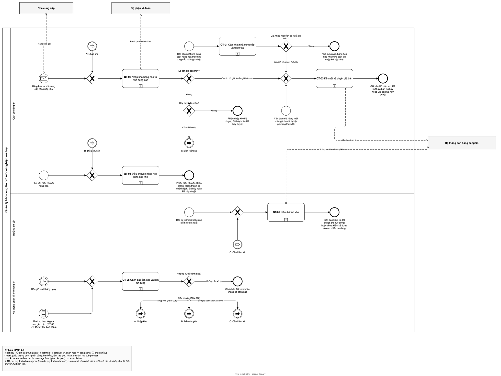
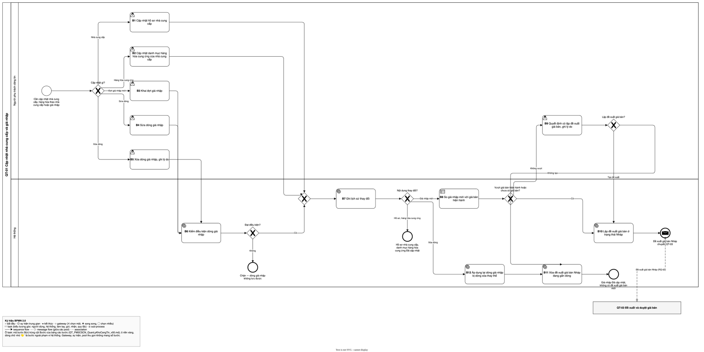
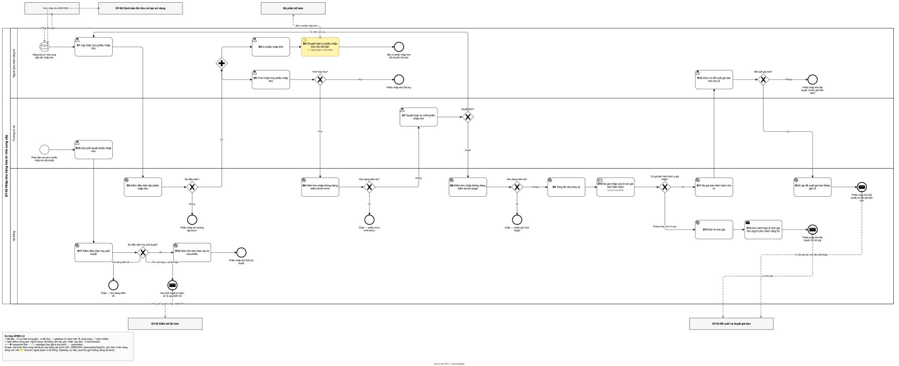
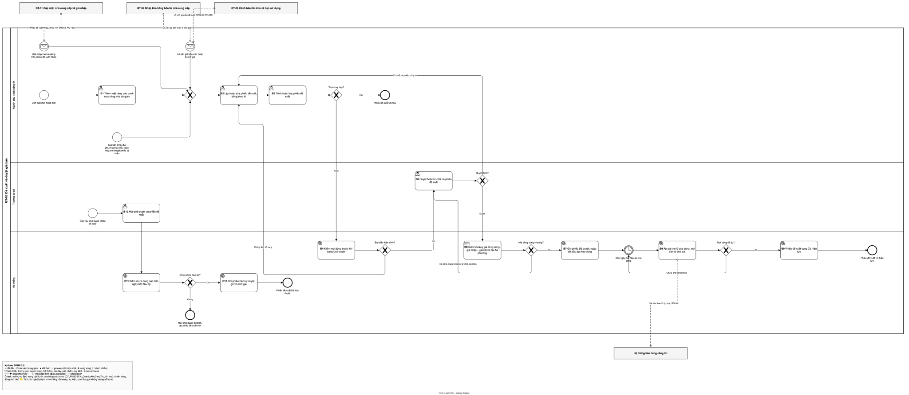
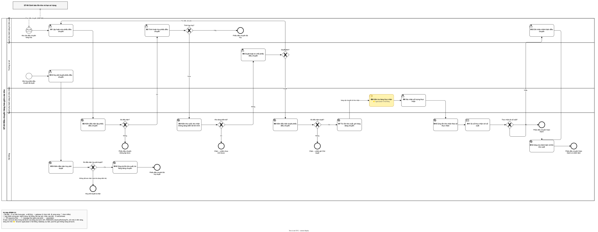
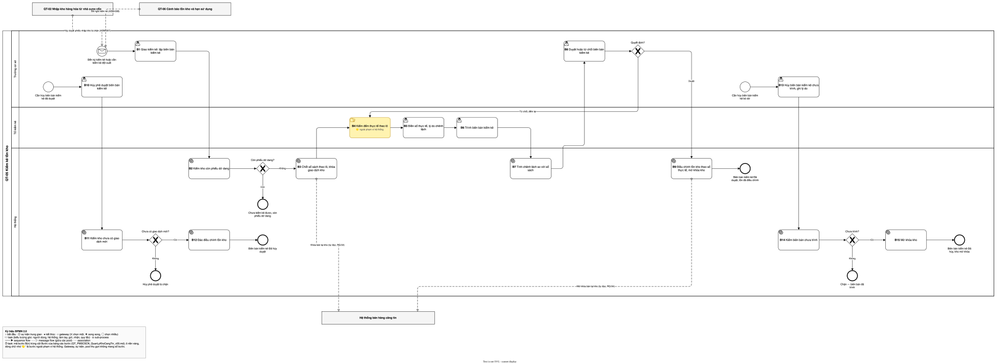
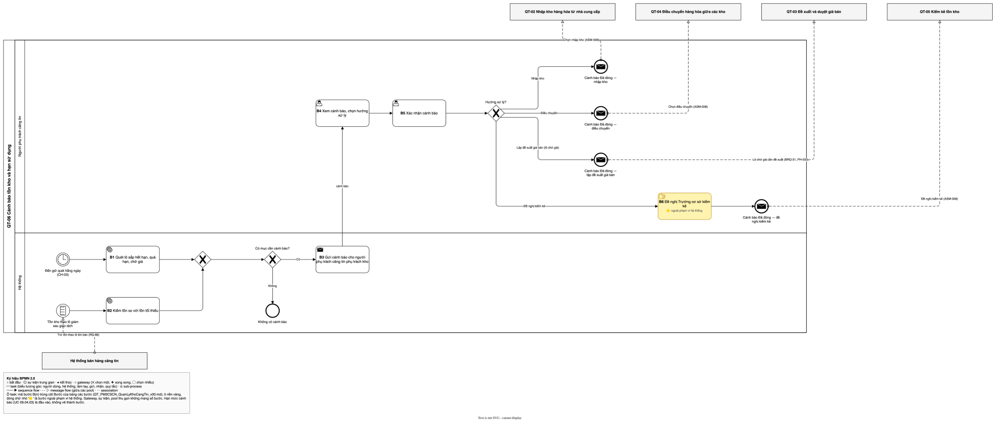

# QUY TRÌNH QUẢN LÝ KHO CĂNG TIN — Quản lý kho căng tin

> **6 quy trình, 4 tác vụ nền và 4 tham số cấu hình** của quản lý kho căng tin (nhà cung cấp và giá nhập; nhập kho; giá bán; điều chuyển; kiểm kê; cảnh báo), dựng từ bản đồ quy trình bước 1 (QT-01 → QT-06, BA chốt — RQ-47, RQ-119), quy trình presales `QP-01` → `QP-07`, prototype presales (giá nhập), BRD, TT79 và câu trả lời của BA (RQ-01 → RQ-163).
> Mỗi quy trình gồm **bảng các bước** kèm căn cứ và chứng từ, **một sơ đồ BPMN 2.0 (draw.io)**, **bảng trường hợp biên** và **điểm kiểm soát**.
> Nút trong sơ đồ mang **đúng số bước của bảng** — `B1`, `B2`… — để đối chiếu hai chiều. Nút không mang số gồm: sự kiện bắt đầu; sự kiện trung gian hẹn giờ; sự kiện kết thúc, kể cả kết thúc chặn và kết thúc gửi thông điệp sang quy trình khác; cổng rẽ nhánh hoặc cổng gộp (cổng chỉ hỏi kết quả của bước ngay trước, theo skill ba-bpmn); pool thu gọn của quy trình khác hoặc hệ thống, đơn vị ngoài.
> Cột **Căn cứ** dẫn **văn bản pháp luật** (`TT79 Đ41.4`) · **`D-xx`** ở mục 4 · **`CH-xx`** ở mục 6 · **`GS-xx`** ở mục 3.1 · giả định của sổ (bôi đỏ) · giả định bước 1 `ASM-00n` (BA xác nhận — RQ-116) · `BRQ-xx`, `NFR-xx`, `CON-xx` của BRD · câu trả lời của BA `RQ-nn` (loại nguồn "BA xác nhận") · bước presales `QP-xx.yy` · UC presales `PS:<mã>` · màn presales `MP-xxx` và mã nguồn prototype `[SRC]`; sau lượt điền ngược thêm mã BR. ❓ kèm `Q-Pnn` là chỗ còn chờ chốt (mục 11.3).
> 🟡 **Ngoài phạm vi hệ thống** — bước tô vàng là nghĩa vụ có thật nhưng không xây chức năng; giữ lại để thấy đủ luồng.
> Giá trị liệt kê viết **tên tiếng Việt**. Mã kỹ thuật ở ERD — [`ERD_PM3CSCN_QuanLyKhoCangTin_v02.md`](../3-erd/ERD_PM3CSCN_QuanLyKhoCangTin_v02.md).
> Tài liệu **không** chứa màn hình, nút, API, tên bảng, mã trạng thái, vòng đời trạng thái, danh sách use case, nội dung từng business rule — xem ERD ([`ERD_PM3CSCN_QuanLyKhoCangTin_v02.md`](../3-erd/ERD_PM3CSCN_QuanLyKhoCangTin_v02.md)), máy trạng thái (`chờ lớp 4`), tác nhân và use case ([`UCD_PM3CSCN_QuanLyKhoCangTin_v00.md`](../5-actor-usecase/UCD_PM3CSCN_QuanLyKhoCangTin_v00.md), [`UCL_PM3CSCN_QuanLyKhoCangTin_v00.md`](../5-actor-usecase/UCL_PM3CSCN_QuanLyKhoCangTin_v00.md)), business rule (`chờ lớp 6`).

## Thông tin tài liệu

| Mục | Nội dung |
|---|---|
| Mã tài liệu | `QT_PM3CSCN_QuanLyKhoCangTin` |
| Dự án · Phân hệ | Quản lý kho căng tin (mã dự án PM3CSCN, nền tảng WEB — RQ-69) · Ba phân hệ presales: QUẢN LÝ KHO CĂNG TIN; CẤU HÌNH NGHIỆP VỤ HỆ THỐNG (danh mục hàng hóa và giá bán căng tin); QUẢN LÝ NHÀ CUNG CẤP HÀNG HÓA CĂNG TIN — một bộ tài liệu cho cả ba (RQ-70) |
| Phiên bản · Trạng thái | v02 · Chờ review |
| Người soạn · Người review · Người duyệt | phongnq12 — BA (AI hỗ trợ soạn) · chưa chốt (BA lead) · chưa chốt (BA) |
| Mức mật | Nội bộ |
| Tài liệu cấp trên | `../1-brd/BRD_PM3CSCN_QuanLyKhoCangTin_v02.md` |

## Version control

| Tên version | Ngày cập nhật | PIC | Mô tả |
| :--- | :--- | :--- | :--- |
| v00 | 2026-10-29 | phongnq12 | - Khởi tạo tài liệu (/ba-overview đợt 2, lớp quy trình): 6 quy trình QT-01 đến QT-06 giữ mã, trigger, kết quả, UC presales của bản đồ quy trình bước 1; thuật ngữ mục 1.1. - Sửa theo review độc lập vòng 1: QT-01 sửa có điều kiện, xóa dòng giá nhập, xóa đề xuất Nháp, lý do bắt buộc; QT-02, QT-04 kiểm khóa kho khi duyệt; QT-03 nhánh giá ngoài khoảng quay về Trưởng cơ sở; QT-06 hạn mức cảnh báo là đầu vào; PH-033; thêm Q-P14 → Q-P17. - BA chốt 29/10/2026: áp Q-P01 → Q-P12, Q-P14 → Q-P17 (RQ-120 → RQ-135); D-01 chốt (RQ-131); chuyển giao QT-06 → QT-03 (RQ-119). - Sửa theo review độc lập vòng 2 và BA chốt 29/10/2026 (RQ-116, RQ-136 → RQ-142): khóa kho đang kiểm kê chặn lập, trình, duyệt, hủy phê duyệt và mở khi biên bản Đã duyệt, Đã hủy duyệt hoặc lần giao bị hủy; QT-05 thêm nhánh hủy lần giao kiểm kê; lô của mặt hàng chưa có giá bán được duyệt là lô chờ giá; giá bán hiện hành theo ngày hiệu lực đã tới, mỗi lô một đề xuất chờ duyệt; QT-02 thêm bước kiểm khi trình và bước lập đề xuất Nháp gắn lô; QT-04 thêm bước kiểm khi trình; QT-01 phủ quy tắc thay thế dòng, ngày bắt đầu, cặp ngừng hoạt động; thêm N-03, GS-06; chống lặp cảnh báo theo kho + lô + loại; phạm vi kho của người phụ trách căng tin. Tổng 76 bước (vòng 2); 3 tác vụ nền N-01 → N-03; 4 tham số CH-01 → CH-04; 6 quy tắc GS-01 → GS-06; 1 quyết định D-01; 30 điểm kiểm soát. Còn Q-P13 chờ lớp 3. - BA chốt bảng bước 29/10/2026 (RQ-143 → RQ-146): QT-01 → QT-04 và chuyển giao chốt nguyên trạng; QT-05 gộp giao kiểm kê và biên bản kiểm kê thành một chứng từ "biên bản kiểm kê" (RQ-145), 15 bước; QT-06 cảnh báo không tự đóng, chỉ đóng khi người phụ trách căng tin xác nhận, thêm bước xác nhận (RQ-146), 6 bước; GS-06, N-01, N-03 sửa theo. Tổng 78 bước. - Chờ lớp sau điền: đường dẫn ERD ở khối giới thiệu và cột Thực thể ERD mục 1.1 (chờ lớp 3); mục 10 (chờ lớp 5); mã BR ở cột Căn cứ và dòng Business rule mục 1 (lớp 6, lượt điền ngược). - Sơ đồ vẽ BPMN 2.0 draw.io theo skill ba-bpmn thay khối Mermaid của template (quy ước của kit); bản đồ mục 3 nhúng sơ đồ cấp 1 của bước 1, không vẽ lại. - Điền từ ERD_PM3CSCN_QuanLyKhoCangTin_v02, không đổi nghĩa: mục 1.1 cột Thực thể ERD; mục 3 tên thực thể dữ liệu trục, Q-P13 ✅ lớp 3 đặt tên; đường dẫn ERD ở khối giới thiệu và bảng nguồn mục 1. |
| v01 | 2026-10-29 | phongnq12 | - Bổ sung theo lớp 3 (ERD E-05, E-06, E-08, E-11, E-12, E-13), thay đổi có nghĩa sau commit faf80196, về Chờ review (RQ-148 → RQ-163): phạm vi nhiều cơ sở, dữ liệu riêng từng cơ sở (RQ-151, RQ-152) ở mục 1, 2, mục 9 điểm 30; phân công kho do Trưởng cơ sở (RQ-148, PH-034); thêm N-04 đối soát tồn kho theo lô với sổ biến động (RQ-153, RQ-154); N-03 xét mọi giá Đã duyệt có ngày hiệu lực ≤ ngày chạy, QT-03 bước 7 duyệt khi ngày hiệu lực đã tới thì giá sang Có hiệu lực ngay (RQ-123, RQ-139, RQ-160); tên trạng thái Đã xác nhận thực nhận (QT-04 bước 11) và Chưa xem (QT-06 bước 3); QT-05 bước 2 mỗi kho một biên bản đang mở, biên bản gồm mọi lô có dòng tồn kể cả số sách 0, lý do chênh lệch bắt buộc khi có chênh lệch, thành viên tổ ghi họ tên, chỉ người có tài khoản điền và trình (RQ-155, RQ-156, RQ-162); QT-01 bước 5 xóa dòng cuối thì đợt giá nhập bị xóa mềm (RQ-163). 4 tác vụ nền N-01 → N-04. Số bước không đổi (78). - BA chốt 29/10/2026: RQ-165 → RQ-169 (theo ERD vòng 2): số lượng dòng phiếu nhập kho, phiếu điều chuyển là số nguyên > 0 (RQ-165); ngày bắt đầu áp giá là ngày muộn hơn giữa ngày hiệu lực và ngày duyệt — QT-03 bước 7, N-03 (RQ-166); dòng giá nhập đã phát sinh chỉ khi phiếu nhập kho đã trình trở đi (RQ-167); phân công kho không ghi nhật ký (RQ-168); cảnh báo "Tồn lệch sổ biến động" của N-04 gửi Trưởng cơ sở và người phụ trách kho, chỉ Trưởng cơ sở xác nhận đóng — QT-06 thêm bước 7 → 9, làn Trưởng cơ sở (RQ-169); QT-01 bước 11 xóa đề xuất Nháp kèm lô áp dụng, tệp đính kèm, nhật ký giữ (ERD). Tổng 81 bước. - BA chốt 29/10/2026: RQ-170 → RQ-181 (theo lớp 4): công tắc Cho phép bán, Cho phép đặt hàng theo mặt hàng × kho là cấu hình danh mục, không là quy trình (RQ-170 → RQ-172); mặt hàng ngừng hoạt động chặn lập mới phiếu nhập, đề xuất giá, giá nhập; kích hoạt lại mặt hàng, nhà cung cấp (RQ-171, RQ-173); người lập không hủy chứng từ Chờ duyệt, lý do bắt buộc khi hủy và hủy phê duyệt (RQ-174, RQ-175); cảnh báo tồn lệch chuyển Đã xem ở lần xem đầu của bất kỳ người nhận (RQ-176); QT-05 bước 11 thêm điều kiện không có biên bản khác đang mở (RQ-177); chứng từ chưa trình treo không thời hạn (RQ-178); giữ bước kiểm lại khóa kho chống tranh chấp (RQ-179); QT-02 bước 17 thêm điều kiện lô không trên đề xuất chưa đóng (RQ-180); hủy phê duyệt do vai Trưởng cơ sở của cơ sở (RQ-181); mục 9 thêm điểm 31; cột Thực thể ERD của Hạn mức cảnh báo, Cho phép bán, Cho phép đặt hàng theo ERD v01 (`Mat_Hang_Kho`). Số bước không đổi (81). - Điền từ UCD_PM3CSCN_QuanLyKhoCangTin_v00, UCL_PM3CSCN_QuanLyKhoCangTin_v00, không đổi nghĩa: mục 10 Quy trình chưa có Use case (dòng *Không có*); khối giới thiệu dẫn UCD, UCL thay `chờ lớp 5`. |
| **v02 (hiện tại)** | **2026-10-29** | phongnq12 | - Bổ sung theo lớp 5, thay đổi có nghĩa, về Chờ review (BA chốt 29/10/2026: RQ-183 → RQ-198): đề xuất giá bán thành phiếu nhiều dòng theo lô — QT-03 viết lại 12 bước (lập, trình, kiểm khoảng giá từng dòng, duyệt hoặc từ chối cả phiếu, `N-03` áp theo dòng, phiếu Có hiệu lực khi mọi dòng đã áp, hủy phê duyệt cả phiếu khi chưa dòng nào áp — RQ-191, RQ-197, RQ-198); QT-01 bước 10, 11 và QT-02 bước 13 lập phiếu Nháp hoặc thêm dòng (RQ-190, RQ-193); GS-01, GS-04, N-03, mục 8.2, mục 9 điểm 14 → 18 sửa theo dòng; mục 2 thêm Hệ thống xác thực dùng chung (RQ-149, RQ-196); mục 9 điểm 8 tách nhiệm biên bản kiểm kê (RQ-195); điểm 30 phạm vi kho, cơ sở (RQ-184, RQ-185). Tổng 82 bước. - Sửa không đổi nghĩa: mục 9 điểm 7 dẫn hủy phê duyệt phiếu đề xuất là QT-03 bước 10; mục 1 Ngoài phạm vi bỏ số đếm UC tra cứu, dẫn UCL. |

## Phê duyệt

| Vai trò | Họ tên | Ngày | Ý kiến |
|---|---|---|---|
| BA soạn | | | |
| Product owner / Khách hàng | | | |
| Tech lead | | | |

---

## 1. Phạm vi và nguồn

**Trong phạm vi:** Một bản cài đặt phục vụ nhiều cơ sở cai nghiện; kho, mặt hàng, nhà cung cấp, giá nhập, giá bán, chứng từ thuộc riêng một cơ sở, người dùng chỉ thấy dữ liệu cơ sở mình (RQ-151, RQ-152; BRD NFR-10). Mọi quy trình dưới đây chạy trong phạm vi một cơ sở. Ai khai báo cơ sở: chưa chốt (BA) — BRD Q-B36. Phân công người phụ trách căng tin theo kho do Trưởng cơ sở thực hiện, là danh mục, không là quy trình (RQ-148, PH-034). Quy trình: Cập nhật nhà cung cấp và giá nhập (QT-01) · Nhập kho hàng hóa từ nhà cung cấp (QT-02) · Đề xuất và duyệt giá bán (QT-03) · Điều chuyển hàng hóa giữa các kho (QT-04) · Kiểm kê tồn kho (QT-05) · Cảnh báo tồn kho và hạn sử dụng (QT-06) · Đồng bộ dữ liệu kho với phần mềm quản lý cơ sở cai nghiện — tác vụ nền `N-02`, không là quy trình (`D-01`).

Mã quy trình giữ `QT-nn` của bản đồ quy trình bước 1 (BA chốt — RQ-47), không đổi sang dạng `{XX}-nn` của template, để mọi bước sau dẫn cùng một mã.

**Ngoài phạm vi:**
- Bán hàng cho người cai nghiện ma túy, trừ tồn theo lô khi bán — Hệ thống bán hàng căng tin (RQ-03, `TT79 Đ41.7`); tài liệu này chỉ nối vào qua mục 5.1 và dữ liệu Hệ thống bán hàng căng tin tự đọc (RQ-54).
- Tìm kiếm, xem chi tiết, kết xuất chứng từ, danh mục, lịch sử (UC tra cứu — UCL_PM3CSCN_QuanLyKhoCangTin_v00; BRQ-25 Truy lại chứng từ) và xem tồn kho hiện tại (RQ-88) — chỉ đọc dữ liệu của QT-01 → QT-05, không có sự kiện kích hoạt và kết quả nghiệp vụ riêng nên không có quy trình (bản đồ quy trình bước 1 mục 6.1); đặc tả ở lớp 5.
- Khai báo danh sách kho (`PS:PM3CSCN.WEB.09.04.01`, `PS:PM3CSCN.WEB.09.04.02`; BRQ-21 Danh sách kho) — danh mục dùng chung, không có sự kiện kích hoạt và kết quả nghiệp vụ riêng nên không có quy trình (bản đồ quy trình bước 1 mục 6.1); đặc tả ở lớp 5.
- Thiết lập hạn mức cảnh báo (`PS:PM3CSCN.WEB.09.04.03`) và quản lý danh mục hàng hóa căng tin ngoài việc thêm mặt hàng (sửa, ngừng hoạt động, kích hoạt lại mặt hàng — `PS:PM3CSCN.WEB.10.01.01`; kích hoạt lại không cần duyệt, ghi nhật ký — RQ-171, RQ-173) — danh mục, làm đầu vào cho QT-01, QT-03, QT-06, không có bước; đặc tả ở lớp 5.
- Công tắc Cho phép bán, Cho phép đặt hàng của mỗi mặt hàng tại mỗi kho — cấu hình danh mục, không là quy trình: người phụ trách căng tin của kho bật, tắt, không duyệt, ghi nhật ký; mặc định cả hai bật (RQ-170, RQ-172). Cho phép bán là dữ liệu kho cung cấp cho việc bán (mục 5.1, BRQ-24 Dữ liệu cho bán hàng); Cho phép đặt hàng định nghĩa trước, nghiệp vụ đặt hàng ngoài phạm vi lần này **<u>GD-0004</u>**.
- Phiếu đặt hàng hóa từ đơn hàng (mua hộ khi cơ sở không có căng tin) — ngoài phạm vi lần này **<u>GD-0004</u>**, BRD mục 15 TH-01.
- Tính chi phí hợp lý — làm bên ngoài hệ thống **<u>GD-0001</u>**; BRD mục 3.
- Kế toán thao tác trên hệ thống — BRD mục 15 TH-03 (RQ-79); bản in phiếu nhập kho chuyển cho kế toán ngoài hệ thống (QT-02 bước 4 🟡).
- Xuất kho khác ngoài điều chuyển (RQ-02); thu giữ, xử lý chất cấm, đồ vật cấm (`TT79 Đ17`, `TT79 Đ18`) — BRD mục 3, không sinh quy trình.

| Nguồn | Đường dẫn | Vai trò |
|---|---|---|
| BRD | `../1-brd/BRD_PM3CSCN_QuanLyKhoCangTin_v02.md` | Mục tiêu, phạm vi, BRQ, NFR, CON-05, tên vai người (mục 4) |
| Business rule | chưa có (lớp 6 chạy sau) | Ràng buộc pháp lý — điền ở lượt điền ngược |
| ERD | `../3-erd/ERD_PM3CSCN_QuanLyKhoCangTin_v02.md` | Tên bảng, tên trường, mã enum của thuật ngữ mục 1.1 và dữ liệu trục mục 3 |
| Thông tư 79/2026/TT-BCA — viết tắt `TT79`; `TT79 Đ41.4` = `PL:TT79-2026/Đ41.K4` | 79/2026/TT-BCA — Điều 5, 16, 41 · `../../0-inputs/phap-ly/TT79/1. Thông tư số 79.docx`; danh mục `../../1-ba-init/0-dau-vao/phap-ly.md` | Đ41.4: duyệt giá bán, trần giá bán lẻ tại địa phương → QT-03; Đ16.1–Đ16.8: chất cấm, đồ vật cấm → QT-03 bước 5; Đ41.7: hệ thống bán hàng căng tin → mục 5.1; Đ5.1.a: bối cảnh kết nối của phần mềm quản lý cơ sở cai nghiện, nghĩa vụ đồng bộ của kho do BA xác nhận (RQ-91) và giả định tạm **<u>GD-0007</u>** → `N-02`. Các điều khác đã rà ở BRD mục 1.3, không sinh quy trình |
| Nghị định 163/2026/NĐ-CP — viết tắt `NĐ163` | `../../0-inputs/phap-ly/Nghị định 163/NGHỊ ĐỊNH 163.docx` | Đã rà toàn văn, không sinh quy trình — Đ120.3 cùng nghĩa `TT79 Đ41.4` (RQ-49) |
| Bản đồ quy trình bước 1 (BA chốt — RQ-47, RQ-119) | `../../1-ba-init/0-dau-vao/ban-do-quy-trinh/ban-do-quy-trinh.md`, `cap-2/QT-nn-*/QT-nn.md` | Danh sách QT, trigger, kết quả, UC presales, chuyển giao, hệ thống ngoài |
| Quy trình presales `QP-01` → `QP-07` | `../../1-ba-init/0-dau-vao/quy-trinh-presales.md` | Nguồn chính của bảng bước, cổng, kết thúc; presales không gắn UC cho bước nào **<u>GD-0005</u>** |
| UC presales, màn presales, ma trận UC × pháp lý | `../../1-ba-init/0-dau-vao/uc-presales.md`; `man-presales.md`; `uc-phap-ly.md` | Mã `PS:`, `MP-xxx`; căn cứ điều khoản của QT-01, QT-03 |
| Mã nguồn prototype giá nhập | `../../0-inputs/presales/prototype/src/pages/PurchasePriceShared/` (`BatchForm.jsx`, `LineEditForm.jsx`, `DeleteLineDialog.jsx`, `DecisionDialog.jsx`); `../../0-inputs/presales/prototype/src/data/purchasePriceStore.js` | Luồng khách đã thấy của QT-01: so giá, khai, sửa, xóa, thay thế dòng giá nhập, quyết định giá bán |
| Câu trả lời của BA (loại nguồn "BA xác nhận") | `../../0-inputs/answers-2026-10-28.md`; `../../0-inputs/answers-2026-10-29.md` | RQ-01 → RQ-142: vai trò, điều kiện, ngoại lệ, đường vòng |
| Sổ giả định; sổ câu hỏi bước 1, dự án | `../assumption_log.md`; `../../1-ba-init/open-questions.md`; `../../du-an/open-questions.md` | GD-0001 → GD-0008; ASM-004, ASM-007, ASM-008 (BA xác nhận — RQ-116); PH-017 → PH-027, PH-033 |

### 1.1. Thuật ngữ

Các loại khóa định nghĩa ở mục 3, quy tắc `GS-xx` ở mục 3.1, tham số `CH-xx` ở mục 6. Thuật ngữ cấp tổ chức (Trưởng cơ sở, người phụ trách căng tin, tổ kiểm kê, Hệ thống bán hàng căng tin…) ở BRD mục 5 và `du-an/glossary.md`, không định nghĩa lại.

#### a. Kho, hàng hóa và tồn kho

| Thuật ngữ | Định nghĩa | Thực thể ERD |
|---|---|---|
| **Kho** | Nơi giữ hàng hóa căng tin; các kho ngang hàng, mỗi kho có người phụ trách căng tin được phân công (RQ-01, RQ-95) | `Kho` |
| **Kho được phân công** | Kho mà một người phụ trách căng tin được giao; một người có thể được giao nhiều kho; chỉ lưu phân công hiện tại, không ghi nhật ký thay đổi (RQ-95, RQ-142, RQ-168) | `Phan_Cong_Kho` |
| **Mặt hàng** | Một dòng của danh mục hàng hóa căng tin (RQ-17) | `Mat_Hang` |
| **Danh mục hàng hóa cung ứng** | Danh sách mặt hàng mà một nhà cung cấp cung ứng; mỗi dòng là một cặp nhà cung cấp – mặt hàng (RQ-16) | `Mat_Hang_Nha_Cung_Cap` |
| **Ngừng hoạt động** | Tình trạng của cặp nhà cung cấp – mặt hàng khi nhà cung cấp Ngừng hợp tác hoặc mặt hàng ngừng hoạt động hoặc bị xóa (`[SRC: 0-inputs/presales/prototype/src/pages/PurchasePriceShared/LineEditForm.jsx, dòng 83]`). Mặt hàng ngừng hoạt động ở cấp danh mục: không lập mới phiếu nhập kho, đề xuất giá bán, dòng giá nhập; chứng từ đang mở đi tiếp; kích hoạt lại được (RQ-171, RQ-173) | Δ `ngung_hoat_dong` trên `Mat_Hang_Nha_Cung_Cap` |
| **Cho phép bán** | Công tắc của một mặt hàng tại một kho; tắt thì Hệ thống bán hàng căng tin không bán mặt hàng đó tại kho; người phụ trách căng tin của kho bật, tắt, không duyệt, ghi nhật ký; mặc định bật; kho × mặt hàng chưa có dòng thì dùng mặc định (RQ-170, RQ-171, RQ-172) | `Mat_Hang_Kho.cho_phep_ban` |
| **Cho phép đặt hàng** | Công tắc của một mặt hàng tại một kho, định nghĩa trước cho nghiệp vụ đặt hàng ngoài phạm vi lần này; mặc định bật (RQ-170, RQ-172) | `Mat_Hang_Kho.cho_phep_dat_hang` |
| **Hồ sơ nhà cung cấp** | Thông tin một nhà cung cấp, ở một trong hai trạng thái Đang hoạt động, Ngừng hợp tác, kèm họ tên, điện thoại người liên hệ (RQ-16, RQ-20, RQ-104) | `Nha_Cung_Cap` |
| **Lô** | Phần hàng hóa của một mặt hàng nhập cùng một phiếu nhập kho, có số lô, hạn sử dụng (RQ-14) | `Lo` |
| **Tồn kho theo lô** | Số lượng của một lô đang có tại một kho; biến động theo mục 3 | `Ton_Kho_Lo` · `Bien_Dong_Ton` |
| **Hàng đang chuyển** | Số lượng của một lô đã trừ khỏi tồn kho xuất khi phiếu điều chuyển được duyệt, chưa được kho nhận xác nhận hoặc kho xuất ghi nhận chênh lệch (RQ-06) | Δ `hang_dang_chuyen` trên `Phieu_Dieu_Chuyen_Dong` |
| **Số sách** | Tồn kho theo lô của một kho do hệ thống ghi nhận, chốt tại thời điểm bắt đầu kiểm kê (RQ-12) | `Bien_Ban_Kiem_Ke_Dong.so_sach` |
| **Số thực tế** | Số lượng của một lô do tổ kiểm kê đếm được, ghi trên biên bản kiểm kê (RQ-07) | `Bien_Ban_Kiem_Ke_Dong.so_thuc_te` |
| **Chênh lệch kiểm kê** | Hiệu số thực tế và số sách của một lô — `GS-02` | Δ `chenh_lech` trên `Bien_Ban_Kiem_Ke_Dong` |
| **Lô chờ giá** | Lô bị giữ, không được bán, vì giá nhập của lô lớn hơn giá bán hiện hành lúc phiếu nhập kho được duyệt, hoặc vì mặt hàng của lô chưa có giá bán được duyệt; chờ giá bán được duyệt (RQ-11, RQ-13, RQ-41, RQ-122); khóa ở mục 3 | Δ `lo_cho_gia` trên `Lo` |
| **Lô sắp hết hạn** | Lô còn tồn mà số ngày còn lại tới hạn sử dụng tới ngưỡng `CH-02` của kho — `GS-03` | Δ `lo_sap_het_han` trên `Lo` |
| **Lô quá hạn** | Lô còn tồn đã qua hạn sử dụng (RQ-30) | Δ `lo_qua_han` trên `Lo` |
| **Phiếu dở dang** | Phiếu nhập kho, phiếu điều chuyển chờ duyệt của một kho, và phiếu điều chuyển đã duyệt chưa hoàn thành (hàng đang chuyển tới, đi khỏi kho đó) (QP-06.03, RQ-12, RQ-39, RQ-125) | Δ `phieu_dang_do` trên `Kho` |
| **Hạn mức cảnh báo** | Tồn tối thiểu theo kho × mặt hàng (`CH-01`) và số ngày cảnh báo sắp hết hạn N theo kho (`CH-02`) (RQ-28, RQ-31, RQ-33) | `Mat_Hang_Kho` · `Kho.so_ngay_canh_bao_het_han` |
| **Cảnh báo** | Thông báo hệ thống gửi người phụ trách căng tin phụ trách kho về tồn dưới mức tối thiểu, lô sắp hết hạn, lô quá hạn hoặc lô chờ giá; mở tới khi người phụ trách căng tin xác nhận — `GS-06` (RQ-146) (QP-07.04, RQ-95) | `Canh_Bao` |
| **FEFO** | Cách Hệ thống bán hàng căng tin trừ tồn khi bán: lô có hạn sử dụng gần nhất trước (RQ-19) | — (không lưu, ERD mục 2 Không lưu) |

#### b. Giá

| Thuật ngữ | Định nghĩa | Thực thể ERD |
|---|---|---|
| **Giá nhập** | Giá nhà cung cấp bán hàng hóa cho cơ sở, theo nhà cung cấp, mặt hàng và đợt nhập (RQ-04) | `Dong_Gia_Nhap.gia_nhap` · `Lo.gia_nhap` |
| **Đợt giá nhập** | Nhóm dòng giá nhập khai cùng lúc cho một nhà cung cấp, có số hiệu căn cứ, tệp căn cứ, hiệu lực từ, đến (MP-004) | `Dot_Gia_Nhap` |
| **Dòng giá nhập** | Giá nhập của một cặp nhà cung cấp – mặt hàng trong một đợt, ở một trong bốn hiệu lực Khai trước, Hiện hành, Đã thay thế, Hết hiệu lực (`du-an/glossary.md`; MP-001, MP-002; `[SRC: 0-inputs/presales/prototype/src/data/purchasePriceStore.js, dòng 18]`) | `Dong_Gia_Nhap` |
| **Dòng giá nhập thay thế** | Dòng mới của cùng cặp bắt đầu trong hiệu lực của dòng cũ và thay thế dòng cũ từ ngày bắt đầu; dòng cũ sang Đã thay thế (`[SRC: 0-inputs/presales/prototype/src/data/purchasePriceStore.js, dòng 4, 130–131]`) | Δ `dong_bi_thay_the` trên `Dong_Gia_Nhap` |
| **Dòng giá nhập đã phát sinh** | Dòng giá nhập đã được dùng làm giá nhập của ít nhất một phiếu nhập kho đã trình trở đi (Chờ duyệt, Đã duyệt, Đã hủy duyệt); phiếu chưa trình, Đã hủy, bị từ chối không tính (MP-002 bảng "Phát sinh từ dòng"; RQ-167) | Δ `da_phat_sinh` trên `Dong_Gia_Nhap` |
| **Giá bán** | Giá bán tại căng tin do Trưởng cơ sở duyệt, gắn theo lô — `GS-01` (`TT79 Đ41.4`, RQ-21) | `De_Xuat_Gia_Ban` (đã duyệt) · `Gia_Ban_Lo` |
| **Giá bán hiện hành** | Giá bán đã duyệt của mặt hàng có ngày hiệu lực gần nhất đã tới — `GS-01` (RQ-87, RQ-139) | Δ `gia_ban_hien_hanh` trên `De_Xuat_Gia_Ban` |
| **Giá bán lẻ tại địa phương** | Mức trần của giá bán, so với hàng hóa cùng loại, ghi trên đề xuất giá bán kèm chứng từ (`TT79 Đ41.4`, RQ-112) | `De_Xuat_Gia_Ban.gia_ban_le_dia_phuong` |
| **Chi phí hợp lý** | Khoản được tính khi duyệt giá bán, tính bên ngoài hệ thống (`TT79 Đ41.4`, RQ-112) | `De_Xuat_Gia_Ban.chi_phi_hop_ly` |
| **Ngày hiệu lực** | Ngày giá bán đã duyệt bắt đầu áp cho các lô ghi trên đề xuất (RQ-23, RQ-25) | `De_Xuat_Gia_Ban.ngay_hieu_luc` |

#### c. Chứng từ kho và giá

| Thuật ngữ | Định nghĩa | Thực thể ERD |
|---|---|---|
| **Phiếu nhập kho** | Chứng từ ghi hàng hóa nhập từ một nhà cung cấp vào một kho, mỗi dòng một lô có số lô, hạn sử dụng, số lượng, giá nhập (RQ-05, RQ-14) | `Phieu_Nhap_Kho` · `Lo` |
| **Phiếu nhập kho đầu kỳ** | Phiếu nhập kho lập cho hàng đang tồn khi bắt đầu vận hành; đi đúng QT-02 (RQ-98, RQ-105) | `Phieu_Nhap_Kho` |
| **Bản in phiếu nhập kho** | Bản giấy của phiếu nhập kho theo mẫu dự án tự thiết kế, phục vụ lưu trữ kế toán (RQ-57, RQ-60) | — (không lưu, ERD mục 2 Không lưu) |
| **Phiếu điều chuyển** | Chứng từ chuyển hàng hóa theo lô từ kho xuất sang kho nhận (RQ-06, RQ-15) | `Phieu_Dieu_Chuyen` · `Phieu_Dieu_Chuyen_Dong` |
| **Số thực nhận** | Số lượng của một lô kho nhận xác nhận đã nhận (RQ-26) | `Phieu_Dieu_Chuyen_Dong.so_thuc_nhan` |
| **Chênh lệch điều chuyển** | Hiệu số xuất và số thực nhận của một lô — `GS-05` (RQ-29) | Δ `chenh_lech_dieu_chuyen` trên `Phieu_Dieu_Chuyen_Dong` |
| **Giao kiểm kê** | Việc Trưởng cơ sở lập biên bản kiểm kê cho một kho, ghi kho và tổ kiểm kê; không là chứng từ riêng (QP-06.02, BRQ-18, RQ-145) | `Bien_Ban_Kiem_Ke` |
| **Biên bản kiểm kê** | Chứng từ do Trưởng cơ sở lập khi giao kiểm kê (kho, tổ kiểm kê), ghi cho từng lô của kho số sách, số thực tế, chênh lệch và lý do chênh lệch; ở một trong các trạng thái Đang kiểm kê, Chờ duyệt, Đã duyệt, Đã hủy, Đã hủy duyệt (RQ-07, RQ-145, BRQ-19) | `Bien_Ban_Kiem_Ke` · `Bien_Ban_Kiem_Ke_Dong` · `Thanh_Vien_Kiem_Ke` |
| **Phiếu đề xuất giá bán** | Phiếu đề nghị giá bán gồm nhiều dòng theo lô, có người lập, cơ sở, trạng thái (Nháp, Chờ duyệt, Đã duyệt, Có hiệu lực, Bị từ chối, Đã hủy, Đã hủy duyệt), người duyệt, thời điểm, lý do; Trưởng cơ sở duyệt hoặc từ chối cả phiếu (RQ-08, RQ-191, RQ-197); gọi tắt "đề xuất giá bán" | `De_Xuat_Gia_Ban` |
| **Dòng đề xuất giá bán** | Một dòng của phiếu đề xuất: mặt hàng, lô, giá bán đề xuất, ngày hiệu lực, giá bán lẻ tại địa phương kèm chứng từ, giá nhập của lô (hệ thống tham chiếu), chi phí hợp lý (không bắt buộc); ngày bắt đầu áp riêng theo dòng (RQ-23, RQ-112, RQ-166, RQ-191) | `De_Xuat_Gia_Ban_Dong` |
| **Đồ vật cấm, chất cấm** | Thứ cấm đưa vào cơ sở theo `TT79 Đ16.1`–`Đ16.8` (RQ-24) | — (không lưu, ERD mục 2 Không lưu) |

#### d. Phê duyệt và chứng từ

| Thuật ngữ | Định nghĩa |
|---|---|
| **Trình** | Người phụ trách căng tin gửi phiếu nhập kho, phiếu điều chuyển, đề xuất giá bán cho Trưởng cơ sở; chứng từ sang Chờ duyệt (QP-03.03, QP-04.04, QP-05.03) |
| **Duyệt** | Trưởng cơ sở chấp thuận chứng từ Chờ duyệt; chứng từ sang Đã duyệt, hệ thống ghi người duyệt, thời điểm (RQ-05, RQ-07, RQ-15, BRQ-05) |
| **Từ chối** | Trưởng cơ sở không chấp thuận, kèm lý do; phiếu, đề xuất trả về người lập; biên bản kiểm kê trả về tổ kiểm kê (RQ-34) |
| **Hủy** | Người lập bỏ phiếu, đề xuất chưa trình (Nháp hoặc bị từ chối), kèm lý do; chứng từ sang Đã hủy. Chứng từ Chờ duyệt không được người lập hủy, phải chờ Trưởng cơ sở từ chối (QP-03.16, QP-04.11, QP-05.14, RQ-34, RQ-174, RQ-175). Trưởng cơ sở hủy biên bản kiểm kê chưa trình; biên bản sang Đã hủy (RQ-137, RQ-145) |
| **Hủy phê duyệt** | Trưởng cơ sở của cơ sở (cùng vai, không bắt buộc đúng người đã duyệt) rút lại phê duyệt một chứng từ đã duyệt, kèm lý do; chứng từ sang Đã hủy duyệt, đóng hẳn (RQ-35, RQ-38, RQ-40, RQ-175, RQ-181) |
| **Xác nhận thực nhận** | Người phụ trách căng tin kho nhận ghi số thực nhận của phiếu điều chuyển Đã duyệt (RQ-06, RQ-26) |
| **Ghi nhận chênh lệch** | Người phụ trách căng tin kho xuất ghi nhận phần chênh lệch điều chuyển (RQ-26, RQ-29) |

---

## 2. Tác nhân

| Tác nhân | Vai trò trong quản lý kho căng tin | Căn cứ |
|---|---|---|
| **Người phụ trách căng tin** | Cập nhật hồ sơ nhà cung cấp, danh mục hàng hóa cung ứng; khai đợt giá nhập, sửa, xóa dòng giá nhập; quyết định có lập đề xuất giá bán (QT-01) · lập, sửa, trình, hủy, in phiếu nhập kho; chọn có đề xuất giá bán mới cho lô (QT-02) · thêm mặt hàng; lập, sửa, trình, hủy đề xuất giá bán (QT-03) · kho xuất: lập, sửa, trình, hủy phiếu điều chuyển, ghi nhận chênh lệch; kho nhận: xác nhận số thực nhận (QT-04) · xem cảnh báo, chọn hướng xử lý (QT-06) · thiết lập hạn mức cảnh báo (đầu vào QT-06). Thuộc một cơ sở (RQ-151, RQ-152); phân công theo từng kho do Trưởng cơ sở thực hiện (RQ-148, PH-034), một người phụ trách được nhiều kho; chứng từ kho và cảnh báo chỉ của kho được phân công, danh mục chung (hàng hóa, nhà cung cấp, giá) dùng chung (RQ-142); QT-04 vẽ hai làn cùng vai trò cho kho xuất, kho nhận | BRD mục 4 SH-02 · Q-001 · RQ-05, RQ-06, RQ-08, RQ-15, RQ-17, RQ-20, RQ-25, RQ-33, RQ-95, RQ-142 · tên vai theo `TT79 Đ41.2`, `Đ41.3` (RQ-66) |
| **Trưởng cơ sở** | Duyệt hoặc từ chối phiếu nhập kho, đề xuất giá bán, phiếu điều chuyển, biên bản kiểm kê · xác nhận đóng cảnh báo "Tồn lệch sổ biến động" (RQ-169) · loại đồ vật cấm khi duyệt giá đầu của mặt hàng · hủy phê duyệt bốn loại chứng từ, kèm lý do — vai Trưởng cơ sở của cơ sở, không bắt buộc đúng người đã duyệt (RQ-175, RQ-181) · giao kiểm kê (lập biên bản kiểm kê), hủy biên bản kiểm kê chưa trình · phân công người phụ trách căng tin theo kho (danh mục, không là quy trình). Thuộc một cơ sở, chỉ quyết trên chứng từ, dữ liệu của cơ sở mình | BRD mục 4 SH-01 · `TT79 Đ41.4` · RQ-05, RQ-07, RQ-15, RQ-24, RQ-40, RQ-137, RQ-145, RQ-148, RQ-151, RQ-152 · NFR-01 |
| **Tổ kiểm kê** | Kiểm đếm thực tế theo lô (🟡) · điền số thực tế, trình biên bản kiểm kê (chỉ thành viên có tài khoản — RQ-155) · đếm lại, sửa, trình lại khi biên bản bị từ chối. Thành viên ghi họ tên trên biên bản, tài khoản nếu có | BRD mục 4 SH-03 · RQ-07, RQ-34, RQ-145, RQ-155 |
| **Hệ thống** | Hệ thống quản lý kho căng tin (tên làn trên sơ đồ: "Hệ thống"): kiểm điều kiện, ghi lịch sử, tăng, giảm, điều chỉnh tồn kho theo lô, so giá, giữ lô chờ giá, lập phiếu đề xuất giá bán Nháp, thêm, xóa dòng đề xuất Nháp, áp giá bán, chốt số sách, khóa và mở khóa kho, tính chênh lệch, quét và gửi cảnh báo, đồng bộ dữ liệu, đối soát tồn (`N-01` → `N-04`) | — |
| **Hệ thống xác thực dùng chung** | Hệ thống ngoài: giữ tài khoản người dùng và cơ sở của tài khoản; phần mềm kho chỉ tham chiếu, tài khoản không xóa cứng | RQ-149 · RQ-196 |
| **Hệ thống bán hàng căng tin** | Hệ thống ngoài: tự đọc giá bán theo lô, trạng thái lô, trạng thái kiểm kê của kho; ghi thẳng phần trừ tồn theo lô khi bán (mục 5.1) | `TT79 Đ41.7` · RQ-54, RQ-86 · BRD `ASM-02` Hệ thống bán hàng căng tin tự đọc dữ liệu kho |
| **Phần mềm quản lý cơ sở cai nghiện** | Hệ thống ngoài: nhận dữ liệu kho đồng bộ (`N-02`); đầu mối kết nối cơ sở dữ liệu quốc gia | `TT79 Đ5.1.a` (bối cảnh) · RQ-91 · **<u>GD-0007</u>** |
| **Nhà cung cấp** | Đơn vị ngoài: giao hàng hóa để nhập kho (QT-02) | BRD mục 4 SH-08 · QP-01.04, QP-03.01 |
| **Bộ phận kế toán** | Đơn vị ngoài hệ thống trong phạm vi này: nhận bản in phiếu nhập kho (QT-02 bước 4 🟡) | BRD mục 4 SH-07 · RQ-57, RQ-79 |

**Tách nhiệm bắt buộc — COSO:** người phụ trách căng tin lập phiếu nhập kho, phiếu điều chuyển, đề xuất giá bán và tổ kiểm kê điền, trình biên bản kiểm kê; chỉ Trưởng cơ sở duyệt, từ chối, hủy phê duyệt các chứng từ đó (NFR-01, RQ-05, RQ-07, RQ-15, RQ-40) · người lập một chứng từ không được duyệt chính chứng từ đó, kể cả khi một người được giao cả hai vai (RQ-121). Một người phụ trách cả kho xuất và kho nhận (RQ-95) được lập phiếu điều chuyển và xác nhận thực nhận của cùng phiếu; hệ thống ghi người thực hiện từng thao tác (RQ-121). Mỗi thao tác workflow — trình, duyệt, từ chối, hủy, hủy phê duyệt, xác nhận thực nhận, ghi nhận chênh lệch, giao kiểm kê, hủy biên bản kiểm kê, sửa, xóa dòng giá nhập, xác nhận cảnh báo — là **một quyền riêng**. Ma trận quyền chi tiết đặc tả ở SRS.

---

## 3. Bản đồ quy trình và dữ liệu trục

Bản đồ quy trình cấp 1 đã vẽ ở bước 1 (BA chốt — RQ-47, RQ-119), không vẽ lại. Nguồn: `../../1-ba-init/0-dau-vao/ban-do-quy-trinh/cap-1/cap-1.drawio.svg`

Chuyển giao giữa các quy trình (cạnh của bản đồ, nhãn là điều kiện kích hoạt quy trình sau):

| Từ | Điều kiện | Đến | Cách chuyển | Căn cứ |
|---|---|---|---|---|
| QT-01 bước 10 | Giá nhập mới có dòng trên phiếu đề xuất giá bán Nháp | QT-03 | hệ thống | MP-003, MP-004 · RQ-52 |
| QT-02 bước 13 | Người phụ trách căng tin chọn đề xuất giá bán mới cho lô; hệ thống lập phiếu đề xuất Nháp hoặc thêm dòng cho lô | QT-03 | hệ thống | QP-03.12 · RQ-22, RQ-25, RQ-141, RQ-193 · PH-022 |
| QT-02 bước 15 | Lô chờ giá | QT-03 | hệ thống | QP-03.15 · RQ-11, RQ-13, RQ-122 |
| QT-02 bước 17 | Hủy phê duyệt phiếu nhập kho bị chặn vì tồn không đủ | QT-05 | thủ công | QP-03.23 · RQ-09 · ASM-007 (BA xác nhận — RQ-116) |
| QT-03 bước 11 | Hủy phê duyệt phiếu đề xuất bị chặn, lập phiếu đề xuất mới | QT-03 (sự kiện bắt đầu mới) | thủ công | QP-04.19 · RQ-198 |
| QT-06 bước 4 | Chọn nhập kho / điều chuyển | QT-02 / QT-04 | thủ công | QP-07.05 · ASM-008 (BA xác nhận — RQ-116) |
| QT-06 bước 5 | Đề nghị kiểm kê | QT-05 | thủ công | QP-07.05 · ASM-008 (BA xác nhận — RQ-116) |
| QT-06 bước 4 | Chọn lập đề xuất giá bán cho lô chờ giá | QT-03 | thủ công | BRQ-31 · RQ-41 · PH-033 · RQ-119 |

**Bảng dữ liệu trục:**

| Bảng | Trả lời | Ai ghi |
|---|---|---|
| Tồn kho theo lô — `Ton_Kho_Lo` (số dư), `Bien_Dong_Ton` (biến động) | Kho K đang có bao nhiêu của lô L? | QT-02 tăng (bước 9), giảm (bước 18) · QT-04 trừ kho xuất (bước 7), cộng kho nhận (bước 10), cộng trả kho xuất (bước 13, 16) · QT-05 điều chỉnh (bước 9), đảo (bước 12) · Hệ thống bán hàng căng tin trừ khi bán (mục 5.1) |
| Hàng đang chuyển — Δ `hang_dang_chuyen` trên `Phieu_Dieu_Chuyen_Dong` (ERD mục 4.5, E-04) | Phiếu điều chuyển P còn bao nhiêu của lô L chưa về kho nhận, chưa ghi nhận chênh lệch? | QT-04 tạo (bước 7), giảm (bước 10, 13, 16) |

**Loại biến động** — định nghĩa ở 1.1 (Tồn kho theo lô, Hàng đang chuyển):

| Loại | Dấu | Quy trình |
|---|:-:|---|
| **Nhập kho** | + | QT-02 bước 9 |
| **Hủy phê duyệt nhập kho** | − | QT-02 bước 18 |
| **Xuất điều chuyển** | − tồn kho xuất · + hàng đang chuyển | QT-04 bước 7 |
| **Nhận điều chuyển** | + tồn kho nhận · − hàng đang chuyển | QT-04 bước 10 |
| **Cộng trả chênh lệch điều chuyển** | + tồn kho xuất · − hàng đang chuyển | QT-04 bước 13 |
| **Hủy phê duyệt điều chuyển** | + tồn kho xuất · − hàng đang chuyển | QT-04 bước 16 |
| **Điều chỉnh kiểm kê** | + · − | QT-05 bước 9 |
| **Đảo điều chỉnh kiểm kê** | + · − | QT-05 bước 12 |
| **Trừ tồn do bán** | − | Hệ thống bán hàng căng tin, mục 5.1 |

**Nguyên tắc bảo toàn:** với mỗi kho K, lô L: Tồn(K, L) = Σ Nhập kho − Σ Hủy phê duyệt nhập kho − Σ Xuất điều chuyển (K là kho xuất) + Σ Nhận điều chuyển (K là kho nhận) + Σ Cộng trả chênh lệch + Σ Hủy phê duyệt điều chuyển (K là kho xuất) + Σ Điều chỉnh kiểm kê − Σ Đảo điều chỉnh kiểm kê − Σ Trừ tồn do bán. Với mỗi phiếu điều chuyển P, lô L: Hàng đang chuyển(P, L) = số xuất − số thực nhận − phần cộng trả (chênh lệch hoặc hủy phê duyệt); bằng 0 khi phiếu Hoàn thành, Hoàn thành có chênh lệch hoặc Đã hủy duyệt — `GS-05`.

**Các loại khóa** do hệ thống tự áp, **suy ra từ dữ liệu**, không lưu cờ riêng:

| Khóa | Bật khi | Chặn | Gỡ khi | Căn cứ |
|---|---|---|---|---|
| **Khóa kho đang kiểm kê** | Kho có biên bản kiểm kê đã chốt số sách mà biên bản chưa Đã duyệt, Đã hủy duyệt hoặc Đã hủy | Lập, trình, duyệt, hủy phê duyệt phiếu nhập kho có kho đó là kho nhập; lập, trình, duyệt, hủy phê duyệt phiếu điều chuyển có kho đó là kho xuất hoặc kho nhận; bán tại kho (Hệ thống bán hàng căng tin tự đọc) | Biên bản kiểm kê Đã duyệt (QT-05 bước 9), Đã hủy duyệt (QT-05 bước 12, mở khóa ngay; cần thì giao kiểm kê mới), hoặc Đã hủy (QT-05 bước 15) | RQ-12 · RQ-110 · RQ-133 · RQ-136 · RQ-137 · RQ-138 · RQ-145 · BRQ-29 Khóa kho đang kiểm kê · BRD `ASM-02` Hệ thống bán hàng căng tin tự đọc dữ liệu kho |
| **Khóa lô chờ giá** | Lô có giá nhập lớn hơn giá bán hiện hành, hoặc mặt hàng của lô chưa có giá bán được duyệt, lúc phiếu nhập kho được duyệt; và chưa có giá bán ≥ giá nhập của lô có hiệu lực | Bán lô (Hệ thống bán hàng căng tin bỏ qua lô) | Giá bán cho lô được duyệt và tới ngày hiệu lực (QT-03 bước 8); đề xuất bị hủy hoặc giá bị hủy phê duyệt thì không gỡ | RQ-11 · RQ-13 · RQ-19 · RQ-41 · RQ-122 · BRQ-04 Không bán dưới giá nhập · **<u>GD-0001</u>** · **<u>GD-0008</u>** |
| **Khóa lô quá hạn** | Ngày hiện tại sau hạn sử dụng của lô | Bán lô (Hệ thống bán hàng căng tin bỏ qua lô); không đổi trạng thái lô | Không gỡ — lô ghi giảm qua kiểm kê | RQ-19 · RQ-30 |
| **Khóa dòng giá nhập** | Sửa: dòng đã phát sinh, Hết hiệu lực, Đã thay thế, hoặc không có đề xuất giá bán Nháp gắn dòng. Xóa: dòng đã phát sinh, hoặc có đề xuất gắn dòng đã trình | Sửa, xóa dòng giá nhập | Không gỡ — đổi giá thì thêm đợt giá nhập mới | `[SRC: 0-inputs/presales/prototype/src/data/purchasePriceStore.js, dòng 167–184]` · `[SRC: 0-inputs/presales/prototype/src/pages/PurchasePriceShared/DeleteLineDialog.jsx, dòng 39]` · RQ-132 · RQ-167 (đã phát sinh: phiếu nhập kho đã trình trở đi) |
| **Khóa chứng từ đã đóng** | Chứng từ Đã hủy hoặc Đã hủy duyệt | Sửa, trình, duyệt, hủy phê duyệt lại | Không gỡ — cần thì lập chứng từ mới | RQ-38 · NFR-08 · **<u>GD-0006</u>** |

### 3.1. Quy tắc dùng chung

| Mã | Quy tắc |
|---|---|
| **GS-01 Giá bán theo lô** | Giá bán gắn theo lô (mặt hàng + lô); cùng một lô cùng giá ở mọi kho, kể cả sau điều chuyển. Giá bán hiện hành của mặt hàng là giá đã duyệt có ngày bắt đầu áp gần nhất đã tới (trùng ngày thì giá duyệt muộn hơn — RQ-160); giá đã duyệt chưa tới ngày bắt đầu áp chưa là giá hiện hành; lô mới không đề xuất giá nhận giá hiện hành. Mỗi lô chỉ có một dòng đề xuất đang chờ duyệt trên mọi phiếu. Ví dụ (số minh họa): mặt hàng X có giá 10.000 đ hiệu lực 01/07, giá 12.000 đ hiệu lực 15/07; ngày 10/07 giá hiện hành 10.000 đ; lô nhập ngày 20/07 không đề xuất giá mới → 12.000 đ. Áp cho QT-02, QT-03 (RQ-21, RQ-25, RQ-87, RQ-139, RQ-160, RQ-166) |
| **GS-02 Chênh lệch kiểm kê** | Chênh lệch của một lô = số thực tế − số sách; âm là thiếu, dương là thừa; điều chỉnh tồn kho theo lô bằng đúng chênh lệch khi biên bản Đã duyệt, đảo đúng số đó khi hủy phê duyệt. Ví dụ (số minh họa): số sách 62, số thực tế 60 → chênh lệch −2, tồn sau duyệt 60. Áp cho QT-05 (RQ-07; cách tính giao lớp 2 — BRQ-19) |
| **GS-03 Ngưỡng sắp hết hạn** | Số ngày còn lại của lô = hạn sử dụng − ngày quét, tính theo ngày lịch; lô sắp hết hạn khi 0 ≤ số ngày còn lại ≤ `CH-02` của kho chứa lô; lô quá hạn khi số ngày còn lại < 0 (RQ-127). Ví dụ (số minh họa): `CH-02` = 30, hạn sử dụng 31/12, quét 01/12 → còn 30 ngày → sắp hết hạn. Áp cho QT-06 bước 1 |
| **GS-04 Khoảng giá bán được duyệt** | Với từng dòng của phiếu đề xuất: giá nhập của lô ≤ giá bán đề xuất của dòng ≤ giá bán lẻ tại địa phương của dòng (`TT79 Đ41.4` · **<u>GD-0001</u>** · **<u>GD-0008</u>**). Một dòng ngoài khoảng thì cả phiếu không duyệt được (RQ-191). Ví dụ (số minh họa): dòng lô A giá nhập 8.000 đ, đề xuất 8.500 đ, bán lẻ 10.000 đ → đạt; dòng lô B giá nhập 9.000 đ, đề xuất 8.500 đ → không đạt, cả phiếu bị từ chối. Áp cho QT-03 bước 6 |
| **GS-05 Bảo toàn điều chuyển** | Với mỗi lô của phiếu điều chuyển: số thực nhận + phần cộng trả về kho xuất = số xuất; số thực nhận ≤ số xuất. Ví dụ (số minh họa): xuất 30, thực nhận 28 → cộng trả 2. Áp cho QT-04 (RQ-26, RQ-29, RQ-111, BRQ-27) |
| **GS-06 Cảnh báo đang mở** | Mỗi kho + lô + loại cảnh báo (sắp hết hạn, quá hạn, chờ giá) và mỗi kho + mặt hàng (tồn tối thiểu) chỉ có một cảnh báo đang mở; cảnh báo "Tồn lệch sổ biến động" (`N-04`) tính theo kho + lô. Cảnh báo không tự đóng; chỉ đóng khi người phụ trách căng tin xác nhận, riêng cảnh báo "Tồn lệch sổ biến động" chỉ Trưởng cơ sở xác nhận, người phụ trách kho chỉ xem (RQ-169). Lần quét kế tiếp (`N-01`) hoặc giao dịch giảm tồn kế tiếp: còn cảnh báo đang mở thì không sinh thêm; cảnh báo đã đóng mà điều kiện còn thì sinh cảnh báo mới (RQ-146, thay phần tự đóng của RQ-130 và cách chống lặp của RQ-140). Ví dụ (số minh họa): lô L sắp hết hạn được cảnh báo ngày 01/12; quét 02/12 không sinh thêm vì cảnh báo còn mở; người phụ trách căng tin xác nhận ngày 02/12; quét 03/12 lô còn tồn → cảnh báo mới. Áp cho QT-02 bước 15, QT-06, `N-01`, `N-04` |

---

## 4. Quyết định thiết kế

Chưa có mã nào bị bỏ.

| Mã | Nhóm | Quyết định | Ngày chốt · người chốt |
|---|---|---|---|
| **D-01** | Kết nối, đồng bộ | Đồng bộ dữ liệu kho (danh mục kho, hàng hóa, nhà cung cấp, tồn kho theo lô, giá bán) sang phần mềm quản lý cơ sở cai nghiện là tác vụ nền `N-02`, không là quy trình nghiệp vụ. Vì việc này không có sự kiện kích hoạt nghiệp vụ, không đổi trạng thái đối tượng nào, chỉ sao dữ liệu QT-01 → QT-05 tạo (bản đồ quy trình bước 1 mục 4; RQ-91 · **<u>GD-0007</u>**). Loại phương án: một quy trình riêng có bước người. Áp cho nhóm "Kết nối, đồng bộ dữ liệu" ở BRD mục 6.2 | BA chốt 29/10/2026 (RQ-131) |

---

# PHẦN A — NHÀ CUNG CẤP, NHẬP KHO VÀ GIÁ BÁN

## QT-01. Cập nhật nhà cung cấp và giá nhập

| Mục | Nội dung |
|---|---|
| **Mục đích** | Hồ sơ nhà cung cấp, danh mục hàng hóa theo nhà cung cấp, giá nhập Đã cập nhật (có lịch sử thay đổi); giá nhập mới chuyển sang QT-03 qua việc quyết định giá bán thuộc UC `PS:PM3CSCN.WEB.10.01.01` (bản đồ quy trình bước 1, RQ-52) |
| **Chủ quy trình** | Người phụ trách căng tin (lane chủ trì ở bản đồ cấp 1; RQ-20) |
| **Kích hoạt** | Cần cập nhật nhà cung cấp, hàng hóa theo nhà cung cấp hoặc giá nhập |
| **Đầu vào từ** | Người phụ trách căng tin — thông tin nhà cung cấp, mặt hàng cung ứng, đợt giá nhập kèm số hiệu căn cứ, tệp căn cứ (MP-004) · danh mục hàng hóa căng tin (`PS:PM3CSCN.WEB.10.01.01`) |
| **Đầu ra kích hoạt** | QT-03 khi có đề xuất giá bán Nháp từ giá nhập mới (bước 10) · QT-02 đọc nhà cung cấp Đang hoạt động, danh mục hàng hóa cung ứng, giá nhập mặc định (quan hệ dữ liệu, RQ-16) |
| **Tần suất** | Theo sự kiện |
| **Chỉ số theo dõi** | — |
| **Căn cứ** | `TT79 Đ41.4` · RQ-04 · RQ-11 · RQ-16 · RQ-20 · RQ-22 · RQ-52 · RQ-56 · RQ-104 · RQ-132 · BRQ-02 Trình đề xuất giá đủ thông tin · BRQ-08 Danh mục hàng hóa dùng chung · BRQ-09 Hồ sơ nhà cung cấp · BRQ-11 Giá nhập theo đợt · NFR-07 · MP-003 · MP-004 · PH-017 · `GS-01` · `[SRC]` mã nguồn prototype giá nhập (mục 1) |

UC presales của quy trình (bản đồ bước 1): `PS:PM3CSCN.WEB.15.01.01`, `PS:PM3CSCN.WEB.15.02.01`, `PS:PM3CSCN.WEB.15.03.01`.

| Bước | Tác nhân | Hành động | Căn cứ | Chứng từ |
|---|---|---|---|---|
| 1 | Người phụ trách căng tin | Cập nhật hồ sơ nhà cung cấp (thêm, sửa, ngừng hợp tác, kích hoạt lại) — nhà cung cấp Đang hoạt động hoặc Ngừng hợp tác; không duyệt, ghi nhật ký | QP-02.03 · `PS:PM3CSCN.WEB.15.01.01` · RQ-20 · RQ-56 · RQ-104 · RQ-173 · BRQ-09 | Hồ sơ nhà cung cấp — *không có mẫu* |
| 2 | Người phụ trách căng tin | Cập nhật danh mục hàng hóa cung ứng của nhà cung cấp; mặt hàng phải có trong danh mục hàng hóa căng tin | QP-02.04 · `PS:PM3CSCN.WEB.15.02.01` · RQ-16 · RQ-20 · BRQ-08 · BRQ-09 | Danh mục hàng hóa cung ứng — *không có mẫu* |
| 3 | Người phụ trách căng tin | Khai đợt giá nhập: dòng giá nhập theo mặt hàng, hiệu lực từ, đến, số hiệu căn cứ, tệp căn cứ — dòng giá nhập Khai trước hoặc Hiện hành; dòng bắt đầu trong hiệu lực của dòng cũ cùng cặp thì thay thế dòng cũ từ ngày bắt đầu | QP-02.05 · `PS:PM3CSCN.WEB.15.03.01` · MP-004 · RQ-04 · RQ-20 · BRQ-11 · `[SRC: 0-inputs/presales/prototype/src/data/purchasePriceStore.js, dòng 4]` | Đợt giá nhập — *không có mẫu* |
| 4 | Người phụ trách căng tin | Sửa dòng giá nhập (giá nhập, hiệu lực đến; hiệu lực từ chỉ khi dòng còn Khai trước) | QP-02.05 · MP-003 · `[SRC: 0-inputs/presales/prototype/src/pages/PurchasePriceShared/LineEditForm.jsx, dòng 1–2]` | Đợt giá nhập — *không có mẫu* |
| 5 | Người phụ trách căng tin | Xóa dòng giá nhập, ghi lý do; xóa dòng cuối của đợt thì đợt giá nhập bị xóa mềm cùng lần | `[SRC: 0-inputs/presales/prototype/src/pages/PurchasePriceShared/DeleteLineDialog.jsx, dòng 1–2]` · `[SRC: 0-inputs/presales/prototype/src/data/purchasePriceStore.js, dòng 318]` · RQ-132 · RQ-163 · MP-001 · MP-002 | Đợt giá nhập — *không có mẫu* |
| 6 | Hệ thống | **Kiểm điều kiện dòng giá nhập** của bước 3, 4, 5: hiệu lực từ sau ngày bắt đầu của mọi dòng khác cùng cặp; cặp nhà cung cấp – mặt hàng không đang có đề xuất giá bán mở của dòng khác; cặp không ngừng hoạt động; sửa chỉ khi dòng chưa phát sinh, chưa Hết hiệu lực, chưa Đã thay thế và có đề xuất giá bán Nháp gắn dòng; xóa chỉ khi dòng chưa phát sinh và không có đề xuất gắn dòng đã trình | `[SRC: 0-inputs/presales/prototype/src/data/purchasePriceStore.js, dòng 167–196]` · `[SRC: 0-inputs/presales/prototype/src/pages/PurchasePriceShared/LineEditForm.jsx, dòng 3, 54, 83]` · `[SRC: 0-inputs/presales/prototype/src/pages/PurchasePriceShared/DeleteLineDialog.jsx, dòng 39]` · `[SRC: 0-inputs/presales/prototype/src/pages/PurchasePriceShared/BatchForm.jsx, dòng 2]` · RQ-132 | — |
| 7 | Hệ thống | Ghi lịch sử thay đổi của bước 1 → 5 | QP-02.07 · RQ-20 · NFR-07 | — |
| 8 | Hệ thống | **So giá nhập mới** của từng dòng với giá bán hiện hành của mặt hàng | `[SRC: 0-inputs/presales/prototype/src/pages/PurchasePriceShared/BatchForm.jsx, dòng 3, 116]` (`vượt hoặc chưa có giá bán thì tự sinh đề xuất, không vượt thì hỏi`) · RQ-52 · `GS-01` | — |
| 9 | Người phụ trách căng tin | Khi giá nhập mới không vượt giá bán hiện hành: **quyết định có lập đề xuất giá bán**, ghi lý do cho lựa chọn đó | `[SRC: 0-inputs/presales/prototype/src/pages/PurchasePriceShared/DecisionDialog.jsx, dòng 1–2, 27]` (`Mỗi dòng chọn Không tạo đề xuất / Tạo đề xuất và bắt buộc nhập lý do`) · RQ-22 · RQ-52 · PH-017 | — |
| 10 | Hệ thống | Lập phiếu đề xuất giá bán Nháp, hoặc thêm dòng vào phiếu Nháp, cho mặt hàng có giá nhập mới (khi vượt giá bán hiện hành hoặc mặt hàng chưa có giá bán, hoặc khi bước 9 chọn lập), chuyển QT-03; việc quyết định này là bước của khai đợt và sửa dòng giá nhập, không là việc riêng | `[SRC: 0-inputs/presales/prototype/src/pages/PurchasePriceShared/BatchForm.jsx, dòng 3, 116]` · MP-003 · RQ-11 · RQ-52 · RQ-190 · RQ-191 · BRQ-02 | Phiếu đề xuất giá bán — *không có mẫu* |
| 11 | Hệ thống | Xóa dòng đề xuất giá bán Nháp đang gắn dòng giá nhập, kèm tệp đính kèm của dòng; nhật ký thay đổi giữ dòng ghi việc xóa (khi bước 9 chọn không lập, hoặc dòng bị xóa ở bước 5) | `[SRC: 0-inputs/presales/prototype/src/pages/PurchasePriceShared/DecisionDialog.jsx, dòng 14, 57]` · `[SRC: 0-inputs/presales/prototype/src/pages/PurchasePriceShared/DeleteLineDialog.jsx, dòng 2]` (`Phiếu đề xuất Nháp gắn dòng bị xóa kèm`) · ERD (xóa dòng đề xuất Nháp xóa kèm tệp đính kèm; nhật ký giữ) · RQ-190 | — |
| 12 | Hệ thống | Khi dòng bị xóa đang thay thế một dòng cũ còn trong hạn: áp dụng lại dòng cũ | `[SRC: 0-inputs/presales/prototype/src/pages/PurchasePriceShared/DeleteLineDialog.jsx, dòng 3, 53–54, 61]` · `[SRC: 0-inputs/presales/prototype/src/data/purchasePriceStore.js, dòng 311–316]` | — |

*Bước 1 gộp thêm, sửa, ngừng hợp tác vì cùng một đối tượng, cùng UC, cùng kết quả (hồ sơ đã cập nhật, không duyệt). Bước 6, 7, 8, 10, 11, 12 chạy cùng request với bước người ngay trước (bước 3 → 5 hoặc 9); bước 1, 2 đi thẳng tới bước 7. Không có khoảng chờ trong quy trình; đề xuất Nháp chờ người phụ trách căng tin hoàn thiện ở QT-03.*

Nguồn: QT_PM3CSCN_QuanLyKhoCangTin_QT-01.drawio.svg (đặc tả `QT_PM3CSCN_QuanLyKhoCangTin_QT-01.bpmn.json`)

**Trường hợp biên**

| Tình huống | Xử lý |
|---|---|
| Người phụ trách căng tin thêm vào danh mục hàng hóa cung ứng một mặt hàng chưa có trong danh mục hàng hóa căng tin | **Chặn** — danh mục cung ứng không đổi — BRQ-08 |
| Khai dòng giá nhập có hiệu lực từ trùng ngày bắt đầu của dòng mới nhất cùng cặp | **Chặn** — hiệu lực từ phải sau ngày đó — `[SRC: 0-inputs/presales/prototype/src/data/purchasePriceStore.js, dòng 189, 196]` |
| Khai dòng giá nhập bắt đầu sau ngày bắt đầu của dòng Hiện hành cùng cặp, trong hiệu lực của dòng đó | **Cho phép** — dòng mới thay thế dòng cũ từ ngày bắt đầu; dòng cũ sang Đã thay thế — `[SRC: 0-inputs/presales/prototype/src/data/purchasePriceStore.js, dòng 4, 130–131]` |
| Khai dòng giá nhập cho cặp đang có đề xuất giá bán mở của dòng khác | **Chặn** — `[SRC: 0-inputs/presales/prototype/src/data/purchasePriceStore.js, dòng 191–192]` |
| Khai hoặc sửa dòng giá nhập khi nhà cung cấp Ngừng hợp tác hoặc mặt hàng ngừng hoạt động | **Chặn** — `[SRC: 0-inputs/presales/prototype/src/pages/PurchasePriceShared/LineEditForm.jsx, dòng 83]` · `[SRC: 0-inputs/presales/prototype/src/data/purchasePriceStore.js, dòng 193]` |
| Kích hoạt lại nhà cung cấp Ngừng hợp tác | **Cho phép** — không duyệt, ghi nhật ký — RQ-173 |
| Sửa hiệu lực từ của dòng đã Hiện hành | **Chặn** — hiệu lực từ chỉ sửa khi dòng còn Khai trước — `[SRC: 0-inputs/presales/prototype/src/pages/PurchasePriceShared/LineEditForm.jsx, dòng 2]` |
| Sửa dòng giá nhập khi đề xuất giá bán gắn dòng đã trình | **Chặn** — đổi giá thì thêm đợt giá nhập mới — `[SRC: 0-inputs/presales/prototype/src/pages/PurchasePriceShared/LineEditForm.jsx, dòng 108]` |
| Sửa dòng giá nhập giữ giá bán hiện hành, không có đề xuất Nháp gắn dòng | **Chặn** — `[SRC: 0-inputs/presales/prototype/src/data/purchasePriceStore.js, dòng 172–175]` |
| Sửa hoặc xóa dòng giá nhập đã phát sinh (đã dùng trên phiếu nhập kho Chờ duyệt, Đã duyệt hoặc Đã hủy duyệt) | **Chặn** — `[SRC: 0-inputs/presales/prototype/src/data/purchasePriceStore.js, dòng 171, 181]` · RQ-132 · RQ-167 |
| Sửa dòng giá nhập chỉ được dùng trên phiếu nhập kho chưa trình, Đã hủy hoặc bị từ chối | **Cho phép** — dòng chưa tính là đã phát sinh (khi đủ các điều kiện sửa khác ở bước 6) — RQ-167 |
| Xóa dòng giá nhập không có đề xuất gắn dòng, chưa phát sinh | **Cho phép kèm điều kiện** — ghi lý do — `[SRC: 0-inputs/presales/prototype/src/pages/PurchasePriceShared/DeleteLineDialog.jsx, dòng 2, 39]` · RQ-132 |
| Xóa dòng giá nhập mà không ghi lý do | **Chặn** — `[SRC: 0-inputs/presales/prototype/src/pages/PurchasePriceShared/DeleteLineDialog.jsx, dòng 2]` · RQ-132 |
| Xóa dòng giá nhập có đề xuất giá bán Nháp gắn dòng | **Cho phép** — đề xuất Nháp bị xóa kèm (bước 11) — `[SRC: 0-inputs/presales/prototype/src/pages/PurchasePriceShared/DeleteLineDialog.jsx, dòng 2]` |
| Xóa dòng giá nhập đang thay thế một dòng cũ còn trong hạn | **Cho phép** — dòng cũ được áp dụng lại (bước 12) — `[SRC: 0-inputs/presales/prototype/src/pages/PurchasePriceShared/DeleteLineDialog.jsx, dòng 3, 53–54]` |
| Xóa dòng giá nhập cuối cùng của một đợt | **Cho phép** — đợt giá nhập bị xóa mềm cùng lần xóa dòng — RQ-163 · `[SRC: 0-inputs/presales/prototype/src/data/purchasePriceStore.js, dòng 318]` |
| Giá nhập mới đúng bằng giá bán hiện hành | **Cho phép** — đi nhánh "không vượt", người phụ trách căng tin quyết định ở bước 9 — `[SRC: 0-inputs/presales/prototype/src/pages/PurchasePriceShared/BatchForm.jsx, dòng 116]` |
| Giá nhập mới lớn hơn giá bán hiện hành 1 đ | **Cảnh báo** — hệ thống tự lập đề xuất giá bán Nháp (bước 10) — `[SRC: 0-inputs/presales/prototype/src/pages/PurchasePriceShared/BatchForm.jsx, dòng 116]` · RQ-11 |
| Mặt hàng chưa có giá bán hiện hành khi lưu giá nhập | **Cảnh báo** — hệ thống tự lập đề xuất giá bán Nháp (bước 10) — `[SRC: 0-inputs/presales/prototype/src/pages/PurchasePriceShared/BatchForm.jsx, dòng 3, 116]` |
| Người phụ trách căng tin chọn "tạo đề xuất" hoặc "không tạo đề xuất" mà không ghi lý do | **Chặn** — giá nhập chưa được lưu — `[SRC: 0-inputs/presales/prototype/src/pages/PurchasePriceShared/DecisionDialog.jsx, dòng 2, 27]` |
| Chọn không tạo đề xuất cho dòng đang có đề xuất Nháp | **Cho phép kèm điều kiện** — ghi lý do; đề xuất Nháp đang gắn dòng bị xóa (bước 11) — `[SRC: 0-inputs/presales/prototype/src/pages/PurchasePriceShared/DecisionDialog.jsx, dòng 14, 57]` |
| Người phụ trách căng tin ngừng hợp tác một nhà cung cấp | **Cho phép** — nhà cung cấp không còn được chọn khi lập phiếu nhập kho mới (QT-02 bước 2) — RQ-16 |

**Điểm kiểm soát bắt buộc:** Hệ thống phải ghi lịch sử mỗi thay đổi hồ sơ nhà cung cấp, danh mục hàng hóa cung ứng, giá nhập (B7) · Hệ thống phải lập đề xuất giá bán Nháp khi giá nhập mới vượt giá bán hiện hành hoặc mặt hàng chưa có giá bán (B10) · Người phụ trách căng tin phải ghi lý do cho lựa chọn tạo hoặc không tạo đề xuất giá bán (B9) · Hệ thống không cho khai, sửa, xóa dòng giá nhập trái điều kiện: ngày bắt đầu không sau dòng mới nhất cùng cặp, cặp ngừng hoạt động, dòng đã phát sinh, đề xuất gắn dòng đã trình (B6) · Người phụ trách căng tin phải ghi lý do khi xóa dòng giá nhập (B5).

---

## QT-02. Nhập kho hàng hóa từ nhà cung cấp

| Mục | Nội dung |
|---|---|
| **Mục đích** | Phiếu nhập kho Đã duyệt (lô bán giá hiện hành — kể cả lô có đề xuất giá bán mới Nháp (RQ-141) — hoặc lô chờ giá), Đã hủy hoặc Đã hủy duyệt; hủy duyệt bị chặn thì xử lý qua QT-05 (bản đồ quy trình bước 1) |
| **Chủ quy trình** | Người phụ trách căng tin (lane chủ trì ở bản đồ cấp 1) |
| **Kích hoạt** | Hàng hóa từ nhà cung cấp cần nhập kho (kể cả khi người phụ trách căng tin chọn nhập kho sau cảnh báo của QT-06) · phát hiện sai sót ở phiếu nhập kho đã duyệt (QP-03.17) |
| **Đầu vào từ** | Nhà cung cấp — hàng hóa giao (số lô, hạn sử dụng) · QT-01 — nhà cung cấp Đang hoạt động, danh mục hàng hóa cung ứng, giá nhập mặc định (RQ-16) · QT-06 — cảnh báo đã xem (ASM-008, BA xác nhận — RQ-116) · hàng đang tồn khi bắt đầu vận hành — phiếu nhập kho đầu kỳ (RQ-98) |
| **Đầu ra kích hoạt** | QT-03 khi lô chờ giá hoặc người phụ trách căng tin chọn đề xuất giá bán mới · QT-05 khi hủy phê duyệt bị chặn vì tồn không đủ (ASM-007, BA xác nhận — RQ-116) · QT-06 kiểm tồn tối thiểu khi hủy phê duyệt làm giảm tồn (RQ-42) |
| **Tần suất** | Theo sự kiện |
| **Chỉ số theo dõi** | OBJ-06 Thay đổi tồn không có chứng từ = 0 · OBJ-08 Lô bán dưới giá nhập = 0 |
| **Căn cứ** | RQ-05 · RQ-09 · RQ-11 · RQ-13 · RQ-14 · RQ-16 · RQ-22 · RQ-25 · RQ-34 · RQ-37 · RQ-38 · RQ-40 · RQ-41 · RQ-57 · RQ-60 · RQ-79 · RQ-87 · RQ-90 · RQ-95 · RQ-98 · RQ-105 · RQ-110 · RQ-120 · RQ-121 · RQ-122 · RQ-133 · RQ-138 · RQ-139 · RQ-141 · RQ-142 · BRQ-01 Chỉ bán lô có giá duyệt · BRQ-02 Trình đề xuất giá đủ thông tin · BRQ-04 Không bán dưới giá nhập · BRQ-05 Duyệt hoặc từ chối chứng từ · BRQ-06 Hủy phê duyệt chứng từ · BRQ-10 Phiếu nhập truy về nhà cung cấp · BRQ-12 Tồn theo lô · BRQ-13 Tồn chỉ đổi theo chứng từ · BRQ-14 Bản in phiếu nhập kho · BRQ-17 Xử lý chứng từ bị từ chối · BRQ-26 Từ chối có lý do · BRQ-29 Khóa kho đang kiểm kê · BRQ-31 Cảnh báo lô chờ giá · NFR-01 · NFR-08 · `GS-01` · `GS-06` · **<u>GD-0001</u>** · **<u>GD-0006</u>** · **<u>GD-0008</u>** · ASM-007 · PH-020 · PH-021 · PH-022 |

UC presales của quy trình (bản đồ bước 1): `PS:PM3CSCN.WEB.09.01.01`, `PS:PM3CSCN.WEB.09.01.05`, `PS:PM3CSCN.WEB.09.01.02`, `PS:PM3CSCN.WEB.09.01.03`, `PS:PM3CSCN.WEB.09.01.04`.

| Bước | Tác nhân | Hành động | Căn cứ | Chứng từ |
|---|---|---|---|---|
| 1 | Người phụ trách căng tin | Lập hoặc sửa phiếu nhập kho cho kho được phân công: kho, nhà cung cấp, mặt hàng của nhà cung cấp; mỗi lô số lô, hạn sử dụng, số lượng, giá nhập (mặc định từ giá nhập Hiện hành, sửa được theo đợt nhập) | QP-03.02 · `PS:PM3CSCN.WEB.09.01.01` · RQ-05 · RQ-14 · RQ-16 · RQ-98 · RQ-105 · RQ-142 · BRQ-10 · BRQ-12 | Phiếu nhập kho — *không có mẫu* |
| 2 | Hệ thống | **Kiểm điều kiện lập phiếu nhập kho**: kho thuộc kho được phân công của người lập; có nhà cung cấp Đang hoạt động; mọi mặt hàng thuộc danh mục hàng hóa cung ứng của nhà cung cấp; mỗi lô có số lô, hạn sử dụng, số lượng là số nguyên lớn hơn 0; kho không đang kiểm kê | RQ-14 · RQ-16 · RQ-105 · RQ-110 · RQ-142 · RQ-165 · BRQ-10 · BRQ-12 · BRQ-29 | — |
| 3 | Người phụ trách căng tin | In phiếu nhập kho, từ khi phiếu lập xong, không chờ phê duyệt; phiếu sửa thì in lại | `PS:PM3CSCN.WEB.09.01.05` · RQ-57 · RQ-60 · RQ-120 · BRQ-14 · PH-020 | Bản in phiếu nhập kho — *không có mẫu* |
| 🟡 4 | Người phụ trách căng tin | Chuyển bản in phiếu nhập kho cho Bộ phận kế toán, ngoài hệ thống | Nghĩa vụ: `PS:PM3CSCN.WEB.09.01.05` "phục vụ lưu trữ kế toán"; BRD mục 3 Ngoài phạm vi "bản in phiếu nhập kho chuyển cho kế toán ngoài hệ thống" · TH-03 · RQ-79 · RQ-120 · PH-021 | Bản in phiếu nhập kho — *không có mẫu* |
| 5 | Người phụ trách căng tin | **Trình hoặc hủy** phiếu nhập kho chưa trình — Chờ duyệt hoặc Đã hủy; hủy phải ghi lý do | QP-03.03 · QP-03.16 · RQ-34 · RQ-142 · RQ-174 · RQ-175 · BRQ-17 | Phiếu nhập kho — *không có mẫu* |
| 6 | Hệ thống | Khi trình: **kiểm kho nhập không đang kiểm kê** | RQ-138 ("chặn trình") · BRQ-29 | — |
| 7 | Trưởng cơ sở | **Duyệt hoặc từ chối** phiếu nhập kho; từ chối phải ghi lý do, phiếu trả về người lập | QP-03.04 · QP-03.05 · `PS:PM3CSCN.WEB.09.01.02` · `PS:PM3CSCN.WEB.09.01.03` · RQ-05 · RQ-34 · RQ-121 · BRQ-05 · BRQ-26 · NFR-01 | Phiếu nhập kho — *không có mẫu* |
| 8 | Hệ thống | Khi Trưởng cơ sở duyệt: **kiểm kho nhập không đang kiểm kê** | RQ-110 · RQ-138 · BRQ-29 | — |
| 9 | Hệ thống | Tăng tồn kho theo lô của kho nhập — phiếu nhập kho Đã duyệt | QP-03.06 · RQ-05 · BRQ-05 · BRQ-13 | — |
| 10 | Hệ thống | **So giá nhập** của từng lô với giá bán hiện hành của mặt hàng | QP-03.07 · QP-03.08 · RQ-11 · RQ-13 · RQ-37 · RQ-87 · RQ-122 · RQ-139 · `GS-01` · BRQ-04 · **<u>GD-0001</u>** · **<u>GD-0008</u>** | — |
| 11 | Hệ thống | Khi có giá bán hiện hành ≥ giá nhập: áp giá bán hiện hành cho lô — lô có giá bán Có hiệu lực, mở bán | QP-03.09 · RQ-25 · RQ-87 · RQ-139 · `GS-01` · BRQ-01 | — |
| 12 | Người phụ trách căng tin | **Chọn có đề xuất giá bán mới** cho lô; chọn không thì không ghi gì | QP-03.10 · QP-03.11 · RQ-22 · RQ-25 · RQ-141 · BRQ-02 · PH-022 | — |
| 13 | Hệ thống | Khi chọn có: lập phiếu đề xuất giá bán Nháp có dòng cho lô (hoặc thêm dòng vào phiếu Nháp), chuyển QT-03 để người phụ trách căng tin điền và trình | RQ-141 · RQ-191 · RQ-193 · QP-03.12 · BRQ-02 | Phiếu đề xuất giá bán — *không có mẫu* |
| 14 | Hệ thống | Khi giá bán hiện hành < giá nhập, hoặc mặt hàng chưa có giá bán được duyệt: giữ lô chờ giá | QP-03.14 · RQ-11 · RQ-13 · RQ-122 · BRQ-04 · **<u>GD-0001</u>** · **<u>GD-0008</u>** | — |
| 15 | Hệ thống | Gửi cảnh báo lô chờ giá cho người phụ trách căng tin phụ trách kho | QP-03.14 · RQ-11 · RQ-41 · RQ-95 · BRQ-31 · `GS-06` | Cảnh báo — *không có mẫu* |
| 16 | Trưởng cơ sở | Hủy phê duyệt phiếu nhập kho đã duyệt, ghi lý do | QP-03.18 · `PS:PM3CSCN.WEB.09.01.04` · RQ-40 · RQ-175 · RQ-181 · BRQ-06 | — |
| 17 | Hệ thống | **Kiểm điều kiện hủy phê duyệt**: tồn hiện tại của mọi dòng ≥ số đã nhập; kho nhập không đang kiểm kê; không lô nào của phiếu nằm trên dòng đề xuất giá bán của phiếu chưa đóng (Nháp hoặc Chờ duyệt) | QP-03.19 · QP-03.20 · RQ-09 · RQ-133 · RQ-138 · RQ-180 | — |
| 18 | Hệ thống | Giảm tồn kho theo các lô của phiếu — phiếu nhập kho Đã hủy duyệt, đóng hẳn | QP-03.21 · RQ-09 · RQ-38 · BRQ-13 · NFR-08 · **<u>GD-0006</u>** | — |

*Bước 2 chạy cùng request với bước 1; bước 6 với bước 5; bước 8 → 11, 14, 15 với bước 7; bước 13 với bước 12; bước 17, 18 với bước 16. Bước 10 → 15 áp cho từng lô của phiếu. Sau bước 2, nhánh in (bước 3, 4) và nhánh trình (bước 5) chạy song song. Khoảng chờ: giữa bước 6 và bước 7 (chờ Trưởng cơ sở xét, không đặt thời hạn — RQ-90); giữa bước 11 và bước 12 (người phụ trách căng tin chọn sau khi phiếu được duyệt — RQ-25). Bước 8, 17 kiểm lại kho không đang kiểm kê ngay lúc duyệt, hủy phê duyệt để chống tranh chấp khi giao kiểm kê và duyệt phiếu xảy ra cùng lúc (RQ-179).*

Nguồn: QT_PM3CSCN_QuanLyKhoCangTin_QT-02.drawio.svg (đặc tả `QT_PM3CSCN_QuanLyKhoCangTin_QT-02.bpmn.json`)

**Trường hợp biên**

| Tình huống | Xử lý |
|---|---|
| Người phụ trách căng tin lập phiếu nhập kho cho kho không được phân công | **Chặn** — RQ-142 |
| Phiếu nhập kho chọn nhà cung cấp Ngừng hợp tác | **Chặn** — phiếu không lập được — RQ-16 |
| Phiếu nhập kho có mặt hàng ngừng hoạt động ở cấp danh mục | **Chặn** — không lập mới; phiếu đã lập trước đó đi tiếp — RQ-171 |
| Người lập hủy phiếu nhập kho đang Chờ duyệt | **Chặn** — phải chờ Trưởng cơ sở từ chối — RQ-174 |
| Người lập hủy phiếu chưa trình mà không ghi lý do | **Chặn** — RQ-175 |
| Phiếu chưa trình hoặc bị từ chối để lâu không xử lý | **Cho phép** — không đặt thời hạn — RQ-178 |
| Phiếu có một mặt hàng không thuộc danh mục hàng hóa cung ứng của nhà cung cấp | **Chặn** — phiếu không lập được — RQ-16 · BRQ-10 |
| Phiếu nhập kho đầu kỳ cho hàng đang tồn không rõ nhà cung cấp | **Chặn** — mọi phiếu nhập kho bắt buộc có nhà cung cấp — RQ-105 |
| Một lô trên phiếu thiếu số lô hoặc hạn sử dụng | **Chặn** — phiếu không lập được — RQ-14 · BRQ-12 |
| Một lô trên phiếu có số lượng bằng 0 | **Chặn** — số lượng phải là số nguyên lớn hơn 0 — RQ-165 |
| Lập phiếu nhập kho cho kho đang kiểm kê | **Chặn** — Khóa kho đang kiểm kê (bước 2) — RQ-110 · RQ-138 · BRQ-29 |
| Trình phiếu đã lập trước khi kho bắt đầu kiểm kê | **Chặn** — phiếu chưa trình được tới khi kho mở khóa (bước 6) — RQ-138 · RQ-125 |
| Trưởng cơ sở duyệt phiếu nhập kho của kho đang kiểm kê | **Chặn** — phiếu giữ Chờ duyệt, tồn không đổi (bước 8) — RQ-110 · RQ-138 · BRQ-29 |
| Trưởng cơ sở duyệt phiếu do chính mình lập | **Chặn** — RQ-121 |
| Trưởng cơ sở từ chối mà không ghi lý do | **Chặn** — RQ-34 · BRQ-26 |
| Phiếu bị từ chối | **Cho phép kèm điều kiện** — người lập sửa và trình lại (bước 1) hoặc hủy (bước 5) — RQ-34 · BRQ-17 |
| Giá bán hiện hành đúng bằng giá nhập của lô | **Cho phép** — lô nhận giá bán hiện hành, mở bán (bước 11) — QP-03.08 ("Giá bán hiện hành ≥ giá nhập?") |
| Mặt hàng có giá đã duyệt nhưng chưa tới ngày hiệu lực, và giá cũ đã tới ngày hiệu lực | **Cho phép** — giá bán hiện hành là giá cũ — `GS-01` · RQ-139 |
| Giá nhập của lô lớn hơn giá bán hiện hành 1 đ | **Cảnh báo** — nhập kho không bị chặn, lô chờ giá (bước 14, 15) — RQ-11 · RQ-13 · RQ-90 · BRQ-04 · **<u>GD-0001</u>** · **<u>GD-0008</u>** |
| Phiếu có hai lô của cùng mặt hàng, một lô giá nhập cao hơn giá bán hiện hành | **Cảnh báo** — chỉ lô đó chờ giá, lô kia bán giá hiện hành — RQ-13 |
| Mặt hàng của lô chưa từng có giá bán được duyệt | **Chuyển quy trình** — nhập kho bình thường, lô giữ như lô chờ giá tới khi giá bán đầu được duyệt (bước 14, 15; QT-03) — RQ-122 · RQ-24 |
| Người phụ trách căng tin chọn không đề xuất giá mới cho lô | **Cho phép** — không ghi gì, lô bán giá hiện hành — RQ-141 |
| Người phụ trách căng tin chọn đề xuất giá mới cho lô đã có một đề xuất đang chờ duyệt | **Chặn** — mỗi lô chỉ một đề xuất đang chờ duyệt — RQ-139 |
| Hủy phê duyệt khi tồn hiện tại của mọi dòng đúng bằng số đã nhập | **Cho phép** — giảm tồn, Đã hủy duyệt — RQ-09 ("≥ số đã nhập") |
| Hủy phê duyệt khi tồn hiện tại của một dòng ít hơn số đã nhập 1 | **Chuyển quy trình** — hủy phê duyệt bị chặn, Trưởng cơ sở giao kiểm kê đột xuất (QT-05) — RQ-09 · ASM-007 (BA xác nhận — RQ-116) |
| Hủy phê duyệt phiếu nhập kho khi kho nhập đang kiểm kê | **Chặn** — tới khi kho mở khóa — RQ-133 · RQ-138 |
| Hủy phê duyệt phiếu nhập kho khi một lô của phiếu nằm trên đề xuất giá bán Nháp hoặc Chờ duyệt | **Chặn** — phải hủy hoặc từ chối đề xuất trước — RQ-180 |
| Hủy phê duyệt mà không ghi lý do | **Chặn** — RQ-175 |
| Trưởng cơ sở khác người đã duyệt (cùng cơ sở) hủy phê duyệt | **Cho phép** — cùng vai Trưởng cơ sở của cơ sở — RQ-181 |
| Phiếu đã in rồi bị từ chối, sửa và in lại | **Cho phép kèm điều kiện** — người phụ trách căng tin của kho nhập in lại và chuyển bản mới cho kế toán — RQ-120 |

**Điểm kiểm soát bắt buộc:** Hệ thống không cho lập phiếu nhập kho khi kho không được phân công cho người lập, thiếu nhà cung cấp Đang hoạt động, có mặt hàng ngoài danh mục cung ứng, thiếu số lô, hạn sử dụng, hoặc kho đang kiểm kê (B2) · Người phụ trách căng tin chỉ lập, trình phiếu nhập kho của kho được phân công (B1, B5) · Hệ thống không cho trình, duyệt, hủy phê duyệt phiếu nhập kho khi kho nhập đang kiểm kê (B6, B8, B17) · Chỉ Trưởng cơ sở được duyệt, từ chối, hủy phê duyệt phiếu nhập kho (B7, B16) · Người lập phiếu không được duyệt chính phiếu đó (B7) · Trưởng cơ sở phải ghi lý do khi từ chối (B7) · Tồn kho chỉ tăng khi phiếu nhập kho được duyệt (B9) · Hệ thống phải giữ lô chờ giá khi giá nhập của lô lớn hơn giá bán hiện hành hoặc mặt hàng chưa có giá bán được duyệt (B14) · Hệ thống không cho hủy phê duyệt khi tồn hiện tại của một dòng nhỏ hơn số đã nhập, hoặc một lô của phiếu nằm trên dòng đề xuất giá bán của phiếu chưa đóng (B17) · Người lập chỉ được hủy phiếu chưa trình, phải ghi lý do; hủy phê duyệt phải ghi lý do (B5, B16) · Phiếu Đã hủy, Đã hủy duyệt đóng hẳn, không dùng lại (B5, B18).

---

## QT-03. Đề xuất và duyệt giá bán

| Mục | Nội dung |
|---|---|
| **Mục đích** | Giá bán Có hiệu lực theo lô, Đề xuất giá bán Đã hủy hoặc Giá bán Đã hủy duyệt (bản đồ quy trình bước 1); mọi giá bán có hiệu lực đã được Trưởng cơ sở duyệt, không vượt giá bán lẻ tại địa phương. Đề xuất giá bán là một phiếu nhiều dòng theo lô; Trưởng cơ sở duyệt hoặc từ chối cả phiếu một lần (RQ-191) |
| **Chủ quy trình** | Trưởng cơ sở — `TT79 Đ41.4` giao thẩm quyền duyệt giá bán cho Trưởng cơ sở, nên chủ quy trình khác lane chủ trì "Người phụ trách căng tin" ở bản đồ cấp 1 (lane đó chỉ là người khởi động) |
| **Kích hoạt** | Cần bán mặt hàng mới · lô cần giá bán mới hoặc lô chờ giá (QT-02) · giá nhập mới có dòng đề xuất giá bán Nháp (QT-01, RQ-52, RQ-190) · lô chờ giá cần đề xuất sau cảnh báo (QT-06, RQ-119) · giá bán lẻ tại địa phương thay đổi (RQ-89) · hủy phê duyệt bị chặn, cần lập đề xuất mới (QP-04.19) · cần hủy phê duyệt phiếu đề xuất đã duyệt (QP-04.14) |
| **Đầu vào từ** | QT-01 — phiếu đề xuất giá bán Nháp có dòng từ giá nhập mới · QT-02 — phiếu đề xuất Nháp có dòng cho lô cần giá bán mới, lô chờ giá · QT-06 — lô chờ giá cần đề xuất (BRQ-31; PH-033 · RQ-119) · Người phụ trách căng tin — giá bán lẻ tại địa phương kèm chứng từ theo từng dòng |
| **Đầu ra kích hoạt** | Hệ thống bán hàng căng tin tự đọc giá bán theo lô (RQ-54) · QT-06 cảnh báo lô chờ giá khi phiếu bị hủy hoặc bị hủy phê duyệt (RQ-41) |
| **Tần suất** | Theo sự kiện |
| **Chỉ số theo dõi** | OBJ-01 Hàng bán mang giá đã duyệt = 100% · OBJ-02 Giá duyệt vượt giá bán lẻ tại địa phương = 0 · OBJ-03 Mặt hàng thuộc đồ vật cấm, chất cấm có giá duyệt = 0 |
| **Căn cứ** | `TT79 Đ41.4` · `TT79 Đ16.1`–`Đ16.8` · RQ-08 · RQ-17 · RQ-21 · RQ-23 · RQ-24 · RQ-25 · RQ-34 · RQ-38 · RQ-40 · RQ-41 · RQ-49 · RQ-54 · RQ-89 · RQ-90 · RQ-100 · RQ-112 · RQ-121 · RQ-123 · RQ-139 · RQ-160 · RQ-166 · RQ-171 · RQ-174 · RQ-175 · RQ-181 · RQ-191 · RQ-197 · RQ-198 · BRQ-01 Chỉ bán lô có giá duyệt · BRQ-02 Trình đề xuất giá đủ thông tin · BRQ-03 Không duyệt giá vượt giá bán lẻ · BRQ-04 Không bán dưới giá nhập · BRQ-05 Duyệt hoặc từ chối chứng từ · BRQ-06 Hủy phê duyệt chứng từ · BRQ-07 Không duyệt giá đồ vật cấm, chất cấm · BRQ-08 Danh mục hàng hóa dùng chung · BRQ-17 Xử lý chứng từ bị từ chối · BRQ-24 Dữ liệu cho bán hàng · BRQ-26 Từ chối có lý do · NFR-01 · NFR-08 · `GS-01` · `GS-04` · `N-03` · **<u>GD-0001</u>** · **<u>GD-0002</u>** · **<u>GD-0006</u>** · **<u>GD-0008</u>** · ASM-004 · PH-023 |

UC presales của quy trình (bản đồ bước 1): `PS:PM3CSCN.WEB.10.01.01`, `PS:PM3CSCN.WEB.10.01.02`, `PS:PM3CSCN.WEB.10.01.03`, `PS:PM3CSCN.WEB.10.01.04`.

| Bước | Tác nhân | Hành động | Căn cứ | Chứng từ |
|---|---|---|---|---|
| 1 | Người phụ trách căng tin | Thêm mặt hàng vào danh mục hàng hóa căng tin, không cần duyệt | QP-04.02 · `PS:PM3CSCN.WEB.10.01.01` · RQ-17 · BRQ-08 | — |
| 2 | Người phụ trách căng tin | Lập hoặc sửa phiếu đề xuất giá bán: thêm, sửa, bỏ dòng theo lô; mỗi dòng có mặt hàng, lô, giá bán đề xuất, giá bán lẻ tại địa phương kèm chứng từ, ngày hiệu lực riêng; giá nhập của lô do hệ thống tham chiếu; chi phí hợp lý không bắt buộc — phiếu ở trạng thái Nháp | QP-04.03 · RQ-08 · RQ-23 · RQ-89 · RQ-112 · RQ-191 · BRQ-02 · **<u>GD-0001</u>** · PH-023 | Phiếu đề xuất giá bán — *không có mẫu* |
| 3 | Người phụ trách căng tin | **Trình hoặc hủy** phiếu đề xuất chưa trình — Chờ duyệt hoặc Đã hủy; hủy phải ghi lý do | QP-04.04 · QP-04.11 · RQ-34 · RQ-174 · RQ-175 · BRQ-17 | Phiếu đề xuất giá bán — *không có mẫu* |
| 4 | Hệ thống | **Kiểm phiếu trước khi sang Chờ duyệt**: mọi dòng đủ năm thông tin bắt buộc (mặt hàng, lô, giá bán đề xuất, giá bán lẻ tại địa phương kèm chứng từ, ngày hiệu lực); không lô nào của phiếu đã có dòng đang chờ duyệt ở phiếu khác | RQ-112 · RQ-139 · RQ-191 · BRQ-02 · `GS-01` | — |
| 5 | Trưởng cơ sở | **Duyệt hoặc từ chối** cả phiếu đề xuất một lần; khi một dòng là giá đầu của mặt hàng, tự xét mặt hàng có thuộc `TT79 Đ16.1`–`Đ16.8` không (hệ thống không phân loại); từ chối phải ghi lý do, phiếu trả về người lập. Gộp việc xét đồ vật cấm vào bước duyệt vì cùng một người, cùng một quyết định trên cùng phiếu (RQ-24) | QP-04.05 · QP-04.06 · `PS:PM3CSCN.WEB.10.01.02` · `PS:PM3CSCN.WEB.10.01.03` · `TT79 Đ41.4` · `TT79 Đ16.1`–`Đ16.8` · RQ-24 · RQ-34 · RQ-49 · RQ-100 · RQ-121 · RQ-191 · BRQ-05 · BRQ-07 · **<u>GD-0002</u>** · BRQ-26 · NFR-01 | Phiếu đề xuất giá bán — *không có mẫu* |
| 6 | Hệ thống | Khi Trưởng cơ sở duyệt: **kiểm khoảng giá từng dòng** — giá nhập của lô ≤ giá bán đề xuất ≤ giá bán lẻ tại địa phương của dòng; một dòng ngoài khoảng thì quyết định duyệt không được ghi, Trưởng cơ sở từ chối cả phiếu kèm lý do (bước 5) | `TT79 Đ41.4` ("không được cao hơn giá bán lẻ tại địa phương") · `GS-04` · BRQ-03 · BRQ-04 · **<u>GD-0001</u>** · **<u>GD-0008</u>** · RQ-90 · RQ-191 | — |
| 7 | Hệ thống | Ghi phiếu Đã duyệt, kèm người duyệt, thời điểm; mỗi dòng có ngày bắt đầu áp = ngày muộn hơn giữa ngày hiệu lực của dòng và ngày duyệt; dòng có ngày bắt đầu áp đã tới thì áp giá ngay | QP-04.07 · RQ-23 · RQ-25 · RQ-123 · RQ-160 · RQ-166 · RQ-197 · BRQ-05 | Phiếu đề xuất giá bán — *không có mẫu* |
| 8 | Hệ thống | Đến ngày bắt đầu áp của dòng (`N-03`): áp giá bán cho lô của dòng, mở bán nếu là lô chờ giá — giá của lô Có hiệu lực, thành giá bán hiện hành | QP-04.08 · QP-04.09 · RQ-21 · RQ-25 · RQ-54 · RQ-139 · RQ-160 · RQ-197 · `GS-01` · BRQ-01 · BRQ-24 | — |
| 9 | Hệ thống | Khi mọi dòng của phiếu đã áp: phiếu đề xuất sang Có hiệu lực | RQ-197 | — |
| 10 | Trưởng cơ sở | Hủy phê duyệt cả phiếu đề xuất đã duyệt, ghi lý do | QP-04.15 · `PS:PM3CSCN.WEB.10.01.04` · RQ-40 · RQ-175 · RQ-181 · RQ-198 · BRQ-06 · ASM-004 (BA xác nhận — RQ-116) | — |
| 11 | Hệ thống | **Kiểm chưa dòng nào đến ngày bắt đầu áp** | QP-04.16 · QP-04.17 · RQ-198 (thay RQ-35 phần đề xuất giá bán) | — |
| 12 | Hệ thống | Ghi phiếu đề xuất Đã hủy duyệt, đóng hẳn; lô chờ giá của phiếu tiếp tục bị giữ | QP-04.18 · RQ-38 · RQ-41 · RQ-198 · NFR-08 · **<u>GD-0006</u>** | — |

*Bước 4 chạy cùng request với bước 3; bước 6, 7 chạy cùng request với bước 5; bước 8, 9 do `N-03` chạy, lặp tới khi mọi dòng đã áp; bước 11, 12 chạy cùng request với bước 10. Khoảng chờ: giữa bước 4 và bước 5 (chờ Trưởng cơ sở xét, không đặt thời hạn — RQ-90); giữa bước 7 và bước 8 (chờ tới ngày bắt đầu áp của từng dòng).*

Nguồn: QT_PM3CSCN_QuanLyKhoCangTin_QT-03.drawio.svg (đặc tả `QT_PM3CSCN_QuanLyKhoCangTin_QT-03.bpmn.json`)

**Trường hợp biên**

| Tình huống | Xử lý |
|---|---|
| Một dòng của phiếu thiếu chứng từ giá bán lẻ tại địa phương khi trình | **Chặn** — cả phiếu không sang Chờ duyệt, quay lại bước 2 — RQ-112 · BRQ-02 |
| Trình phiếu có một lô đã có dòng đang chờ duyệt ở phiếu khác | **Chặn** — mỗi lô chỉ một dòng đề xuất đang chờ duyệt trên mọi phiếu — RQ-139 |
| Lập dòng đề xuất cho mặt hàng ngừng hoạt động ở cấp danh mục | **Chặn** — RQ-171 |
| Người lập hủy phiếu đang Chờ duyệt | **Chặn** — phải chờ Trưởng cơ sở từ chối — RQ-174 |
| Hủy phiếu hoặc hủy phê duyệt mà không ghi lý do | **Chặn** — RQ-175 |
| Một dòng không ghi chi phí hợp lý | **Cho phép** — chi phí hợp lý không bắt buộc — RQ-112 · **<u>GD-0001</u>** |
| Giá bán đề xuất của một dòng đúng bằng giá bán lẻ tại địa phương của dòng | **Cho phép** — trong khoảng `GS-04` — `TT79 Đ41.4` ("không được cao hơn") |
| Phiếu ba dòng, một dòng có giá bán đề xuất lớn hơn giá bán lẻ tại địa phương 1 đ, Trưởng cơ sở chọn duyệt | **Chặn** — quyết định duyệt không được ghi cho cả phiếu; Trưởng cơ sở từ chối cả phiếu kèm lý do — `TT79 Đ41.4` · `GS-04` · BRQ-03 · RQ-191 · **<u>GD-0008</u>** |
| Giá bán đề xuất của một dòng đúng bằng giá nhập của lô | **Cho phép** — `GS-04` · **<u>GD-0001</u>** |
| Giá bán đề xuất của một dòng nhỏ hơn giá nhập của lô 1 đ, Trưởng cơ sở chọn duyệt | **Chặn** — quyết định duyệt không được ghi; Trưởng cơ sở từ chối cả phiếu kèm lý do — `GS-04` · BRQ-04 · **<u>GD-0001</u>** · **<u>GD-0008</u>** |
| Phiếu hai dòng cùng mặt hàng: lô A giá nhập 8.000 đ, đề xuất 8.500 đ; lô B giá nhập 9.000 đ, đề xuất 8.500 đ (số minh họa) | **Chặn** — dòng lô B dưới giá nhập; từ chối cả phiếu — `GS-04` · BRQ-04 · **<u>GD-0001</u>** · **<u>GD-0008</u>** |
| Giá đầu của một mặt hàng mà Trưởng cơ sở xét thuộc `TT79 Đ16.4` (thuốc lá) | **Chặn** — kiểm soát do Trưởng cơ sở thực hiện: Trưởng cơ sở từ chối cả phiếu, ghi lý do; hệ thống không phân loại mặt hàng; mặt hàng không có giá duyệt nên không bán được — RQ-24 · RQ-49 · RQ-100 · BRQ-07 · **<u>GD-0002</u>** |
| Trưởng cơ sở duyệt phiếu do chính mình lập | **Chặn** — RQ-121 |
| Trưởng cơ sở từ chối mà không ghi lý do | **Chặn** — quyết định từ chối không được ghi — RQ-34 · BRQ-26 |
| Người lập hủy phiếu có dòng cho lô chờ giá | **Cảnh báo** — lô tiếp tục bị giữ, đưa vào cảnh báo lô chờ giá (QT-06) — RQ-41 · BRQ-31 |
| Dòng có ngày hiệu lực là ngày duyệt hoặc ngày đã qua | **Cho phép** — giá của dòng áp ngay khi duyệt; ngày bắt đầu áp là ngày duyệt — RQ-123 · RQ-166 |
| Phiếu hai dòng: dòng 1 ngày hiệu lực 01/08, dòng 2 ngày hiệu lực 10/08; duyệt ngày 05/08 (số minh họa) | **Cho phép** — dòng 1 áp từ 05/08, dòng 2 áp từ 10/08; phiếu Đã duyệt tới 10/08 rồi sang Có hiệu lực — RQ-166 · RQ-197 |
| Hai giá đã duyệt cho cùng mặt hàng, giá sau chưa tới ngày bắt đầu áp | **Cho phép** — giá bán hiện hành vẫn là giá có ngày bắt đầu áp gần nhất đã tới — `GS-01` · RQ-139 |
| Hai giá đã duyệt có cùng ngày bắt đầu áp | **Cho phép** — giá có thời điểm duyệt muộn hơn là giá bán hiện hành — RQ-160 |
| Trưởng cơ sở duyệt phiếu có dòng ngày hiệu lực đã qua, khi `N-03` chưa chạy | **Cho phép** — dòng đó áp ngay khi duyệt (bước 7) — RQ-123 · ERD E-13 |
| Hủy phê duyệt phiếu khi đã có một dòng tới ngày bắt đầu áp | **Chặn** — lập phiếu đề xuất mới — QP-04.19 · RQ-198 |
| Hủy phê duyệt phiếu khi mọi dòng còn chưa tới ngày bắt đầu áp | **Cho phép** — phiếu Đã hủy duyệt, lô chờ giá tiếp tục bị giữ — RQ-198 · RQ-41 |
| Giá bán lẻ tại địa phương giảm xuống dưới giá bán đang có hiệu lực | **Chuyển quy trình** — hệ thống không theo dõi; người phụ trách căng tin chủ động lập phiếu đề xuất mới (bước 2) — RQ-89 |

**Điểm kiểm soát bắt buộc:** Hệ thống không cho trình phiếu đề xuất khi một dòng thiếu một trong năm thông tin bắt buộc, hoặc một lô đã có dòng đang chờ duyệt ở phiếu khác (B4) · Hệ thống không cho ghi quyết định duyệt khi giá bán đề xuất của bất kỳ dòng nào lớn hơn giá bán lẻ tại địa phương của dòng hoặc nhỏ hơn giá nhập của lô (B6) · Trưởng cơ sở không được duyệt giá đầu của mặt hàng thuộc `TT79 Đ16.1`–`Đ16.8` — kiểm soát do Trưởng cơ sở thực hiện, hệ thống không phân loại (B5) · Giá bán chỉ có hiệu lực sau khi Trưởng cơ sở duyệt và từ ngày bắt đầu áp của dòng (B7, B8) · Chỉ Trưởng cơ sở được duyệt, từ chối, hủy phê duyệt phiếu đề xuất (B5, B10) · Người lập phiếu không được duyệt chính phiếu đó (B5) · Trưởng cơ sở phải ghi lý do khi từ chối (B5) · Hệ thống không cho hủy phê duyệt phiếu khi đã có dòng tới ngày bắt đầu áp (B11) · Người lập chỉ được hủy phiếu chưa trình; hủy và hủy phê duyệt phải ghi lý do (B3, B10) · Phiếu Đã hủy duyệt đóng hẳn, không dùng lại (B12).

---

# PHẦN B — ĐIỀU CHUYỂN VÀ KIỂM KÊ

## QT-04. Điều chuyển hàng hóa giữa các kho

| Mục | Nội dung |
|---|---|
| **Mục đích** | Phiếu điều chuyển Hoàn thành, Hoàn thành có chênh lệch, Đã hủy hoặc Đã hủy duyệt (bản đồ quy trình bước 1); tồn kho nhận bằng số thực nhận, phần chênh lệch quay về kho xuất |
| **Chủ quy trình** | Người phụ trách căng tin (kho xuất; lane chủ trì ở bản đồ cấp 1; RQ-15) |
| **Kích hoạt** | Kho cần điều chuyển hàng hóa (kể cả khi người phụ trách căng tin chọn điều chuyển sau cảnh báo của QT-06) · cần hủy phiếu điều chuyển đã duyệt (QP-05.15) |
| **Đầu vào từ** | Người phụ trách căng tin kho xuất · QT-06 — cảnh báo đã xem (ASM-008, BA xác nhận — RQ-116) |
| **Đầu ra kích hoạt** | QT-06 kiểm tồn tối thiểu của kho xuất khi tồn giảm (RQ-42) |
| **Tần suất** | Theo sự kiện |
| **Chỉ số theo dõi** | OBJ-06 Thay đổi tồn không có chứng từ = 0 |
| **Căn cứ** | RQ-01 · RQ-06 · RQ-14 · RQ-15 · RQ-26 · RQ-29 · RQ-34 · RQ-35 · RQ-38 · RQ-40 · RQ-90 · RQ-95 · RQ-110 · RQ-111 · RQ-121 · RQ-124 · RQ-129 · RQ-133 · RQ-134 · RQ-138 · RQ-142 · BRQ-05 Duyệt hoặc từ chối chứng từ · BRQ-06 Hủy phê duyệt chứng từ · BRQ-13 Tồn chỉ đổi theo chứng từ · BRQ-15 Phiếu điều chuyển · BRQ-16 Xác nhận thực nhận · BRQ-17 Xử lý chứng từ bị từ chối · BRQ-21 Danh sách kho · BRQ-26 Từ chối có lý do · BRQ-27 Ghi nhận chênh lệch điều chuyển · BRQ-29 Khóa kho đang kiểm kê · NFR-01 · NFR-08 · `GS-05` · **<u>GD-0006</u>** · ASM-008 · PH-024 · PH-025 |

UC presales của quy trình (bản đồ bước 1): `PS:PM3CSCN.WEB.09.02.01`, `PS:PM3CSCN.WEB.09.02.02`, `PS:PM3CSCN.WEB.09.02.03`, `PS:PM3CSCN.WEB.09.02.04`.

| Bước | Tác nhân | Hành động | Căn cứ | Chứng từ |
|---|---|---|---|---|
| 1 | Người phụ trách căng tin | Kho xuất lập hoặc sửa phiếu điều chuyển: kho xuất (kho được phân công), kho nhận, mặt hàng, lô, số lượng | QP-05.02 · `PS:PM3CSCN.WEB.09.02.01` (chỉ ghi "Tạo"; sửa là việc ngoài danh sách UC — PH-025) · RQ-01 · RQ-14 · RQ-15 · RQ-142 · BRQ-15 | Phiếu điều chuyển — *không có mẫu* |
| 2 | Hệ thống | **Kiểm điều kiện lập phiếu điều chuyển**: kho xuất thuộc kho được phân công của người lập; kho nhận khác kho xuất; kho xuất, kho nhận không đang kiểm kê; số lượng mỗi lô là số nguyên lớn hơn 0, không vượt tồn của lô tại kho xuất | RQ-110 · RQ-124 · RQ-138 · RQ-142 · RQ-165 · BRQ-21 · BRQ-29 | — |
| 3 | Người phụ trách căng tin | Kho xuất **trình hoặc hủy** phiếu điều chuyển chưa trình — Chờ duyệt hoặc Đã hủy; hủy phải ghi lý do | QP-05.03 · QP-05.14 · RQ-34 · RQ-174 · RQ-175 · BRQ-17 · PH-025 | Phiếu điều chuyển — *không có mẫu* |
| 4 | Hệ thống | Khi trình: **kiểm kho xuất, kho nhận không đang kiểm kê** | RQ-138 ("chặn trình") · BRQ-29 | — |
| 5 | Trưởng cơ sở | **Duyệt hoặc từ chối** phiếu điều chuyển; từ chối phải ghi lý do, phiếu trả về người lập | QP-05.04 · QP-05.05 · `PS:PM3CSCN.WEB.09.02.02` · `PS:PM3CSCN.WEB.09.02.03` · RQ-15 · RQ-34 · RQ-121 · BRQ-05 · BRQ-26 · NFR-01 | Phiếu điều chuyển — *không có mẫu* |
| 6 | Hệ thống | Khi Trưởng cơ sở duyệt: **kiểm điều kiện duyệt** — kho xuất, kho nhận không đang kiểm kê; số lượng mỗi lô không vượt tồn của lô tại kho xuất | RQ-110 · RQ-124 · RQ-138 · BRQ-29 | — |
| 7 | Hệ thống | Trừ tồn kho xuất theo lô, ghi hàng đang chuyển — phiếu điều chuyển Đã duyệt | QP-05.06 · RQ-06 · BRQ-05 · BRQ-13 | — |
| 🟡 8 | Người phụ trách căng tin | Kho nhận kiểm tra hàng thực nhận theo lô tại kho, ngoài hệ thống | Nghĩa vụ: QP-05.07 · RQ-26 ("kho nhận kiểm tra"); BRQ-16 chỉ đòi hệ thống ghi số thực nhận · RQ-129 (làm ngoài hệ thống) | — |
| 9 | Người phụ trách căng tin | Kho nhận (kho được phân công) **xác nhận số lượng thực nhận** theo lô, không lớn hơn số xuất | QP-05.07 · RQ-06 · RQ-26 · RQ-111 · RQ-121 · RQ-142 · BRQ-16 · PH-024 | Phiếu điều chuyển — *không có mẫu* |
| 10 | Hệ thống | Cộng tồn kho nhận theo số thực nhận | QP-05.08 · RQ-06 · BRQ-16 | — |
| 11 | Hệ thống | **So số thực nhận với số xuất** — phiếu điều chuyển Hoàn thành khi đủ; thiếu thì Đã xác nhận thực nhận, chờ kho xuất ghi nhận chênh lệch | QP-05.09 · QP-05.10 · `GS-05` · ERD E-05 | — |
| 12 | Người phụ trách căng tin | Kho xuất ghi nhận chênh lệch điều chuyển khi thực nhận thiếu | QP-05.11 · RQ-26 · RQ-29 · RQ-142 · BRQ-27 · PH-024 | Phiếu điều chuyển — *không có mẫu* |
| 13 | Hệ thống | Cộng trả chênh lệch về tồn kho xuất theo lô — phiếu điều chuyển Hoàn thành có chênh lệch | QP-05.12 · QP-05.13 · RQ-29 · BRQ-27 · `GS-05` | — |
| 14 | Trưởng cơ sở | Hủy phê duyệt phiếu điều chuyển đã duyệt, ghi lý do | QP-05.16 · `PS:PM3CSCN.WEB.09.02.04` · RQ-35 · RQ-40 · RQ-175 · RQ-181 · BRQ-06 | — |
| 15 | Hệ thống | **Kiểm điều kiện hủy phê duyệt**: kho nhận chưa xác nhận thực nhận; kho xuất, kho nhận không đang kiểm kê | QP-05.17 · QP-05.18 · RQ-35 · RQ-133 · RQ-138 | — |
| 16 | Hệ thống | Cộng trả tồn kho xuất, bỏ hàng đang chuyển — phiếu điều chuyển Đã hủy duyệt, đóng hẳn | QP-05.19 · QP-05.20 · RQ-35 · RQ-38 · BRQ-13 · NFR-08 · **<u>GD-0006</u>** | — |

*Bước 2 chạy cùng request với bước 1; bước 4 với bước 3; bước 6, 7 với bước 5; bước 10, 11 với bước 9; bước 13 với bước 12; bước 15, 16 với bước 14. Khoảng chờ: giữa bước 4 và bước 5 (chờ Trưởng cơ sở xét — RQ-90); giữa bước 7 và bước 8 (hàng vận chuyển tới kho nhận); giữa bước 11 và bước 12 (chờ kho xuất ghi nhận chênh lệch). Hai khoảng chờ sau không có thời hạn (RQ-134). Bước 6, 15 kiểm lại kho không đang kiểm kê ngay lúc duyệt, hủy phê duyệt để chống tranh chấp khi giao kiểm kê và duyệt phiếu xảy ra cùng lúc (RQ-179).*

Nguồn: QT_PM3CSCN_QuanLyKhoCangTin_QT-04.drawio.svg (đặc tả `QT_PM3CSCN_QuanLyKhoCangTin_QT-04.bpmn.json`)

**Trường hợp biên**

| Tình huống | Xử lý |
|---|---|
| Người phụ trách căng tin lập phiếu điều chuyển từ kho không được phân công | **Chặn** — RQ-142 |
| Phiếu điều chuyển có kho nhận trùng kho xuất | **Chặn** — phiếu không lập được — BRQ-21 ("giữa hai kho") |
| Kho xuất hoặc kho nhận đang kiểm kê khi lập phiếu | **Chặn** — Khóa kho đang kiểm kê (bước 2) — RQ-110 · RQ-138 · BRQ-29 |
| Kho xuất hoặc kho nhận đang kiểm kê khi trình phiếu | **Chặn** — phiếu chưa trình được (bước 4) — RQ-138 |
| Kho xuất hoặc kho nhận đang kiểm kê khi Trưởng cơ sở duyệt | **Chặn** — phiếu giữ Chờ duyệt (bước 6) — RQ-110 · RQ-138 · BRQ-29 |
| Số lượng điều chuyển của một lô đúng bằng tồn của lô tại kho xuất | **Cho phép** — RQ-124 |
| Một lô trên phiếu điều chuyển có số lượng bằng 0 | **Chặn** — số lượng phải là số nguyên lớn hơn 0 — RQ-165 |
| Số lượng điều chuyển của một lô lớn hơn tồn của lô tại kho xuất 1 | **Chặn** — khi lập (bước 2) và khi duyệt (bước 6) — RQ-124 |
| Trưởng cơ sở duyệt phiếu do chính mình lập | **Chặn** — RQ-121 |
| Trưởng cơ sở từ chối mà không ghi lý do | **Chặn** — RQ-34 · BRQ-26 |
| Phiếu bị từ chối | **Cho phép kèm điều kiện** — người lập sửa và trình lại (bước 1) hoặc hủy (bước 3) — RQ-34 · BRQ-17 |
| Người lập hủy phiếu điều chuyển đang Chờ duyệt | **Chặn** — phải chờ Trưởng cơ sở từ chối — RQ-174 |
| Hủy phiếu điều chuyển hoặc hủy phê duyệt mà không ghi lý do | **Chặn** — RQ-175 |
| Số thực nhận đúng bằng số xuất | **Cho phép** — phiếu Hoàn thành — QP-05.09 · QP-05.10 |
| Số thực nhận lớn hơn số xuất 1 | **Chặn** — không ghi được; phần thừa xử lý qua kiểm kê kế tiếp của kho nhận — RQ-111 |
| Số thực nhận nhỏ hơn số xuất 2 | **Cho phép kèm điều kiện** — tồn kho nhận tăng bằng số thực nhận; kho xuất ghi nhận chênh lệch 2, cộng trả về tồn kho xuất; hao hụt thật lộ ra ở kiểm kê kế tiếp của kho xuất — RQ-26 · RQ-29 · `GS-05` |
| Phiếu điều chuyển thực nhận thiếu, kho xuất chưa ghi nhận chênh lệch | **Cho phép** — phiếu ở trạng thái Đã xác nhận thực nhận tới khi kho xuất ghi nhận — ERD E-05 · RQ-134 |
| Kho nhận không xác nhận thực nhận, hoặc kho xuất không ghi nhận chênh lệch | **Cho phép kèm điều kiện** — không đặt thời hạn; phiếu treo chặn giao kiểm kê kho xuất, kho nhận (QT-05 bước 2) tới khi xử lý; Trưởng cơ sở hủy phê duyệt (khi kho nhận chưa xác nhận) hoặc yêu cầu người phụ trách xử lý — RQ-134 |
| Hủy phê duyệt khi kho nhận chưa xác nhận thực nhận | **Cho phép** — cộng trả kho xuất, Đã hủy duyệt — RQ-35 |
| Hủy phê duyệt khi kho nhận đã xác nhận thực nhận | **Chặn** — hủy phê duyệt bị chặn — QP-05.21 · RQ-35 |
| Hủy phê duyệt khi kho xuất hoặc kho nhận đang kiểm kê | **Chặn** — tới khi kho mở khóa — RQ-133 · RQ-138 |
| Một người phụ trách cả kho xuất và kho nhận lập phiếu, xác nhận thực nhận và ghi nhận chênh lệch của cùng phiếu | **Cho phép kèm điều kiện** — hệ thống ghi người thực hiện từng thao tác — RQ-121 · RQ-95 |

**Điểm kiểm soát bắt buộc:** Hệ thống không cho lập phiếu điều chuyển khi kho xuất không được phân công cho người lập, kho nhận trùng kho xuất, kho xuất, kho nhận đang kiểm kê, hoặc số lượng một lô vượt tồn của lô tại kho xuất (B2) · Người phụ trách căng tin chỉ lập, trình phiếu điều chuyển của kho xuất được phân công và chỉ xác nhận thực nhận, ghi nhận chênh lệch cho kho được phân công (B1, B3, B9, B12) · Hệ thống không cho trình, duyệt, hủy phê duyệt phiếu điều chuyển khi kho xuất hoặc kho nhận đang kiểm kê (B4, B6, B15) · Hệ thống không cho duyệt khi số lượng một lô vượt tồn của lô tại kho xuất (B6) · Chỉ Trưởng cơ sở được duyệt, từ chối, hủy phê duyệt phiếu điều chuyển (B5, B14) · Người lập phiếu không được duyệt chính phiếu đó (B5) · Trưởng cơ sở phải ghi lý do khi từ chối (B5) · Số thực nhận không được lớn hơn số xuất (B9) · Tồn kho nhận chỉ tăng khi kho nhận xác nhận số thực nhận (B10) · Hệ thống không cho hủy phê duyệt phiếu điều chuyển khi kho nhận đã xác nhận thực nhận (B15) · Người lập chỉ được hủy phiếu chưa trình; hủy và hủy phê duyệt phải ghi lý do (B3, B14) · Phiếu Đã hủy, Đã hủy duyệt đóng hẳn, không dùng lại (B3, B16).

---

## QT-05. Kiểm kê tồn kho

| Mục | Nội dung |
|---|---|
| **Mục đích** | Biên bản kiểm kê Đã duyệt (tồn đã điều chỉnh, kho mở khóa), Biên bản kiểm kê Đã hủy duyệt, hoặc chưa kiểm kê được do còn phiếu dở dang (bản đồ quy trình bước 1); biên bản bỏ dở chưa trình được hủy, kho mở khóa (RQ-137, RQ-145) |
| **Chủ quy trình** | Trưởng cơ sở (giao kiểm kê, duyệt biên bản — RQ-07) |
| **Kích hoạt** | Đến kỳ kiểm kê (chu kỳ do cán bộ quyết định) hoặc cần kiểm kê đột xuất, kể cả khi hủy duyệt phiếu nhập kho bị chặn (QT-02) hoặc người phụ trách căng tin đề nghị sau cảnh báo (QT-06) · cần hủy biên bản kiểm kê đã duyệt (QP-06.14) · cần hủy biên bản kiểm kê bỏ dở chưa trình (RQ-137) |
| **Đầu vào từ** | Trưởng cơ sở · QT-02 — hủy phê duyệt bị chặn (ASM-007, BA xác nhận — RQ-116) · QT-06 — đề nghị kiểm kê (ASM-008, BA xác nhận — RQ-116) |
| **Đầu ra kích hoạt** | Hệ thống bán hàng căng tin tự đọc trạng thái kiểm kê của kho (RQ-54) · QT-06 kiểm tồn tối thiểu khi điều chỉnh, đảo điều chỉnh làm giảm tồn (RQ-42) |
| **Tần suất** | Theo kỳ do cơ sở quyết định, không cố định trong hệ thống, và đột xuất (RQ-28, RQ-31) |
| **Chỉ số theo dõi** | OBJ-04 Kỳ kiểm kê có biên bản đối chiếu số thực tế với số sách = 100% |
| **Căn cứ** | RQ-02 · RQ-07 · RQ-12 · RQ-14 · RQ-28 · RQ-30 · RQ-31 · RQ-34 · RQ-35 · RQ-38 · RQ-39 · RQ-40 · RQ-54 · RQ-110 · RQ-121 · RQ-125 · RQ-126 · RQ-129 · RQ-134 · RQ-136 · RQ-137 · RQ-138 · RQ-145 · BRQ-05 Duyệt hoặc từ chối chứng từ · BRQ-06 Hủy phê duyệt chứng từ · BRQ-13 Tồn chỉ đổi theo chứng từ · BRQ-18 Giao kiểm kê · BRQ-19 Biên bản kiểm kê · BRQ-20 Chốt số sách · BRQ-24 Dữ liệu cho bán hàng · BRQ-26 Từ chối có lý do · BRQ-28 Đếm lại khi bị từ chối · BRQ-29 Khóa kho đang kiểm kê · NFR-01 · NFR-08 · `GS-02` · **<u>GD-0006</u>** · ASM-007 · ASM-008 · PH-026 |

UC presales của quy trình (bản đồ bước 1): `PS:PM3CSCN.WEB.09.03.01`, `PS:PM3CSCN.WEB.09.03.02`, `PS:PM3CSCN.WEB.09.03.03`, `PS:PM3CSCN.WEB.09.03.04`.

| Bước | Tác nhân | Hành động | Căn cứ | Chứng từ |
|---|---|---|---|---|
| 1 | Trưởng cơ sở | Giao kiểm kê: lập biên bản kiểm kê cho một kho, ghi kho và tổ kiểm kê (họ tên từng thành viên, tài khoản nếu có) | QP-06.02 · RQ-07 · RQ-28 · RQ-145 · RQ-155 · BRQ-18 · PH-026 | Biên bản kiểm kê — *không có mẫu* |
| 2 | Hệ thống | **Kiểm kho được giao kiểm kê**: kho chưa có biên bản kiểm kê đang mở; không còn phiếu dở dang (phiếu nhập kho, phiếu điều chuyển chờ duyệt; phiếu điều chuyển đã duyệt chưa hoàn thành) | QP-06.03 · QP-06.04 · RQ-12 · RQ-39 · RQ-125 · BRQ-20 · ERD E-08 | — |
| 3 | Hệ thống | Chốt số sách vào biên bản cho mọi lô có dòng tồn tại kho, kể cả số sách 0; khóa giao dịch kho — biên bản Đang kiểm kê | QP-06.05 · RQ-12 · RQ-110 · RQ-138 · RQ-145 · RQ-156 · BRQ-20 · BRQ-24 · BRQ-29 | Biên bản kiểm kê — *không có mẫu* |
| 🟡 4 | Tổ kiểm kê | Kiểm đếm thực tế theo lô tại kho, ngoài hệ thống | Nghĩa vụ: QP-06.06 · RQ-07 ("tổ kiểm kê đếm"); BRQ-19 chỉ đòi biên bản ghi số thực tế · RQ-129 (làm ngoài hệ thống) | — |
| 5 | Tổ kiểm kê | Thành viên có tài khoản điền vào biên bản số thực tế theo lô; lý do chênh lệch bắt buộc khi số thực tế khác số sách (kể cả lô quá hạn, hư hỏng ghi giảm) | QP-06.07 · `PS:PM3CSCN.WEB.09.03.01` · RQ-02 · RQ-07 · RQ-14 · RQ-30 · RQ-145 · RQ-155 · RQ-162 · BRQ-19 | Biên bản kiểm kê — *không có mẫu* |
| 6 | Tổ kiểm kê | Thành viên có tài khoản trình biên bản kiểm kê — Chờ duyệt | RQ-145 ("điền số thực tế rồi trình") · RQ-137 · RQ-155 | Biên bản kiểm kê — *không có mẫu* |
| 7 | Hệ thống | Tính chênh lệch so với số sách theo lô | QP-06.08 · RQ-07 · `GS-02` · BRQ-19 | — |
| 8 | Trưởng cơ sở | **Duyệt hoặc từ chối** biên bản kiểm kê; từ chối phải ghi lý do, tổ kiểm kê đếm lại, sửa và trình lại trên cùng biên bản | QP-06.09 · QP-06.10 · `PS:PM3CSCN.WEB.09.03.02` · `PS:PM3CSCN.WEB.09.03.03` · RQ-07 · RQ-34 · RQ-121 · RQ-145 · BRQ-05 · BRQ-26 · BRQ-28 · NFR-01 | Biên bản kiểm kê — *không có mẫu* |
| 9 | Hệ thống | Điều chỉnh tồn kho theo số thực tế, mở khóa kho — biên bản kiểm kê Đã duyệt | QP-06.11 · QP-06.12 · RQ-07 · RQ-12 · `GS-02` · BRQ-05 · BRQ-13 | — |
| 10 | Trưởng cơ sở | Hủy phê duyệt biên bản kiểm kê đã duyệt, ghi lý do | QP-06.15 · `PS:PM3CSCN.WEB.09.03.04` · RQ-35 · RQ-40 · RQ-175 · RQ-181 · BRQ-06 | — |
| 11 | Hệ thống | **Kiểm điều kiện hủy phê duyệt**: kho chưa có giao dịch mới sau thời điểm duyệt biên bản, kể cả trừ tồn do bán; kho không có biên bản kiểm kê khác đang mở | QP-06.16 · QP-06.17 · RQ-35 · RQ-126 · RQ-177 | — |
| 12 | Hệ thống | Đảo điều chỉnh tồn kho — biên bản kiểm kê Đã hủy duyệt, đóng hẳn; kho giữ mở khóa, cần thì Trưởng cơ sở giao kiểm kê mới | QP-06.18 · QP-06.19 · RQ-35 · RQ-38 · RQ-136 · `GS-02` · NFR-08 · **<u>GD-0006</u>** | — |
| 13 | Trưởng cơ sở | Hủy biên bản kiểm kê bỏ dở, ghi lý do | RQ-137 · RQ-145 ("hủy lần giao là hủy chứng từ khi chưa trình") | Biên bản kiểm kê — *không có mẫu* |
| 14 | Hệ thống | **Kiểm biên bản chưa trình** | RQ-137 · RQ-145 | — |
| 15 | Hệ thống | Mở khóa kho — biên bản kiểm kê Đã hủy | RQ-137 · RQ-145 | — |

*Bước 2, 3 chạy cùng request với bước 1; bước 7 với bước 6; bước 9 với bước 8; bước 11, 12 với bước 10; bước 14, 15 với bước 13. Giao kiểm kê và biên bản kiểm kê là một chứng từ (RQ-145). Khoảng chờ: giữa bước 3 và bước 4 (tổ kiểm kê tới kho); giữa bước 7 và bước 8 (chờ Trưởng cơ sở xét).*

Nguồn: QT_PM3CSCN_QuanLyKhoCangTin_QT-05.drawio.svg (đặc tả `QT_PM3CSCN_QuanLyKhoCangTin_QT-05.bpmn.json`)

**Trường hợp biên**

| Tình huống | Xử lý |
|---|---|
| Giao kiểm kê khi kho còn một phiếu nhập kho chờ duyệt | **Chặn** — biên bản không được tạo, liệt kê phiếu dở dang; xử lý xong thì giao lại — RQ-39 · RQ-125 |
| Giao kiểm kê khi kho còn hàng đang chuyển tới hoặc đi, kể cả phiếu điều chuyển kho nhận chưa xác nhận | **Chặn** — RQ-12 · RQ-39 · RQ-125 · RQ-134 |
| Giao kiểm kê cho kho đang có một biên bản kiểm kê đang mở | **Chặn** — mỗi kho chỉ một biên bản kiểm kê đang mở — ERD E-08 |
| Kho có một lô tồn số sách 0 khi giao kiểm kê | **Cho phép** — lô vẫn có dòng trên biên bản; không thêm lô ngoài sổ — RQ-156 |
| Số thực tế khác số sách mà không ghi lý do chênh lệch | **Chặn** — biên bản không trình được — RQ-162 |
| Thành viên tổ kiểm kê không có tài khoản | **Cho phép kèm điều kiện** — ghi họ tên trên biên bản; chỉ thành viên có tài khoản điền số và trình — RQ-155 |
| Giao kiểm kê khi kho có phiếu đã lập chưa trình, hoặc phiếu bị từ chối chưa trình lại | **Cho phép kèm điều kiện** — không tính là phiếu dở dang; phiếu không trình, duyệt được tới khi kho mở khóa — RQ-125 · RQ-138 |
| Lô quá hạn còn trong kho khi kiểm đếm | **Cho phép kèm điều kiện** — tổ kiểm kê ghi giảm lô trên biên bản, lý do quá hạn — RQ-02 · RQ-30 |
| Số thực tế của một lô đúng bằng số sách | **Cho phép** — chênh lệch 0, tồn không đổi — `GS-02` |
| Trưởng cơ sở từ chối biên bản | **Cho phép kèm điều kiện** — ghi lý do; tổ kiểm kê đếm lại (bước 4), sửa và trình lại cùng biên bản; tồn không đổi, kho vẫn khóa — RQ-34 · RQ-145 · BRQ-28 |
| Trưởng cơ sở từ chối mà không ghi lý do | **Chặn** — RQ-34 · BRQ-26 |
| Trưởng cơ sở duyệt biên bản mà chính mình trình (thành viên tổ kiểm kê) | **Chặn** — RQ-121 |
| Hủy phê duyệt khi kho chưa có giao dịch mới sau thời điểm duyệt biên bản | **Cho phép** — đảo điều chỉnh, Đã hủy duyệt; kho mở khóa, cần thì giao kiểm kê mới — RQ-35 · RQ-136 |
| Hủy phê duyệt khi đã có một phiếu nhập kho được duyệt cho kho sau thời điểm duyệt biên bản | **Chặn** — hủy phê duyệt bị chặn — QP-06.20 · RQ-35 |
| Hủy phê duyệt khi Hệ thống bán hàng căng tin đã trừ tồn của kho sau thời điểm duyệt biên bản | **Chặn** — trừ tồn do bán tính là giao dịch mới — RQ-126 |
| Hủy phê duyệt biên bản A khi kho đã có biên bản B đang mở | **Chặn** — RQ-177 |
| Hủy phê duyệt biên bản mà không ghi lý do | **Chặn** — RQ-175 |
| Trưởng cơ sở hủy biên bản kiểm kê chưa trình, có ghi lý do | **Cho phép** — biên bản Đã hủy, kho mở khóa ngay — RQ-137 · RQ-145 |
| Trưởng cơ sở hủy biên bản đã bị từ chối, tổ kiểm kê chưa trình lại | **Cho phép** — biên bản đang chưa trình — RQ-137 · RQ-145 |
| Trưởng cơ sở hủy biên bản kiểm kê đang Chờ duyệt | **Chặn** — biên bản đã trình — RQ-137 · RQ-145 |
| Hủy biên bản kiểm kê mà không ghi lý do | **Chặn** — RQ-137 |

**Điểm kiểm soát bắt buộc:** Hệ thống không cho giao kiểm kê khi kho còn phiếu dở dang (B2) · Hệ thống phải chốt số sách và khóa giao dịch kho từ khi bắt đầu kiểm kê tới khi biên bản Đã duyệt, Đã hủy duyệt hoặc Đã hủy (B3) · Chỉ Trưởng cơ sở được giao kiểm kê, hủy biên bản chưa trình, duyệt, từ chối, hủy phê duyệt biên bản kiểm kê (B1, B8, B10, B13) · Người trình biên bản không được duyệt chính biên bản đó (B8) · Trưởng cơ sở phải ghi lý do khi từ chối (B8) · Tồn kho chỉ điều chỉnh theo biên bản kiểm kê đã duyệt (B9) · Hệ thống không cho hủy phê duyệt biên bản khi kho đã có giao dịch mới hoặc có biên bản khác đang mở; hủy phê duyệt phải ghi lý do (B10, B11) · Biên bản Đã hủy duyệt, Đã hủy đóng hẳn, không dùng lại (B12, B15) · Trưởng cơ sở chỉ được hủy biên bản kiểm kê khi chưa trình và phải ghi lý do (B13, B14).

---

# PHẦN C — CẢNH BÁO

## QT-06. Cảnh báo tồn kho và hạn sử dụng

| Mục | Nội dung |
|---|---|
| **Mục đích** | Cảnh báo Đã xem (người phụ trách căng tin chọn nhập kho, điều chuyển hoặc đề nghị kiểm kê) hoặc không có cảnh báo (bản đồ quy trình bước 1); với lô chờ giá, người phụ trách căng tin chọn lập đề xuất giá bán (RQ-119); cảnh báo chỉ đóng khi người phụ trách căng tin xác nhận (RQ-146); tồn theo lô lệch sổ biến động được cảnh báo, Trưởng cơ sở xác nhận đóng (RQ-154, RQ-169) |
| **Chủ quy trình** | Người phụ trách căng tin (người nhận cảnh báo — RQ-95) |
| **Kích hoạt** | Đến giờ quét hằng ngày (`CH-03` · **<u>GD-0003</u>**, RQ-61, RQ-130; `N-01`) hoặc tồn kho theo lô giảm sau giao dịch, theo hạn mức cảnh báo người phụ trách căng tin đã thiết lập (RQ-42) · đến giờ đối soát hằng ngày (`CH-03`; `N-04` — RQ-154) |
| **Đầu vào từ** | Người phụ trách căng tin — hạn mức cảnh báo đã thiết lập: `CH-01`, `CH-02` (`PS:PM3CSCN.WEB.09.04.03`; không duyệt, có lịch sử thay đổi — RQ-33, NFR-07); công tắc Cho phép bán, Cho phép đặt hàng của mặt hàng tại kho (cấu hình danh mục, không duyệt, ghi nhật ký — RQ-170, RQ-172) · QT-02, QT-04, QT-05, Hệ thống bán hàng căng tin — tồn kho theo lô giảm (RQ-42; tồn giảm do bán phát hiện bằng sự kiện dữ liệu, `N-01` quét bù — RQ-135) |
| **Đầu ra kích hoạt** | QT-02 khi chọn nhập kho · QT-04 khi chọn điều chuyển · QT-05 khi đề nghị kiểm kê (ASM-008, BA xác nhận — RQ-116) · QT-03 khi chọn lập đề xuất giá bán cho lô chờ giá (BRQ-31; PH-033 · RQ-119) |
| **Tần suất** | Hằng ngày vào giờ `CH-03` và sau mỗi giao dịch làm giảm tồn (RQ-42) |
| **Chỉ số theo dõi** | — |
| **Căn cứ** | `PS:PM3CSCN.WEB.09.04.03` · RQ-14 · RQ-27 · RQ-28 · RQ-30 · RQ-31 · RQ-33 · RQ-41 · RQ-42 · RQ-61 · RQ-95 · RQ-119 · RQ-127 · RQ-128 · RQ-129 · RQ-130 · RQ-135 · RQ-142 · RQ-146 · BRQ-22 Cảnh báo tồn tối thiểu · BRQ-23 Cảnh báo hạn sử dụng · **<u>GD-0003</u>** · BRQ-31 Cảnh báo lô chờ giá · `GS-03` · `GS-06` · `CH-01` · `CH-02` · `CH-03` · `N-01` · ASM-008 · PH-027 · PH-033 · RQ-153 · RQ-154 · RQ-169 · `N-04` |

UC presales của quy trình (bản đồ bước 1): `PS:PM3CSCN.WEB.09.04.03` — thiết lập đầu vào của quy trình, không là bước (mục 1 Ngoài phạm vi).

| Bước | Tác nhân | Hành động | Căn cứ | Chứng từ |
|---|---|---|---|---|
| 1 | Hệ thống | **Quét** lô sắp hết hạn, lô quá hạn, lô chờ giá của mọi kho; quét bù tồn tối thiểu theo kho × mặt hàng | QP-07.01 · QP-07.02 · RQ-14 · RQ-27 · RQ-30 · RQ-41 · RQ-42 · RQ-135 · `GS-03` · `CH-02` · `CH-03` · BRQ-23 · **<u>GD-0003</u>** · BRQ-31 | — |
| 2 | Hệ thống | **Kiểm tồn** của mặt hàng tại kho so với tồn tối thiểu, ngay sau giao dịch làm giảm tồn | QP-07.02 · QP-07.08 · RQ-28 · RQ-42 · RQ-135 · `CH-01` · BRQ-22 | — |
| 3 | Hệ thống | Gửi cảnh báo cho người phụ trách căng tin phụ trách kho — cảnh báo Chưa xem; trừ khi đã có cảnh báo cùng kho + lô hoặc mặt hàng + loại đang mở (Chưa xem hoặc Đã xem) | QP-07.03 · QP-07.04 · RQ-95 · RQ-146 · ERD E-06 · `GS-06` · BRQ-22 · BRQ-23 · **<u>GD-0003</u>** · BRQ-31 | Cảnh báo — *không có mẫu* |
| 4 | Người phụ trách căng tin | Xem cảnh báo của kho được phân công, **chọn hướng xử lý**: nhập kho, điều chuyển, đề nghị kiểm kê, lập đề xuất giá bán cho lô chờ giá — Cảnh báo Đã xem | QP-07.05 · QP-07.06 · ASM-008 (BA xác nhận — RQ-116) · BRQ-31 · RQ-41 · RQ-119 · RQ-142 · PH-027 · PH-033 | — |
| 5 | Người phụ trách căng tin | Xác nhận cảnh báo (trừ cảnh báo "Tồn lệch sổ biến động") — Cảnh báo Đã đóng | RQ-169 · RQ-146 ("xác nhận cảnh báo thì cảnh báo đóng") · `GS-06` | Cảnh báo — *không có mẫu* |
| 🟡 6 | Người phụ trách căng tin | Đề nghị Trưởng cơ sở kiểm kê, ngoài hệ thống | Nghĩa vụ: QP-07.05 ("đề nghị kiểm kê") · RQ-30 · ASM-008 (BA xác nhận — RQ-116: "đề nghị Trưởng cơ sở kiểm kê ngoài hệ thống") · RQ-129 | — |
| 7 | Hệ thống | **Đối soát** tồn kho theo lô của mọi kho với sổ biến động tồn (`N-04`) | RQ-153 · RQ-154 · ERD R-01 | — |
| 8 | Hệ thống | Gửi cảnh báo "Tồn lệch sổ biến động" cho Trưởng cơ sở và người phụ trách căng tin của kho — cảnh báo Chưa xem, lần xem đầu của bất kỳ người nhận nào chuyển Đã xem; trừ khi đã có cảnh báo cùng kho + lô + loại đang mở; không tự sửa dữ liệu | RQ-154 · RQ-169 · RQ-176 · `GS-06` | Cảnh báo — *không có mẫu* |
| 9 | Trưởng cơ sở | Xác nhận cảnh báo "Tồn lệch sổ biến động" (từ Chưa xem hoặc Đã xem) — Cảnh báo Đã đóng; người phụ trách căng tin của kho chỉ xem | RQ-169 · RQ-176 · RQ-146 · `GS-06` | Cảnh báo — *không có mẫu* |

*Bước 1 do `N-01` chạy; bước 7, 8 do `N-04` chạy; bước 9 là việc của Trưởng cơ sở, người phụ trách căng tin của kho chỉ xem cảnh báo này (RQ-169). Bước 2 chạy sau giao dịch làm giảm tồn của kho: QT-02 bước 18, QT-04 bước 7, QT-05 bước 9, 12 (cùng request); trừ tồn do bán (mục 5.1) do Hệ thống bán hàng căng tin ghi thẳng vào tồn kho (RQ-86): mỗi lần ghi trừ tồn là sự kiện dữ liệu kích hoạt bước 2 ngay; không bắt được sự kiện thì `N-01` kiểm thêm tồn tối thiểu mỗi lần quét (RQ-135). Bước 1, 2 cùng quy tắc `GS-06`: còn cảnh báo đang mở thì không sinh thêm; cảnh báo không tự đóng, chỉ đóng ở bước 5; đã đóng mà lần quét hoặc giao dịch sau điều kiện còn thì sinh cảnh báo mới (RQ-146). Sơ đồ chỉ vẽ message flow từ Hệ thống bán hàng căng tin vào sự kiện "Tồn kho theo lô giảm sau giao dịch"; giao dịch của QT-02, QT-04, QT-05 nằm trong cùng hệ thống, không vẽ message. Khoảng chờ: giữa bước 3 và bước 4 (người phụ trách căng tin xem cảnh báo).*

Nguồn: QT_PM3CSCN_QuanLyKhoCangTin_QT-06.drawio.svg (đặc tả `QT_PM3CSCN_QuanLyKhoCangTin_QT-06.bpmn.json`)

**Trường hợp biên**

| Tình huống | Xử lý |
|---|---|
| Tồn của mặt hàng tại kho sau giao dịch đúng bằng tồn tối thiểu `CH-01` | **Cho phép** — không cảnh báo — BRQ-22 ("xuống dưới tồn tối thiểu") |
| Tồn của mặt hàng tại kho sau giao dịch ít hơn tồn tối thiểu 1 | **Cảnh báo** — gửi người phụ trách căng tin phụ trách kho, ghi kho, mặt hàng, tồn hiện tại, tồn tối thiểu — BRQ-22 · RQ-95 |
| Hệ thống bán hàng căng tin trừ tồn làm tồn xuống dưới `CH-01` | **Cảnh báo** — kiểm ngay khi ghi trừ tồn — RQ-135 |
| Tồn đã dưới tồn tối thiểu, cảnh báo của kho × mặt hàng còn mở, giao dịch giảm tồn tiếp theo | **Cho phép** — không sinh cảnh báo mới — `GS-06` · RQ-146 |
| Tồn trở lại bằng tồn tối thiểu sau nhập kho, cảnh báo chưa xác nhận | **Cho phép** — cảnh báo vẫn mở tới khi người phụ trách căng tin xác nhận — `GS-06` · RQ-146 |
| Người phụ trách căng tin xác nhận cảnh báo lô sắp hết hạn; hôm sau lô vẫn còn tồn | **Cảnh báo** — lần quét kế tiếp sinh cảnh báo mới — `GS-06` · RQ-146 |
| Người phụ trách căng tin xem cảnh báo nhưng chưa xác nhận | **Cho phép** — cảnh báo vẫn mở; lần quét sau không sinh cảnh báo trùng — `GS-06` · RQ-146 |
| Lô còn đúng `CH-02` ngày tới hạn sử dụng | **Cảnh báo** — tính là sắp hết hạn — `GS-03` · RQ-127 |
| Lô đã qua hạn sử dụng 1 ngày | **Cảnh báo** — lô quá hạn; kho không đổi trạng thái lô, không bán; ghi giảm qua kiểm kê — RQ-30 · BRQ-23 · **<u>GD-0003</u>** |
| Kho chưa thiết lập số ngày N hoặc mặt hàng chưa có tồn tối thiểu | **Cho phép kèm điều kiện** — kho chưa đặt N chỉ được cảnh báo lô quá hạn, lô chờ giá; kho × mặt hàng chưa đặt tồn tối thiểu thì không cảnh báo tồn — RQ-128 |
| Lô chờ giá có dòng đề xuất trên phiếu bị hủy hoặc phiếu bị hủy phê duyệt | **Cảnh báo** — lô tiếp tục bị giữ; cảnh báo lô chờ giá mở tới khi xác nhận, lần quét sau điều kiện còn thì sinh lại — RQ-41 · RQ-146 · BRQ-31 |
| Một người phụ trách căng tin phụ trách hai kho, cả hai có mục cần cảnh báo | **Cảnh báo** — người đó nhận cảnh báo của cả hai kho — RQ-95 |
| Người phụ trách căng tin xem, xác nhận cảnh báo của kho không được phân công | **Chặn** — RQ-142 |
| Quét chạy lại trong cùng ngày khi cảnh báo của lô còn mở | **Cho phép** — không tạo cảnh báo trùng — `GS-06` · RQ-146 |
| Đối soát `N-04` thấy tồn của một lô lệch tổng biến động | **Cảnh báo** — không tự sửa; xử lý qua kiểm kê (QT-05) — RQ-154 |
| Người phụ trách căng tin xác nhận cảnh báo "Tồn lệch sổ biến động" | **Chặn** — chỉ Trưởng cơ sở xác nhận đóng; người phụ trách kho chỉ xem — RQ-169 |
| Người phụ trách căng tin của kho xem cảnh báo "Tồn lệch sổ biến động" trước Trưởng cơ sở | **Cho phép** — cảnh báo chuyển Đã xem; Trưởng cơ sở vẫn đóng được — RQ-176 |
| Cảnh báo "Tồn lệch sổ biến động" của lô còn mở, đối soát hôm sau vẫn lệch | **Cho phép** — không sinh cảnh báo mới — `GS-06` · RQ-146 |

**Điểm kiểm soát bắt buộc:** Hệ thống phải cảnh báo người phụ trách căng tin phụ trách kho khi tồn xuống dưới tồn tối thiểu, có lô sắp hết hạn, lô quá hạn hoặc lô chờ giá; mỗi kho + lô (hoặc mặt hàng) + loại chỉ một cảnh báo đang mở (B3) · Cảnh báo chỉ đóng khi người phụ trách căng tin xác nhận; hệ thống không tự đóng (B5) · Người phụ trách căng tin chỉ xem, xác nhận cảnh báo của kho được phân công (B4, B5) · Hệ thống phải cảnh báo Trưởng cơ sở và người phụ trách kho khi tồn theo lô lệch sổ biến động, không tự sửa dữ liệu (B7, B8) · Chỉ Trưởng cơ sở được xác nhận đóng cảnh báo "Tồn lệch sổ biến động" (B9).

---

## 5. Tác vụ nền của hệ thống

Giờ chạy theo giờ Việt Nam (UTC+7). Mỗi cảnh báo có **khóa chống lặp**; cảnh báo không tự đóng, chỉ **đóng khi người phụ trách căng tin xác nhận** (RQ-146).

| Mã | Tác vụ | Nguồn dữ liệu | Tham số | Lịch chạy | Người nhận | Khóa chống lặp | Kết quả |
|---|---|---|---|---|---|---|---|
| **N-01** | Quét cảnh báo hạn sử dụng, lô chờ giá và quét bù tồn tối thiểu (chạy QT-06 bước 1, 3) | Lô còn tồn ở mọi kho: hạn sử dụng; lô chờ giá; tồn theo kho × mặt hàng | `CH-01` · `CH-02` · `CH-03` · `GS-03` · `GS-06` | Hằng ngày vào giờ `CH-03` (RQ-61, RQ-130 · **<u>GD-0003</u>**) | Người phụ trách căng tin phụ trách kho chứa lô (RQ-95) | Kho + lô + loại cảnh báo (sắp hết hạn, quá hạn, chờ giá); tồn tối thiểu: kho + mặt hàng — chỉ một cảnh báo đang mở; cảnh báo đã xác nhận đóng thì lần quét sau được sinh lại (RQ-146) | Cảnh báo, không tự sửa dữ liệu, không đổi trạng thái lô (RQ-30); không tự đóng — `GS-06` |
| **N-02** | Đồng bộ dữ liệu kho với phần mềm quản lý cơ sở cai nghiện | Danh mục kho, mặt hàng, hồ sơ nhà cung cấp (trừ họ tên, điện thoại người liên hệ — RQ-104), tồn kho theo lô, giá bán | `CH-04` | Theo `CH-04` — chưa chốt (PM + khách) — RQ-101 | Phần mềm quản lý cơ sở cai nghiện | chưa chốt (PM + khách) — SRS chi tiết hóa cách kết nối (RQ-101) | Sao dữ liệu sang phần mềm quản lý cơ sở cai nghiện, không đổi dữ liệu kho; không gửi dữ liệu cá nhân — `TT79 Đ5.1.a` (bối cảnh) · RQ-91 · **<u>GD-0007</u>** · `D-01` |
| **N-03** | Áp giá bán tới ngày bắt đầu áp (chạy QT-03 bước 8, 9) | Mọi dòng của phiếu đề xuất Đã duyệt có ngày bắt đầu áp (ngày muộn hơn giữa ngày hiệu lực của dòng và ngày duyệt — RQ-166) ≤ ngày chạy, chưa áp (ERD E-13) | `CH-03` | Hằng ngày vào giờ `CH-03`, đầu ngày hiệu lực — giá mới áp từ ngày hiệu lực (RQ-25) | Hệ thống (tự chuyển trạng thái); Hệ thống bán hàng căng tin tự đọc giá (RQ-54) | Dòng đề xuất giá bán | Giá của lô theo dòng sang Có hiệu lực, thành giá bán hiện hành (`GS-01`; trùng ngày thì giá duyệt muộn hơn — RQ-160); lô chờ giá của dòng mở bán; mọi dòng của phiếu đã áp thì phiếu sang Có hiệu lực (RQ-197); lần quét sau không còn điều kiện nên không sinh cảnh báo lô chờ giá mới (`GS-06`). Không làm gì với phiếu đã hủy phê duyệt |
| **N-04** | Đối soát tồn kho theo lô với sổ biến động (chạy QT-06 bước 7, 8) | Tồn kho theo lô của mọi kho; sổ biến động tồn (mọi lần thay đổi tồn, kể cả trừ tồn do bán mà Hệ thống bán hàng căng tin ghi cùng giao dịch — RQ-153) | `CH-03` | Hằng ngày vào giờ `CH-03` (RQ-154) | Trưởng cơ sở (xác nhận đóng) và người phụ trách căng tin phụ trách kho (chỉ xem) (RQ-142, RQ-169) | Kho + lô + loại "Tồn lệch sổ biến động" — một cảnh báo đang mở (`GS-06`) | Tồn của lô lệch tổng biến động thì cảnh báo "Tồn lệch sổ biến động", **không tự sửa** dữ liệu (RQ-154); chỉ Trưởng cơ sở xác nhận đóng (RQ-169); kiểm đẳng thức nguyên tắc bảo toàn mục 3 (ERD R-01) |

### 5.1. Sự kiện nhận từ hệ thống ngoài

| Sự kiện từ Hệ thống bán hàng căng tin | Quy trình chung | Nhãn | Tác động |
|---|---|---|---|
| Hệ thống bán hàng căng tin bán hàng và ghi thẳng phần trừ tồn theo lô vào tồn kho, theo FEFO, bỏ qua lô chờ giá, lô quá hạn, kho đang kiểm kê, mặt hàng có Cho phép bán tắt tại kho (RQ-19, RQ-86, RQ-171; BRD `ASM-02` Hệ thống bán hàng căng tin tự đọc dữ liệu kho) | QT-06 Cảnh báo tồn kho và hạn sử dụng (bước 2; phát hiện bằng sự kiện dữ liệu, `N-01` quét bù — RQ-135) | Trừ tồn do bán | Tồn kho theo lô của kho giảm; mỗi lần trừ ghi lô, số lượng, thời điểm, mã giao dịch bán (NFR-09, RQ-115) |

---

## 6. Tham số cấu hình

Quy trình dẫn mã `CH-xx` thay vì ghi con số. Tham số **lưu lịch sử thay đổi** và **chụp vào chứng từ lúc tạo**. Giá trị mặc định là **đề xuất**, BA chốt trước triển khai.

| Mã | Tham số | Đơn vị | Mặc định đề xuất | Phạm vi áp | Nơi lưu | Người cấu hình | Quy trình dẫn |
|---|---|---|---|---|---|---|---|
| **CH-01** | Tồn tối thiểu | số lượng theo đơn vị tính của mặt hàng | Không có mặc định — người phụ trách căng tin đặt cho từng kho × mặt hàng (RQ-28, RQ-33); kho × mặt hàng chưa đặt thì không cảnh báo tồn (RQ-128) | Kho × mặt hàng | Hạn mức cảnh báo (`PS:PM3CSCN.WEB.09.04.03`) | Người phụ trách căng tin | QT-06 · `N-01` · `GS-06` |
| **CH-02** | Số ngày cảnh báo sắp hết hạn N | ngày | Không mặc định — người phụ trách căng tin thiết lập theo kho; kho chưa đặt N chỉ cảnh báo lô quá hạn, lô chờ giá (RQ-128, thay RQ-31) | Kho | Hạn mức cảnh báo (`PS:PM3CSCN.WEB.09.04.03`) | Người phụ trách căng tin | QT-06 · `N-01` · `GS-03` |
| **CH-03** | Giờ quét cảnh báo hằng ngày | giờ | 00:00, cố định, không cấu hình — RQ-130 · RQ-61 · **<u>GD-0003</u>** | Toàn hệ thống | Tham số quét cảnh báo | n/a — cố định, không cấu hình (RQ-130) | QT-06 · `N-01` · `N-03` |
| **CH-04** | Tần suất đồng bộ dữ liệu kho | chưa chốt (PM + khách) | chưa chốt (PM + khách) — RQ-101 | Toàn hệ thống | Tham số đồng bộ | chưa chốt (PM + khách) | `N-02` |

**Ràng buộc giá trị:** `CH-01` số không âm · `CH-02` số nguyên ngày, không âm · `CH-03` cố định, không cấu hình (RQ-130) · `CH-04` chưa chốt (PM + khách) — SRS chi tiết hóa (RQ-101).

---

## 7. Truy vết một ví dụ

Số minh họa, không phải số nghiệp vụ. Kho A, kho B; mặt hàng mì gói; giá bán hiện hành của mì gói 4.000 đ (đã duyệt, đã tới ngày hiệu lực). Lô L1 nhập vào kho A.

| Thời điểm | Việc | Tồn L1 tại kho A | Tồn L1 tại kho B · hàng đang chuyển |
|---|---|---|---|
| Ngày 1 | Phiếu nhập kho 100 gói L1, giá nhập 3.000 đ, Trưởng cơ sở duyệt (QT-02 bước 1–11); giá bán hiện hành ≥ giá nhập → L1 giá 4.000 đ (`GS-01`) | 0 → 100 | 0 · 0 |
| Ngày 3 | Phiếu điều chuyển 30 gói L1 A → B được duyệt (QT-04 bước 1–7) | 100 → 70 | 0 · 0 → 30 |
| Ngày 4 | Kho B xác nhận thực nhận 28 (QT-04 bước 9–11) | 70 | 0 → 28 · 30 → 2 |
| Ngày 5 | Kho A ghi nhận chênh lệch 2, cộng trả (QT-04 bước 12–13, `GS-05`) | 70 → 72 | 28 · 2 → 0 |
| Ngày 6 | Hệ thống bán hàng căng tin bán 10 gói L1 tại kho A (mục 5.1) | 72 → 62 | 28 · 0 |
| Ngày 10 | Kiểm kê kho A: số sách 62, số thực tế 60, biên bản được duyệt (QT-05 bước 1–9, `GS-02`) | 62 → 60 | 28 · 0 |

→ *Kho A: 100 − 30 + 2 − 10 + (60 − 62) = 60 khớp nguyên tắc bảo toàn mục 3. Kho B: 28. Phiếu điều chuyển: 28 + 2 = 30 = số xuất (`GS-05`). Tổng L1: 60 + 28 = 88 = 100 − 10 (bán) − 2 (chênh lệch kiểm kê).*

---

## 8. Bảng tổng hợp chứng từ

### 8.1. Chứng từ có mẫu ban hành — bắt buộc dùng đúng mẫu

| Chứng từ | Mẫu số | Phụ lục | Văn bản ban hành | Điều khoản yêu cầu lập | Quy trình |
|---|---|---|---|---|---|

Không có chứng từ có mẫu ban hành — không văn bản áp dụng nào có mẫu phiếu nhập kho, phiếu điều chuyển, biên bản kiểm kê, đề xuất giá bán (PH-006; BRD CON-03); mẫu do dự án tự thiết kế, Trưởng cơ sở duyệt (RQ-60, RQ-107).

### 8.2. Chứng từ không có mẫu — tự thiết kế

| Chứng từ | Điều khoản yêu cầu lập | Nội dung bắt buộc phải có | Quy trình |
|---|---|---|---|
| Phiếu đề xuất giá bán (nhiều dòng theo lô) | `TT79 Đ41.4` (giá bán "phải được Trưởng cơ sở cai nghiện ma túy duyệt", văn bản không ban hành mẫu) | Phần đầu: người lập, cơ sở, trạng thái, thời điểm lập, trình, duyệt, người duyệt, lý do từ chối, hủy, hủy phê duyệt (BRQ-05, BRQ-26, RQ-175, RQ-191). Mỗi dòng: mặt hàng, lô, giá bán đề xuất, giá bán lẻ tại địa phương kèm chứng từ, ngày hiệu lực (RQ-112); giá nhập của lô (hệ thống tham chiếu); chi phí hợp lý (không bắt buộc — RQ-112); ngày bắt đầu áp (RQ-166) | QT-01 bước 10 · QT-02 bước 13 · QT-03 bước 2, 3, 5, 7 |

### 8.3. Chứng từ nội bộ của hệ thống

Nghiệp vụ nội bộ, không văn bản nào yêu cầu lập (RQ-55, RQ-56): Hồ sơ nhà cung cấp (QT-01 bước 1) · Danh mục hàng hóa cung ứng (QT-01 bước 2) · Đợt giá nhập — dòng giá nhập, hiệu lực, dòng bị thay thế, số hiệu căn cứ, tệp căn cứ, lý do quyết định giá bán, lý do xóa dòng (QT-01 bước 3, 4, 5) · Phiếu nhập kho — kho, nhà cung cấp, mỗi lô số lô, hạn sử dụng, số lượng, giá nhập; người lập, người duyệt, lý do từ chối (QT-02 bước 1, 5, 7) · Bản in phiếu nhập kho (QT-02 bước 3, 4) · Phiếu điều chuyển — kho xuất, kho nhận, lô, số xuất, số thực nhận, chênh lệch điều chuyển, người thực hiện từng thao tác (QT-04 bước 1, 3, 5, 9, 12) · Biên bản kiểm kê — kho, tổ kiểm kê, mỗi lô số sách, số thực tế, chênh lệch, lý do chênh lệch, lý do từ chối, lý do hủy (QT-05 bước 1, 3, 5, 6, 8, 13; RQ-145) · Cảnh báo — người xác nhận, thời điểm xác nhận (QT-02 bước 15, QT-06 bước 3, 5).

---

## 9. Điểm kiểm soát bắt buộc — tổng hợp

Điểm có chữ **phải**, **trước khi**, **không được** trong căn cứ. Hệ thống cưỡng chế, người dùng không bỏ qua được; điểm do người thực hiện ghi rõ ở cột Điểm kiểm soát.

| # | Điểm kiểm soát | Loại kiểm soát | Quy trình | Căn cứ |
|---|---|---|---|---|
| 1 | Hệ thống phải ghi lịch sử mỗi thay đổi hồ sơ nhà cung cấp, danh mục hàng hóa cung ứng, giá nhập | Phát hiện | QT-01 bước 7 | RQ-20 · NFR-07 |
| 2 | Hệ thống phải lập đề xuất giá bán Nháp khi giá nhập mới vượt giá bán hiện hành hoặc mặt hàng chưa có giá bán | Phát hiện | QT-01 bước 10 | `[SRC: 0-inputs/presales/prototype/src/pages/PurchasePriceShared/BatchForm.jsx, dòng 3, 116]` · RQ-52 |
| 3 | Người phụ trách căng tin phải ghi lý do cho lựa chọn tạo hoặc không tạo đề xuất giá bán | Ngăn chặn | QT-01 bước 9 | `[SRC: 0-inputs/presales/prototype/src/pages/PurchasePriceShared/DecisionDialog.jsx, dòng 2, 27]` |
| 4 | Hệ thống không cho khai, sửa dòng giá nhập khi hiệu lực từ không sau ngày bắt đầu của dòng mới nhất cùng cặp, cặp đang có đề xuất mở của dòng khác, hoặc cặp ngừng hoạt động; chỉ cho sửa khi dòng chưa phát sinh, chưa Hết hiệu lực, chưa Đã thay thế và có đề xuất Nháp gắn dòng; chỉ cho xóa khi dòng chưa phát sinh và không có đề xuất gắn dòng đã trình | Ngăn chặn | QT-01 bước 6 | `[SRC: 0-inputs/presales/prototype/src/data/purchasePriceStore.js, dòng 167–196]` · `[SRC: 0-inputs/presales/prototype/src/pages/PurchasePriceShared/DeleteLineDialog.jsx, dòng 39]` · RQ-132 |
| 5 | Người phụ trách căng tin phải ghi lý do khi xóa dòng giá nhập | Ngăn chặn | QT-01 bước 5 | `[SRC: 0-inputs/presales/prototype/src/pages/PurchasePriceShared/DeleteLineDialog.jsx, dòng 2]` · RQ-132 |
| 6 | Hệ thống không cho lập phiếu nhập kho khi kho không được phân công cho người lập, thiếu nhà cung cấp Đang hoạt động, có mặt hàng ngoài danh mục cung ứng, thiếu số lô, hạn sử dụng, hoặc kho đang kiểm kê | Ngăn chặn | QT-02 bước 2 | RQ-14 · RQ-16 · RQ-105 · RQ-110 · RQ-142 · BRQ-10 Phiếu nhập truy về nhà cung cấp · BRQ-12 Tồn theo lô · BRQ-29 Khóa kho đang kiểm kê |
| 7 | Chỉ Trưởng cơ sở được duyệt, từ chối, hủy phê duyệt phiếu nhập kho, đề xuất giá bán, phiếu điều chuyển, biên bản kiểm kê, và giao kiểm kê, hủy biên bản kiểm kê chưa trình  (hủy phê duyệt do vai Trưởng cơ sở của cơ sở, không bắt buộc đúng người đã duyệt) | Phê duyệt | QT-02 bước 7, 16 · QT-03 bước 5, 10 · QT-04 bước 5, 14 · QT-05 bước 1, 8, 10, 13 | NFR-01 · RQ-05 · RQ-07 · RQ-15 · RQ-40 · RQ-181 · RQ-137 · RQ-145 · `TT79 Đ41.4` |
| 8 | Người lập một chứng từ không được duyệt chính chứng từ đó; với biên bản kiểm kê, người trình (thành viên tổ kiểm kê) không được là người duyệt — Trưởng cơ sở giao kiểm kê rồi duyệt là đúng quy trình | Tách nhiệm | QT-02 bước 7 · QT-03 bước 5 · QT-04 bước 5 · QT-05 bước 8 | RQ-121 · RQ-195 |
| 9 | Trưởng cơ sở phải ghi lý do khi từ chối | Ngăn chặn | QT-02 bước 7 · QT-03 bước 5 · QT-04 bước 5 · QT-05 bước 8 | RQ-34 · BRQ-26 Từ chối có lý do |
| 10 | Hệ thống không cho trình, duyệt, hủy phê duyệt phiếu nhập kho, phiếu điều chuyển khi kho nhập, kho xuất hoặc kho nhận đang kiểm kê | Ngăn chặn | QT-02 bước 6, 8, 17 · QT-04 bước 4, 6, 15 | RQ-110 · RQ-133 · RQ-138 · BRQ-29 Khóa kho đang kiểm kê |
| 11 | Tồn kho chỉ tăng khi phiếu nhập kho được duyệt | Phê duyệt | QT-02 bước 9 | RQ-05 · BRQ-13 Tồn chỉ đổi theo chứng từ |
| 12 | Hệ thống phải giữ lô chờ giá khi giá nhập của lô lớn hơn giá bán hiện hành hoặc mặt hàng chưa có giá bán được duyệt | Ngăn chặn | QT-02 bước 14 | RQ-11 · RQ-13 · RQ-122 · BRQ-04 Không bán dưới giá nhập · **<u>GD-0001</u>** · **<u>GD-0008</u>** |
| 13 | Hệ thống không cho hủy phê duyệt phiếu nhập kho khi tồn hiện tại của một dòng nhỏ hơn số đã nhập, hoặc một lô của phiếu nằm trên dòng đề xuất giá bán của phiếu chưa đóng | Ngăn chặn | QT-02 bước 17 | RQ-09 · RQ-180 |
| 14 | Hệ thống không cho trình phiếu đề xuất khi một dòng thiếu một trong năm thông tin bắt buộc, hoặc một lô đã có dòng đang chờ duyệt ở phiếu khác | Ngăn chặn | QT-03 bước 4 | RQ-112 · RQ-139 · RQ-191 · BRQ-02 Trình đề xuất giá đủ thông tin |
| 15 | Hệ thống không cho ghi quyết định duyệt phiếu khi giá bán đề xuất của bất kỳ dòng nào lớn hơn giá bán lẻ tại địa phương của dòng hoặc nhỏ hơn giá nhập của lô | Ngăn chặn | QT-03 bước 6 | `TT79 Đ41.4` · `GS-04` · BRQ-03 Không duyệt giá vượt giá bán lẻ · BRQ-04 Không bán dưới giá nhập · **<u>GD-0001</u>** · **<u>GD-0008</u>** |
| 16 | Trưởng cơ sở không được duyệt giá đầu của mặt hàng thuộc `TT79 Đ16.1`–`Đ16.8` — kiểm soát do Trưởng cơ sở thực hiện khi xét, hệ thống không phân loại mặt hàng | Phê duyệt | QT-03 bước 5 | `TT79 Đ16.1`–`Đ16.8` · RQ-24 · RQ-49 · RQ-100 · BRQ-07 Không duyệt giá đồ vật cấm, chất cấm · **<u>GD-0002</u>** |
| 17 | Giá bán chỉ có hiệu lực sau khi Trưởng cơ sở duyệt và từ ngày bắt đầu áp của dòng | Phê duyệt | QT-03 bước 7, 8 | `TT79 Đ41.4` · RQ-25 · RQ-139 · RQ-166 · RQ-197 · BRQ-01 Chỉ bán lô có giá duyệt |
| 18 | Hệ thống không cho hủy phê duyệt phiếu đề xuất khi đã có dòng tới ngày bắt đầu áp; hủy phê duyệt áp cho cả phiếu | Ngăn chặn | QT-03 bước 11 | RQ-198 |
| 19 | Hệ thống không cho lập phiếu điều chuyển khi kho xuất không được phân công cho người lập, kho nhận trùng kho xuất, kho xuất, kho nhận đang kiểm kê, hoặc số lượng một lô vượt tồn của lô tại kho xuất; không cho duyệt khi vượt tồn | Ngăn chặn | QT-04 bước 2, 6 | RQ-110 · RQ-124 · RQ-142 · BRQ-21 Danh sách kho · BRQ-29 Khóa kho đang kiểm kê |
| 20 | Số thực nhận không được lớn hơn số xuất | Ngăn chặn | QT-04 bước 9 | RQ-111 · `GS-05` |
| 21 | Tồn kho nhận chỉ tăng khi kho nhận xác nhận số thực nhận | Ngăn chặn | QT-04 bước 10 | RQ-06 · BRQ-16 Xác nhận thực nhận |
| 22 | Hệ thống không cho hủy phê duyệt phiếu điều chuyển khi kho nhận đã xác nhận thực nhận | Ngăn chặn | QT-04 bước 15 | RQ-35 |
| 23 | Hệ thống không cho giao kiểm kê khi kho còn phiếu dở dang | Ngăn chặn | QT-05 bước 2 | RQ-12 · RQ-39 · RQ-125 |
| 24 | Hệ thống phải chốt số sách và khóa giao dịch kho từ khi bắt đầu kiểm kê tới khi biên bản Đã duyệt, Đã hủy duyệt hoặc Đã hủy | Ngăn chặn | QT-05 bước 3 | RQ-12 · RQ-110 · RQ-136 · RQ-137 · RQ-138 · RQ-145 · BRQ-20 Chốt số sách · BRQ-29 Khóa kho đang kiểm kê |
| 25 | Tồn kho chỉ điều chỉnh theo biên bản kiểm kê đã duyệt | Phê duyệt | QT-05 bước 9 | RQ-07 · BRQ-13 Tồn chỉ đổi theo chứng từ |
| 26 | Hệ thống không cho hủy phê duyệt biên bản kiểm kê khi kho đã có giao dịch mới, kể cả trừ tồn do bán, hoặc kho có biên bản kiểm kê khác đang mở | Ngăn chặn | QT-05 bước 11 | RQ-35 · RQ-126 · RQ-177 |
| 27 | Hệ thống phải cảnh báo người phụ trách căng tin phụ trách kho khi tồn xuống dưới tồn tối thiểu, có lô sắp hết hạn, lô quá hạn hoặc lô chờ giá; mỗi kho + lô (hoặc mặt hàng) + loại chỉ một cảnh báo đang mở; cảnh báo chỉ đóng khi người phụ trách căng tin xác nhận; hệ thống phải cảnh báo Trưởng cơ sở và người phụ trách kho khi tồn theo lô lệch sổ biến động, chỉ Trưởng cơ sở xác nhận đóng | Phát hiện | QT-06 bước 3, 5, 7, 8, 9 | RQ-28 · RQ-42 · RQ-95 · RQ-146 · RQ-154 · RQ-169 · `GS-06` · BRQ-22 Cảnh báo tồn tối thiểu · BRQ-23 Cảnh báo hạn sử dụng · **<u>GD-0003</u>** · BRQ-31 Cảnh báo lô chờ giá |
| 28 | Chứng từ Đã hủy, Đã hủy duyệt đóng hẳn, không dùng lại | Ngăn chặn | QT-02 bước 5, 18 · QT-03 bước 3, 12 · QT-04 bước 3, 16 · QT-05 bước 12, 15 | RQ-38 · NFR-08 · **<u>GD-0006</u>** |
| 29 | Trưởng cơ sở chỉ được hủy biên bản kiểm kê khi chưa trình, và phải ghi lý do | Ngăn chặn | QT-05 bước 13, 14 | RQ-137 · RQ-145 |
| 30 | Người dùng chỉ thấy, thao tác dữ liệu của cơ sở mình; Trưởng cơ sở chỉ quyết trên chứng từ của cơ sở mình; người phụ trách căng tin chỉ được lập, trình, xác nhận chứng từ, xem, xác nhận cảnh báo, sửa kho và đặt số ngày cảnh báo của kho được phân công (cảnh báo "Tồn lệch sổ biến động" chỉ xem); thêm, xóa kho, xem tồn kho, lịch sử nhập, điều chuyển trong cả cơ sở; Trưởng cơ sở xem, kết xuất mọi dữ liệu của cơ sở mình; danh mục của cơ sở (hàng hóa, nhà cung cấp, giá) dùng chung trong cơ sở | Ngăn chặn | QT-01 → QT-06 (mọi bước người) · QT-02 bước 1, 5 · QT-04 bước 1, 3, 9, 12 · QT-06 bước 4, 5 | RQ-95 · RQ-142 · RQ-148 · RQ-151 · RQ-152 · RQ-169 · RQ-183 · RQ-184 · RQ-185 · BRD NFR-10 |
| 31 | Người lập chỉ được hủy chứng từ chưa trình (Nháp hoặc bị từ chối), không được hủy chứng từ Chờ duyệt; hủy và hủy phê duyệt phải ghi lý do | Ngăn chặn | QT-02 bước 5, 16 · QT-03 bước 3, 10 · QT-04 bước 3, 14 · QT-05 bước 10, 13 | RQ-174 · RQ-175 |

---

## 10. Quy trình chưa có Use case

| Quy trình | Nghĩa vụ | Căn cứ |
|---|---|---|
| Không có — mọi bước người làm đã có use case (32 bước người của QT-01 → QT-06; 4 bước 🟡 QT-02 bước 4, QT-04 bước 8, QT-05 bước 4, QT-06 bước 6 ngoài phạm vi hệ thống) | Không có nghĩa vụ chưa phủ | `UCL_PM3CSCN_QuanLyKhoCangTin` mục 6 dòng "Mọi bước quy trình do người thực hiện có use case phủ" · bảng bước → use case ở [`TRACE_PM3CSCN_QuanLyKhoCangTin_v00.md`](../5-actor-usecase/TRACE_PM3CSCN_QuanLyKhoCangTin_v00.md) mục 6 |

---

## 11. Rủi ro còn lại, điểm tạm hoãn, câu hỏi

### 11.1. Rủi ro còn lại

| Mã | Rủi ro | Căn cứ bị ảnh hưởng | Mức | Biện pháp | Cần khách xác nhận văn bản |
|---|---|---|:-:|---|:-:|
| RK-01 | Hệ thống bán hàng căng tin ghi sai lô hoặc sai số lượng khi trừ tồn, tồn trên hệ thống lệch thực tế mà không qua chứng từ của kho | Mục 5.1 · nguyên tắc bảo toàn mục 3 · RQ-86 | Cao | Kiểm kê định kỳ, đột xuất (QT-05) phát hiện lệch; mỗi lần trừ ghi mã giao dịch bán (NFR-09) | — |
| RK-02 | Phiếu nhập kho đã in rồi bị từ chối, sửa; bản in đã chuyển kế toán không còn khớp phiếu | QT-02 bước 3, 4 · RQ-57 | Trung bình | Phiếu sửa thì in lại và chuyển bản mới (RQ-120) | — |
| RK-03 | Mặt hàng thuộc `TT79 Đ16` vào kho (QT-02, QT-04) trước khi Trưởng cơ sở duyệt giá đầu; chỉ bị chặn ở khâu bán | `TT79 Đ16.1`–`Đ16.8` · QT-03 bước 5 · RQ-100 | Trung bình | BA chấp nhận rủi ro (RQ-100); xin khách xác nhận bằng văn bản | ✓ |
| RK-04 | Một lô bị trừ đồng thời bởi bán và duyệt phiếu điều chuyển, tồn âm | Mục 3 · QT-04 bước 7 · mục 5.1 | Trung bình | Kiểm số lượng không vượt tồn khi lập và khi duyệt (RQ-124); lớp 3 đặt ràng buộc dữ liệu | — |
| RK-05 | Khách đòi đồng bộ dữ liệu khác hoặc kết nối thẳng cơ sở dữ liệu quốc gia, khác giả định tạm | `N-02` · `D-01` · **<u>GD-0007</u>** · `TT79 Đ5.1.a` | Trung bình | Xin khách chốt **<u>GD-0007</u>** trước lớp 3 | ✓ |
| RK-06 | Trưởng cơ sở duyệt giá trong khoảng `GS-04` theo cách hiểu chi phí hợp lý của BA, cơ quan kiểm tra hiểu khác | QT-03 bước 6 · `TT79 Đ41.4` · **<u>GD-0001</u>** | Thấp | Xin khách (pháp chế) xác nhận **<u>GD-0001</u>** trước lớp 6 | ✓ |
| RK-07 | Phiếu điều chuyển treo (kho nhận không xác nhận, kho xuất không ghi nhận chênh lệch) chặn kiểm kê của hai kho | QT-04 bước 9, 12 · QT-05 bước 2 · RQ-39 · RQ-134 | Trung bình | Trưởng cơ sở hủy phê duyệt hoặc yêu cầu người phụ trách xử lý (RQ-134) | — |

### 11.2. Điểm tạm hoãn

| Mã | Nội dung | Ngày tạm hoãn | Điều kiện mở lại |
|---|---|---|---|

Không có điểm tạm hoãn riêng của tài liệu này; tạm hoãn của BRD (TH-01 phiếu đặt hàng hóa từ đơn hàng, TH-02 xét bao bì, TH-03 kế toán thao tác trên hệ thống) không sinh quy trình ở phiên bản này.

### 11.3. Câu hỏi cần chốt

| Mã | Câu hỏi | Kịch bản | Đề xuất mặc định | Người chốt | Quyết định |
|---|---|---|---|---|---|
| Q-P01 | Ai in phiếu nhập kho (`PS:PM3CSCN.WEB.09.01.05`) và ai chuyển bản in cho Bộ phận kế toán? Phiếu bị từ chối, sửa xong có phải in lại không? (PH-020, PH-021; Q-021 chỉ chốt thời điểm in — RQ-57) | Phiếu đã in và chuyển kế toán, Trưởng cơ sở từ chối, người lập sửa số lượng | Người phụ trách căng tin của kho nhập in và chuyển bản in; phiếu sửa sau khi đã in thì in lại và chuyển bản mới | BA (phongnq12) | ✅ 29/10/2026: RQ-120: người phụ trách căng tin của kho nhập in và chuyển bản giấy cho kế toán; phiếu sửa thì in lại |
| Q-P02 | (a) Một người được giao cả vai Trưởng cơ sở và người phụ trách căng tin (hoặc thành viên tổ kiểm kê) có được duyệt chứng từ do chính mình lập không? (b) Một người phụ trách cả kho xuất và kho nhận (RQ-95) có được lập phiếu điều chuyển, xác nhận thực nhận và ghi nhận chênh lệch của cùng phiếu không? | (a) Trưởng cơ sở lập hộ phiếu nhập kho rồi tự duyệt; (b) một người phụ trách kho A và kho B điều chuyển A → B, tự xác nhận thực nhận thiếu 2 | (a) Không: hệ thống không cho người lập một chứng từ duyệt chính chứng từ đó; (b) Có: cho phép (RQ-95), hệ thống ghi người thực hiện từng thao tác | BA (phongnq12) | ✅ 29/10/2026: RQ-121: (a) người lập không được duyệt chính chứng từ mình lập; (b) một người phụ trách hai kho được vừa lập phiếu điều chuyển vừa xác nhận thực nhận, hệ thống ghi người thực hiện từng thao tác |
| Q-P03 | Lô của mặt hàng chưa từng có giá bán được duyệt (không có giá bán hiện hành) ở trạng thái nào khi phiếu nhập kho được duyệt (QT-02 bước 9)? (Phía QT-01 đã có nguồn: tự lập đề xuất Nháp — BatchForm.jsx dòng 3, 116) | Mặt hàng mới thêm, chưa trình giá đầu, đã có phiếu nhập kho được duyệt | Lô giữ như lô chờ giá, cảnh báo, chuyển QT-03 | BA (phongnq12) | ✅ 29/10/2026: RQ-122: nhập kho bình thường, lô giữ như lô chờ giá tới khi giá bán đầu được duyệt |
| Q-P04 | Ngày hiệu lực ghi trên đề xuất giá bán là ngày duyệt hoặc ngày đã qua thì giá áp từ khi nào? | Đề xuất ghi ngày hiệu lực 01/08, Trưởng cơ sở duyệt ngày 05/08 | Giá áp ngay khi duyệt | BA (phongnq12) | ✅ 29/10/2026: RQ-123: áp ngay khi duyệt |
| Q-P05 | Số lượng điều chuyển của một lô có được vượt tồn hiện tại của lô tại kho xuất không; kiểm khi lập, khi duyệt, hay cả hai? | Lô còn 20 ở kho xuất, phiếu ghi 25; hoặc lúc lập còn 30, tới khi duyệt đã bán còn 20 | Không; chặn khi lập và khi duyệt; đúng bằng tồn thì cho phép | BA (phongnq12) | ✅ 29/10/2026: RQ-124: chặn khi lập và khi duyệt; đúng bằng tồn thì cho phép |
| Q-P06 | "Phiếu dở dang" chặn giao kiểm kê (RQ-39) gồm những gì: chỉ phiếu Chờ duyệt và hàng đang chuyển (QP-06.03), hay cả phiếu đã lập chưa trình, phiếu bị từ chối chưa trình lại? Phiếu chưa trình có trình được khi kho đang kiểm kê không? | Kho có một phiếu nhập kho lập dở, chưa trình | Chỉ phiếu nhập kho, phiếu điều chuyển Chờ duyệt và hàng đang chuyển; phiếu chưa trình không trình, duyệt được tới khi biên bản được duyệt (RQ-110) | BA (phongnq12) | ✅ 29/10/2026: RQ-125: phiếu nhập, phiếu điều chuyển chờ duyệt và phiếu điều chuyển đã duyệt chưa hoàn thành |
| Q-P07 | "Giao dịch mới" chặn hủy phê duyệt biên bản kiểm kê (RQ-35) có gồm trừ tồn do bán của Hệ thống bán hàng căng tin không? | Biên bản duyệt sáng 10/08, chiều bán 3 gói, Trưởng cơ sở muốn hủy phê duyệt | Có: mọi thay đổi tồn kho của kho sau thời điểm duyệt biên bản, kể cả trừ tồn do bán | BA (phongnq12) | ✅ 29/10/2026: RQ-126: có |
| Q-P08 | Lô còn đúng N ngày (`CH-02`) tới hạn sử dụng có tính là sắp hết hạn không; số ngày tính theo ngày lịch? (`GS-03`) | N = 30, hạn sử dụng 31/12, quét 01/12 | Có; ngày lịch; sắp hết hạn khi 0 ≤ số ngày còn lại ≤ N | BA (phongnq12) | ✅ 29/10/2026: RQ-127: cảnh báo khi 0 ≤ số ngày còn tới hạn sử dụng ≤ N, ngày lịch |
| Q-P09 | Giá trị N (`CH-02`) của từng kho là bao nhiêu (RQ-31 để trống giá trị); kho chưa thiết lập N, kho × mặt hàng chưa có tồn tối thiểu (`CH-01`) thì cảnh báo thế nào? | Kho mới tạo chưa thiết lập hạn mức, có lô hết hạn sau 5 ngày | Khách cho N theo kho; kho chưa thiết lập N chỉ được cảnh báo lô quá hạn, lô chờ giá; chưa có tồn tối thiểu thì không cảnh báo tồn | BA (phongnq12) | ✅ 29/10/2026: RQ-128: N do người phụ trách căng tin thiết lập theo kho, không mặc định; kho chưa đặt N chỉ cảnh báo lô quá hạn, lô chờ giá |
| Q-P10 | Các việc vật lý — kho nhận kiểm tra hàng thực nhận (QT-04 bước 7), tổ kiểm kê kiểm đếm (QT-05 bước 4), người phụ trách căng tin đề nghị Trưởng cơ sở kiểm kê (QT-06 bước 5, ASM-008) — có làm ngoài hệ thống (🟡) không? | BRD không liệt kê các việc này ở phạm vi trong hay ngoài | Có: ngoài hệ thống; hệ thống chỉ ghi kết quả ở bước kế tiếp (QT-04 bước 8, QT-05 bước 5) hoặc Trưởng cơ sở giao kiểm kê (QT-05 bước 1) | BA (phongnq12) | ✅ 29/10/2026: RQ-129: có |
| Q-P11 | Giờ quét (`CH-03`) là tham số cấu hình hay cố định, ai cấu hình? Cảnh báo sắp hết hạn, quá hạn, tồn tối thiểu tự đóng khi nào; khóa chống lặp của cảnh báo tồn tối thiểu? | Lô quá hạn đã ghi giảm về 0 qua kiểm kê, cảnh báo cũ còn hiện; tồn đã dưới mức tối thiểu, bán tiếp thêm 1 | Cố định theo `CH-03`, không có người cấu hình; cảnh báo hạn sử dụng tự đóng khi tồn của lô về 0; cảnh báo tồn tối thiểu: một cảnh báo mở cho mỗi kho + mặt hàng, tự đóng khi tồn ≥ `CH-01` | BA (phongnq12) | ✅ 29/10/2026: RQ-130: giờ quét cố định 00:00; tự đóng khi tồn lô về 0 hoặc tồn trở lại ≥ mức tối thiểu; mỗi kho × mặt hàng một cảnh báo tồn tối thiểu đang mở; phần tự đóng thay bởi RQ-146: cảnh báo chỉ đóng khi người phụ trách căng tin xác nhận |
| Q-P12 | Chốt `D-01`: đồng bộ dữ liệu kho với phần mềm quản lý cơ sở cai nghiện là tác vụ nền `N-02`, không là quy trình riêng? | BRD mục 6.2 có nhóm "Kết nối, đồng bộ dữ liệu" | Đồng ý `D-01`; BRD mục 6.2 ghi `N-02` | BA (phongnq12) | ✅ 29/10/2026: RQ-131: đồng ý D-01 |
| Q-P13 | Tên thực thể của dữ liệu trục (Tồn kho theo lô, Hàng đang chuyển) — lớp 3 đặt | Mục 3 bảng dữ liệu trục đang ghi tên nghiệp vụ | Lớp 3 đặt tên bảng, điền lại mục 3 và 1.1 | BA / data-modeler (lớp 3) | ✅ 29/10/2026: lớp 3 đặt tên — `Ton_Kho_Lo`, `Bien_Dong_Ton`; hàng đang chuyển là Δ trên `Phieu_Dieu_Chuyen_Dong` (ERD_PM3CSCN_QuanLyKhoCangTin E-04) |
| Q-P14 | Điều kiện xóa dòng giá nhập: prototype ghi "lúc xác nhận kiểm lại điều kiện trên dữ liệu mới nhất" (`DeleteLineDialog.jsx` dòng 2) mà phần mô tả không nêu điều kiện; mã kiểm ở dòng 39 chặn khi dòng đã phát sinh hoặc có đề xuất đã gửi duyệt | Dòng giá nhập đã dùng trên một phiếu nhập kho, người phụ trách căng tin muốn xóa | Giống điều kiện sửa: chỉ xóa khi đề xuất giá bán gắn dòng còn Nháp và dòng chưa phát sinh | BA (phongnq12) | ✅ 29/10/2026: RQ-132: giống điều kiện sửa; bắt buộc lý do |
| Q-P15 | Trưởng cơ sở có được hủy phê duyệt phiếu nhập kho, phiếu điều chuyển của kho đang kiểm kê không? (RQ-12 "khóa giao dịch"; RQ-110 chỉ nêu lập, duyệt) | Kho A đang kiểm kê, Trưởng cơ sở phát hiện sai sót ở phiếu nhập kho đã duyệt của kho A | Không: chặn tới khi biên bản kiểm kê được duyệt | BA (phongnq12) | ✅ 29/10/2026: RQ-133: không, chặn tới khi biên bản kiểm kê được duyệt |
| Q-P16 | Kho nhận không xác nhận thực nhận, hoặc kho xuất không ghi nhận chênh lệch: hàng đang chuyển treo bao lâu, ai xử lý? (hàng đang chuyển chặn giao kiểm kê — RQ-12, RQ-39) | Phiếu điều chuyển duyệt ngày 01/08, tới 30/08 kho nhận chưa xác nhận; Trưởng cơ sở muốn kiểm kê kho xuất | Không đặt thời hạn; phiếu treo chặn giao kiểm kê cả hai kho tới khi xử lý; Trưởng cơ sở hủy phê duyệt khi kho nhận chưa xác nhận (RQ-35), hoặc yêu cầu người phụ trách xác nhận, ghi nhận | BA (phongnq12) | ✅ 29/10/2026: RQ-134: không đặt thời hạn; phiếu treo chặn giao kiểm kê hai kho; Trưởng cơ sở hủy phê duyệt hoặc yêu cầu người phụ trách xử lý |
| Q-P17 | Hệ thống phát hiện tồn giảm do bán thế nào để kiểm tồn tối thiểu (QT-06 bước 2), khi Hệ thống bán hàng căng tin ghi thẳng vào tồn kho (RQ-86, RQ-54)? | Bán 5 gói làm tồn kho A từ 12 xuống 7, tồn tối thiểu 10 | Mỗi lần Hệ thống bán hàng căng tin ghi trừ tồn là một sự kiện dữ liệu kích hoạt kiểm ngay (RQ-42 "ngay sau mỗi giao dịch"); không bắt được sự kiện thì `N-01` kiểm thêm tồn tối thiểu ở mỗi lần quét | BA (phongnq12) | ✅ 29/10/2026: RQ-135: mỗi lần ghi trừ tồn kích hoạt kiểm ngay; không bắt được sự kiện thì N-01 kiểm thêm mỗi lần quét |

---

## 12. Nguồn

| Nội dung | Đường dẫn |
|---|---|
| Danh sách QT, trigger, kết quả, UC presales, chuyển giao (mục 1, 3, bảng thông tin từng QT) | `../../1-ba-init/0-dau-vao/ban-do-quy-trinh/ban-do-quy-trinh.md`; `../../1-ba-init/0-dau-vao/ban-do-quy-trinh/cap-2/` |
| Bảng bước, cổng, kết thúc QT-01 → QT-06 | `../../1-ba-init/0-dau-vao/quy-trinh-presales.md` |
| Sửa, xóa dòng giá nhập, quyết định giá bán (QT-01) | `../../0-inputs/presales/prototype/src/pages/PurchasePriceShared/`; `../../1-ba-init/0-dau-vao/man-presales.md` (MP-001 → MP-004) |
| BRQ, NFR, CON, tên vai người (mục 2, căn cứ) | `../1-brd/BRD_PM3CSCN_QuanLyKhoCangTin_v02.md` |
| `TT79 Đ41.4`, `Đ16`, `Đ41.7`, `Đ5.1.a` (QT-03, mục 5, 8.2) | `../../0-inputs/phap-ly/TT79/1. Thông tư số 79.docx`; `../../1-ba-init/0-dau-vao/phap-ly.md` |
| Câu trả lời của BA (mọi `RQ-nn`) | `../../0-inputs/answers-2026-10-28.md`; `../../0-inputs/answers-2026-10-29.md` |
| Giả định của sổ | `../assumption_log.md` |
| Sơ đồ QT-01 → QT-06 | `QT_PM3CSCN_QuanLyKhoCangTin_QT-0n.drawio.svg`, đặc tả `QT_PM3CSCN_QuanLyKhoCangTin_QT-0n.bpmn.json` (thư mục này) |

Quy trình presales và giả định bước 1 được dẫn:

| Tài liệu | Đường dẫn |
|---|---|
| QP-01 — Bản đồ quy trình quản lý kho căng tin (presales, quy trình tổng) | `../../1-ba-init/0-dau-vao/quy-trinh-presales.md` mục 1 |
| QP-02 — Quản lý nhà cung cấp, giá nhập và kho (presales) | `../../1-ba-init/0-dau-vao/quy-trinh-presales.md` mục 1, 2 |
| QP-03 — Nhập kho hàng hóa từ nhà cung cấp (presales) | `../../1-ba-init/0-dau-vao/quy-trinh-presales.md` mục 1, 2 |
| QP-04 — Quản lý danh mục hàng hóa và giá bán (presales) | `../../1-ba-init/0-dau-vao/quy-trinh-presales.md` mục 1, 2 |
| QP-05 — Điều chuyển hàng hóa giữa các kho (presales) | `../../1-ba-init/0-dau-vao/quy-trinh-presales.md` mục 1, 2 |
| QP-06 — Kiểm kê tồn kho (presales) | `../../1-ba-init/0-dau-vao/quy-trinh-presales.md` mục 1, 2 |
| QP-07 — Cảnh báo tồn kho và hạn sử dụng (presales) | `../../1-ba-init/0-dau-vao/quy-trinh-presales.md` mục 1, 2 |
| ASM-004 — Hủy phê duyệt giá bán thuộc thẩm quyền duyệt giá của Trưởng cơ sở; giả định bước 1, BA xác nhận — RQ-116 | `../../1-ba-init/open-questions.md` mục 2 |
| ASM-007 — Hủy phê duyệt phiếu nhập kho bị chặn thì Trưởng cơ sở giao kiểm kê đột xuất, hệ thống không tự mở kiểm kê; giả định bước 1, BA xác nhận — RQ-116 | `../../1-ba-init/open-questions.md` mục 2 |
| ASM-008 — Sau khi xem cảnh báo, người phụ trách căng tin tự bắt đầu QT-02, QT-04, hoặc đề nghị Trưởng cơ sở kiểm kê ngoài hệ thống; hệ thống không tự tạo chứng từ; giả định bước 1, BA xác nhận — RQ-116 | `../../1-ba-init/open-questions.md` mục 2 |

Câu trả lời của BA không có ở BRD mục 16:

| Tài liệu | Đường dẫn |
|---|---|
| RQ-37 — Chi phí hợp lý thuộc quy trình giá bán; nhập kho chỉ so giá nhập với giá bán hiện hành | `../../0-inputs/answers-2026-10-28.md` |
| RQ-47 — BA chốt bản đồ quy trình QT-01 → QT-06, cách gom, chuyển giao | `../../0-inputs/answers-2026-10-29.md` |
| RQ-61 — Quét cảnh báo lúc 00:00 hằng ngày (**<u>GD-0003</u>**) | `../../0-inputs/answers-2026-10-29.md` |
