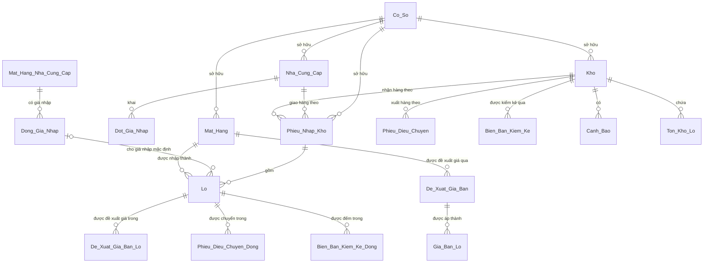
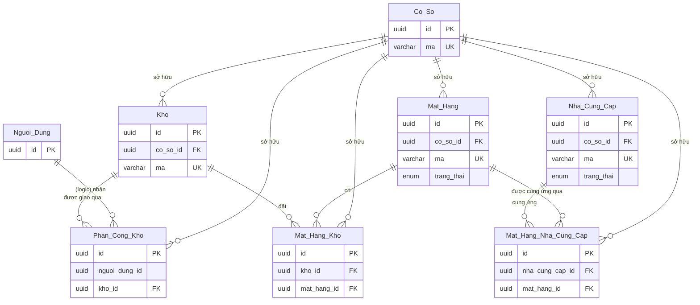
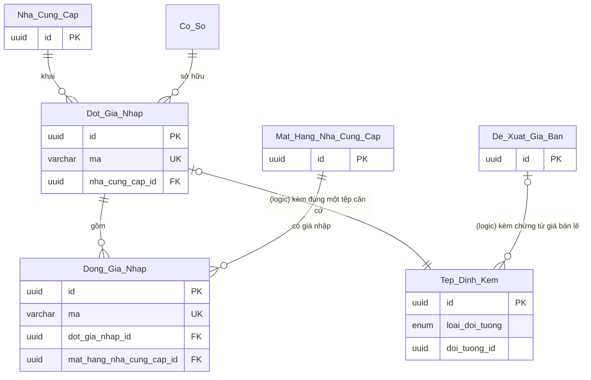
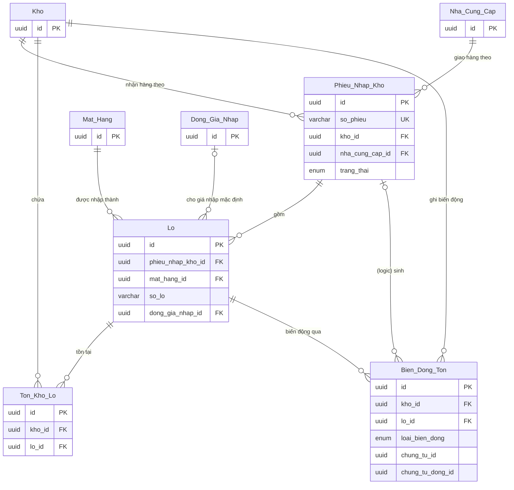
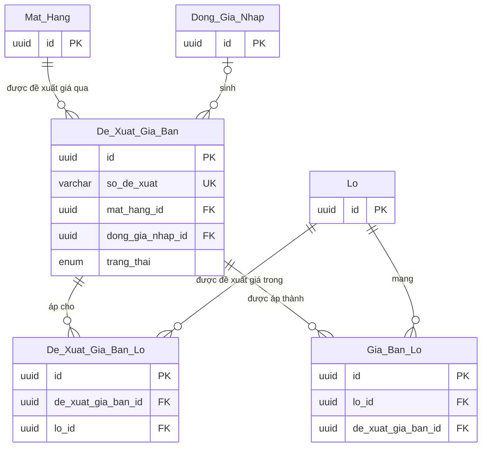
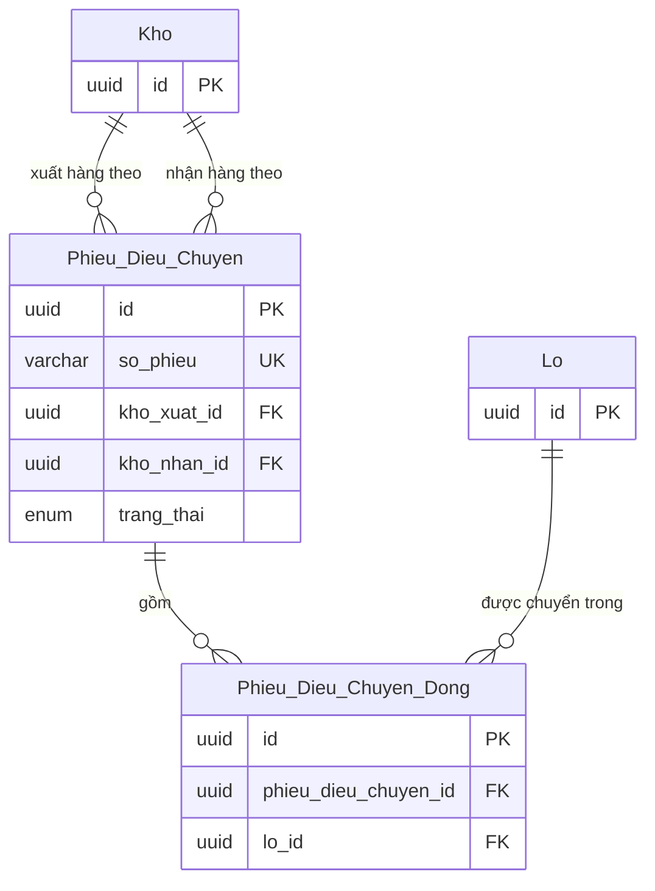
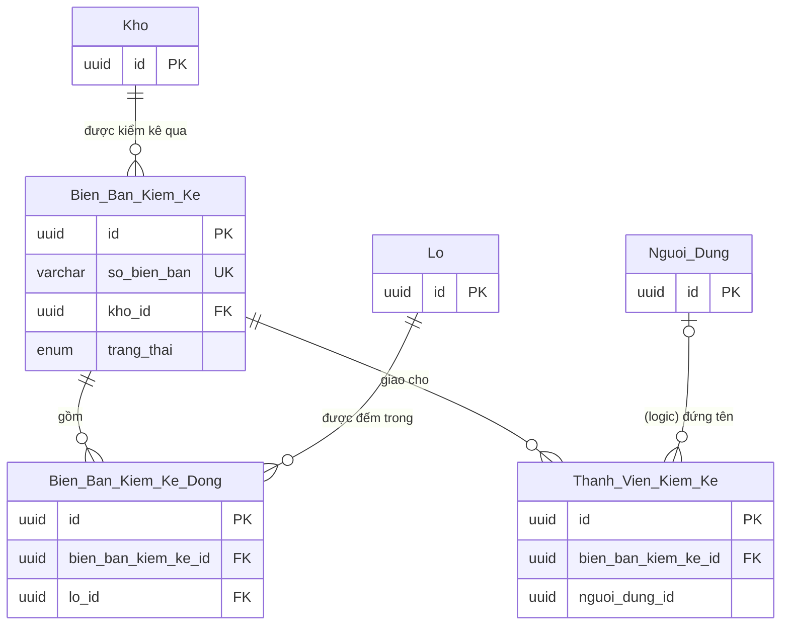
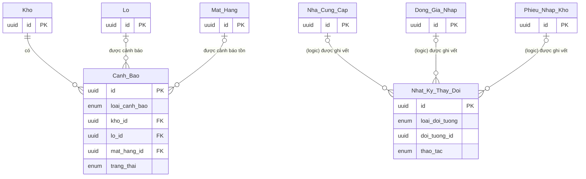

# ERD — Quản lý kho căng tin (PM3CSCN)

> Mô hình dữ liệu cho phần **quản lý kho căng tin, hàng hóa và giá bán, nhà cung cấp và giá nhập** của nhiều cơ sở cai nghiện ma túy, dựng từ [Quy trình nghiệp vụ](../2-business-process/QT_PM3CSCN_QuanLyKhoCangTin_v01.md) — mục 1.1 Thuật ngữ, 3 Dữ liệu trục và loại biến động, 3.1 Quy tắc dùng chung, 5 Tác vụ nền, 6 Tham số, 8 Chứng từ, 9 Điểm kiểm soát — cùng prototype giá nhập presales (MP-001 → MP-004) và câu trả lời của BA (RQ-01 → RQ-163). **Tài liệu này là nguồn duy nhất** về mô hình dữ liệu và mã kỹ thuật.
> Không có bản vẽ gốc (`../templates/00_quy_uoc_chung.md` mục 11): mọi bảng, trường ghi ✳; tên bảng, tên trường do ERD đặt. Giá trị liệt kê dùng **mã tiếng Anh**, tên tiếng Việt ghi cạnh.
> Gồm **24 thực thể** thuộc phạm vi, 2 thực thể tham chiếu ngoài, 27 ràng buộc liên bảng `R-xx`, 14 điểm khác hoặc bổ sung `E-xx`.
> Đọc: `*` bắt buộc, `◐` bắt buộc có điều kiện, 🧪 ERD tự đề xuất (mục 7), Δ giá trị dẫn xuất không lưu; câu hỏi và quyết định của BA ở mục 8; giả định của sổ bôi đỏ.
> Tài liệu **không** chứa index, partition (thiết kế kỹ thuật), chuyển trạng thái (máy trạng thái — lớp 4), nội dung quy tắc nghiệp vụ (business rule — lớp 6), nhãn và validate theo màn (SRS, `/ba-detail`).

## Thông tin tài liệu

| Mục | Nội dung |
|---|---|
| Mã tài liệu | `ERD_PM3CSCN_QuanLyKhoCangTin` |
| Dự án · Phân hệ | Quản lý kho căng tin (mã dự án PM3CSCN, nền tảng WEB — RQ-69) · Ba phân hệ presales: QUẢN LÝ KHO CĂNG TIN; CẤU HÌNH NGHIỆP VỤ HỆ THỐNG (danh mục hàng hóa và giá bán căng tin); QUẢN LÝ NHÀ CUNG CẤP HÀNG HÓA CĂNG TIN — một bộ tài liệu cho cả ba (RQ-70) |
| Phiên bản · Trạng thái | v01 · Chờ review |
| Người soạn · Người review · Người duyệt | phongnq12 — BA (AI hỗ trợ soạn) · chưa chốt (BA lead) · chưa chốt (BA) |
| Mức mật | chưa chốt (BA) |
| Mức mô hình | Logical |
| Quy trình nguồn | `../2-business-process/QT_PM3CSCN_QuanLyKhoCangTin_v01.md` v01 (BA chốt bảng bước 29/10/2026 — RQ-143, RQ-147) |
| Bản vẽ nguồn | n/a — không có bản vẽ gốc |

## Version control

| Tên version | Ngày cập nhật | PIC | Mô tả |
| :--- | :--- | :--- | :--- |
| v00 | 2026-10-29 | phongnq12 | - Dựng từ quy trình QT_PM3CSCN_QuanLyKhoCangTin v00 (/ba-overview đợt 3, lớp ERD). - Điền ô của lớp trước (sửa không đổi nghĩa): quy trình mục 1.1 cột Thực thể ERD, mục 3 tên thực thể dữ liệu trục (Q-P13), đường dẫn ERD; BRD mục 9 NFR-02 (· **<u>GD-0007</u>** · **<u>GD-0006</u>**) dẫn ERD mục 9. - BA chốt 29/10/2026: Q-E1 → Q-E14 (RQ-148 → RQ-162); nhiều cơ sở, dữ liệu riêng từng cơ sở (RQ-151, RQ-152) — thêm `Co_So`, `co_so_id` ở mọi bảng, R-23; đợt giá nhập hết dòng thì xóa mềm (RQ-163). - Sửa theo review độc lập vòng 1: đề xuất giá bán duyệt khi ngày hiệu lực đã tới chuyển thẳng `EFFECTIVE`, giá bán hiện hành chỉ lấy `EFFECTIVE`; bỏ R-06 (sang business rule); thêm R-21, R-22; R-18 đúng một tệp; lô quá hạn theo kho; enum nhật ký thêm phân công kho; dẫn PH-034, PH-035. - Tổng: 24 thực thể trong 7 nhóm, 2 thực thể ngoài, 22 R-xx, 13 E-xx, 14 câu hỏi đã chốt. Chỗ mô tả `trang_thai` trỏ máy trạng thái: chờ lớp 4. - Sửa theo review độc lập vòng 2 và BA chốt 29/10/2026 (RQ-164 → RQ-168): cảnh báo lệch đối soát `STOCK_MISMATCH` của N-04 (R-24); số lượng lô, dòng điều chuyển số nguyên > 0; ngày bắt đầu áp giá là ngày muộn hơn giữa ngày hiệu lực và ngày duyệt; thêm R-24 → R-29; phân công kho không ghi nhật ký, chỉ lưu phân công hiện tại (bỏ `WAREHOUSE_ASSIGNMENT`); dòng giá nhập đã phát sinh chỉ tính phiếu đã trình; người khai báo `Co_So` hoãn theo BRD TH-04; nguồn QT, BRD v01. Tổng 24 thực thể, 28 R-xx đang dùng, 13 E-xx. - Điền từ SM_PM3CSCN_QuanLyKhoCangTin_v00, không đổi nghĩa: mục 4 chỗ mô tả `trang_thai` thay `chờ lớp 4` bằng `SM mục n` — `Nha_Cung_Cap` SM mục 2, `Mat_Hang` SM mục 3, `Phieu_Nhap_Kho` SM mục 5, `De_Xuat_Gia_Ban` SM mục 6, `Phieu_Dieu_Chuyen` SM mục 7, `Bien_Ban_Kiem_Ke` SM mục 8, `Canh_Bao` SM mục 9. |
| **v01 (hiện tại)** | **2026-10-29** | phongnq12 | - Bổ sung theo lớp 4 (máy trạng thái), thay đổi có nghĩa, về Chờ review. BA chốt 29/10/2026 (RQ-169 → RQ-181): - RQ-170 → RQ-172: công tắc Cho phép bán, Cho phép đặt hàng theo kho × mặt hàng; gộp với tồn tối thiểu thành `Mat_Hang_Kho` (đổi tên từ `Ton_Toi_Thieu`, cùng grain — E-14); `so_luong_toi_thieu` thành không bắt buộc. - RQ-172, RQ-173: nhật ký thêm loại đối tượng `ITEM` Mặt hàng; `MIN_STOCK` đổi thành `ITEM_WAREHOUSE` Mặt hàng tại kho. - RQ-146, RQ-169, RQ-176: R-07 mở rộng cho `STOCK_MISMATCH`; bỏ R-24; Trưởng cơ sở xác nhận đóng cảnh báo lệch đối soát. - RQ-175: lý do bắt buộc khi người lập hủy (`ly_do_huy`) và khi hủy phê duyệt (`ly_do_huy_duyet`) trên bốn chứng từ. - RQ-180: ghi chú chặn hủy phê duyệt phiếu nhập kho khi lô nằm trên đề xuất giá bán chưa đóng (business rule). - Tổng: 24 thực thể, 27 R-xx đang dùng, 14 E-xx. |

## Phê duyệt

| Vai trò | Họ tên | Ngày | Ý kiến |
|---|---|---|---|
| BA soạn | | | |
| Product owner / Khách hàng | | | |
| Tech lead | | | |

---

## 1. Quy ước

| Ký hiệu | Nghĩa |
|---|---|
| **PK** · **FK** · **UK** | Khóa chính · khóa ngoại · ràng buộc duy nhất |
| `*` | Bắt buộc |
| `◐` | Bắt buộc **có điều kiện** — điều kiện ghi ở cột Ràng buộc |
| **Giữ** · **✳** · **✎** · **⊘** | Không đổi · mới · sửa · bỏ — so với bản vẽ gốc |
| **🧪** | ERD **tự đề xuất** để hiện thực quy trình; quy trình chưa nêu — xem mục 7 |
| **Δ** | Giá trị dẫn xuất — không lưu, tính khi truy vấn |
| *Ngoài* | Thực thể của phân hệ khác; chỉ vẽ để thấy liên kết |

**Quy ước chung cho mọi bảng** — không lặp lại trong từ điển:

- Khóa chính: `id uuid`.
- Trường chung: `co_so_id` (FK → `Co_So`, `*`; mọi bảng trừ `Co_So`), `nguoi_tao`, `thoi_diem_tao`, `nguoi_cap_nhat`, `thoi_diem_cap_nhat`; trường người là tham chiếu logic tới `Nguoi_Dung`. Kho, mặt hàng, nhà cung cấp, giá nhập, giá bán, chứng từ đều riêng từng cơ sở; người dùng chỉ thấy dữ liệu cơ sở mình (RQ-151, RQ-152). `co_so_id` ở dòng chứng từ, sổ, nhật ký là sao chép khóa phạm vi có chủ đích để lọc theo cơ sở; cha và con luôn cùng cơ sở — R-23 (E-12). **UK nghiệp vụ** tính trong phạm vi `co_so_id` và chỉ trên các dòng chưa xóa mềm. Tài khoản người dùng ghi vào bản ghi phải thuộc cùng cơ sở: thao tác ghi tra hệ thống xác thực dùng chung (R-23; RQ-149, NFR-10 Dữ liệu riêng từng cơ sở). `nguoi_tao` của chứng từ là **người lập** chứng từ đó.
- Chứng từ có `trang_thai` (`Phieu_Nhap_Kho`, `Phieu_Dieu_Chuyen`, `Bien_Ban_Kiem_Ke`, `De_Xuat_Gia_Ban`, `Canh_Bao`) và sổ `Ton_Kho_Lo` có `row_version int` cho **khóa lạc quan** 🧪 — E-03. Mọi bên ghi `Ton_Kho_Lo`, kể cả Hệ thống bán hàng căng tin, tuân tồn không âm và ghi `Bien_Dong_Ton` cùng giao dịch (RQ-153).
- Tiền: `decimal` không phần lẻ, đơn vị đồng; số lượng: `int` theo đơn vị tính nhỏ nhất của mặt hàng; độ dài `varchar` không ghi số do SRS đặt (RQ-150); ngoại lệ có số lấy từ prototype giá nhập: `Dot_Gia_Nhap.so_hieu_can_cu` 100 ký tự, `Dong_Gia_Nhap.ly_do_quyet_dinh` và `Dong_Gia_Nhap.ly_do_xoa` 500 ký tự (nguồn ở từng dòng). Ngày giờ lưu kèm múi giờ; so theo ngày dùng giờ Việt Nam UTC+7 (quy trình mục 5), ngày lịch (`GS-03` Ngưỡng sắp hết hạn).
- **Xóa mềm**: `da_xoa`, `nguoi_xoa_id`, `thoi_diem_xoa` — áp cho `Co_So`, `Kho`, `Mat_Hang`, `Mat_Hang_Nha_Cung_Cap`, `Mat_Hang_Kho`, `Dong_Gia_Nhap`, và `Dot_Gia_Nhap` khi mọi dòng của đợt đã bị xóa (RQ-163, E-11). Nhà cung cấp không xóa, chỉ ngừng hợp tác (QT-01 bước 1). Chứng từ khác đóng bằng trạng thái, không xóa (quy trình mục 3 Khóa chứng từ đã đóng; NFR-08 Giữ chứng từ đã đóng · **<u>GD-0006</u>**). **Xóa hẳn** chỉ ở: đề xuất giá bán Nháp gắn dòng giá nhập ở QT-01 bước 11, kèm `De_Xuat_Gia_Ban_Lo`, `Tep_Dinh_Kem` của nó; dòng con của chứng từ chưa trình bị bỏ khi sửa (`Lo` của phiếu nhập kho ở `DRAFT`, `REJECTED`; `Phieu_Dieu_Chuyen_Dong` của phiếu điều chuyển ở `DRAFT`, `REJECTED`; `De_Xuat_Gia_Ban_Lo`, `Tep_Dinh_Kem` của đề xuất ở `DRAFT`, `REJECTED`); `Phan_Cong_Kho` khi bỏ phân công — chỉ lưu phân công hiện tại (RQ-168). Sổ, nhật ký chỉ thêm.
- **Tham chiếu ngoài phân hệ** là tham chiếu logic, **không** đặt khóa ngoại cơ sở dữ liệu; dữ liệu cần để quyết định được **chụp** vào chứng từ.
- **Khóa ngoại đa hình** luôn đi cùng cột loại, có chỉ mục (loại, id) — bảng ánh xạ ở mục 5.2. Trên sơ đồ, đường đa hình mang nhãn `(logic)` và đầu cha `|o`: một dòng con chỉ trỏ tới bảng đó khi cột loại có đúng giá trị tương ứng.
- **Không lưu cờ** cho các khóa của quy trình mục 3 (khóa kho đang kiểm kê, khóa lô chờ giá, khóa lô quá hạn, khóa dòng giá nhập, khóa chứng từ đã đóng), hiệu lực của dòng giá nhập, giá bán hiện hành, tình trạng ngừng hoạt động của cặp nhà cung cấp – mặt hàng, hàng đang chuyển — suy ra khi truy vấn (dòng Δ ở mục 4).
- Đặt tên: bảng `Pascal_Snake` tiếng Việt không dấu · trường `snake_case` · enum `UPPER_SNAKE` tiếng Anh.

---

## 2. Danh sách thực thể

Cột `Quy trình ghi` chỉ ghi phía **ghi** (tạo · sửa · xóa); phía đọc thuộc quy trình và use case.

| # | Thực thể | Nhóm | Thay đổi | Loại | Quy trình ghi | Chủ sở hữu dữ liệu | Nghĩa ngắn |
|---|---|---|---|---|---|---|---|
| 1 | `Kho` | A. Cơ sở, danh mục và cấu hình kho | ✳ | Danh mục | Thêm, sửa, xóa theo `PS:PM3CSCN.WEB.09.04.02` — không có bước quy trình (quy trình mục 1 Ngoài phạm vi); số ngày cảnh báo theo `PS:PM3CSCN.WEB.09.04.03` | Người phụ trách căng tin | Nơi giữ hàng hóa căng tin, các kho ngang hàng |
| 2 | `Phan_Cong_Kho` | A. Cơ sở, danh mục và cấu hình kho | ✳ | Danh mục | Trưởng cơ sở phân công, bỏ phân công — UC mới ngoài danh sách presales, lớp 5 thêm (RQ-148, PH-034); không ghi nhật ký (RQ-168) | Trưởng cơ sở | Kho đang được phân công cho một người phụ trách căng tin |
| 3 | `Mat_Hang` | A. Cơ sở, danh mục và cấu hình kho | ✳ | Danh mục | QT-03 bước 1 tạo · sửa, ngừng hoạt động, xóa theo `PS:PM3CSCN.WEB.10.01.01` (quy trình mục 1 Ngoài phạm vi) | Người phụ trách căng tin | Một dòng của danh mục hàng hóa căng tin |
| 4 | `Nha_Cung_Cap` | A. Cơ sở, danh mục và cấu hình kho | ✳ | Danh mục | QT-01 bước 1 tạo, sửa, ngừng hợp tác | Người phụ trách căng tin | Hồ sơ nhà cung cấp |
| 5 | `Mat_Hang_Nha_Cung_Cap` | A. Cơ sở, danh mục và cấu hình kho | ✳ | Danh mục | QT-01 bước 2 thêm, xóa | Người phụ trách căng tin | Danh mục hàng hóa cung ứng — cặp nhà cung cấp – mặt hàng |
| 6 | `Mat_Hang_Kho` | A. Cơ sở, danh mục và cấu hình kho | ✳ | Cấu hình | Tồn tối thiểu theo `PS:PM3CSCN.WEB.09.04.03` — đầu vào QT-06, không có bước (quy trình mục 1 Ngoài phạm vi); công tắc Cho phép bán, Cho phép đặt hàng do người phụ trách căng tin của kho bật, tắt, không duyệt (RQ-170, RQ-172) | Người phụ trách căng tin | Thiết lập của một mặt hàng tại một kho: tồn tối thiểu `CH-01`, cho phép bán, cho phép đặt hàng |
| 7 | `Dot_Gia_Nhap` | B. Giá nhập | ✳ | Chứng từ | QT-01 bước 3 tạo · bước 5 xóa mềm khi hết dòng (RQ-163) | Người phụ trách căng tin | Đợt giá nhập của một nhà cung cấp theo một căn cứ |
| 8 | `Dong_Gia_Nhap` | B. Giá nhập | ✳ | Dòng chứng từ | QT-01 bước 3 tạo · bước 4 sửa · bước 5 xóa | Người phụ trách căng tin | Giá nhập của một cặp trong một đợt |
| 9 | `Tep_Dinh_Kem` | B. Giá nhập | ✳ 🧪 | Dòng chứng từ | QT-01 bước 3 tạo · QT-03 bước 2 tạo, xóa | Người phụ trách căng tin | Tệp căn cứ của đợt giá nhập, chứng từ giá bán lẻ của đề xuất giá bán |
| 10 | `Phieu_Nhap_Kho` | C. Nhập kho và tồn kho | ✳ | Chứng từ | QT-02 bước 1 tạo, sửa · bước 5 trình, hủy · bước 7 duyệt, từ chối · bước 16 hủy phê duyệt | Người phụ trách căng tin | Phiếu nhập kho, kể cả phiếu nhập kho đầu kỳ |
| 11 | `Lo` | C. Nhập kho và tồn kho | ✳ | Dòng chứng từ | QT-02 bước 1 tạo, sửa | Người phụ trách căng tin | Lô — một dòng hàng của phiếu nhập kho |
| 12 | `Ton_Kho_Lo` | C. Nhập kho và tồn kho | ✳ | Sổ ghi thêm | QT-02 bước 9, 18 · QT-04 bước 7, 10, 13, 16 · QT-05 bước 9, 12 · Hệ thống bán hàng căng tin (quy trình mục 5.1) | Người phụ trách căng tin | Tồn kho theo lô |
| 13 | `Bien_Dong_Ton` | C. Nhập kho và tồn kho | ✳ | Sổ ghi thêm | QT-02 bước 9, 18 · QT-04 bước 7, 10, 13, 16 · QT-05 bước 9, 12 · Hệ thống bán hàng căng tin (quy trình mục 5.1) | Người phụ trách căng tin | Mỗi lần tồn kho theo lô thay đổi |
| 14 | `De_Xuat_Gia_Ban` | D. Giá bán | ✳ | Chứng từ | QT-01 bước 10 tạo, bước 11 xóa · QT-02 bước 13 tạo · QT-03 bước 2 tạo, sửa · bước 3 trình, hủy · bước 5 duyệt, từ chối · bước 7, 8 có hiệu lực · bước 9, 11 hủy phê duyệt | Trưởng cơ sở | Đề xuất giá bán; khi được duyệt là giá bán đã duyệt |
| 15 | `De_Xuat_Gia_Ban_Lo` | D. Giá bán | ✳ | Dòng chứng từ | QT-02 bước 13 tạo · QT-03 bước 2 tạo, xóa | Trưởng cơ sở | Lô áp dụng ghi trên đề xuất giá bán |
| 16 | `Gia_Ban_Lo` | D. Giá bán | ✳ 🧪 | Sổ ghi thêm | QT-02 bước 11 · QT-03 bước 7 · QT-03 bước 8 (`N-03`) | Trưởng cơ sở | Giá bán đã duyệt áp cho một lô từ một ngày |
| 17 | `Phieu_Dieu_Chuyen` | E. Điều chuyển | ✳ | Chứng từ | QT-04 bước 1 tạo, sửa · bước 3 trình, hủy · bước 5 duyệt, từ chối · bước 9 xác nhận thực nhận · bước 12 ghi nhận chênh lệch · bước 14, 16 hủy phê duyệt | Người phụ trách căng tin | Phiếu điều chuyển từ kho xuất sang kho nhận |
| 18 | `Phieu_Dieu_Chuyen_Dong` | E. Điều chuyển | ✳ | Dòng chứng từ | QT-04 bước 1 tạo, sửa · bước 9 ghi số thực nhận | Người phụ trách căng tin | Một lô chuyển trên phiếu điều chuyển |
| 19 | `Bien_Ban_Kiem_Ke` | F. Kiểm kê | ✳ | Chứng từ | QT-05 bước 1, 3 tạo · bước 6 trình · bước 8 duyệt, từ chối · bước 10, 12 hủy phê duyệt · bước 13, 15 hủy | Trưởng cơ sở | Biên bản kiểm kê, gồm giao kiểm kê |
| 20 | `Bien_Ban_Kiem_Ke_Dong` | F. Kiểm kê | ✳ | Dòng chứng từ | QT-05 bước 3 tạo (chốt số sách) · bước 5 sửa (số thực tế) | Trưởng cơ sở | Một lô trên biên bản kiểm kê |
| 21 | `Thanh_Vien_Kiem_Ke` | F. Kiểm kê | ✳ | Dòng chứng từ | QT-05 bước 1 tạo | Trưởng cơ sở | Một thành viên tổ kiểm kê của biên bản |
| 22 | `Canh_Bao` | G. Cảnh báo và nhật ký | ✳ | Chứng từ | QT-02 bước 15 tạo · QT-06 bước 3 tạo (`N-01` · **<u>GD-0003</u>**) · `N-04` tạo cảnh báo lệch đối soát · QT-06 bước 4 xem · bước 5 đóng | Người phụ trách căng tin | Cảnh báo tồn, hạn sử dụng, lô chờ giá |
| 23 | `Nhat_Ky_Thay_Doi` | G. Cảnh báo và nhật ký | ✳ | Nhật ký | QT-01 bước 7 · mọi thao tác workflow ở QT-02 → QT-06 (quy trình mục 2 — mỗi thao tác một quyền; RQ-121) · thiết lập kho, mặt hàng tại kho (NFR-07 Lịch sử thay đổi; RQ-172) · ngừng hoạt động, kích hoạt lại mặt hàng, nhà cung cấp (RQ-173) | Chủ sở hữu của đối tượng được ghi vết | Lịch sử thay đổi |
| 24 | `Co_So` | A. Cơ sở, danh mục và cấu hình kho | ✳ | Danh mục | Hoãn tới kế hoạch triển khai — đơn vị vận hành bản cài đặt chung chưa xác định (BRD Q-B36 → TH-04; RQ-164; E-12) | Hoãn — BRD TH-04 | Một cơ sở cai nghiện ma túy dùng hệ thống |

**Thực thể tham chiếu ngoài:**

| Thực thể | Phân hệ | Dùng để | Cách liên kết |
|---|---|---|---|
| `Nguoi_Dung` — tài khoản người dùng | Hệ thống xác thực dùng chung; phần mềm kho chỉ tham chiếu, tài khoản không xóa cứng (RQ-149) | Xác định người lập, trình, duyệt, xác nhận, người được phân công kho, thành viên tổ kiểm kê | Tham chiếu logic · không chụp; tên người đọc khi hiển thị. `Thanh_Vien_Kiem_Ke` chụp `ho_ten` vì có thành viên không có tài khoản (RQ-155) |
| n/a — Giao dịch bán: hệ thống ngoài, không có ERD (RQ-54) | Hệ thống bán hàng căng tin | Truy một lần trừ tồn do bán về giao dịch bán (NFR-09 Ghi vết trừ tồn do bán; RQ-86) | Tham chiếu logic · chụp mã giao dịch bán vào `Bien_Dong_Ton.ma_giao_dich_ban` |

**Không lưu** — thứ quy trình nhắc tới mà ERD không lập thực thể:

| Thứ được nhắc | Nơi nhắc | Lý do không lưu | Căn cứ |
|---|---|---|---|
| Bản in phiếu nhập kho | mục 1.1 c, mục 8.3, QT-02 bước 3, 4 | Mẫu in chỉ hiển thị; dữ liệu lấy từ `Phieu_Nhap_Kho`, `Lo`; in lại khi phiếu sửa, không giữ bản chụp | RQ-57 · RQ-60 · RQ-120 |
| Giao kiểm kê | mục 1.1 c, QT-05 bước 1 | Không là chứng từ riêng: là việc Trưởng cơ sở lập `Bien_Ban_Kiem_Ke` | RQ-145 |
| Giá bán hiện hành | mục 1.1 b | Δ `gia_ban_hien_hanh` dưới `De_Xuat_Gia_Ban` | `GS-01` Giá bán theo lô · RQ-87 · RQ-139 |
| Lô chờ giá, lô sắp hết hạn, lô quá hạn | mục 1.1 a, mục 3 | Δ dưới `Lo`; khóa suy ra từ dữ liệu, không lưu cờ | Quy trình mục 3 Các loại khóa · `GS-03` Ngưỡng sắp hết hạn |
| Khóa kho đang kiểm kê, khóa chứng từ đã đóng | mục 3 | Δ `kho_dang_kiem_ke` dưới `Kho`; trạng thái chứng từ; không lưu cờ | Quy trình mục 3 Các loại khóa |
| Khóa dòng giá nhập | mục 3 | Δ suy từ `Dong_Gia_Nhap` (`hieu_luc`, `da_phat_sinh`) và trạng thái `De_Xuat_Gia_Ban` gắn dòng; không lưu cờ | Quy trình mục 3 Các loại khóa · RQ-132 · RQ-167 |
| Phiếu dở dang | mục 1.1 a | Δ `phieu_dang_do` dưới `Kho` | RQ-125 |
| Hàng đang chuyển | mục 1.1 a, mục 3 dữ liệu trục | Δ `hang_dang_chuyen` dưới `Phieu_Dieu_Chuyen_Dong` (E-04) | `GS-05` Bảo toàn điều chuyển |
| Chênh lệch kiểm kê · chênh lệch điều chuyển | mục 1.1 a, c | Δ dưới `Bien_Ban_Kiem_Ke_Dong`, `Phieu_Dieu_Chuyen_Dong` | `GS-02` Chênh lệch kiểm kê · `GS-05` Bảo toàn điều chuyển |
| Ngừng hoạt động của cặp nhà cung cấp – mặt hàng · dòng giá nhập đã phát sinh · dòng giá nhập thay thế | mục 1.1 a, b | Δ dưới `Mat_Hang_Nha_Cung_Cap`, `Dong_Gia_Nhap` | `[SRC: 0-inputs/presales/prototype/src/data/purchasePriceStore.js, dòng 5]` ("giá trị dẫn xuất — tính lúc đọc, không lưu") |
| Hướng xử lý cảnh báo (nhập kho, điều chuyển, đề nghị kiểm kê, lập đề xuất giá bán) | QT-06 bước 4 | Là việc người phụ trách căng tin tự bắt đầu quy trình khác; hệ thống không tạo chứng từ, không ghi lựa chọn | ASM-008 (BA xác nhận — RQ-116) |
| Đề nghị Trưởng cơ sở kiểm kê | QT-06 bước 6 🟡 | Làm ngoài hệ thống | RQ-129 · ASM-008 (BA xác nhận — RQ-116) |
| Đồ vật cấm, chất cấm | mục 1.1 b, QT-03 bước 5 | Hệ thống không phân loại mặt hàng, không xét bao bì; Trưởng cơ sở xét khi duyệt giá đầu | RQ-24 · RQ-49 · **<u>GD-0002</u>** |
| Chi phí hợp lý (cách tính) | mục 1.1 b | Tính ngoài hệ thống; đề xuất chỉ ghi số tiền không bắt buộc (`De_Xuat_Gia_Ban.chi_phi_hop_ly`) | **<u>GD-0001</u>** · RQ-112 |
| FEFO | mục 1.1 a | Cách Hệ thống bán hàng căng tin chọn lô khi bán; kho không lưu | RQ-19 |
| `CH-03` Giờ quét cảnh báo hằng ngày | mục 6 | Cố định 00:00, không cấu hình | RQ-130 · **<u>GD-0003</u>** |
| `CH-04` Tần suất đồng bộ dữ liệu kho; dấu mốc lần đồng bộ của `N-02` | mục 5, mục 6 | Giá trị, đơn vị, cách kết nối chưa chốt (PM + khách), SRS chi tiết hóa; chưa lập bảng tham số đồng bộ | RQ-101 · `D-01` · **<u>GD-0007</u>** |
| Phiếu đặt hàng hóa từ đơn hàng | mục 1 Ngoài phạm vi | Ngoài phạm vi lần này | **<u>GD-0004</u>** |
| Cơ sở mà một tài khoản được dùng | — (ERD bổ sung theo RQ-152) | Thuộc hệ thống xác thực dùng chung; kho đọc khi lọc dữ liệu theo cơ sở | RQ-149 · RQ-152 · E-12 |

---

## 3. Sơ đồ quan hệ

Mỗi sơ đồ vẽ một nhóm; thực thể nhóm khác chỉ hiện khóa chính. Thuộc tính đầy đủ ở mục 4. Mọi bảng có `co_so_id` (mục 1); sơ đồ chỉ vẽ đường từ `Co_So` tới các danh mục và chứng từ gốc.

### 3.1. Tổng quan giữa các nhóm

### 3.2. Nhóm A — Cơ sở, danh mục và cấu hình kho

### 3.3. Nhóm B — Giá nhập

### 3.4. Nhóm C — Nhập kho và tồn kho

### 3.5. Nhóm D — Giá bán

### 3.6. Nhóm E — Điều chuyển

### 3.7. Nhóm F — Kiểm kê

### 3.8. Nhóm G — Cảnh báo và nhật ký

Nhật ký ghi vết mọi loại đối tượng ở mục 5.2; sơ đồ chỉ vẽ ba đường đại diện.

---

## 4. Từ điển dữ liệu

### 4.1. Nhóm A — Cơ sở, danh mục và cấu hình kho

#### `Co_So` — Cơ sở cai nghiện · ✳

Mỗi dòng là một cơ sở cai nghiện ma túy dùng hệ thống; mọi dữ liệu khác thuộc đúng một cơ sở (RQ-151, RQ-152). Không có `co_so_id` của chính nó. Ai khai báo cơ sở: hoãn tới kế hoạch triển khai (BRD Q-B36 → TH-04; RQ-164) — E-12.

| Trường | Kiểu | Ràng buộc | Đổi | Mô tả | Nguồn |
|---|---|---|---|---|---|
| `ma` | varchar | `*` · UK | ✳ 🧪 | Mã cơ sở, duy nhất toàn hệ thống (E-12) | E-12 · RQ-151 |
| `ten` | varchar | `*` | ✳ | Tên cơ sở, ví dụ "Cơ sở cai nghiện công lập" | RQ-151 · RQ-92 |

#### `Kho` — Kho · ✳

Mỗi dòng là một kho của một cơ sở; các kho ngang hàng, không có kho cấp trên (RQ-01). Người phụ trách căng tin thêm, sửa, xóa theo `PS:PM3CSCN.WEB.09.04.02` và đặt số ngày cảnh báo theo `PS:PM3CSCN.WEB.09.04.03`, không duyệt, có lịch sử (RQ-33, NFR-07 Lịch sử thay đổi).

| Trường | Kiểu | Ràng buộc | Đổi | Mô tả | Nguồn |
|---|---|---|---|---|---|
| `ma` | varchar | `*` · UK trong `co_so_id` | ✳ 🧪 | Mã kho người dùng thấy, hệ thống cấp (E-01) | E-01 · BRQ-21 Danh sách kho · RQ-152 |
| `ten` | varchar | `*` | ✳ | Tên kho | `PS:PM3CSCN.WEB.09.04.02` · RQ-01 · BRQ-21 Danh sách kho |
| `so_ngay_canh_bao_het_han` | int | ≥ 0 | ✳ | Số ngày cảnh báo sắp hết hạn N của kho — `CH-02`, ngày lịch. Trống là kho chưa đặt N: kho chỉ được cảnh báo lô quá hạn, lô chờ giá | Quy trình mục 6 `CH-02` (số nguyên ngày, không âm) · RQ-128 · RQ-31 · `PS:PM3CSCN.WEB.09.04.03` |

**Giá trị dẫn xuất Δ:** `kho_dang_kiem_ke(K)` = tồn tại `Bien_Ban_Kiem_Ke` có `kho_id` = K và `trang_thai` ∈ {`IN_PROGRESS`, `PENDING_APPROVAL`} — quy trình mục 3 Khóa kho đang kiểm kê. `phieu_dang_do(K)` = các `Phieu_Nhap_Kho` có `kho_id` = K ở `PENDING_APPROVAL`, các `Phieu_Dieu_Chuyen` có K là `kho_xuat_id` hoặc `kho_nhan_id` ở `PENDING_APPROVAL`, `APPROVED` hoặc `RECEIVED` — RQ-125.

#### `Phan_Cong_Kho` — Kho được phân công · ✳

Mỗi dòng là việc giao một kho cho một người phụ trách căng tin; một người được giao nhiều kho (RQ-95, RQ-142). Trưởng cơ sở phân công, qua UC mới ngoài danh sách presales (RQ-148, PH-034); chỉ lưu phân công hiện tại, bỏ phân công thì xóa hẳn dòng, không ghi nhật ký (RQ-168). Chứng từ kho và cảnh báo của kho chỉ do người được giao kho đó lập, trình, xác nhận, xem (quy trình mục 9 điểm 30).

| Trường | Kiểu | Ràng buộc | Đổi | Mô tả | Nguồn |
|---|---|---|---|---|---|
| `nguoi_dung_id` | uuid | `*` · UK(`nguoi_dung_id`, `kho_id`) | ✳ | Người phụ trách căng tin được giao; tham chiếu logic tới `Nguoi_Dung` | RQ-95 · RQ-142 · RQ-148 |
| `kho_id` | FK → `Kho` | `*` · UK(`nguoi_dung_id`, `kho_id`) | ✳ | Kho được giao | RQ-95 · RQ-142 · RQ-148 |

#### `Mat_Hang` — Mặt hàng · ✳

Mỗi dòng là một mặt hàng của danh mục hàng hóa căng tin của một cơ sở, dùng chung cho giá bán, nhà cung cấp, nhập kho, điều chuyển, kiểm kê trong cơ sở đó (BRQ-08 Danh mục hàng hóa dùng chung; RQ-152). Người phụ trách căng tin thêm ở QT-03 bước 1, không duyệt (RQ-17); sửa, ngừng hoạt động, xóa theo `PS:PM3CSCN.WEB.10.01.01`.

| Trường | Kiểu | Ràng buộc | Đổi | Mô tả | Nguồn |
|---|---|---|---|---|---|
| `ma` | varchar | `*` · UK trong `co_so_id` | ✳ | Mã hàng | MP-001 (ô tìm "mã hàng") · `[SRC: 0-inputs/presales/prototype/src/data/seed/PM3_PurchasePrice_Data.js, dòng 19–29]` · RQ-152 |
| `ten` | varchar | `*` | ✳ | Tên hàng | QT-03 bước 1 · `[SRC: 0-inputs/presales/prototype/src/data/seed/PM3_PurchasePrice_Data.js, dòng 19–29]` |
| `don_vi_tinh` | varchar | `*` | ✳ | Đơn vị tính nhỏ nhất; số lượng của lô, tồn kho, tồn tối thiểu là số nguyên theo đơn vị này | Quy trình mục 6 `CH-01` ("số lượng theo đơn vị tính của mặt hàng") · RQ-150 · `[SRC: 0-inputs/presales/prototype/src/data/seed/PM3_PurchasePrice_Data.js, dòng 19–29]` |
| `trang_thai` | enum | `*` | ✳ | `ACTIVE` Đang hoạt động · `INACTIVE` Ngừng hoạt động — máy trạng thái SM mục 3 | Quy trình mục 1.1 Ngừng hoạt động · `PS:PM3CSCN.WEB.10.01.01` · RQ-171 · RQ-173 |

#### `Nha_Cung_Cap` — Hồ sơ nhà cung cấp · ✳

Mỗi dòng là hồ sơ của một nhà cung cấp trong một cơ sở. Người phụ trách căng tin thêm, sửa, ngừng hợp tác ở QT-01 bước 1, không duyệt (RQ-20, RQ-56); mỗi thay đổi có lịch sử (NFR-07 Lịch sử thay đổi). Hồ sơ chỉ gồm các trường dưới (RQ-161).

| Trường | Kiểu | Ràng buộc | Đổi | Mô tả | Nguồn |
|---|---|---|---|---|---|
| `ma` | varchar | `*` · UK trong `co_so_id` | ✳ | Mã nhà cung cấp | `[SRC: 0-inputs/presales/prototype/src/data/seed/PM3_PurchasePrice_Data.js, dòng 10–16]` · RQ-152 |
| `ten` | varchar | `*` | ✳ | Tên nhà cung cấp | QT-01 bước 1 · `[SRC: 0-inputs/presales/prototype/src/data/seed/PM3_PurchasePrice_Data.js, dòng 10–16]` |
| `ho_ten_nguoi_lien_he` | varchar | | ✳ | Họ tên người liên hệ — dữ liệu cá nhân (mục 9); không đồng bộ sang phần mềm quản lý cơ sở cai nghiện | RQ-104 · RQ-159 · quy trình mục 5 `N-02` · **<u>GD-0007</u>** |
| `dien_thoai_nguoi_lien_he` | varchar | | ✳ | Điện thoại người liên hệ — dữ liệu cá nhân (mục 9); không đồng bộ | RQ-104 · RQ-159 · quy trình mục 5 `N-02` · **<u>GD-0007</u>** |
| `trang_thai` | enum | `*` | ✳ | `ACTIVE` Đang hoạt động · `TERMINATED` Ngừng hợp tác — máy trạng thái SM mục 2 | QT-01 bước 1 · quy trình mục 1.1 Hồ sơ nhà cung cấp · RQ-16 |

#### `Mat_Hang_Nha_Cung_Cap` — Danh mục hàng hóa cung ứng · ✳

Mỗi dòng là một mặt hàng mà một nhà cung cấp cung ứng (một cặp nhà cung cấp – mặt hàng), cùng cơ sở (R-23). Người phụ trách căng tin thêm, bỏ ở QT-01 bước 2; mặt hàng phải có trong danh mục hàng hóa căng tin (BRQ-08 Danh mục hàng hóa dùng chung).

| Trường | Kiểu | Ràng buộc | Đổi | Mô tả | Nguồn |
|---|---|---|---|---|---|
| `nha_cung_cap_id` | FK → `Nha_Cung_Cap` | `*` · UK(`nha_cung_cap_id`, `mat_hang_id`) | ✳ | Nhà cung cấp | QT-01 bước 2 · RQ-16 |
| `mat_hang_id` | FK → `Mat_Hang` | `*` · UK(`nha_cung_cap_id`, `mat_hang_id`) | ✳ | Mặt hàng được cung ứng | QT-01 bước 2 · BRQ-08 Danh mục hàng hóa dùng chung |

**Giá trị dẫn xuất Δ:** `ngung_hoat_dong` = `Nha_Cung_Cap.trang_thai` = `TERMINATED`, hoặc `Mat_Hang.trang_thai` = `INACTIVE`, hoặc `Mat_Hang.da_xoa`, hoặc dòng cặp `da_xoa` — quy trình mục 1.1 Ngừng hoạt động.

#### `Mat_Hang_Kho` — Mặt hàng tại kho: hạn mức cảnh báo tồn tối thiểu, cho phép bán, cho phép đặt hàng · ✳

Mỗi dòng là thiết lập của một mặt hàng tại một kho: tồn tối thiểu (`CH-01`) và hai công tắc Cho phép bán, Cho phép đặt hàng (RQ-170, RQ-171). Không có dòng thì dùng mặc định: chưa đặt tồn tối thiểu, không cảnh báo tồn (RQ-128); cả hai công tắc bật (RQ-172). Người phụ trách căng tin của kho thiết lập (tồn tối thiểu theo `PS:PM3CSCN.WEB.09.04.03`), không duyệt, ghi `Nhat_Ky_Thay_Doi` (RQ-33, RQ-172, NFR-07 Lịch sử thay đổi). `cho_phep_ban` thuộc dữ liệu cung cấp cho bán hàng (BRQ-24 Dữ liệu cho bán hàng); `Mat_Hang.trang_thai` Ngừng hoạt động vẫn là công tắc cấp danh mục (RQ-171). Gộp tồn tối thiểu và công tắc vì cùng grain kho × mặt hàng (E-14). Phần số ngày N của hạn mức cảnh báo nằm ở `Kho.so_ngay_canh_bao_het_han` vì đặt theo kho, khác grain.

| Trường | Kiểu | Ràng buộc | Đổi | Mô tả | Nguồn |
|---|---|---|---|---|---|
| `kho_id` | FK → `Kho` | `*` · UK(`kho_id`, `mat_hang_id`) | ✳ | Kho | Quy trình mục 6 `CH-01` (phạm vi kho × mặt hàng) · RQ-28 |
| `mat_hang_id` | FK → `Mat_Hang` | `*` · UK(`kho_id`, `mat_hang_id`) | ✳ | Mặt hàng | Quy trình mục 6 `CH-01` · RQ-28 |
| `so_luong_toi_thieu` | int | ≥ 0 | ✳ | Tồn tối thiểu, theo đơn vị tính của mặt hàng; tồn dưới số này thì cảnh báo; trống là chưa đặt, không cảnh báo tồn (RQ-128) | Quy trình mục 6 `CH-01` (số không âm) · RQ-150 · BRQ-22 Cảnh báo tồn tối thiểu |
| `cho_phep_ban` | boolean | `*` · mặc định đúng | ✳ | Đúng: Hệ thống bán hàng căng tin được bán mặt hàng tại kho này; sai: không bán mặt hàng tại kho này | RQ-170 · RQ-171 · RQ-172 · BRQ-24 Dữ liệu cho bán hàng |
| `cho_phep_dat_hang` | boolean | `*` · mặc định đúng | ✳ | Cho phép đặt hàng mặt hàng tại kho; định nghĩa trước cho nghiệp vụ đặt hàng, ngoài phạm vi lần này | RQ-170 · RQ-172 · **<u>GD-0004</u>** |

### 4.2. Nhóm B — Giá nhập

#### `Dot_Gia_Nhap` — Đợt giá nhập · ✳

Mỗi dòng là một lần khai giá nhập của một nhà cung cấp theo một căn cứ, với một khoảng hiệu lực khai chung, gồm nhiều dòng giá nhập — mỗi mặt hàng một dòng (`[SRC: 0-inputs/presales/prototype/src/data/purchasePriceStore.js, dòng 3]`). Người phụ trách căng tin tạo ở QT-01 bước 3, không duyệt (RQ-20). Tệp căn cứ: đúng một tệp ở `Tep_Dinh_Kem` (MP-004; R-18). Khi mọi dòng của đợt bị xóa ở QT-01 bước 5, đợt bị xóa mềm theo (RQ-163, E-11).

| Trường | Kiểu | Ràng buộc | Đổi | Mô tả | Nguồn |
|---|---|---|---|---|---|
| `ma` | varchar | `*` · UK trong `co_so_id` | ✳ | Mã đợt | MP-001 (cột Mã đợt) · MP-002 |
| `nha_cung_cap_id` | FK → `Nha_Cung_Cap` | `*` | ✳ | Nhà cung cấp của đợt | QT-01 bước 3 · MP-004 (Nhà cung cấp bắt buộc) |
| `so_hieu_can_cu` | varchar(100) | | ✳ | Số hợp đồng, phụ lục hoặc báo giá làm căn cứ | MP-004 · `[SRC: 0-inputs/presales/prototype/src/pages/PurchasePriceShared/BatchForm.jsx, dòng 164]` |
| `hieu_luc_tu` | date | `*` | ✳ | Hiệu lực khai chung từ ngày — giá trị ban đầu của `hieu_luc_tu` các dòng | MP-004 (bắt buộc) · MP-002 (Hiệu lực khai chung) |
| `hieu_luc_den` | date | `*` | ✳ | Hiệu lực khai chung đến ngày — giá trị ban đầu của `hieu_luc_den` các dòng | MP-004 (bắt buộc) · MP-002 (Hiệu lực khai chung) |

**Giá trị dẫn xuất Δ:** `so_mat_hang` = đếm `Dong_Gia_Nhap` chưa xóa mềm có `dot_gia_nhap_id` = id — MP-002 (Số mặt hàng trong đợt).

#### `Dong_Gia_Nhap` — Dòng giá nhập · ✳

Mỗi dòng là giá nhập của một cặp nhà cung cấp – mặt hàng trong một đợt, có hiệu lực từ, đến. Tạo ở QT-01 bước 3, sửa ở bước 4, xóa mềm ở bước 5 kèm lý do; điều kiện sửa, xóa là khóa dòng giá nhập (quy trình mục 3) — xem business rule về sửa, xóa dòng giá nhập (QT-01 bước 6, RQ-132). Nhà cung cấp của cặp trùng nhà cung cấp của đợt — R-21.

| Trường | Kiểu | Ràng buộc | Đổi | Mô tả | Nguồn |
|---|---|---|---|---|---|
| `ma` | varchar | `*` · UK trong `co_so_id` | ✳ | Mã dòng giá nhập | MP-002 |
| `dot_gia_nhap_id` | FK → `Dot_Gia_Nhap` | `*` | ✳ | Đợt chứa dòng | QT-01 bước 3 · quy trình mục 1.1 Dòng giá nhập |
| `mat_hang_nha_cung_cap_id` | FK → `Mat_Hang_Nha_Cung_Cap` | `*` | ✳ | Cặp nhà cung cấp – mặt hàng | QT-01 bước 3 · quy trình mục 1.1 Dòng giá nhập |
| `gia_nhap` | decimal | `*` · ≥ 0 | ✳ | Giá nhập, số nguyên đồng | QT-01 bước 3, 4 · RQ-04 · RQ-150 · MP-003 (Giá nhập bắt buộc) |
| `hieu_luc_tu` | date | `*` | ✳ | Hiệu lực từ ngày; chỉ sửa khi dòng còn Khai trước — xem business rule về sửa dòng giá nhập | QT-01 bước 3, 4 · MP-003 (bắt buộc) |
| `hieu_luc_den` | date | `*` | ✳ | Hiệu lực đến ngày | QT-01 bước 3, 4 · MP-003 (bắt buộc) |
| `quyet_dinh_gia_ban` | enum | `*` | ✳ | `AUTO_PROPOSAL` Tự sinh đề xuất · `CREATE_PROPOSAL` Tạo đề xuất · `KEEP_CURRENT` Giữ giá bán hiện hành — cách xử lý giá bán khi lưu giá nhập | QT-01 bước 8, 9, 10 · MP-001 (cột Quyết định giá bán) · `[SRC: 0-inputs/presales/prototype/src/data/purchasePriceStore.js, dòng 20]` |
| `ly_do_quyet_dinh` | varchar(500) | `◐` khi `quyet_dinh_gia_ban` ∈ {`CREATE_PROPOSAL`, `KEEP_CURRENT`} | ✳ | Lý do người phụ trách căng tin chọn tạo hoặc không tạo đề xuất | QT-01 bước 9 · quy trình mục 9 điểm 3 · `[SRC: 0-inputs/presales/prototype/src/pages/PurchasePriceShared/DecisionDialog.jsx, dòng 27, 61]` |
| `ly_do_xoa` | varchar(500) | `◐` khi `da_xoa` = đúng | ✳ | Lý do xóa dòng | QT-01 bước 5 · quy trình mục 9 điểm 5 · RQ-132 · `[SRC: 0-inputs/presales/prototype/src/pages/PurchasePriceShared/DeleteLineDialog.jsx, dòng 65]` |

**Giá trị dẫn xuất Δ:** `hieu_luc(d)` — xét theo thứ tự, ra đúng một: `UPCOMING` Khai trước khi d < `hieu_luc_tu`; `EXPIRED` Hết hiệu lực khi d > `hieu_luc_den`; `REPLACED` Đã thay thế khi có dòng chưa xóa khác cùng cặp có `hieu_luc_tu` > `hieu_luc_tu` của dòng này và ≤ d; còn lại `CURRENT` Hiện hành — `[SRC: 0-inputs/presales/prototype/src/data/purchasePriceStore.js, dòng 123–128]`. `dong_bi_thay_the` = dòng chưa xóa cùng cặp có `hieu_luc_tu` < `hieu_luc_tu` của dòng này ≤ `hieu_luc_den` của nó, chọn `hieu_luc_tu` lớn nhất; xóa dòng mới thì dòng cũ tự áp dụng lại (QT-01 bước 12) — `[SRC: 0-inputs/presales/prototype/src/data/purchasePriceStore.js, dòng 131–132]`. `gia_nhap_hien_hanh(cặp, d)` = `gia_nhap` của dòng chưa xóa cùng cặp có `hieu_luc_tu` ≤ d lớn nhất, khi d ≤ `hieu_luc_den` của dòng đó — `[SRC: 0-inputs/presales/prototype/src/data/purchasePriceStore.js, dòng 117–120]`. `da_phat_sinh` = tồn tại `Lo` có `dong_gia_nhap_id` = id thuộc `Phieu_Nhap_Kho` ở `PENDING_APPROVAL`, `APPROVED` hoặc `REVOKED`; phiếu ở `DRAFT`, `CANCELLED`, `REJECTED` không tính — quy trình mục 1.1 Dòng giá nhập đã phát sinh · RQ-167.

#### `Tep_Dinh_Kem` — Tệp đính kèm · ✳ 🧪

Mỗi dòng là một tệp gắn vào một đợt giá nhập (tệp căn cứ — MP-004) hoặc một đề xuất giá bán (chứng từ giá bán lẻ tại địa phương — RQ-112). Một bảng chung cho hai nơi (E-07); đối tượng gắn tệp trỏ đa hình theo mục 5.2.

| Trường | Kiểu | Ràng buộc | Đổi | Mô tả | Nguồn |
|---|---|---|---|---|---|
| `loai_doi_tuong` | enum | `*` | ✳ | `PURCHASE_PRICE_BATCH` Đợt giá nhập · `PRICE_PROPOSAL` Đề xuất giá bán | MP-004 (Tệp căn cứ bắt buộc) · RQ-112 · QT-03 bước 2 |
| `doi_tuong_id` | uuid | `*` | ✳ | Bản ghi gắn tệp — mục 5.2 | MP-004 · RQ-112 |
| `ten_tep` | varchar | `*` | ✳ | Tên tệp như người dùng tải lên | `[SRC: 0-inputs/presales/prototype/src/pages/PurchasePriceShared/BatchForm.jsx, dòng 168–169]` |
| `ma_tep_luu_tru` | varchar | `*` | ✳ | Mã của tệp trong kho lưu trữ tệp; cách lưu do thiết kế kỹ thuật chọn | E-07 |

### 4.3. Nhóm C — Nhập kho và tồn kho

#### `Phieu_Nhap_Kho` — Phiếu nhập kho · ✳

Mỗi dòng là một phiếu nhập hàng hóa từ một nhà cung cấp vào một kho, kể cả phiếu nhập kho đầu kỳ — không xử lý riêng, không có cờ đầu kỳ (RQ-98, RQ-105). Người phụ trách căng tin của kho lập ở QT-02 bước 1, trình hoặc hủy ở bước 5; Trưởng cơ sở duyệt hoặc từ chối ở bước 7, hủy phê duyệt ở bước 16. Mỗi dòng hàng là một `Lo`. Hủy phê duyệt bị chặn khi một lô của phiếu nằm trên `De_Xuat_Gia_Ban` chưa đóng — phải hủy hoặc từ chối đề xuất trước; xem business rule về hủy phê duyệt phiếu nhập kho (RQ-180).

| Trường | Kiểu | Ràng buộc | Đổi | Mô tả | Nguồn |
|---|---|---|---|---|---|
| `so_phieu` | varchar | `*` · UK trong `co_so_id` | ✳ | Số phiếu | MP-002 (bảng Phát sinh từ dòng: Số phiếu) |
| `kho_id` | FK → `Kho` | `*` | ✳ | Kho nhập; thuộc kho được phân công của người lập — xem business rule về phạm vi kho (quy trình mục 9 điểm 30) | QT-02 bước 1 · RQ-05 · RQ-142 |
| `nha_cung_cap_id` | FK → `Nha_Cung_Cap` | `*` | ✳ | Nhà cung cấp giao hàng; mọi phiếu, kể cả phiếu nhập kho đầu kỳ | QT-02 bước 1 · RQ-105 · BRQ-10 Phiếu nhập truy về nhà cung cấp |
| `ngay_nhap` | date | `*` | ✳ | Ngày nhập hàng ghi trên phiếu | MP-002 (bảng Phát sinh từ dòng: Ngày nhập) |
| `trang_thai` | enum | `*` | ✳ | `DRAFT` Nháp · `PENDING_APPROVAL` Chờ duyệt · `REJECTED` Từ chối · `CANCELLED` Đã hủy · `APPROVED` Đã duyệt · `REVOKED` Đã hủy duyệt — máy trạng thái SM mục 5 | QT-02 bước 1, 5, 7, 18 · quy trình mục 1.1 d · `[SRC: 0-inputs/presales/prototype/src/data/purchasePriceStore.js, dòng 24]` (Nháp) |
| `nguoi_trinh_id` | uuid | `◐` khi `trang_thai` ∈ {`PENDING_APPROVAL`, `REJECTED`, `APPROVED`, `REVOKED`} | ✳ | Người trình lần gần nhất; tham chiếu logic `Nguoi_Dung` | QT-02 bước 5 · RQ-121 |
| `thoi_diem_trinh` | timestamp | `◐` khi `trang_thai` ∈ {`PENDING_APPROVAL`, `REJECTED`, `APPROVED`, `REVOKED`} | ✳ | Thời điểm trình lần gần nhất | QT-02 bước 5 |
| `nguoi_duyet_id` | uuid | `◐` khi `trang_thai` ∈ {`APPROVED`, `REVOKED`} | ✳ | Trưởng cơ sở duyệt phiếu | QT-02 bước 7 · BRQ-05 Duyệt hoặc từ chối chứng từ · NFR-01 Chỉ Trưởng cơ sở duyệt |
| `thoi_diem_duyet` | timestamp | `◐` khi `trang_thai` ∈ {`APPROVED`, `REVOKED`} | ✳ | Thời điểm duyệt | QT-02 bước 7 · BRQ-05 Duyệt hoặc từ chối chứng từ |
| `ly_do_tu_choi` | text | `◐` khi `trang_thai` = `REJECTED` | ✳ | Lý do từ chối lần gần nhất; người từ chối ghi ở `Nhat_Ky_Thay_Doi` | QT-02 bước 7 · RQ-34 · BRQ-26 Từ chối có lý do |
| `ly_do_huy` | text | `◐` khi `trang_thai` = `CANCELLED` | ✳ | Lý do người lập hủy chứng từ | RQ-175 · quy trình mục 1.1 d Hủy |
| `ly_do_huy_duyet` | text | `◐` khi `trang_thai` = `REVOKED` | ✳ | Lý do Trưởng cơ sở hủy phê duyệt | RQ-175 · RQ-40 |
| `nguoi_huy_duyet_id` | uuid | `◐` khi `trang_thai` = `REVOKED` | ✳ | Trưởng cơ sở hủy phê duyệt | QT-02 bước 16 · RQ-40 |
| `thoi_diem_huy_duyet` | timestamp | `◐` khi `trang_thai` = `REVOKED` | ✳ | Thời điểm hủy phê duyệt | QT-02 bước 16, 18 |

#### `Lo` — Lô · ✳

Mỗi dòng là một lô: một dòng hàng của một phiếu nhập kho, gồm một mặt hàng, số lô, hạn sử dụng, số lượng, giá nhập (quy trình mục 1.1 Lô; RQ-14). Dòng phiếu nhập và lô gộp một bảng vì mỗi dòng phiếu sinh đúng một lô (E-02); lô vào tồn kho khi phiếu Đã duyệt (QT-02 bước 9). Một phiếu không có hai dòng cùng mặt hàng, cùng số lô (RQ-157). Mặt hàng phải thuộc danh mục hàng hóa cung ứng của nhà cung cấp trên phiếu lúc lập — xem business rule về lập phiếu nhập kho (QT-02 bước 2, RQ-16); dòng giá nhập mặc định khớp mặt hàng và nhà cung cấp — R-26. Phiếu đã trình có ít nhất một lô — R-28.

| Trường | Kiểu | Ràng buộc | Đổi | Mô tả | Nguồn |
|---|---|---|---|---|---|
| `phieu_nhap_kho_id` | FK → `Phieu_Nhap_Kho` | `*` · UK(`phieu_nhap_kho_id`, `mat_hang_id`, `so_lo`) | ✳ | Phiếu nhập kho của lô | QT-02 bước 1 · RQ-98 · RQ-157 |
| `mat_hang_id` | FK → `Mat_Hang` | `*` · UK(`phieu_nhap_kho_id`, `mat_hang_id`, `so_lo`) | ✳ | Mặt hàng của lô | QT-02 bước 1 · BRQ-08 Danh mục hàng hóa dùng chung · RQ-157 |
| `so_lo` | varchar | `*` · UK(`phieu_nhap_kho_id`, `mat_hang_id`, `so_lo`) | ✳ | Số lô ghi trên hàng giao | QT-02 bước 1 · RQ-14 · BRQ-12 Tồn theo lô · RQ-157 |
| `han_su_dung` | date | `*` | ✳ | Hạn sử dụng của lô | QT-02 bước 1 · RQ-14 · BRQ-12 Tồn theo lô |
| `so_luong` | int | `*` · > 0 | ✳ | Số lượng nhập, số nguyên theo đơn vị tính của mặt hàng | QT-02 bước 1 · quy trình mục 8.3 Phiếu nhập kho · RQ-150 · RQ-165 |
| `gia_nhap` | decimal | `*` · ≥ 0 | ✳ | Giá nhập của lô, số nguyên đồng; mặc định từ giá nhập hiện hành của cặp, sửa được theo thực tế đợt nhập; không đổi sau khi phiếu Đã duyệt | QT-02 bước 1 · RQ-16 · RQ-150 · BRQ-11 Giá nhập theo đợt |
| `dong_gia_nhap_id` | FK → `Dong_Gia_Nhap` | | ✳ | Dòng giá nhập hiện hành dùng làm giá mặc định lúc lập; trống khi cặp không có giá nhập hiện hành | RQ-16 · MP-002 (bảng Phát sinh từ dòng) · quy trình mục 1.1 Dòng giá nhập đã phát sinh |

**Giá trị dẫn xuất Δ:** `lo_cho_gia(L, d)` = `Phieu_Nhap_Kho` của L ở `APPROVED` và không có `Gia_Ban_Lo` của L với `ngay_ap_dung` ≤ d — quy trình mục 3 Khóa lô chờ giá · `GS-01` Giá bán theo lô · RQ-122. `so_ngay_con_lai(L, d)` = `han_su_dung` − d, ngày lịch, giờ Việt Nam. Tại kho K: `lo_qua_han(K, L, d)` khi `so_ngay_con_lai` < 0 và `Ton_Kho_Lo`(K, L).`so_luong` > 0; `lo_sap_het_han(K, L, d)` khi 0 ≤ `so_ngay_con_lai` ≤ `Kho.so_ngay_canh_bao_het_han` của K (K đã đặt N) và `Ton_Kho_Lo`(K, L).`so_luong` > 0 — `GS-03` Ngưỡng sắp hết hạn · RQ-30 · RQ-127.

#### `Ton_Kho_Lo` — Tồn kho theo lô · ✳

Mỗi dòng là số lượng hiện có của một lô tại một kho. Tổng hợp lưu sẵn có chủ đích: bán và duyệt điều chuyển cùng trừ một lô cần một dòng để khóa (quy trình mục 11.1 rủi ro tồn âm; RQ-124), và Hệ thống bán hàng căng tin đọc, ghi thẳng phần trừ tồn vào đây (RQ-86, RQ-54), tuân tồn không âm (RQ-153). Cập nhật cùng giao dịch với `Bien_Dong_Ton` ở QT-02 bước 9, 18, QT-04 bước 7, 10, 13, 16, QT-05 bước 9, 12 và khi bán; đối soát bằng R-01.

| Trường | Kiểu | Ràng buộc | Đổi | Mô tả | Nguồn |
|---|---|---|---|---|---|
| `kho_id` | FK → `Kho` | `*` · UK(`kho_id`, `lo_id`) | ✳ | Kho chứa lô | Quy trình mục 3 dữ liệu trục · RQ-14 · BRQ-12 Tồn theo lô |
| `lo_id` | FK → `Lo` | `*` · UK(`kho_id`, `lo_id`) | ✳ | Lô | Quy trình mục 3 dữ liệu trục · RQ-14 |
| `so_luong` | int | `*` · ≥ 0 | ✳ | Số lượng của lô đang có tại kho | Quy trình mục 3 dữ liệu trục · RQ-124 (không vượt tồn) · RQ-153 (mọi bên ghi tuân tồn không âm) |

**Giá trị dẫn xuất Δ:** `ton_mat_hang(K, M)` = Σ `so_luong` của các `Ton_Kho_Lo` có `kho_id` = K và `Lo.mat_hang_id` = M — so với `Mat_Hang_Kho` ở QT-06 bước 2 · BRQ-22 Cảnh báo tồn tối thiểu.

#### `Bien_Dong_Ton` — Biến động tồn kho theo lô · ✳

Mỗi dòng là một lần tăng hoặc giảm tồn của một lô tại một kho, do một chứng từ được duyệt, hủy phê duyệt, xác nhận, ghi nhận chênh lệch, hoặc do một giao dịch bán. Chỉ thêm, không sửa, không xóa; là căn cứ truy mọi thay đổi tồn về chứng từ (BRQ-13 Tồn chỉ đổi theo chứng từ) và kiểm "giao dịch mới" khi hủy phê duyệt biên bản kiểm kê (QT-05 bước 11). Dòng `SALE` do Hệ thống bán hàng căng tin ghi cùng giao dịch với `Ton_Kho_Lo`, `nguoi_tao` trống (RQ-86, RQ-153, NFR-09 Ghi vết trừ tồn do bán).

| Trường | Kiểu | Ràng buộc | Đổi | Mô tả | Nguồn |
|---|---|---|---|---|---|
| `kho_id` | FK → `Kho` | `*` | ✳ | Kho có tồn thay đổi | Quy trình mục 3 Loại biến động |
| `lo_id` | FK → `Lo` | `*` | ✳ | Lô thay đổi | Quy trình mục 3 Loại biến động · NFR-09 Ghi vết trừ tồn do bán (ghi lô) |
| `loai_bien_dong` | enum | `*` | ✳ | `RECEIPT` Nhập kho · `RECEIPT_REVOKE` Hủy phê duyệt nhập kho · `TRANSFER_OUT` Xuất điều chuyển · `TRANSFER_IN` Nhận điều chuyển · `TRANSFER_VARIANCE_RETURN` Cộng trả chênh lệch điều chuyển · `TRANSFER_REVOKE` Hủy phê duyệt điều chuyển · `STOCKTAKE_ADJUST` Điều chỉnh kiểm kê · `STOCKTAKE_REVERSE` Đảo điều chỉnh kiểm kê · `SALE` Trừ tồn do bán | Quy trình mục 3 Loại biến động |
| `so_luong_thay_doi` | int | `*` · ≠ 0 | ✳ | Số lượng thay đổi có dấu: dương là tăng, âm là giảm; dấu theo loại ở quy trình mục 3 | Quy trình mục 3 Loại biến động · NFR-09 Ghi vết trừ tồn do bán (ghi số lượng) |
| `chung_tu_id` | uuid | `◐` khi `loai_bien_dong` ≠ `SALE` | ✳ | Chứng từ sinh biến động — đa hình theo `loai_bien_dong`, mục 5.2 | BRQ-13 Tồn chỉ đổi theo chứng từ |
| `chung_tu_dong_id` | uuid | `◐` khi `loai_bien_dong` ≠ `SALE` | ✳ | Dòng chứng từ sinh biến động — mục 5.2 | BRQ-13 Tồn chỉ đổi theo chứng từ |
| `ma_giao_dich_ban` | varchar | `◐` khi `loai_bien_dong` = `SALE` | ✳ | **Chụp** mã giao dịch bán của Hệ thống bán hàng căng tin | NFR-09 Ghi vết trừ tồn do bán · RQ-86 · RQ-115 |
| `thoi_diem_phat_sinh` | timestamp | `*` | ✳ | Thời điểm biến động; với `SALE` là thời điểm bán do Hệ thống bán hàng căng tin ghi | NFR-09 Ghi vết trừ tồn do bán (ghi thời điểm) · QT-05 bước 11 · RQ-126 |

### 4.4. Nhóm D — Giá bán

#### `De_Xuat_Gia_Ban` — Đề xuất giá bán · ✳

Mỗi dòng là một đề nghị giá bán cho một mặt hàng, áp cho các lô ghi trên đề xuất; khi được Trưởng cơ sở duyệt, chính dòng này là giá bán đã duyệt (`GS-01` Giá bán theo lô; `TT79 Đ41.4`). Lập Nháp ở QT-01 bước 10 (gắn dòng giá nhập), QT-02 bước 13 (gắn lô) hoặc QT-03 bước 2; QT-01 bước 11 xóa hẳn đề xuất Nháp gắn dòng giá nhập. Ngày bắt đầu áp giá = ngày muộn hơn giữa `ngay_hieu_luc` và ngày của `thoi_diem_duyet` (RQ-166). Khi duyệt (QT-03 bước 7): `ngay_hieu_luc` ≤ ngày duyệt thì chuyển thẳng `EFFECTIVE`, áp từ ngày duyệt (RQ-123, RQ-166); `ngay_hieu_luc` sau ngày duyệt thì `APPROVED`, rồi `N-03` chuyển `EFFECTIVE` khi tới ngày — `N-03` xét mọi đề xuất `APPROVED` có `ngay_hieu_luc` ≤ ngày chạy (E-13; lớp 4 vẽ hai chuyển này). Đề xuất Nháp gắn dòng giá nhập bị xóa hẳn ở QT-01 bước 11 thì xóa kèm `De_Xuat_Gia_Ban_Lo`, `Tep_Dinh_Kem` của nó; `Nhat_Ky_Thay_Doi` giữ dòng, `noi_dung` chụp `so_de_xuat`. Mặt hàng của đề xuất sinh từ dòng giá nhập khớp cặp của dòng — R-25. Khoảng giá được duyệt — xem business rule về khoảng giá bán (`GS-04` Khoảng giá bán được duyệt · **<u>GD-0001</u>** · **<u>GD-0008</u>**).

| Trường | Kiểu | Ràng buộc | Đổi | Mô tả | Nguồn |
|---|---|---|---|---|---|
| `so_de_xuat` | varchar | `*` · UK trong `co_so_id` | ✳ | Số đề xuất | `[SRC: 0-inputs/presales/prototype/src/data/seed/PM3_PurchasePrice_Data.js, dòng 132–136]` (mã `DX-…`) |
| `mat_hang_id` | FK → `Mat_Hang` | `*` | ✳ | Mặt hàng được đề xuất giá | QT-03 bước 2 · RQ-112 · quy trình mục 8.2 |
| `dong_gia_nhap_id` | FK → `Dong_Gia_Nhap` | | ✳ | Dòng giá nhập sinh ra đề xuất (QT-01 bước 10); trống với đề xuất lập ở QT-02, QT-03 | QT-01 bước 10, 11 · MP-002 (bảng đề xuất gắn dòng) |
| `gia_ban_de_xuat` | decimal | `◐` khi `trang_thai` ∉ {`DRAFT`, `CANCELLED`} · ≥ 0 | ✳ | Giá bán đề xuất, số nguyên đồng; một giá cho mọi lô ghi trên đề xuất | QT-03 bước 2, 4 · RQ-112 · RQ-150 · BRQ-02 Trình đề xuất giá đủ thông tin |
| `gia_ban_le_dia_phuong` | decimal | `◐` khi `trang_thai` ∉ {`DRAFT`, `CANCELLED`} · ≥ 0 | ✳ | Giá bán lẻ tại địa phương của hàng hóa cùng loại, số nguyên đồng — mức trần; chứng từ kèm ở `Tep_Dinh_Kem` | `TT79 Đ41.4` · QT-03 bước 2 · RQ-112 |
| `chi_phi_hop_ly` | decimal | ≥ 0 | ✳ | Chi phí hợp lý, số nguyên đồng; không bắt buộc, tính ngoài hệ thống | QT-03 bước 2 · RQ-112 · **<u>GD-0001</u>** |
| `ngay_hieu_luc` | date | `◐` khi `trang_thai` ∉ {`DRAFT`, `CANCELLED`} | ✳ | Ngày giá bán bắt đầu áp cho các lô ghi trên đề xuất; đã qua lúc duyệt thì áp từ ngày duyệt | QT-03 bước 2, 7 · RQ-23 · RQ-112 · RQ-123 · RQ-166 |
| `trang_thai` | enum | `*` | ✳ | `DRAFT` Nháp · `PENDING_APPROVAL` Chờ duyệt · `REJECTED` Từ chối · `CANCELLED` Đã hủy · `APPROVED` Đã duyệt · `EFFECTIVE` Có hiệu lực · `REVOKED` Đã hủy duyệt — máy trạng thái SM mục 6 | QT-01 bước 10 · QT-03 bước 2, 3, 5, 7, 8, 11 · MP-003 (Nháp) · RQ-123 |
| `nguoi_trinh_id` | uuid | `◐` khi `trang_thai` ∈ {`PENDING_APPROVAL`, `REJECTED`, `APPROVED`, `EFFECTIVE`, `REVOKED`} | ✳ | Người trình lần gần nhất | QT-03 bước 3 · RQ-121 |
| `thoi_diem_trinh` | timestamp | `◐` khi `trang_thai` ∈ {`PENDING_APPROVAL`, `REJECTED`, `APPROVED`, `EFFECTIVE`, `REVOKED`} | ✳ | Thời điểm trình lần gần nhất | QT-03 bước 3 |
| `nguoi_duyet_id` | uuid | `◐` khi `trang_thai` ∈ {`APPROVED`, `EFFECTIVE`, `REVOKED`} | ✳ | Trưởng cơ sở duyệt giá | QT-03 bước 5, 7 · `TT79 Đ41.4` · quy trình mục 8.2 |
| `thoi_diem_duyet` | timestamp | `◐` khi `trang_thai` ∈ {`APPROVED`, `EFFECTIVE`, `REVOKED`} | ✳ | Thời điểm duyệt; dùng chọn giá hiện hành khi trùng ngày hiệu lực | QT-03 bước 7 · quy trình mục 8.2 · RQ-160 |
| `ly_do_tu_choi` | text | `◐` khi `trang_thai` = `REJECTED` | ✳ | Lý do từ chối lần gần nhất | QT-03 bước 5 · RQ-34 · BRQ-26 Từ chối có lý do |
| `ly_do_huy` | text | `◐` khi `trang_thai` = `CANCELLED` | ✳ | Lý do người lập hủy chứng từ | RQ-175 · quy trình mục 1.1 d Hủy |
| `ly_do_huy_duyet` | text | `◐` khi `trang_thai` = `REVOKED` | ✳ | Lý do Trưởng cơ sở hủy phê duyệt | RQ-175 · RQ-40 |
| `nguoi_huy_duyet_id` | uuid | `◐` khi `trang_thai` = `REVOKED` | ✳ | Trưởng cơ sở hủy phê duyệt giá | QT-03 bước 9 · RQ-40 · ASM-004 (BA xác nhận — RQ-116) |
| `thoi_diem_huy_duyet` | timestamp | `◐` khi `trang_thai` = `REVOKED` | ✳ | Thời điểm hủy phê duyệt | QT-03 bước 9, 11 |

**Giá trị dẫn xuất Δ:** `ngay_bat_dau_ap(D)` = ngày muộn hơn giữa `ngay_hieu_luc` và ngày (giờ Việt Nam) của `thoi_diem_duyet` — RQ-166. `gia_ban_hien_hanh(M, d)` = `gia_ban_de_xuat` của `De_Xuat_Gia_Ban` có `mat_hang_id` = M, `trang_thai` = `EFFECTIVE`, `ngay_bat_dau_ap` ≤ d, chọn `ngay_bat_dau_ap` lớn nhất; cùng ngày thì chọn `thoi_diem_duyet` muộn hơn (RQ-160) — `GS-01` Giá bán theo lô · RQ-139 · RQ-166.

#### `De_Xuat_Gia_Ban_Lo` — Lô áp dụng của đề xuất giá bán · ✳

Mỗi dòng là một lô ghi trên một đề xuất giá bán. Ghi ở QT-02 bước 13 (lô vừa nhập) hoặc QT-03 bước 2. Lô cùng mặt hàng với đề xuất — R-22. Lô áp dụng là lô đang có trong tồn kho (phiếu nhập kho đã duyệt) — xem business rule về lô áp dụng của đề xuất giá bán (RQ-23, RQ-112). Giá nhập của lô không chụp: hệ thống tham chiếu `Lo.gia_nhap`, giá trị này không đổi sau khi phiếu Đã duyệt.

| Trường | Kiểu | Ràng buộc | Đổi | Mô tả | Nguồn |
|---|---|---|---|---|---|
| `de_xuat_gia_ban_id` | FK → `De_Xuat_Gia_Ban` | `*` · UK(`de_xuat_gia_ban_id`, `lo_id`) | ✳ | Đề xuất | QT-03 bước 2 · RQ-23 · RQ-112 |
| `lo_id` | FK → `Lo` | `*` · UK(`de_xuat_gia_ban_id`, `lo_id`) | ✳ | Lô áp dụng | QT-02 bước 13 · QT-03 bước 2 · RQ-23 · RQ-141 |

**Giá trị dẫn xuất Δ:** `gia_nhap_cao_nhat(D)` = max `Lo.gia_nhap` qua các `De_Xuat_Gia_Ban_Lo` của đề xuất D — sàn của giá bán đề xuất, `GS-04` Khoảng giá bán được duyệt · **<u>GD-0001</u>** · **<u>GD-0008</u>**.

#### `Gia_Ban_Lo` — Giá bán của lô · ✳ 🧪

Mỗi dòng là một lần một giá bán có hiệu lực bắt đầu áp cho một lô, từ một ngày. Ghi ở QT-02 bước 11 (giá bán hiện hành áp cho lô khi phiếu nhập kho được duyệt), QT-03 bước 7 (ngày hiệu lực đã tới khi duyệt — RQ-123) và QT-03 bước 8 (`N-03`, khóa chống lặp "đề xuất giá bán + lô"). Lưu vì giá áp cho lô lúc duyệt phiếu là giá hiện hành của chính thời điểm đó, về sau không suy lại chắc chắn được (RQ-25, RQ-87); Hệ thống bán hàng căng tin đọc giá theo lô (RQ-54). Chỉ thêm; lô không có dòng nào là lô chờ giá (E-10). Giá áp cho lô không nhỏ hơn giá nhập của lô — xem business rule về khoảng giá bán.

| Trường | Kiểu | Ràng buộc | Đổi | Mô tả | Nguồn |
|---|---|---|---|---|---|
| `lo_id` | FK → `Lo` | `*` · UK(`lo_id`, `de_xuat_gia_ban_id`) | ✳ | Lô được áp giá | QT-02 bước 11 · QT-03 bước 8 · RQ-21 |
| `de_xuat_gia_ban_id` | FK → `De_Xuat_Gia_Ban` | `*` · UK(`lo_id`, `de_xuat_gia_ban_id`) | ✳ | Đề xuất `EFFECTIVE` mà giá của nó áp cho lô | QT-02 bước 11 · QT-03 bước 7, 8 · `GS-01` Giá bán theo lô |
| `ngay_ap_dung` | date | `*` | ✳ | Ngày giá bắt đầu áp cho lô: ngày duyệt phiếu nhập kho (QT-02 bước 11), hoặc `ngay_bat_dau_ap` của đề xuất = ngày muộn hơn giữa `ngay_hieu_luc` và ngày duyệt (QT-03 bước 7, 8) | QT-02 bước 11 · QT-03 bước 7, 8 · RQ-25 · RQ-123 · RQ-166 |

**Giá trị dẫn xuất Δ:** `gia_ban_cua_lo(L, d)` = `De_Xuat_Gia_Ban.gia_ban_de_xuat` của dòng `Gia_Ban_Lo` có `lo_id` = L, `ngay_ap_dung` ≤ d, chọn `ngay_ap_dung` lớn nhất, cùng ngày thì `De_Xuat_Gia_Ban.thoi_diem_duyet` lớn nhất (RQ-160); cùng một giá ở mọi kho — `GS-01` Giá bán theo lô · RQ-21.

### 4.5. Nhóm E — Điều chuyển

#### `Phieu_Dieu_Chuyen` — Phiếu điều chuyển · ✳

Mỗi dòng là một phiếu chuyển hàng hóa theo lô từ một kho xuất sang một kho nhận cùng cơ sở (RQ-06, RQ-15; R-23). Người phụ trách căng tin kho xuất lập ở QT-04 bước 1, trình hoặc hủy ở bước 3; Trưởng cơ sở duyệt hoặc từ chối ở bước 5, hủy phê duyệt ở bước 14; người phụ trách căng tin kho nhận xác nhận thực nhận ở bước 9; kho xuất ghi nhận chênh lệch ở bước 12. Kho nhận khác kho xuất — xem business rule về lập phiếu điều chuyển (BRQ-21 Danh sách kho). Hệ thống ghi người thực hiện từng thao tác (RQ-121).

| Trường | Kiểu | Ràng buộc | Đổi | Mô tả | Nguồn |
|---|---|---|---|---|---|
| `so_phieu` | varchar | `*` · UK trong `co_so_id` | ✳ 🧪 | Số phiếu, hệ thống cấp (E-01) | E-01 · BRQ-15 Phiếu điều chuyển |
| `kho_xuat_id` | FK → `Kho` | `*` | ✳ | Kho xuất; thuộc kho được phân công của người lập — xem business rule về phạm vi kho | QT-04 bước 1 · RQ-15 · RQ-142 |
| `kho_nhan_id` | FK → `Kho` | `*` | ✳ | Kho nhận | QT-04 bước 1 · RQ-06 · BRQ-21 Danh sách kho |
| `trang_thai` | enum | `*` | ✳ | `DRAFT` Nháp · `PENDING_APPROVAL` Chờ duyệt · `REJECTED` Từ chối · `CANCELLED` Đã hủy · `APPROVED` Đã duyệt · `RECEIVED` Đã xác nhận thực nhận (🧪 E-05) · `COMPLETED` Hoàn thành · `COMPLETED_WITH_VARIANCE` Hoàn thành có chênh lệch · `REVOKED` Đã hủy duyệt — máy trạng thái SM mục 7; `COMPLETED`, `RECEIVED` suy từ dòng lúc xác nhận — mục 5.3 | QT-04 bước 1, 3, 5, 7, 11, 13, 16 · quy trình mục 1.1 d · E-05 |
| `nguoi_trinh_id` | uuid | `◐` khi `trang_thai` ∉ {`DRAFT`, `CANCELLED`} | ✳ | Người trình lần gần nhất | QT-04 bước 3 · RQ-121 |
| `thoi_diem_trinh` | timestamp | `◐` khi `trang_thai` ∉ {`DRAFT`, `CANCELLED`} | ✳ | Thời điểm trình lần gần nhất | QT-04 bước 3 |
| `nguoi_duyet_id` | uuid | `◐` khi `trang_thai` ∈ {`APPROVED`, `RECEIVED`, `COMPLETED`, `COMPLETED_WITH_VARIANCE`, `REVOKED`} | ✳ | Trưởng cơ sở duyệt phiếu | QT-04 bước 5 · BRQ-05 Duyệt hoặc từ chối chứng từ · NFR-01 Chỉ Trưởng cơ sở duyệt |
| `thoi_diem_duyet` | timestamp | `◐` khi `trang_thai` ∈ {`APPROVED`, `RECEIVED`, `COMPLETED`, `COMPLETED_WITH_VARIANCE`, `REVOKED`} | ✳ | Thời điểm duyệt | QT-04 bước 5, 7 · BRQ-05 Duyệt hoặc từ chối chứng từ |
| `ly_do_tu_choi` | text | `◐` khi `trang_thai` = `REJECTED` | ✳ | Lý do từ chối lần gần nhất | QT-04 bước 5 · RQ-34 · BRQ-26 Từ chối có lý do |
| `ly_do_huy` | text | `◐` khi `trang_thai` = `CANCELLED` | ✳ | Lý do người lập hủy chứng từ | RQ-175 · quy trình mục 1.1 d Hủy |
| `ly_do_huy_duyet` | text | `◐` khi `trang_thai` = `REVOKED` | ✳ | Lý do Trưởng cơ sở hủy phê duyệt | RQ-175 · RQ-40 |
| `nguoi_xac_nhan_thuc_nhan_id` | uuid | `◐` khi `trang_thai` ∈ {`RECEIVED`, `COMPLETED`, `COMPLETED_WITH_VARIANCE`} | ✳ | Người phụ trách căng tin kho nhận xác nhận số thực nhận | QT-04 bước 9 · RQ-121 · quy trình mục 8.3 |
| `thoi_diem_xac_nhan_thuc_nhan` | timestamp | `◐` khi `trang_thai` ∈ {`RECEIVED`, `COMPLETED`, `COMPLETED_WITH_VARIANCE`} | ✳ | Thời điểm xác nhận thực nhận | QT-04 bước 9, 10 |
| `nguoi_ghi_nhan_chenh_lech_id` | uuid | `◐` khi `trang_thai` = `COMPLETED_WITH_VARIANCE` | ✳ | Người phụ trách căng tin kho xuất ghi nhận chênh lệch | QT-04 bước 12 · RQ-29 · RQ-121 |
| `thoi_diem_ghi_nhan_chenh_lech` | timestamp | `◐` khi `trang_thai` = `COMPLETED_WITH_VARIANCE` | ✳ | Thời điểm ghi nhận chênh lệch | QT-04 bước 12, 13 |
| `nguoi_huy_duyet_id` | uuid | `◐` khi `trang_thai` = `REVOKED` | ✳ | Trưởng cơ sở hủy phê duyệt | QT-04 bước 14 · RQ-40 |
| `thoi_diem_huy_duyet` | timestamp | `◐` khi `trang_thai` = `REVOKED` | ✳ | Thời điểm hủy phê duyệt | QT-04 bước 14, 16 |

#### `Phieu_Dieu_Chuyen_Dong` — Dòng phiếu điều chuyển · ✳

Mỗi dòng là một lô chuyển trên một phiếu điều chuyển, với số xuất và số thực nhận. Số xuất không vượt tồn của lô tại kho xuất khi lập và khi duyệt — xem business rule về số lượng điều chuyển (RQ-124). Phiếu đã trình có ít nhất một dòng — R-29. Số thực nhận không lớn hơn số xuất — xem business rule về số thực nhận (`GS-05` Bảo toàn điều chuyển · RQ-111).

| Trường | Kiểu | Ràng buộc | Đổi | Mô tả | Nguồn |
|---|---|---|---|---|---|
| `phieu_dieu_chuyen_id` | FK → `Phieu_Dieu_Chuyen` | `*` · UK(`phieu_dieu_chuyen_id`, `lo_id`) | ✳ | Phiếu điều chuyển | QT-04 bước 1 · BRQ-15 Phiếu điều chuyển |
| `lo_id` | FK → `Lo` | `*` · UK(`phieu_dieu_chuyen_id`, `lo_id`) | ✳ | Lô được chuyển | QT-04 bước 1 · RQ-14 |
| `so_luong` | int | `*` · > 0 | ✳ | Số xuất, số nguyên theo đơn vị tính | QT-04 bước 1 · quy trình mục 8.3 Phiếu điều chuyển · RQ-150 · RQ-165 |
| `so_thuc_nhan` | int | ≥ 0 | ✳ | Số thực nhận do kho nhận xác nhận; có giá trị theo trạng thái phiếu (R-14) | QT-04 bước 9 · RQ-26 · BRQ-16 Xác nhận thực nhận |

**Giá trị dẫn xuất Δ:** `chenh_lech_dieu_chuyen` = `so_luong` − `so_thuc_nhan`, khi `so_thuc_nhan` có giá trị — `GS-05` Bảo toàn điều chuyển · RQ-29. `hang_dang_chuyen` theo `Phieu_Dieu_Chuyen.trang_thai`: `APPROVED` → `so_luong`; `RECEIVED` → `so_luong` − `so_thuc_nhan`; trạng thái khác → 0 — `GS-05` Bảo toàn điều chuyển · quy trình mục 3 dữ liệu trục (E-04).

### 4.6. Nhóm F — Kiểm kê

#### `Bien_Ban_Kiem_Ke` — Biên bản kiểm kê · ✳

Mỗi dòng là một lần kiểm kê một kho: Trưởng cơ sở lập khi giao kiểm kê (kho, tổ kiểm kê) ở QT-05 bước 1; hệ thống chốt số sách, khóa kho ở bước 3; tổ kiểm kê điền số thực tế, trình ở bước 5, 6; Trưởng cơ sở duyệt hoặc từ chối ở bước 8, hủy phê duyệt ở bước 10, hủy biên bản chưa trình ở bước 13 (RQ-145). Bị từ chối thì biên bản trở về `IN_PROGRESS` để tổ kiểm kê đếm lại trên cùng biên bản; quy trình không có trạng thái Từ chối riêng (quy trình mục 1.1 c).

| Trường | Kiểu | Ràng buộc | Đổi | Mô tả | Nguồn |
|---|---|---|---|---|---|
| `so_bien_ban` | varchar | `*` · UK trong `co_so_id` | ✳ 🧪 | Số biên bản, hệ thống cấp (E-01) | E-01 · BRQ-19 Biên bản kiểm kê |
| `kho_id` | FK → `Kho` | `*` | ✳ | Kho được kiểm kê | QT-05 bước 1 · RQ-145 · BRQ-18 Giao kiểm kê |
| `thoi_diem_chot_so_sach` | timestamp | `*` | ✳ | Thời điểm hệ thống chốt số sách, bắt đầu khóa kho | QT-05 bước 3 · RQ-12 · BRQ-20 Chốt số sách |
| `trang_thai` | enum | `*` | ✳ | `IN_PROGRESS` Đang kiểm kê · `PENDING_APPROVAL` Chờ duyệt · `APPROVED` Đã duyệt · `CANCELLED` Đã hủy · `REVOKED` Đã hủy duyệt — máy trạng thái SM mục 8 | Quy trình mục 1.1 c Biên bản kiểm kê · QT-05 bước 3, 6, 9, 12, 15 · RQ-145 |
| `nguoi_trinh_id` | uuid | `◐` khi `trang_thai` ∈ {`PENDING_APPROVAL`, `APPROVED`, `REVOKED`} | ✳ | Thành viên tổ kiểm kê có tài khoản trình lần gần nhất (RQ-155) | QT-05 bước 6 · RQ-121 · RQ-155 |
| `thoi_diem_trinh` | timestamp | `◐` khi `trang_thai` ∈ {`PENDING_APPROVAL`, `APPROVED`, `REVOKED`} | ✳ | Thời điểm trình lần gần nhất | QT-05 bước 6 |
| `nguoi_duyet_id` | uuid | `◐` khi `trang_thai` ∈ {`APPROVED`, `REVOKED`} | ✳ | Trưởng cơ sở duyệt biên bản | QT-05 bước 8 · RQ-07 · BRQ-05 Duyệt hoặc từ chối chứng từ |
| `thoi_diem_duyet` | timestamp | `◐` khi `trang_thai` ∈ {`APPROVED`, `REVOKED`} | ✳ | Thời điểm duyệt; mốc xét "giao dịch mới" khi hủy phê duyệt | QT-05 bước 8, 11 · RQ-35 · RQ-126 |
| `ly_do_tu_choi` | text | | ✳ | Lý do của lần từ chối gần nhất; trống khi biên bản chưa từng bị từ chối | QT-05 bước 8 · RQ-34 · BRQ-26 Từ chối có lý do |
| `ly_do_huy` | text | `◐` khi `trang_thai` = `CANCELLED` | ✳ | Lý do Trưởng cơ sở hủy biên bản chưa trình | QT-05 bước 13 · RQ-137 |
| `ly_do_huy_duyet` | text | `◐` khi `trang_thai` = `REVOKED` | ✳ | Lý do Trưởng cơ sở hủy phê duyệt | RQ-175 · RQ-40 |
| `nguoi_huy_duyet_id` | uuid | `◐` khi `trang_thai` = `REVOKED` | ✳ | Trưởng cơ sở hủy phê duyệt | QT-05 bước 10 · RQ-40 |
| `thoi_diem_huy_duyet` | timestamp | `◐` khi `trang_thai` = `REVOKED` | ✳ | Thời điểm hủy phê duyệt | QT-05 bước 10, 12 |

#### `Bien_Ban_Kiem_Ke_Dong` — Dòng biên bản kiểm kê · ✳

Mỗi dòng là một lô của kho trên một biên bản kiểm kê: số sách chốt lúc bắt đầu, số thực tế tổ kiểm kê đếm, lý do chênh lệch. Hệ thống tạo dòng khi chốt số sách (QT-05 bước 3) cho mọi lô có dòng `Ton_Kho_Lo` tại kho, kể cả số sách 0; không thêm lô ngoài sổ (RQ-156; R-27). Tổ kiểm kê điền ở bước 5.

| Trường | Kiểu | Ràng buộc | Đổi | Mô tả | Nguồn |
|---|---|---|---|---|---|
| `bien_ban_kiem_ke_id` | FK → `Bien_Ban_Kiem_Ke` | `*` · UK(`bien_ban_kiem_ke_id`, `lo_id`) | ✳ | Biên bản | QT-05 bước 3 · BRQ-19 Biên bản kiểm kê |
| `lo_id` | FK → `Lo` | `*` · UK(`bien_ban_kiem_ke_id`, `lo_id`) | ✳ | Lô được kiểm | QT-05 bước 3 · RQ-14 · RQ-156 |
| `so_sach` | int | `*` · ≥ 0 | ✳ | **Chụp** `Ton_Kho_Lo.so_luong` của lô tại kho lúc chốt số sách; không đổi tới khi biên bản đóng | QT-05 bước 3 · quy trình mục 1.1 Số sách · BRQ-20 Chốt số sách |
| `so_thuc_te` | int | ≥ 0 | ✳ | Số thực tế tổ kiểm kê đếm được; có giá trị khi biên bản đã trình (R-13) | QT-05 bước 5 · quy trình mục 1.1 Số thực tế · RQ-07 |
| `ly_do_chenh_lech` | text | `◐` khi `so_thuc_te` ≠ `so_sach` | ✳ | Lý do chênh lệch, kể cả lô quá hạn, hư hỏng ghi giảm | QT-05 bước 5 · RQ-02 · RQ-30 · RQ-162 |

**Giá trị dẫn xuất Δ:** `chenh_lech` = `so_thuc_te` − `so_sach`; âm là thiếu, dương là thừa — `GS-02` Chênh lệch kiểm kê.

#### `Thanh_Vien_Kiem_Ke` — Thành viên tổ kiểm kê · ✳

Mỗi dòng là một người thuộc tổ kiểm kê của một biên bản. Trưởng cơ sở ghi khi giao kiểm kê (QT-05 bước 1; RQ-145); tổ gồm người phụ trách căng tin, kế toán, người chứng kiến (RQ-07). Họ tên bắt buộc, tài khoản ghi khi có; chỉ thành viên có tài khoản được điền số và trình — xem business rule về tổ kiểm kê (RQ-155).

| Trường | Kiểu | Ràng buộc | Đổi | Mô tả | Nguồn |
|---|---|---|---|---|---|
| `bien_ban_kiem_ke_id` | FK → `Bien_Ban_Kiem_Ke` | `*` | ✳ | Biên bản | QT-05 bước 1 · RQ-145 |
| `nguoi_dung_id` | uuid | | ✳ | Tài khoản của thành viên, khi có; tham chiếu logic `Nguoi_Dung` | QT-05 bước 5, 6 · RQ-155 |
| `ho_ten` | varchar | `*` | ✳ | **Chụp** họ tên thành viên lúc giao kiểm kê — dữ liệu cá nhân (mục 9) | RQ-07 · RQ-155 · RQ-159 |

### 4.7. Nhóm G — Cảnh báo và nhật ký

#### `Canh_Bao` — Cảnh báo · ✳

Mỗi dòng là một cảnh báo về một lô (sắp hết hạn, quá hạn, chờ giá, tồn lệch sổ biến động) hoặc một mặt hàng (tồn dưới mức tối thiểu) tại một kho. Cảnh báo tồn, hạn sử dụng, lô chờ giá gửi người phụ trách căng tin được phân công kho (RQ-95); cảnh báo lệch đối soát gửi Trưởng cơ sở và người phụ trách căng tin phụ trách kho (quy trình mục 5 `N-04`; RQ-154). Hệ thống tạo ở QT-02 bước 15, QT-06 bước 3 (`N-01` · **<u>GD-0003</u>**) và `N-04`; người nhận xem ở QT-06 bước 4 (lần xem đầu của bất kỳ người nhận nào chuyển Đã xem — RQ-176), xác nhận đóng ở bước 5 (cảnh báo lệch đối soát chỉ Trưởng cơ sở đóng — RQ-169); không tự đóng (`GS-06` Cảnh báo đang mở · RQ-146). Người nhận suy từ `Phan_Cong_Kho` và vai Trưởng cơ sở, không lưu.

| Trường | Kiểu | Ràng buộc | Đổi | Mô tả | Nguồn |
|---|---|---|---|---|---|
| `loai_canh_bao` | enum | `*` | ✳ | `LOW_STOCK` Tồn dưới mức tối thiểu · `NEAR_EXPIRY` Lô sắp hết hạn · `EXPIRED_LOT` Lô quá hạn · `PENDING_PRICE_LOT` Lô chờ giá · `STOCK_MISMATCH` Tồn lệch sổ biến động | Quy trình mục 1.1 Cảnh báo · `GS-06` Cảnh báo đang mở · BRQ-22 Cảnh báo tồn tối thiểu · BRQ-31 Cảnh báo lô chờ giá · quy trình mục 5 `N-04` · RQ-154 |
| `kho_id` | FK → `Kho` | `*` | ✳ | Kho có điều kiện cảnh báo | QT-06 bước 3 · RQ-95 |
| `lo_id` | FK → `Lo` | `◐` khi `loai_canh_bao` ≠ `LOW_STOCK` | ✳ | Lô được cảnh báo | QT-06 bước 1, 3 · `GS-06` Cảnh báo đang mở |
| `mat_hang_id` | FK → `Mat_Hang` | `◐` khi `loai_canh_bao` = `LOW_STOCK` | ✳ | Mặt hàng có tồn dưới mức tối thiểu | QT-06 bước 2, 3 · `GS-06` Cảnh báo đang mở |
| `ton_luc_canh_bao` | int | `◐` khi `loai_canh_bao` ∈ {`LOW_STOCK`, `STOCK_MISMATCH`} | ✳ | **Chụp** tồn lúc sinh cảnh báo: với `LOW_STOCK` là tồn của mặt hàng tại kho; với `STOCK_MISMATCH` là `Ton_Kho_Lo.so_luong` của lô tại kho | QT-06 trường hợp biên (ghi tồn hiện tại) · BRQ-22 Cảnh báo tồn tối thiểu · quy trình mục 5 `N-04` |
| `tong_bien_dong_luc_doi_soat` | int | `◐` khi `loai_canh_bao` = `STOCK_MISMATCH` | ✳ | **Chụp** Σ `Bien_Dong_Ton.so_luong_thay_doi` của lô tại kho lúc đối soát | Quy trình mục 5 `N-04` · R-01 · RQ-154 |
| `ngay_doi_soat` | date | `◐` khi `loai_canh_bao` = `STOCK_MISMATCH` | ✳ | Ngày `N-04` đối soát sinh cảnh báo, giờ Việt Nam; lần đối soát sau thấy lệch mà cảnh báo còn mở thì không sinh thêm (R-07) | Quy trình mục 5 `N-04` (khóa chống lặp kho + lô + ngày đối soát) |
| `ton_toi_thieu_luc_canh_bao` | int | `◐` khi `loai_canh_bao` = `LOW_STOCK` | ✳ | **Chụp** `Mat_Hang_Kho.so_luong_toi_thieu` lúc sinh cảnh báo | QT-06 trường hợp biên (ghi tồn tối thiểu) · quy trình mục 6 (chụp tham số lúc tạo) |
| `so_ngay_canh_bao_luc_tao` | int | `◐` khi `loai_canh_bao` = `NEAR_EXPIRY` | ✳ | **Chụp** `Kho.so_ngay_canh_bao_het_han` lúc sinh cảnh báo | Quy trình mục 6 (chụp tham số lúc tạo) · `CH-02` |
| `trang_thai` | enum | `*` | ✳ | `NEW` Chưa xem (🧪 E-06) · `VIEWED` Đã xem · `CLOSED` Đã đóng — máy trạng thái SM mục 9 | QT-06 bước 3, 4, 5 · RQ-146 · E-06 |
| `nguoi_xac_nhan_id` | uuid | `◐` khi `trang_thai` = `CLOSED` | ✳ | Người xác nhận đóng: người phụ trách căng tin của kho; Trưởng cơ sở với `STOCK_MISMATCH` | QT-06 bước 5 · quy trình mục 8.3 Cảnh báo · RQ-169 · RQ-176 |
| `thoi_diem_xac_nhan` | timestamp | `◐` khi `trang_thai` = `CLOSED` | ✳ | Thời điểm xác nhận | QT-06 bước 5 · quy trình mục 8.3 Cảnh báo |

#### `Nhat_Ky_Thay_Doi` — Lịch sử thay đổi · ✳

Mỗi dòng là một thao tác trên một bản ghi: ai, lúc nào, làm gì, giá trị trước và sau, lý do. Chỉ thêm, không sửa, không xóa; không có `nguoi_cap_nhat`, `thoi_diem_cap_nhat` (khác quy ước chung). Ghi cho hồ sơ nhà cung cấp, danh mục hàng hóa cung ứng, giá nhập, kho, hạn mức cảnh báo, giá bán (NFR-07 Lịch sử thay đổi; quy trình mục 9 điểm 1), công tắc mặt hàng tại kho (RQ-172), kích hoạt lại mặt hàng, nhà cung cấp (RQ-173) và mọi thao tác workflow trên chứng từ (RQ-121); phân công kho không ghi (RQ-168). Bản ghi bị xóa hẳn (đề xuất Nháp ở QT-01 bước 11) vẫn giữ dòng nhật ký, `noi_dung` chụp mã nghiệp vụ của bản ghi. Giá trị cũ của họ tên, điện thoại người liên hệ được lưu cả trước và sau; chỉ Trưởng cơ sở và người phụ trách căng tin xem (RQ-158).

| Trường | Kiểu | Ràng buộc | Đổi | Mô tả | Nguồn |
|---|---|---|---|---|---|
| `loai_doi_tuong` | enum | `*` | ✳ | `SUPPLIER` Hồ sơ nhà cung cấp · `SUPPLIER_ITEM` Danh mục hàng hóa cung ứng · `PURCHASE_PRICE_BATCH` Đợt giá nhập · `PURCHASE_PRICE_LINE` Dòng giá nhập · `WAREHOUSE` Kho · `ITEM` Mặt hàng · `ITEM_WAREHOUSE` Mặt hàng tại kho · `PRICE_PROPOSAL` Đề xuất giá bán · `GOODS_RECEIPT` Phiếu nhập kho · `TRANSFER` Phiếu điều chuyển · `STOCKTAKE` Biên bản kiểm kê · `ALERT` Cảnh báo | NFR-07 Lịch sử thay đổi · quy trình mục 9 điểm 1 · RQ-121 · RQ-172 · RQ-173 |
| `doi_tuong_id` | uuid | `*` | ✳ | Bản ghi được ghi vết — mục 5.2 | NFR-07 Lịch sử thay đổi · MP-002 (bảng Lịch sử thay đổi) |
| `thao_tac` | enum | `*` | ✳ | `CREATE` Thêm · `UPDATE` Sửa · `DELETE` Xóa · `REPLACE` Thay thế · `SUBMIT` Trình · `APPROVE` Duyệt · `REJECT` Từ chối · `CANCEL` Hủy · `REVOKE` Hủy phê duyệt · `CONFIRM_RECEIPT` Xác nhận thực nhận · `RECORD_VARIANCE` Ghi nhận chênh lệch · `CONFIRM_ALERT` Xác nhận cảnh báo | Quy trình mục 2 (mỗi thao tác workflow một quyền) · RQ-121 · `[SRC: 0-inputs/presales/prototype/src/data/purchasePriceStore.js, dòng 200–203]` |
| `noi_dung` | text | `*` | ✳ | Nội dung thay đổi: trường, giá trị trước, giá trị sau | MP-002 (Lịch sử thay đổi: Nội dung) · NFR-07 Lịch sử thay đổi · RQ-158 |
| `ly_do` | text | | ✳ | Lý do kèm thao tác (từ chối, xóa, hủy, quyết định giá bán) | `[SRC: 0-inputs/presales/prototype/src/data/purchasePriceStore.js, dòng 200–203]` · RQ-34 · RQ-132 |

### 4.8. Danh mục mã enum

| Enum | Mã | Tên hiển thị | Dùng ở |
|---|---|---|---|
| `trang_thai_mat_hang` | `ACTIVE` | Đang hoạt động | `Mat_Hang.trang_thai` |
| `trang_thai_mat_hang` | `INACTIVE` | Ngừng hoạt động | `Mat_Hang.trang_thai` |
| `trang_thai_nha_cung_cap` | `ACTIVE` | Đang hoạt động | `Nha_Cung_Cap.trang_thai` |
| `trang_thai_nha_cung_cap` | `TERMINATED` | Ngừng hợp tác | `Nha_Cung_Cap.trang_thai` |
| `quyet_dinh_gia_ban` | `AUTO_PROPOSAL` | Tự sinh đề xuất | `Dong_Gia_Nhap.quyet_dinh_gia_ban` |
| `quyet_dinh_gia_ban` | `CREATE_PROPOSAL` | Tạo đề xuất | `Dong_Gia_Nhap.quyet_dinh_gia_ban` |
| `quyet_dinh_gia_ban` | `KEEP_CURRENT` | Giữ giá bán hiện hành | `Dong_Gia_Nhap.quyet_dinh_gia_ban` |
| `hieu_luc_dong_gia_nhap` | `UPCOMING` | Khai trước | Δ `Dong_Gia_Nhap.hieu_luc` |
| `hieu_luc_dong_gia_nhap` | `CURRENT` | Hiện hành | Δ `Dong_Gia_Nhap.hieu_luc` |
| `hieu_luc_dong_gia_nhap` | `REPLACED` | Đã thay thế | Δ `Dong_Gia_Nhap.hieu_luc` |
| `hieu_luc_dong_gia_nhap` | `EXPIRED` | Hết hiệu lực | Δ `Dong_Gia_Nhap.hieu_luc` |
| `loai_doi_tuong_tep` | `PURCHASE_PRICE_BATCH` | Đợt giá nhập | `Tep_Dinh_Kem.loai_doi_tuong` |
| `loai_doi_tuong_tep` | `PRICE_PROPOSAL` | Đề xuất giá bán | `Tep_Dinh_Kem.loai_doi_tuong` |
| `trang_thai_phieu_nhap_kho` | `DRAFT` | Nháp | `Phieu_Nhap_Kho.trang_thai` |
| `trang_thai_phieu_nhap_kho` | `PENDING_APPROVAL` | Chờ duyệt | `Phieu_Nhap_Kho.trang_thai` |
| `trang_thai_phieu_nhap_kho` | `REJECTED` | Từ chối | `Phieu_Nhap_Kho.trang_thai` |
| `trang_thai_phieu_nhap_kho` | `CANCELLED` | Đã hủy | `Phieu_Nhap_Kho.trang_thai` |
| `trang_thai_phieu_nhap_kho` | `APPROVED` | Đã duyệt | `Phieu_Nhap_Kho.trang_thai` |
| `trang_thai_phieu_nhap_kho` | `REVOKED` | Đã hủy duyệt | `Phieu_Nhap_Kho.trang_thai` |
| `loai_bien_dong` | `RECEIPT` | Nhập kho | `Bien_Dong_Ton.loai_bien_dong` |
| `loai_bien_dong` | `RECEIPT_REVOKE` | Hủy phê duyệt nhập kho | `Bien_Dong_Ton.loai_bien_dong` |
| `loai_bien_dong` | `TRANSFER_OUT` | Xuất điều chuyển | `Bien_Dong_Ton.loai_bien_dong` |
| `loai_bien_dong` | `TRANSFER_IN` | Nhận điều chuyển | `Bien_Dong_Ton.loai_bien_dong` |
| `loai_bien_dong` | `TRANSFER_VARIANCE_RETURN` | Cộng trả chênh lệch điều chuyển | `Bien_Dong_Ton.loai_bien_dong` |
| `loai_bien_dong` | `TRANSFER_REVOKE` | Hủy phê duyệt điều chuyển | `Bien_Dong_Ton.loai_bien_dong` |
| `loai_bien_dong` | `STOCKTAKE_ADJUST` | Điều chỉnh kiểm kê | `Bien_Dong_Ton.loai_bien_dong` |
| `loai_bien_dong` | `STOCKTAKE_REVERSE` | Đảo điều chỉnh kiểm kê | `Bien_Dong_Ton.loai_bien_dong` |
| `loai_bien_dong` | `SALE` | Trừ tồn do bán | `Bien_Dong_Ton.loai_bien_dong` |
| `trang_thai_de_xuat_gia_ban` | `DRAFT` | Nháp | `De_Xuat_Gia_Ban.trang_thai` |
| `trang_thai_de_xuat_gia_ban` | `PENDING_APPROVAL` | Chờ duyệt | `De_Xuat_Gia_Ban.trang_thai` |
| `trang_thai_de_xuat_gia_ban` | `REJECTED` | Từ chối | `De_Xuat_Gia_Ban.trang_thai` |
| `trang_thai_de_xuat_gia_ban` | `CANCELLED` | Đã hủy | `De_Xuat_Gia_Ban.trang_thai` |
| `trang_thai_de_xuat_gia_ban` | `APPROVED` | Đã duyệt | `De_Xuat_Gia_Ban.trang_thai` |
| `trang_thai_de_xuat_gia_ban` | `EFFECTIVE` | Có hiệu lực | `De_Xuat_Gia_Ban.trang_thai` |
| `trang_thai_de_xuat_gia_ban` | `REVOKED` | Đã hủy duyệt | `De_Xuat_Gia_Ban.trang_thai` |
| `trang_thai_phieu_dieu_chuyen` | `DRAFT` | Nháp | `Phieu_Dieu_Chuyen.trang_thai` |
| `trang_thai_phieu_dieu_chuyen` | `PENDING_APPROVAL` | Chờ duyệt | `Phieu_Dieu_Chuyen.trang_thai` |
| `trang_thai_phieu_dieu_chuyen` | `REJECTED` | Từ chối | `Phieu_Dieu_Chuyen.trang_thai` |
| `trang_thai_phieu_dieu_chuyen` | `CANCELLED` | Đã hủy | `Phieu_Dieu_Chuyen.trang_thai` |
| `trang_thai_phieu_dieu_chuyen` | `APPROVED` | Đã duyệt | `Phieu_Dieu_Chuyen.trang_thai` |
| `trang_thai_phieu_dieu_chuyen` | `RECEIVED` | Đã xác nhận thực nhận | `Phieu_Dieu_Chuyen.trang_thai` |
| `trang_thai_phieu_dieu_chuyen` | `COMPLETED` | Hoàn thành | `Phieu_Dieu_Chuyen.trang_thai` |
| `trang_thai_phieu_dieu_chuyen` | `COMPLETED_WITH_VARIANCE` | Hoàn thành có chênh lệch | `Phieu_Dieu_Chuyen.trang_thai` |
| `trang_thai_phieu_dieu_chuyen` | `REVOKED` | Đã hủy duyệt | `Phieu_Dieu_Chuyen.trang_thai` |
| `trang_thai_bien_ban_kiem_ke` | `IN_PROGRESS` | Đang kiểm kê | `Bien_Ban_Kiem_Ke.trang_thai` |
| `trang_thai_bien_ban_kiem_ke` | `PENDING_APPROVAL` | Chờ duyệt | `Bien_Ban_Kiem_Ke.trang_thai` |
| `trang_thai_bien_ban_kiem_ke` | `APPROVED` | Đã duyệt | `Bien_Ban_Kiem_Ke.trang_thai` |
| `trang_thai_bien_ban_kiem_ke` | `CANCELLED` | Đã hủy | `Bien_Ban_Kiem_Ke.trang_thai` |
| `trang_thai_bien_ban_kiem_ke` | `REVOKED` | Đã hủy duyệt | `Bien_Ban_Kiem_Ke.trang_thai` |
| `loai_canh_bao` | `LOW_STOCK` | Tồn dưới mức tối thiểu | `Canh_Bao.loai_canh_bao` |
| `loai_canh_bao` | `NEAR_EXPIRY` | Lô sắp hết hạn | `Canh_Bao.loai_canh_bao` |
| `loai_canh_bao` | `EXPIRED_LOT` | Lô quá hạn | `Canh_Bao.loai_canh_bao` |
| `loai_canh_bao` | `PENDING_PRICE_LOT` | Lô chờ giá | `Canh_Bao.loai_canh_bao` |
| `loai_canh_bao` | `STOCK_MISMATCH` | Tồn lệch sổ biến động | `Canh_Bao.loai_canh_bao` |
| `trang_thai_canh_bao` | `NEW` | Chưa xem | `Canh_Bao.trang_thai` |
| `trang_thai_canh_bao` | `VIEWED` | Đã xem | `Canh_Bao.trang_thai` |
| `trang_thai_canh_bao` | `CLOSED` | Đã đóng | `Canh_Bao.trang_thai` |
| `loai_doi_tuong_nhat_ky` | `SUPPLIER` | Hồ sơ nhà cung cấp | `Nhat_Ky_Thay_Doi.loai_doi_tuong` |
| `loai_doi_tuong_nhat_ky` | `SUPPLIER_ITEM` | Danh mục hàng hóa cung ứng | `Nhat_Ky_Thay_Doi.loai_doi_tuong` |
| `loai_doi_tuong_nhat_ky` | `PURCHASE_PRICE_BATCH` | Đợt giá nhập | `Nhat_Ky_Thay_Doi.loai_doi_tuong` |
| `loai_doi_tuong_nhat_ky` | `PURCHASE_PRICE_LINE` | Dòng giá nhập | `Nhat_Ky_Thay_Doi.loai_doi_tuong` |
| `loai_doi_tuong_nhat_ky` | `WAREHOUSE` | Kho | `Nhat_Ky_Thay_Doi.loai_doi_tuong` |
| `loai_doi_tuong_nhat_ky` | `ITEM` | Mặt hàng | `Nhat_Ky_Thay_Doi.loai_doi_tuong` |
| `loai_doi_tuong_nhat_ky` | `ITEM_WAREHOUSE` | Mặt hàng tại kho | `Nhat_Ky_Thay_Doi.loai_doi_tuong` |
| `loai_doi_tuong_nhat_ky` | `PRICE_PROPOSAL` | Đề xuất giá bán | `Nhat_Ky_Thay_Doi.loai_doi_tuong` |
| `loai_doi_tuong_nhat_ky` | `GOODS_RECEIPT` | Phiếu nhập kho | `Nhat_Ky_Thay_Doi.loai_doi_tuong` |
| `loai_doi_tuong_nhat_ky` | `TRANSFER` | Phiếu điều chuyển | `Nhat_Ky_Thay_Doi.loai_doi_tuong` |
| `loai_doi_tuong_nhat_ky` | `STOCKTAKE` | Biên bản kiểm kê | `Nhat_Ky_Thay_Doi.loai_doi_tuong` |
| `loai_doi_tuong_nhat_ky` | `ALERT` | Cảnh báo | `Nhat_Ky_Thay_Doi.loai_doi_tuong` |
| `thao_tac_nhat_ky` | `CREATE` | Thêm | `Nhat_Ky_Thay_Doi.thao_tac` |
| `thao_tac_nhat_ky` | `UPDATE` | Sửa | `Nhat_Ky_Thay_Doi.thao_tac` |
| `thao_tac_nhat_ky` | `DELETE` | Xóa | `Nhat_Ky_Thay_Doi.thao_tac` |
| `thao_tac_nhat_ky` | `REPLACE` | Thay thế | `Nhat_Ky_Thay_Doi.thao_tac` |
| `thao_tac_nhat_ky` | `SUBMIT` | Trình | `Nhat_Ky_Thay_Doi.thao_tac` |
| `thao_tac_nhat_ky` | `APPROVE` | Duyệt | `Nhat_Ky_Thay_Doi.thao_tac` |
| `thao_tac_nhat_ky` | `REJECT` | Từ chối | `Nhat_Ky_Thay_Doi.thao_tac` |
| `thao_tac_nhat_ky` | `CANCEL` | Hủy | `Nhat_Ky_Thay_Doi.thao_tac` |
| `thao_tac_nhat_ky` | `REVOKE` | Hủy phê duyệt | `Nhat_Ky_Thay_Doi.thao_tac` |
| `thao_tac_nhat_ky` | `CONFIRM_RECEIPT` | Xác nhận thực nhận | `Nhat_Ky_Thay_Doi.thao_tac` |
| `thao_tac_nhat_ky` | `RECORD_VARIANCE` | Ghi nhận chênh lệch | `Nhat_Ky_Thay_Doi.thao_tac` |
| `thao_tac_nhat_ky` | `CONFIRM_ALERT` | Xác nhận cảnh báo | `Nhat_Ky_Thay_Doi.thao_tac` |

---

## 5. Ràng buộc liên bảng và đối soát

### 5.1. Đẳng thức và ràng buộc toàn vẹn

`N-04` Đối soát tồn kho theo lô với sổ biến động kiểm các dòng loại Đối soát hằng ngày; lệch thì cảnh báo, **không tự sửa**. Các dòng chặn khi ghi do thao tác ghi kiểm trong cùng giao dịch; bước kiểm ghi ở cột Nguồn.

Mã đã bỏ, không dùng lại: R-06, R-24 (dòng ⊘ trong bảng).

| Mã | Đẳng thức hoặc ràng buộc | Loại | Nguồn |
|---|---|---|---|
| R-01 | `Ton_Kho_Lo.so_luong` = Σ `Bien_Dong_Ton.so_luong_thay_doi` theo (`kho_id`, `lo_id`) | Đối soát | Quy trình mục 3 Nguyên tắc bảo toàn · BRQ-13 Tồn chỉ đổi theo chứng từ · kiểm bởi `N-04` Đối soát tồn kho theo lô với sổ biến động (RQ-154) |
| R-02 | Mỗi `Lo` của `Phieu_Nhap_Kho` ở `APPROVED` có đúng một `Bien_Dong_Ton` loại `RECEIPT` tại `kho_id` của phiếu với `so_luong_thay_doi` = `Lo.so_luong`; phiếu ở `REVOKED` có thêm đúng một dòng loại `RECEIPT_REVOKE` bằng −`Lo.so_luong`; phiếu ở trạng thái khác không có dòng biến động; mọi dòng có `so_luong_thay_doi` ≠ 0 vì `Lo.so_luong` > 0 (RQ-165) | Khớp trạng thái | Quy trình mục 3 Loại biến động · quy trình mục 9 điểm 11 · chặn khi ghi ở QT-02 bước 9, 18 |
| R-03 | Mỗi `Phieu_Dieu_Chuyen_Dong` của phiếu ở `APPROVED`, `RECEIVED`, `COMPLETED`, `COMPLETED_WITH_VARIANCE`, `REVOKED` có đúng một `TRANSFER_OUT` = −`so_luong` tại `kho_xuat_id`; ở `RECEIVED`, `COMPLETED`, `COMPLETED_WITH_VARIANCE` có đúng một `TRANSFER_IN` = `so_thuc_nhan` tại `kho_nhan_id` khi `so_thuc_nhan` > 0, không có khi `so_thuc_nhan` = 0; ở `COMPLETED_WITH_VARIANCE` có đúng một `TRANSFER_VARIANCE_RETURN` = `so_luong` − `so_thuc_nhan` tại `kho_xuat_id` khi hiệu đó > 0, không có khi bằng 0; ở `REVOKED` có đúng một `TRANSFER_REVOKE` = `so_luong` tại `kho_xuat_id`. Không có dòng biến động nào bằng 0 | Khớp trạng thái | `GS-05` Bảo toàn điều chuyển · quy trình mục 3 Loại biến động · RQ-165 · chặn khi ghi ở QT-04 bước 7, 10, 13, 16 |
| R-04 | Mỗi `Bien_Ban_Kiem_Ke_Dong` có `so_thuc_te` ≠ `so_sach` của biên bản ở `APPROVED` có đúng một `STOCKTAKE_ADJUST` = `so_thuc_te` − `so_sach` tại `kho_id` của biên bản; biên bản ở `REVOKED` có thêm đúng một `STOCKTAKE_REVERSE` bằng số đối của dòng đó | Khớp trạng thái | `GS-02` Chênh lệch kiểm kê · quy trình mục 9 điểm 25 · chặn khi ghi ở QT-05 bước 9, 12 |
| R-05 | Mỗi `lo_id` có tối đa một `De_Xuat_Gia_Ban_Lo` thuộc `De_Xuat_Gia_Ban` ở `PENDING_APPROVAL` | Duy nhất | `GS-01` Giá bán theo lô · RQ-139 · quy trình mục 9 điểm 14 · chặn khi ghi ở QT-03 bước 4 |
| R-06 | ⊘ Đã bỏ, không dùng lại — lô áp dụng của đề xuất phải là lô đang có trong tồn kho; chuyển sang business rule về lô áp dụng của đề xuất giá bán (review vòng 1) | n/a — mã đã bỏ | RQ-23 · RQ-112 |
| R-07 | Mỗi bộ (`kho_id`, `lo_id`, `loai_canh_bao`) với `loai_canh_bao` ∈ {`NEAR_EXPIRY`, `EXPIRED_LOT`, `PENDING_PRICE_LOT`, `STOCK_MISMATCH`} có tối đa một `Canh_Bao` ở `trang_thai` ≠ `CLOSED` | Duy nhất | `GS-06` Cảnh báo đang mở · RQ-146 · quy trình mục 5 `N-04` · chặn khi ghi ở QT-06 bước 3, QT-02 bước 15, `N-04` |
| R-08 | Mỗi bộ (`kho_id`, `mat_hang_id`) có tối đa một `Canh_Bao` loại `LOW_STOCK` ở `trang_thai` ≠ `CLOSED` | Duy nhất | `GS-06` Cảnh báo đang mở · RQ-146 · chặn khi ghi ở QT-06 bước 3 |
| R-09 | `Phieu_Nhap_Kho.nguoi_duyet_id` ≠ `Phieu_Nhap_Kho.nguoi_tao` | Tách nhiệm | Quy trình mục 9 điểm 8 · RQ-121 · chặn khi ghi ở QT-02 bước 7 |
| R-10 | `Phieu_Dieu_Chuyen.nguoi_duyet_id` ≠ `Phieu_Dieu_Chuyen.nguoi_tao` | Tách nhiệm | Quy trình mục 9 điểm 8 · RQ-121 · chặn khi ghi ở QT-04 bước 5 |
| R-11 | `De_Xuat_Gia_Ban.nguoi_duyet_id` ≠ `De_Xuat_Gia_Ban.nguoi_tao` | Tách nhiệm | Quy trình mục 9 điểm 8 · RQ-121 · chặn khi ghi ở QT-03 bước 5 |
| R-12 | `Bien_Ban_Kiem_Ke.nguoi_duyet_id` ≠ `Bien_Ban_Kiem_Ke.nguoi_trinh_id` | Tách nhiệm | Quy trình mục 9 điểm 8 · QT-05 trường hợp biên (duyệt biên bản mình trình) · RQ-121 · chặn khi ghi ở QT-05 bước 8 |
| R-13 | `Bien_Ban_Kiem_Ke` ở `PENDING_APPROVAL`, `APPROVED`, `REVOKED` thì mọi `Bien_Ban_Kiem_Ke_Dong` của nó có `so_thuc_te` | Khớp trạng thái | QT-05 bước 5, 6 · BRQ-19 Biên bản kiểm kê · chặn khi ghi ở QT-05 bước 6 |
| R-14 | `Phieu_Dieu_Chuyen_Dong.so_thuc_nhan` có giá trị khi và chỉ khi `Phieu_Dieu_Chuyen.trang_thai` ∈ {`RECEIVED`, `COMPLETED`, `COMPLETED_WITH_VARIANCE`} | Khớp trạng thái | QT-04 bước 9 · BRQ-16 Xác nhận thực nhận · chặn khi ghi ở QT-04 bước 9 |
| R-15 | Mỗi `Gia_Ban_Lo.de_xuat_gia_ban_id` trỏ tới `De_Xuat_Gia_Ban` ở `EFFECTIVE` có `mat_hang_id` = `Lo.mat_hang_id` của lô | Khớp trạng thái | `GS-01` Giá bán theo lô · RQ-123 · quy trình mục 9 điểm 17 · chặn khi ghi ở QT-02 bước 11, QT-03 bước 7, 8 |
| R-16 | Mỗi `De_Xuat_Gia_Ban` ở `EFFECTIVE`: mọi lô trong `De_Xuat_Gia_Ban_Lo` của nó có đúng một `Gia_Ban_Lo` (`lo_id`, `de_xuat_gia_ban_id`) | Khớp trạng thái | `GS-01` Giá bán theo lô · QT-03 bước 7, 8 · chặn khi ghi ở QT-03 bước 7, 8 (`N-03`) |
| R-17 | Mỗi `kho_id` có tối đa một `Bien_Ban_Kiem_Ke` ở `IN_PROGRESS` hoặc `PENDING_APPROVAL` 🧪 | Duy nhất | E-08 · quy trình mục 3 Khóa kho đang kiểm kê · chặn khi ghi ở QT-05 bước 1–3 |
| R-18 | Mỗi `Dot_Gia_Nhap` có đúng một `Tep_Dinh_Kem` loại `PURCHASE_PRICE_BATCH` | Duy nhất | MP-004 (Tệp căn cứ bắt buộc) · `[SRC: 0-inputs/presales/prototype/src/pages/PurchasePriceShared/BatchForm.jsx, dòng 72, 169]` (bắt buộc, giữ một tệp) · chặn khi ghi ở QT-01 bước 3 |
| R-19 | `De_Xuat_Gia_Ban` ở trạng thái ∉ {`DRAFT`, `CANCELLED`} có ít nhất một `De_Xuat_Gia_Ban_Lo` | Khớp trạng thái | RQ-112 (lô bắt buộc) · BRQ-02 Trình đề xuất giá đủ thông tin · chặn khi ghi ở QT-03 bước 4 |
| R-20 | `De_Xuat_Gia_Ban` ở trạng thái ∉ {`DRAFT`, `CANCELLED`} có ít nhất một `Tep_Dinh_Kem` loại `PRICE_PROPOSAL` | Khớp trạng thái | RQ-112 (giá bán lẻ tại địa phương kèm chứng từ) · BRQ-02 Trình đề xuất giá đủ thông tin · chặn khi ghi ở QT-03 bước 4 |
| R-21 | Không tồn tại `Dong_Gia_Nhap` mà `Mat_Hang_Nha_Cung_Cap.nha_cung_cap_id` của cặp khác `Dot_Gia_Nhap.nha_cung_cap_id` của đợt | Loại trừ | `[SRC: 0-inputs/presales/prototype/src/data/purchasePriceStore.js, dòng 3]` (một đợt một nhà cung cấp) · MP-004 · chặn khi ghi ở QT-01 bước 3, 6 |
| R-22 | Không tồn tại `De_Xuat_Gia_Ban_Lo` mà `Lo.mat_hang_id` khác `De_Xuat_Gia_Ban.mat_hang_id` | Loại trừ | `GS-01` Giá bán theo lô · RQ-23 · RQ-112 · chặn khi ghi ở QT-02 bước 13, QT-03 bước 2 |
| R-23 | Không tồn tại cặp bản ghi trỏ nhau khác `co_so_id`. Gồm mọi khóa ngoại: `Kho`, `Mat_Hang`, `Nha_Cung_Cap` → `Co_So`; `Phan_Cong_Kho` → `Kho`; `Mat_Hang_Nha_Cung_Cap` → `Nha_Cung_Cap`, `Mat_Hang`; `Mat_Hang_Kho` → `Kho`, `Mat_Hang`; `Dot_Gia_Nhap` → `Nha_Cung_Cap`; `Dong_Gia_Nhap` → `Dot_Gia_Nhap`, `Mat_Hang_Nha_Cung_Cap`; `Phieu_Nhap_Kho` → `Kho`, `Nha_Cung_Cap`; `Lo` → `Phieu_Nhap_Kho`, `Mat_Hang`, `Dong_Gia_Nhap`; `Ton_Kho_Lo` → `Kho`, `Lo`; `Bien_Dong_Ton` → `Kho`, `Lo`; `De_Xuat_Gia_Ban` → `Mat_Hang`, `Dong_Gia_Nhap`; `De_Xuat_Gia_Ban_Lo` → `De_Xuat_Gia_Ban`, `Lo`; `Gia_Ban_Lo` → `Lo`, `De_Xuat_Gia_Ban`; `Phieu_Dieu_Chuyen` → `kho_xuat_id`, `kho_nhan_id`; `Phieu_Dieu_Chuyen_Dong` → `Phieu_Dieu_Chuyen`, `Lo`; `Bien_Ban_Kiem_Ke` → `Kho`; `Bien_Ban_Kiem_Ke_Dong` → `Bien_Ban_Kiem_Ke`, `Lo`; `Thanh_Vien_Kiem_Ke` → `Bien_Ban_Kiem_Ke`; `Canh_Bao` → `Kho`, `Lo`, `Mat_Hang`; mọi khóa ngoại đa hình ở mục 5.2. Mọi trường tài khoản (`nguoi_dung_id`, `nguoi_tao`, `nguoi_trinh_id`, `nguoi_duyet_id`…) trỏ tài khoản được dùng tại cùng cơ sở | Loại trừ | RQ-149 · RQ-151 · RQ-152 · NFR-10 Dữ liệu riêng từng cơ sở · chặn khi ghi ở mọi bước ghi của QT-01 → QT-06, ở các tác vụ nền của quy trình mục 5 và khi Hệ thống bán hàng căng tin ghi trừ tồn; cơ sở của tài khoản do thao tác ghi tra hệ thống xác thực dùng chung |
| R-24 | ⊘ Đã bỏ, không dùng lại — gộp vào R-07: `N-04` đối soát hằng ngày nhưng chỉ sinh cảnh báo mới khi kho + lô không còn cảnh báo `STOCK_MISMATCH` đang mở (RQ-146) | n/a — mã đã bỏ | RQ-146 · GS-06 Cảnh báo đang mở |
| R-25 | Không tồn tại `De_Xuat_Gia_Ban` có `dong_gia_nhap_id` mà `Mat_Hang_Nha_Cung_Cap.mat_hang_id` của cặp thuộc dòng đó khác `De_Xuat_Gia_Ban.mat_hang_id` | Loại trừ | QT-01 bước 10 (đề xuất cho mặt hàng của giá nhập mới) · chặn khi ghi ở QT-01 bước 10 |
| R-26 | Không tồn tại `Lo` có `dong_gia_nhap_id` mà cặp của dòng giá nhập có `mat_hang_id` khác `Lo.mat_hang_id`, hoặc `nha_cung_cap_id` khác `Phieu_Nhap_Kho.nha_cung_cap_id` của phiếu | Loại trừ | RQ-16 (giá nhập mặc định từ bảng giá của nhà cung cấp) · BRQ-10 Phiếu nhập truy về nhà cung cấp · chặn khi ghi ở QT-02 bước 1, 2 |
| R-27 | Không tồn tại `Bien_Ban_Kiem_Ke_Dong` mà không có `Ton_Kho_Lo` (`kho_id` của biên bản, `lo_id`) | Loại trừ | RQ-156 · BRQ-19 Biên bản kiểm kê · chặn khi ghi ở QT-05 bước 3 |
| R-28 | `Phieu_Nhap_Kho` ở trạng thái ∉ {`DRAFT`, `CANCELLED`} có ít nhất một `Lo` | Khớp trạng thái | QT-02 bước 1, 5 · quy trình mục 8.3 Phiếu nhập kho · chặn khi ghi ở QT-02 bước 5 |
| R-29 | `Phieu_Dieu_Chuyen` ở trạng thái ∉ {`DRAFT`, `CANCELLED`} có ít nhất một `Phieu_Dieu_Chuyen_Dong` | Khớp trạng thái | QT-04 bước 1, 3 · BRQ-15 Phiếu điều chuyển · chặn khi ghi ở QT-04 bước 3 |

**Thứ tự khóa:** thao tác ghi tồn (duyệt, hủy phê duyệt phiếu nhập kho; duyệt, xác nhận thực nhận, ghi nhận chênh lệch, hủy phê duyệt phiếu điều chuyển; duyệt, hủy phê duyệt biên bản kiểm kê; trừ tồn do bán) khóa theo thứ tự: chứng từ (phiếu hoặc biên bản) → các dòng `Ton_Kho_Lo` theo (`kho_id`, `lo_id`) tăng dần → ghi thêm `Bien_Dong_Ton`. Hệ thống bán hàng căng tin khóa `Ton_Kho_Lo` theo cùng thứ tự (RQ-153) — 🧪 E-03.

### 5.2. Khóa ngoại đa hình

`Bien_Dong_Ton` — cột loại là `loai_bien_dong`:

| `loai_bien_dong` | `chung_tu_id` → | `chung_tu_dong_id` → |
|---|---|---|
| `RECEIPT` | `Phieu_Nhap_Kho` | `Lo` |
| `RECEIPT_REVOKE` | `Phieu_Nhap_Kho` | `Lo` |
| `TRANSFER_OUT` | `Phieu_Dieu_Chuyen` | `Phieu_Dieu_Chuyen_Dong` |
| `TRANSFER_IN` | `Phieu_Dieu_Chuyen` | `Phieu_Dieu_Chuyen_Dong` |
| `TRANSFER_VARIANCE_RETURN` | `Phieu_Dieu_Chuyen` | `Phieu_Dieu_Chuyen_Dong` |
| `TRANSFER_REVOKE` | `Phieu_Dieu_Chuyen` | `Phieu_Dieu_Chuyen_Dong` |
| `STOCKTAKE_ADJUST` | `Bien_Ban_Kiem_Ke` | `Bien_Ban_Kiem_Ke_Dong` |
| `STOCKTAKE_REVERSE` | `Bien_Ban_Kiem_Ke` | `Bien_Ban_Kiem_Ke_Dong` |
| `SALE` | n/a — giao dịch bán ở hệ thống ngoài, chụp `ma_giao_dich_ban` | n/a |

`Tep_Dinh_Kem` — cột loại là `loai_doi_tuong`:

| `loai_doi_tuong` | `doi_tuong_id` → |
|---|---|
| `PURCHASE_PRICE_BATCH` | `Dot_Gia_Nhap` |
| `PRICE_PROPOSAL` | `De_Xuat_Gia_Ban` |

`Nhat_Ky_Thay_Doi` — cột loại là `loai_doi_tuong`:

| `loai_doi_tuong` | `doi_tuong_id` → |
|---|---|
| `SUPPLIER` | `Nha_Cung_Cap` |
| `SUPPLIER_ITEM` | `Mat_Hang_Nha_Cung_Cap` |
| `PURCHASE_PRICE_BATCH` | `Dot_Gia_Nhap` |
| `PURCHASE_PRICE_LINE` | `Dong_Gia_Nhap` |
| `WAREHOUSE` | `Kho` |
| `ITEM` | `Mat_Hang` |
| `ITEM_WAREHOUSE` | `Mat_Hang_Kho` |
| `PRICE_PROPOSAL` | `De_Xuat_Gia_Ban` |
| `GOODS_RECEIPT` | `Phieu_Nhap_Kho` |
| `TRANSFER` | `Phieu_Dieu_Chuyen` |
| `STOCKTAKE` | `Bien_Ban_Kiem_Ke` |
| `ALERT` | `Canh_Bao` |

### 5.3. Trạng thái suy từ bảng con

`Phieu_Dieu_Chuyen.trang_thai` khi kho nhận xác nhận số thực nhận (QT-04 bước 9–11; `GS-05` Bảo toàn điều chuyển). Bảng chỉ cho giá trị trạng thái theo dòng con; điều kiện chuyển, sự kiện gây chuyển — lớp 4 dẫn. Phiếu đã duyệt luôn có ít nhất một dòng (R-29); xét từ trên xuống, dòng đầu đúng thì dừng:

| Trạng thái bảng cha | Điều kiện |
|---|---|
| `COMPLETED` Hoàn thành | Mọi `Phieu_Dieu_Chuyen_Dong` của phiếu có `so_thuc_nhan` = `so_luong` |
| `RECEIVED` Đã xác nhận thực nhận | Còn ít nhất một `Phieu_Dieu_Chuyen_Dong` có `so_thuc_nhan` < `so_luong` |

---

## 6. Thực thể bỏ, đổi tên

*Không có bản vẽ gốc* (`../templates/00_quy_uoc_chung.md` mục 11) — không có thực thể nào bị bỏ hay đổi tên.

---

## 7. Điểm ERD khác hoặc bổ sung so với bản vẽ và quy trình

*Không có bản vẽ gốc*; các điểm dưới là chỗ ERD bổ sung so với quy trình hoặc khác prototype giá nhập.

| Mã | Điểm | Đề xuất mặc định | Ảnh hưởng quy trình |
|---|---|---|---|
| E-01 | Mã nghiệp vụ `Kho.ma`, `Phieu_Dieu_Chuyen.so_phieu`, `Bien_Ban_Kiem_Ke.so_bien_ban` — quy trình, prototype chưa nêu | Hệ thống tự cấp, duy nhất trong cơ sở; định dạng, độ dài do SRS đặt (RQ-150) | Không |
| E-02 | Dòng phiếu nhập kho và lô gộp thành một bảng `Lo`, vì mỗi dòng phiếu sinh đúng một lô (quy trình mục 1.1 Lô); UK (phiếu, mặt hàng, số lô) theo RQ-157 | Giữ một bảng; lô vào tồn khi phiếu Đã duyệt | Không |
| E-03 | `row_version` cho chứng từ có trạng thái và `Ton_Kho_Lo`; thứ tự khóa mục 5.1 — quy trình chưa có quy tắc về đồng thời | Áp khóa lạc quan và thứ tự khóa; `Ton_Kho_Lo.so_luong` ≥ 0 chặn mọi bên ghi (RQ-153) | Không |
| E-04 | Hàng đang chuyển không lập bảng: là Δ `hang_dang_chuyen` trên `Phieu_Dieu_Chuyen_Dong` theo trạng thái phiếu; bảng dữ liệu trục của quy trình ghi là một bảng | Δ; các bước QT-04 bước 7, 10, 13, 16 ghi trạng thái phiếu và `so_thuc_nhan`, không ghi bảng riêng; QT v01 đã sửa theo (mục 3 dữ liệu trục) | Có — quy trình mục 3 bảng dữ liệu trục dòng Hàng đang chuyển (đã điền tên Δ) |
| E-05 | Trạng thái `RECEIVED` Đã xác nhận thực nhận của phiếu điều chuyển: thực nhận thiếu, chờ kho xuất ghi nhận chênh lệch — quy trình không đặt tên trạng thái giữa QT-04 bước 11 và bước 12 | Thêm `RECEIVED`; lớp 4 vẽ chuyển `APPROVED → RECEIVED → COMPLETED_WITH_VARIANCE`; QT v01 đã sửa theo (QT-04 bước 11) | Có — QT-04 bước 11 (tên trạng thái khi thực nhận thiếu) |
| E-06 | Trạng thái `NEW` Chưa xem của cảnh báo lúc gửi — quy trình chỉ nêu Đã xem, Đã đóng và "đang mở" (`GS-06` Cảnh báo đang mở) | Thêm `NEW`; "đang mở" = `NEW` hoặc `VIEWED`; QT v01 đã sửa theo (QT-06 bước 3) | Có — QT-06 bước 3 (tên trạng thái lúc gửi) |
| E-07 | `Tep_Dinh_Kem` dùng chung cho tệp căn cứ đợt giá nhập và chứng từ giá bán lẻ tại địa phương của đề xuất | Một bảng đa hình (mục 5.2) | Không |
| E-08 | R-17: mỗi kho tối đa một biên bản kiểm kê đang mở — quy trình chỉ chặn giao kiểm kê khi còn phiếu dở dang (QT-05 bước 2) | Chặn giao kiểm kê mới khi kho đang kiểm kê; QT v01 đã sửa theo (QT-05 bước 2) | Có — QT-05 bước 2 (thêm điều kiện kiểm) |
| E-09 | Trường của prototype giá nhập không lấy: nhóm hàng của mặt hàng (RQ-49 — không phân loại), cờ hoạt động riêng của cặp (quy trình mục 1.1 suy ra Ngừng hoạt động), giá bán gắn dòng giá nhập, số dòng đặt hàng (**<u>GD-0004</u>**), loại đề xuất Bắt buộc/Tùy chọn, số phiên bản, trạng thái Đã thay thế của đề xuất, giá nhập tham chiếu chụp trên đề xuất (`refPurchasePrice` — ERD tham chiếu `Lo.gia_nhap`, không chụp); prototype khóa giá bán theo cặp nhà cung cấp – mặt hàng, ERD theo mặt hàng và lô (`GS-01` Giá bán theo lô) — `[SRC: 0-inputs/presales/prototype/src/data/purchasePriceStore.js, dòng 20–22, 48, 141–144]` · PH-035 | Không lấy; bước đặc tả màn xử lý chỗ lệch theo PH-035 | Không |
| E-10 | `Gia_Ban_Lo` sổ giá theo lô: ghi lần áp giá cho lô; lô chờ giá là lô chưa có dòng nào | Lưu như mục 4.4 | Không |
| E-11 | `Dot_Gia_Nhap` (chứng từ) được xóa mềm khi mọi dòng của đợt đã bị xóa — ngoại lệ của quy ước "chứng từ không xóa" | Xóa mềm cùng giao dịch xóa dòng cuối ở QT-01 bước 5 (RQ-163; `[SRC: 0-inputs/presales/prototype/src/data/purchasePriceStore.js, dòng 318]`); BA chốt 29/10/2026: RQ-163; QT v01 đã sửa theo (QT-01 bước 5) | Có — QT-01 bước 5 (hệ quả khi xóa dòng cuối của đợt) |
| E-12 | `Co_So` và `co_so_id` sao chép ở mọi bảng; quy trình chưa có bước, UC khai báo cơ sở; cơ sở của tài khoản người dùng do hệ thống xác thực dùng chung giữ | Thêm `Co_So`, R-23; mã cơ sở duy nhất toàn hệ thống; người khai báo cơ sở chờ BA, lớp 5 thêm UC; BA chốt 29/10/2026: RQ-151, RQ-152; người khai báo cơ sở hoãn — BRD Q-B36 → TH-04 (RQ-164); QT v01 đã sửa theo (mục 1, 2, mục 9 điểm 30) | Có — phạm vi nhiều cơ sở chạm BRD, quy trình (RQ-151) |
| E-13 | Đề xuất giá bán duyệt khi ngày hiệu lực đã tới chuyển thẳng `EFFECTIVE`; `N-03` xét mọi đề xuất `APPROVED` có ngày hiệu lực ≤ ngày chạy; giá bán hiện hành chỉ lấy `EFFECTIVE` | Như mục 4.4; BA chốt 29/10/2026: RQ-160, RQ-166 (ngày bắt đầu áp = ngày muộn hơn giữa ngày hiệu lực và ngày duyệt); QT v01 đã sửa theo (QT-03 bước 7, `N-03`) | Có — `N-03` (quy trình mục 5 ghi "ngày hiệu lực là ngày chạy") |
| E-14 | `Ton_Toi_Thieu` đổi tên thành `Mat_Hang_Kho` và thêm `cho_phep_ban`, `cho_phep_dat_hang` (RQ-170 → RQ-172) vì cùng grain kho × mặt hàng; `so_luong_toi_thieu` thành không bắt buộc | Một bảng `Mat_Hang_Kho`; không có dòng thì dùng mặc định | Có — quy trình mục 1.1 dòng Hạn mức cảnh báo cột Thực thể ERD (đang ghi `Ton_Toi_Thieu`) |

---

## 8. Câu hỏi cần BA chốt

*Không còn câu mở của ERD.* Các câu đã chốt giữ dòng để truy vết. Người khai báo `Co_So` không phải câu của ERD: hoãn theo BRD Q-B36 → TH-04 (RQ-164).

| Mã | Câu hỏi | Kịch bản | Đề xuất mặc định | Người chốt | Quyết định |
|---|---|---|---|---|---|
| Q-E1 | Ai phân công kho cho người phụ trách căng tin (ghi `Phan_Cong_Kho`)? | Kho mới thêm ngày 01/11, chưa ai được giao: không ai lập được phiếu nhập kho cho kho đó | Trưởng cơ sở phân công; lớp 5 thêm UC mới | BA (phongnq12) | ✅ 29/10/2026: RQ-148 — Trưởng cơ sở phân công; UC mới ngoài presales (PH-034) |
| Q-E2 | Tài khoản người dùng (`Nguoi_Dung`) do phân hệ nào quản lý? | Người lập phiếu nghỉ việc, tài khoản bị xóa: phiếu cũ vẫn phải hiện người lập | Hệ thống xác thực dùng chung; tài khoản không xóa cứng | BA (phongnq12) | ✅ 29/10/2026: RQ-149 — hệ thống xác thực dùng chung; kho chỉ tham chiếu; không xóa cứng |
| Q-E3 | Kiểu số và độ dài trường | Mặt hàng nhập 1,5 kg; giá nhập 4.250,5 đ; số lô dài 40 ký tự | Tiền nguyên đồng; số lượng nguyên; độ dài do SRS | BA (phongnq12) | ✅ 29/10/2026: RQ-150 — tiền nguyên đồng; số lượng nguyên theo đơn vị tính nhỏ nhất; độ dài chữ do SRS |
| Q-E4 | Một bản cài đặt phục vụ một hay nhiều cơ sở? | Hai cơ sở cùng có kho mã K01 | Một cơ sở | BA (phongnq12) | ✅ 29/10/2026: RQ-151, RQ-152 — nhiều cơ sở; dữ liệu riêng từng cơ sở, mã duy nhất trong cơ sở; người dùng chỉ thấy cơ sở mình |
| Q-E5 | Hệ thống bán hàng căng tin có tuân tồn không âm, ghi biến động cùng giao dịch? | Lô còn 5; cùng lúc bán 3 và duyệt điều chuyển 5 | Có | BA (phongnq12) | ✅ 29/10/2026: RQ-153 — có |
| Q-E6 | Ai đối soát định kỳ R-01? | Bán trừ `Ton_Kho_Lo` 3 nhưng không ghi `Bien_Dong_Ton` | Tác vụ nền đối soát hằng ngày; lệch thì cảnh báo, không tự sửa | BA (phongnq12) | ✅ 29/10/2026: RQ-154 — tác vụ nền đối soát hằng ngày (N-04 (đối soát tồn, RQ-154)) |
| Q-E7 | Thành viên tổ kiểm kê không có tài khoản lưu thế nào? | Kế toán, người chứng kiến không có tài khoản | Họ tên bắt buộc, tài khoản khi có | BA (phongnq12) | ✅ 29/10/2026: RQ-155 — họ tên bắt buộc, tài khoản nếu có; chỉ người có tài khoản được điền số và trình |
| Q-E8 | Biên bản kiểm kê gồm lô nào? | Lô tồn 0 lúc chốt nhưng đếm thấy 2 | Mọi lô có dòng tồn tại kho, kể cả số sách 0 | BA (phongnq12) | ✅ 29/10/2026: RQ-156 — mọi lô có dòng tồn tại kho, kể cả số sách 0; không thêm lô ngoài sổ |
| Q-E9 | Một phiếu có hai dòng cùng mặt hàng, cùng số lô? | Hai thùng cùng số lô S01, hạn sử dụng khác nhau | Không | BA (phongnq12) | ✅ 29/10/2026: RQ-157 — không |
| Q-E10 | Nhật ký lưu giá trị cũ dữ liệu cá nhân người liên hệ? | Ngày 01/12 đổi điện thoại người liên hệ | Lưu trước/sau; hạn chế người xem | BA (phongnq12) | ✅ 29/10/2026: RQ-158 — lưu trước/sau; chỉ Trưởng cơ sở và người phụ trách căng tin xem |
| Q-E11 | Phân loại, người xem, thời hạn lưu dữ liệu cá nhân | Nhà cung cấp ngừng hợp tác từ 2027 | Cá nhân cơ bản; giữ không thời hạn tới khi khách chốt | BA (phongnq12) + khách | ✅ 29/10/2026: RQ-159 — dữ liệu cá nhân cơ bản; chỉ Trưởng cơ sở, người phụ trách căng tin xem; giữ không thời hạn tới khi khách chốt |
| Q-E12 | Hai giá đã duyệt cùng ngày hiệu lực: giá nào là giá hiện hành? | D1 10.000 đ duyệt 01/07, D2 11.000 đ duyệt 10/07, cùng hiệu lực 15/07 (số minh họa) | Thời điểm duyệt muộn hơn | BA (phongnq12) | ✅ 29/10/2026: RQ-160 — lấy giá có thời điểm duyệt muộn hơn |
| Q-E13 | Hồ sơ nhà cung cấp có thêm trường nào? | Kế toán cần mã số thuế trên bản in | Chỉ các trường đã có | BA (phongnq12) | ✅ 29/10/2026: RQ-161 — chỉ các trường đã có |
| Q-E14 | Lý do chênh lệch kiểm kê có bắt buộc? | Số sách 62, số thực tế 60 (số minh họa), không ghi lý do | Bắt buộc khi có chênh lệch | BA (phongnq12) | ✅ 29/10/2026: RQ-162 — bắt buộc khi số thực tế khác số sách |

---

## 9. Dữ liệu nhạy cảm

Dự án chưa có thang phân loại thông tin; văn bản áp dụng chỉ TT79, NĐ163 (CON-02 Văn bản áp dụng chỉ là TT79, NĐ163). Loại ghi theo câu trả lời của BA (RQ-104, RQ-159); mức `chưa chốt (BA)`. Kho không chứa dữ liệu cá nhân của người cai nghiện ma túy (NFR-02 Không dữ liệu cá nhân người cai nghiện · **<u>GD-0007</u>** · **<u>GD-0006</u>**). Mọi dữ liệu chỉ người dùng của cùng cơ sở xem (RQ-152).

| Dữ liệu | Bảng · trường | Loại | Mức | Ai được xem | Xử lý — che, mã hóa, không lưu |
|---|---|---|---|---|---|
| Họ tên người liên hệ của nhà cung cấp | `Nha_Cung_Cap.ho_ten_nguoi_lien_he` · `Nhat_Ky_Thay_Doi.noi_dung` (giá trị trước, sau — RQ-158) | Cá nhân cơ bản (RQ-159) | chưa chốt (BA) | Trưởng cơ sở; Người phụ trách căng tin (RQ-104, RQ-158, RQ-159) | Không đồng bộ: `N-02` chỉ đồng bộ danh mục kho, hàng hóa, nhà cung cấp trừ người liên hệ, tồn kho theo lô, giá bán (`D-01` · **<u>GD-0007</u>**; RQ-104) |
| Điện thoại người liên hệ của nhà cung cấp | `Nha_Cung_Cap.dien_thoai_nguoi_lien_he` · `Nhat_Ky_Thay_Doi.noi_dung` (RQ-158) | Cá nhân cơ bản (RQ-159) | chưa chốt (BA) | Trưởng cơ sở; Người phụ trách căng tin (RQ-104, RQ-158, RQ-159) | Không đồng bộ (`D-01` · **<u>GD-0007</u>**; RQ-104) |
| Họ tên thành viên tổ kiểm kê | `Thanh_Vien_Kiem_Ke.ho_ten` | Cá nhân cơ bản (RQ-159) | chưa chốt (BA) | Trưởng cơ sở; Người phụ trách căng tin (RQ-159) | Không đồng bộ: biên bản kiểm kê không thuộc dữ liệu `N-02` đồng bộ (`D-01` · **<u>GD-0007</u>**) |
| Mã giao dịch bán | `Bien_Dong_Ton.ma_giao_dich_ban` | Nội bộ | chưa chốt (BA) | Trưởng cơ sở; Người phụ trách căng tin | Chỉ lưu mã giao dịch; không lưu người mua (NFR-02 Không dữ liệu cá nhân người cai nghiện · **<u>GD-0007</u>** · **<u>GD-0006</u>**) |
| Giá nhập, chi phí hợp lý | `Dong_Gia_Nhap.gia_nhap` · `Lo.gia_nhap` · `De_Xuat_Gia_Ban.chi_phi_hop_ly` | Nội bộ | chưa chốt (BA) | Trưởng cơ sở; Người phụ trách căng tin (RQ-142 — danh mục giá dùng chung trong cơ sở) | Không đồng bộ: `N-02` chỉ đồng bộ giá bán (`D-01` · **<u>GD-0007</u>**) |
| Tệp căn cứ, chứng từ giá bán lẻ | `Tep_Dinh_Kem` | Nội bộ | chưa chốt (BA) | Trưởng cơ sở; Người phụ trách căng tin | Không đồng bộ (`D-01` · **<u>GD-0007</u>**) |

**Thời hạn lưu trữ:** chứng từ kho, đề xuất giá bán (cả đã đóng) giữ không thời hạn — NFR-08 Giữ chứng từ đã đóng · **<u>GD-0006</u>**; `Bien_Dong_Ton`, `Gia_Ban_Lo`, `Nhat_Ky_Thay_Doi` đi theo chứng từ, giữ không thời hạn — **<u>GD-0006</u>**. Dữ liệu cá nhân của hồ sơ nhà cung cấp, thành viên tổ kiểm kê và giá trị cũ trong nhật ký giữ không thời hạn tới khi khách chốt, như **<u>GD-0006</u>** (RQ-159).

---

## 10. Rủi ro còn lại

| Mã | Rủi ro | Căn cứ bị ảnh hưởng | Mức | Biện pháp | Cần khách xác nhận văn bản |
|---|---|---|:-:|---|:-:|
| RK-01 | Hệ thống bán hàng căng tin ghi `Ton_Kho_Lo` mà không ghi `Bien_Dong_Ton`, hoặc ghi lệch, nên tồn lệch sổ biến động | `Ton_Kho_Lo` · `Bien_Dong_Ton` · R-01 | TB | N-04 (đối soát tồn, RQ-154) cảnh báo lệch hằng ngày; kiểm kê (QT-05) phát hiện lệch thực tế | Có |
| RK-02 | `N-03` không chạy một ngày, đề xuất tới ngày hiệu lực không sang `EFFECTIVE`, lô chờ giá bị giữ thêm | `Gia_Ban_Lo` · `De_Xuat_Gia_Ban` · R-16 · E-13 | T | `N-03` xét mọi đề xuất `APPROVED` có ngày hiệu lực ≤ ngày chạy (E-13) | Không |
| RK-03 | Giá trị cũ của dữ liệu cá nhân người liên hệ nằm trong nhật ký chỉ thêm, không xóa được khi khách yêu cầu xóa | `Nhat_Ky_Thay_Doi` · RQ-158 · RQ-159 | TB | Hạn chế người xem (RQ-158); khách chốt thời hạn lưu dữ liệu cá nhân | Có |

---

## 11. Điểm tạm hoãn

*Không có.*

---

## 12. Nguồn

| Tài liệu | Dùng cho |
|---|---|
| [Quy trình nghiệp vụ](../2-business-process/QT_PM3CSCN_QuanLyKhoCangTin_v01.md) | Thuật ngữ (mục 1.1), tác nhân (mục 2), dữ liệu trục, loại biến động, khóa (mục 3), `GS-01` → `GS-06`, `D-01` · **<u>GD-0007</u>**, `N-01` · **<u>GD-0003</u>** → `N-03`, `CH-01` → `CH-04`, bước QT-01 → QT-06, chứng từ (mục 8), điểm kiểm soát (mục 9) |
| [BRD](../1-brd/BRD_PM3CSCN_QuanLyKhoCangTin_v01.md) | BRQ, NFR-01, NFR-02 · **<u>GD-0007</u>** · **<u>GD-0006</u>**, NFR-07, NFR-08 · **<u>GD-0006</u>**, NFR-09, CON-02; mã `PS:` ở mục 3; RQ-01 → RQ-115 ở mục 16 |
| Prototype giá nhập presales — `../../0-inputs/presales/prototype/src/data/purchasePriceStore.js`, `../../0-inputs/presales/prototype/src/data/seed/PM3_PurchasePrice_Data.js`, `../../0-inputs/presales/prototype/src/pages/PurchasePriceShared/` | Trường của mặt hàng, nhà cung cấp, đợt giá nhập, dòng giá nhập, quyết định giá bán, lý do, độ dài lý do và số hiệu căn cứ, công thức hiệu lực dòng giá nhập |
| Danh mục màn presales `../../1-ba-init/0-dau-vao/man-presales.md` | MP-001 → MP-004: trường, bảng của màn giá nhập |
| Thông tư 79/2026/TT-BCA — viết tắt `TT79`; `TT79 Đ41.4` = `PL:TT79-2026/Đ41.K4` — `../../1-ba-init/0-dau-vao/phap-ly.md` | Giá bán phải được Trưởng cơ sở duyệt, không cao hơn giá bán lẻ tại địa phương → `De_Xuat_Gia_Ban`; `TT79 Đ16.1`–`Đ16.8` đồ vật cấm không sinh thực thể (**<u>GD-0002</u>**). Các điều khác đã rà ở BRD mục 1.3, không sinh thực thể |
| Nghị định 163/2026/NĐ-CP — viết tắt `NĐ163` | Đã rà toàn văn ở BRD mục 1.3, không sinh thực thể — Đ120.3 cùng nghĩa `TT79 Đ41.4` (RQ-49) |
| Câu trả lời của BA `../../0-inputs/answers-2026-10-28.md`, `../../0-inputs/answers-2026-10-29.md` | RQ-01 → RQ-181 (loại nguồn "BA xác nhận"); RQ-148 → RQ-163 chốt Q-E1 → Q-E14, nhiều cơ sở, xóa mềm đợt giá nhập; RQ-164 → RQ-168 sửa theo review vòng 2; RQ-169 → RQ-181 bổ sung theo lớp 4 |
| Sổ giả định `../assumption_log.md` | **<u>GD-0001</u>**, **<u>GD-0002</u>**, **<u>GD-0003</u>**, **<u>GD-0004</u>**, **<u>GD-0006</u>**, **<u>GD-0007</u>**, **<u>GD-0008</u>** |
| Sổ phát hiện `../../du-an/open-questions.md` mục 3 | PH-034 (phân công kho — `Phan_Cong_Kho`), PH-035 (mô hình giá bán của prototype — mục 7) |
| ASM-004, ASM-008 — giả định bước 1, BA xác nhận (RQ-116) — `../../1-ba-init/open-questions.md` mục 2 | Hủy phê duyệt giá bán của Trưởng cơ sở; hướng xử lý cảnh báo không lưu |
