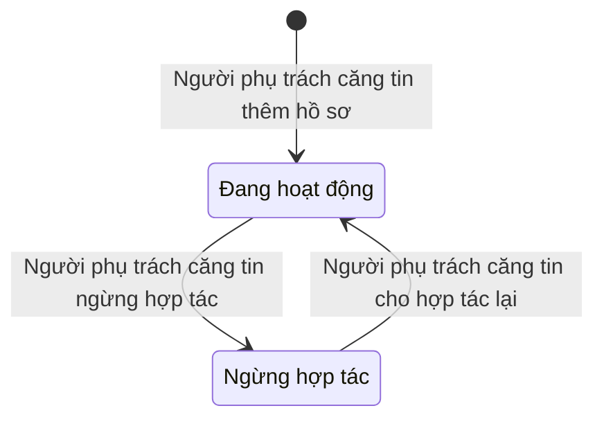
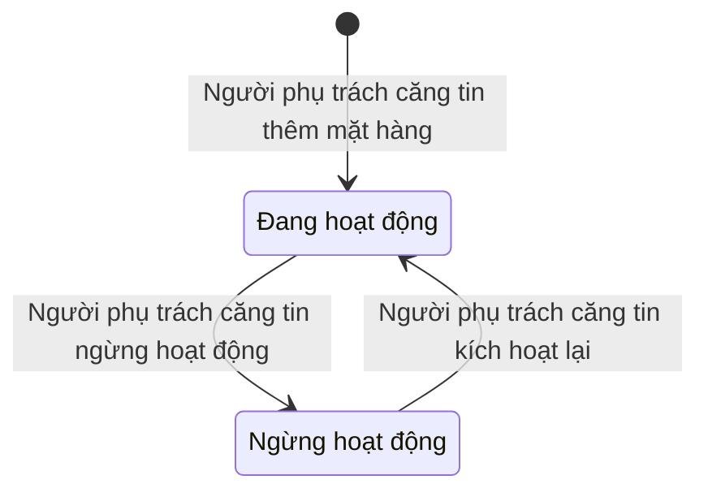
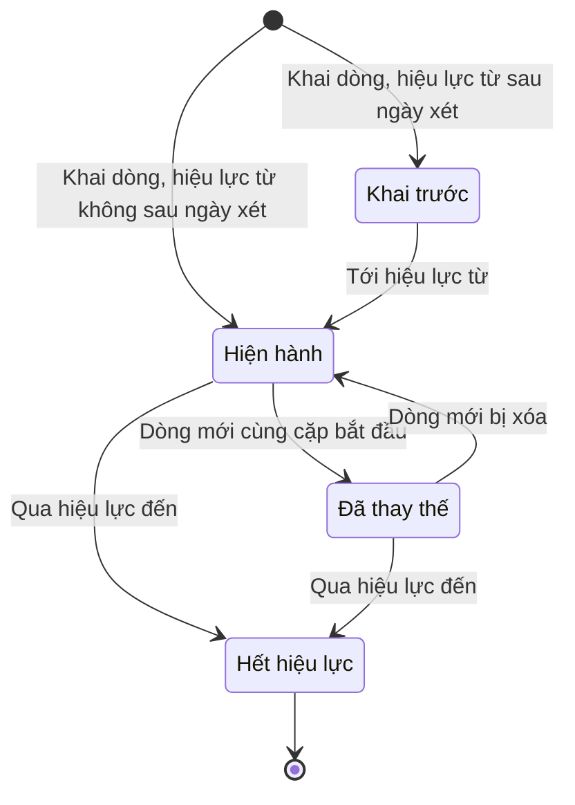
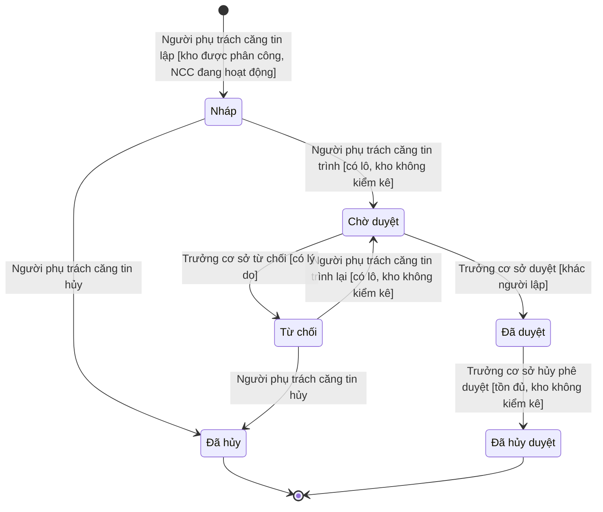
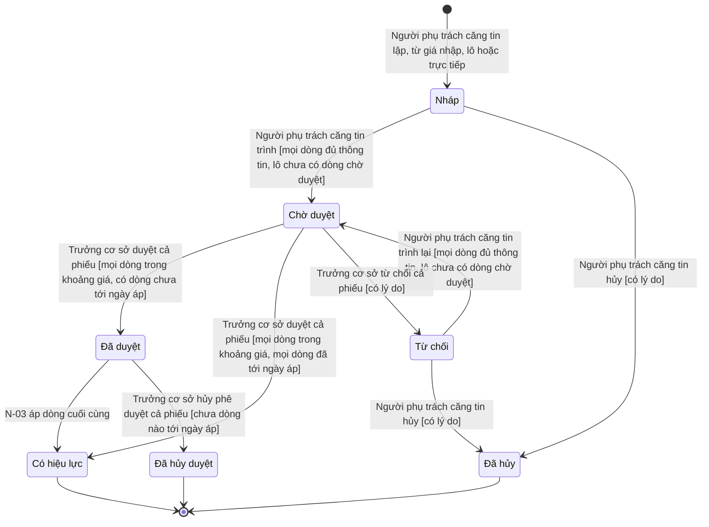
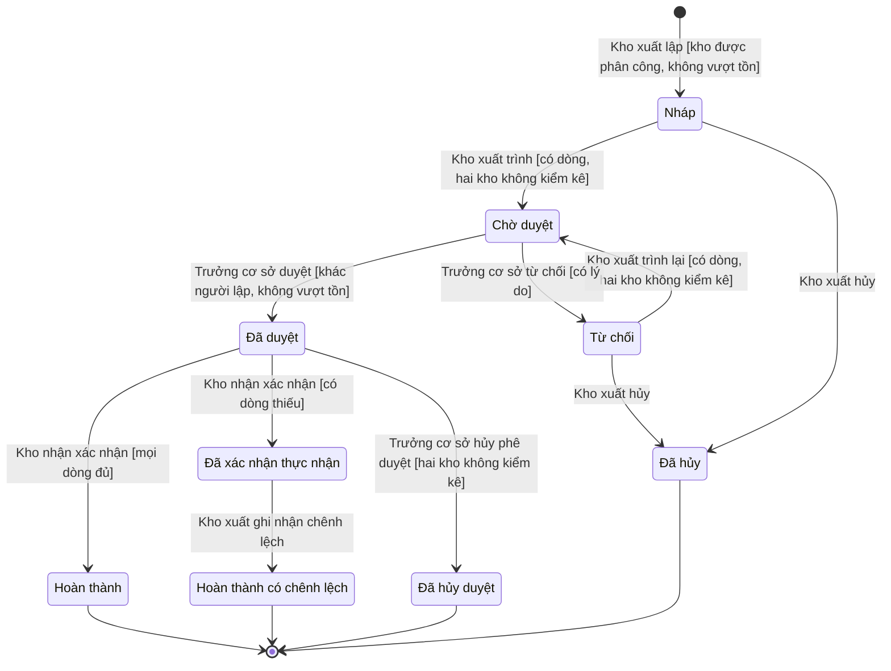
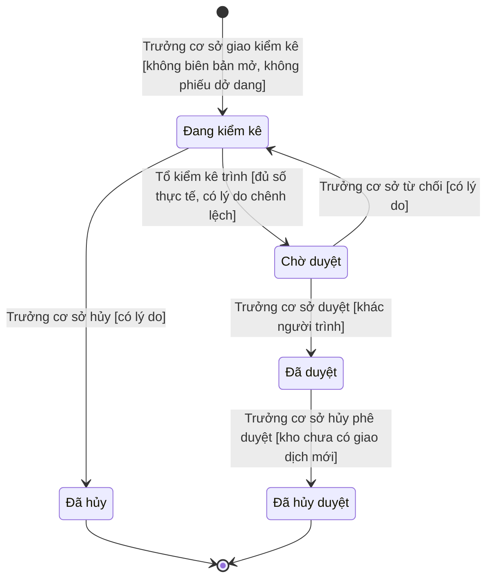
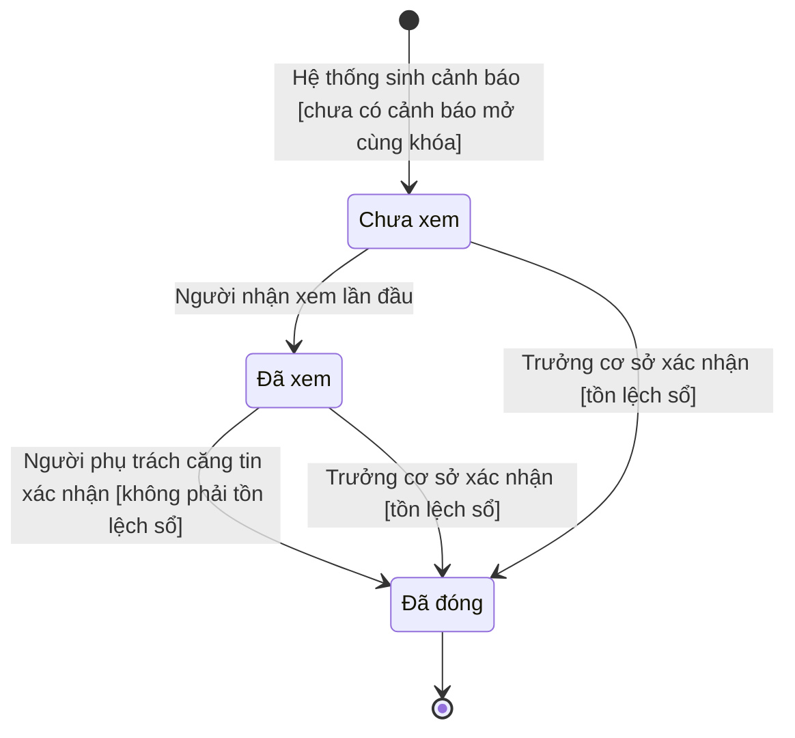

# MÁY TRẠNG THÁI — Quản lý kho căng tin (PM3CSCN)

> Đặc tả **vòng đời của từng đối tượng nghiệp vụ** trong quản lý kho căng tin: **8 máy trạng thái theo 3 nhóm** (7 máy lưu, 1 máy dẫn xuất Δ), 38 trạng thái, 45 dòng chuyển của máy lưu. Mỗi máy gồm:
> - bảng trạng thái — mã enum tiếng Anh theo ERD, tên hiển thị tiếng Việt theo quy trình;
> - sơ đồ Mermaid `stateDiagram-v2`;
> - bảng chuyển trạng thái: sự kiện, ai làm, điều kiện, hệ quả;
> - các chuyển bị cấm.
>
> Dựng từ [Quy trình nghiệp vụ v01](../2-business-process/QT_PM3CSCN_QuanLyKhoCangTin_v02.md) (bảng bước BA chốt 29/10/2026, mục 2 Tác nhân, mục 3 Các loại khóa, mục 3.1 `GS-01` → `GS-06`, mục 5 `N-01` · **<u>GD-0003</u>** → `N-04`, mục 5.1, mục 9) và [ERD v01](../3-erd/ERD_PM3CSCN_QuanLyKhoCangTin_v02.md) (mục 4 enum `trang_thai`, Δ, mục 5.1 `R-xx`, mục 5.3, mục 7 `E-xx`), cùng câu trả lời của BA (RQ-01 → RQ-169, loại nguồn "BA xác nhận").
>
> Không viết lại quy tắc: bước quy trình dẫn `QT-nn bước n`, quyết định dẫn `D-xx`, quy tắc dẫn `GS-xx` — [QT_PM3CSCN_QuanLyKhoCangTin_v02](../2-business-process/QT_PM3CSCN_QuanLyKhoCangTin_v02.md). Mã enum, trường, bảng dẫn theo [ERD_PM3CSCN_QuanLyKhoCangTin_v02](../3-erd/ERD_PM3CSCN_QuanLyKhoCangTin_v02.md). **Hai nơi khác nhau thì quy trình là chuẩn về nghiệp vụ, ERD là chuẩn về mã.** Đọc: 👤 người · ⚙️ hệ thống tự chuyển · 🔗 hệ thống ngoài · ■ kết thúc · Δ dẫn xuất · 🧪 tài liệu tự đề xuất · ❓ chờ chốt (mục 14); giả định của sổ bôi đỏ.
>
> Tài liệu **không** chứa nội dung quy tắc (business rule — lớp 6), bước quy trình (quy trình nghiệp vụ — lớp 2), thiết kế màn hình và nút (SRS).

## Thông tin tài liệu

| Mục | Nội dung |
|---|---|
| Mã tài liệu | `SM_PM3CSCN_QuanLyKhoCangTin` |
| Dự án · Phân hệ | Quản lý kho căng tin (mã dự án PM3CSCN, nền tảng WEB — RQ-69) · Ba phân hệ presales: QUẢN LÝ KHO CĂNG TIN; CẤU HÌNH NGHIỆP VỤ HỆ THỐNG (danh mục hàng hóa và giá bán căng tin); QUẢN LÝ NHÀ CUNG CẤP HÀNG HÓA CĂNG TIN — một bộ tài liệu cho cả ba (RQ-70) |
| Phiên bản · Trạng thái | v01 · Chờ review |
| Người soạn · Người review · Người duyệt | phongnq12 — BA (AI hỗ trợ soạn) · chưa chốt (BA lead) · chưa chốt (BA) |
| Mức mật | Nội bộ |
| Quy trình nguồn · ERD nguồn | v01 [`QT_PM3CSCN_QuanLyKhoCangTin_v02.md`](../2-business-process/QT_PM3CSCN_QuanLyKhoCangTin_v02.md) · v01 [`ERD_PM3CSCN_QuanLyKhoCangTin_v02.md`](../3-erd/ERD_PM3CSCN_QuanLyKhoCangTin_v02.md) |

## Version control

| Tên version | Ngày cập nhật | PIC | Mô tả |
| :--- | :--- | :--- | :--- |
| v00 | 2026-10-29 | phongnq12 | - Dựng theo QT_PM3CSCN_QuanLyKhoCangTin v01 và ERD_PM3CSCN_QuanLyKhoCangTin v00 (/ba-overview đợt 4, lớp máy trạng thái): 8 máy trạng thái theo 3 nhóm, gồm 7 máy lưu và 1 máy dẫn xuất Δ; 3 ma trận trạng thái × thao tác; 9 câu hỏi S-01 → S-09. - Giữ đủ SM-01 → SM-09, chỉnh theo dự án (mục 1.1); không bỏ nguyên tắc nào. - Điền ERD mục 4 (sửa không đổi nghĩa): chỗ mô tả `trang_thai` của bảy thực thể trỏ `SM mục n`. - BA chốt 29/10/2026: S-01 → S-09 (RQ-170 → RQ-178; S-06 theo đề xuất mặc định): ngừng hoạt động mặt hàng cấp danh mục, công tắc Cho phép bán, Cho phép đặt hàng theo kho × mặt hàng là cờ cấu hình; kích hoạt lại mặt hàng, nhà cung cấp; Chờ duyệt không tự hủy; lý do bắt buộc khi hủy và hủy phê duyệt; xem cảnh báo tồn lệch sổ; chặn hủy phê duyệt biên bản khi kho có biên bản đang mở; chứng từ Nháp, Từ chối được treo. - Sửa theo review độc lập vòng 1 (RQ-179 → RQ-181) và ERD v01: giữ kiểm lại kho không đang kiểm kê để chống tranh chấp đồng thời; chống lặp cảnh báo theo R-07 mở rộng cho cả tồn lệch sổ; điều kiện lô của đề xuất giá bán; chặn hủy phê duyệt phiếu nhập kho khi lô nằm trên đề xuất chưa đóng; hủy phê duyệt theo vai Trưởng cơ sở; dẫn `ly_do_huy`, `ly_do_huy_duyet`, `Mat_Hang_Kho`, loại nhật ký `ITEM`. Sửa các điểm Nhẹ của review vòng 1 (#5, #7 → #15). Không còn ô chờ BA chốt, chuyển Chờ review. |
| **v01 (hiện tại)** | **2026-10-29** | phongnq12 | - Bổ sung theo lớp 5, thay đổi có nghĩa sau commit 66817af1, về Chờ review (RQ-190 → RQ-198): mục 6 đề xuất giá bán thành phiếu nhiều dòng `De_Xuat_Gia_Ban_Dong` (RQ-191); duyệt, từ chối, hủy phê duyệt cả phiếu; mọi dòng trong khoảng giá `GS-04` · **<u>GD-0001</u>** · **<u>GD-0008</u>**, mỗi lô một dòng chờ duyệt (RQ-139); ngày bắt đầu áp theo dòng (RQ-166), phiếu Có hiệu lực khi mọi dòng đã áp (RQ-197); hủy phê duyệt chỉ khi chưa dòng nào tới ngày áp (RQ-198, thay RQ-35 phần đề xuất); điểm vào lập đề xuất (RQ-190, RQ-193); ma trận mục 12 theo. - Mục 5: điều kiện hủy phê duyệt phiếu nhập kho dẫn dòng đề xuất của phiếu đề xuất chưa đóng (RQ-180). Mục 8: tách nhiệm người trình khác người duyệt (RQ-195). - Sửa không đổi nghĩa theo lớp 5: dẫn bước hủy phê duyệt phiếu đề xuất theo QT v02 (QT-03 bước 10–12, điều kiện bước 11) ở mục 6 và ma trận. |

## Phê duyệt

| Vai trò | Họ tên | Ngày | Ý kiến |
|---|---|---|---|
| BA soạn | | | |
| Product owner / Khách hàng | | | |
| Tech lead | | | |

---

## 1. Quy ước chung

### 1.1. Nguyên tắc

| Mã | Quy ước | Căn cứ |
|---|---|---|
| **SM-01** | Mã trạng thái là **enum tiếng Anh** đúng như ERD. Giao diện chỉ hiện **tên tiếng Việt** ở cột *Hiển thị* | ERD mục 4, mục 4.8 Danh mục mã enum |
| **SM-02** | Trạng thái **dẫn xuất** **không lưu cờ**, tính khi truy vấn. Máy dẫn xuất có ký hiệu **Δ** (mục 4) | ERD mục 1 (Không lưu cờ cho hiệu lực của dòng giá nhập) |
| **SM-03** | Mỗi chuyển trạng thái ghi một dòng nhật ký `Nhat_Ky_Thay_Doi`: đối tượng, thao tác, giá trị trước và sau, lý do, người hoặc hệ thống, thời điểm. Mặt hàng ghi loại đối tượng `ITEM`, công tắc theo kho ghi `ITEM_WAREHOUSE`; chuyển ⚙️ `N-03` ghi thao tác `UPDATE`, người để trống; ngoại lệ: xem cảnh báo (`NEW` → `VIEWED`) không ghi nhật ký — S-06 | ERD mục 4.7 `Nhat_Ky_Thay_Doi` · RQ-121 · NFR-07 Lịch sử thay đổi |
| **SM-04** | Chuyển bằng **cập nhật có điều kiện** `WHERE trang_thai = :tu` và phiên bản bản ghi `row_version`. Bản ghi đã đổi thì báo *bản ghi đã được xử lý*, tải lại. Bấm hai lần chỉ ghi một lần. `Mat_Hang`, `Nha_Cung_Cap` không có `row_version` ở ERD: chỉ dùng điều kiện trạng thái | ERD mục 1 (khóa lạc quan) · E-03 Khóa lạc quan và thứ tự khóa |
| **SM-05** | Trạng thái kết thúc **■** không quay lại; làm lại thì tạo bản ghi mới. Tài liệu này không có ngoại lệ | RQ-38 (đóng hẳn, cần thì lập chứng từ mới) · quy trình mục 3 Khóa chứng từ đã đóng · NFR-08 Giữ chứng từ đã đóng · **<u>GD-0006</u>** |
| **SM-06** | Từ chối (`ly_do_tu_choi`), hủy (`ly_do_huy` — người lập hủy chứng từ, Trưởng cơ sở hủy biên bản kiểm kê) và hủy phê duyệt (`ly_do_huy_duyet`): **bắt buộc lý do**, ghi ở cột *Điều kiện* của từng chuyển. Không có ngoại lệ | RQ-34 · BRQ-26 Từ chối có lý do · RQ-137 · RQ-175 |
| **SM-07** | Mỗi chuyển do người là **một quyền riêng** (tính theo thao tác); người lập một chứng từ **không tự duyệt** chính chứng từ đó, ghi ở cột *Điều kiện* của chuyển duyệt. Hủy phê duyệt theo **vai** Trưởng cơ sở của cơ sở, không đòi đúng người đã duyệt | Quy trình mục 2 Tách nhiệm bắt buộc · quy trình mục 9 điểm 8 · RQ-121 · R-09 → R-12 · RQ-40 · RQ-181 |
| **SM-08** | Chuyển kéo theo ghi sổ khác thì mọi thứ chạy **trong một giao dịch**, khóa theo thứ tự chứng từ → `Ton_Kho_Lo` theo (`kho_id`, `lo_id`) tăng dần → ghi thêm `Bien_Dong_Ton`. Cột *Hệ quả* ghi đủ phần kéo theo | ERD mục 5.1 Thứ tự khóa · E-03 Khóa lạc quan và thứ tự khóa · R-01 |
| **SM-09** | Mọi chuyển 👤 chỉ trên bản ghi cùng cơ sở với người thao tác; chuyển của Người phụ trách căng tin trên chứng từ, cảnh báo của một kho chỉ khi kho đó được phân công cho người đó (`Phan_Cong_Kho`). Bảng chuyển không nhắc lại | R-23 · NFR-10 Dữ liệu riêng từng cơ sở · quy trình mục 9 điểm 30 · RQ-142 · RQ-151 · RQ-152 |

### 1.2. Ký hiệu

| Ký hiệu | Nghĩa |
|---|---|
| 👤 | Người thao tác, ghi rõ vai trò đúng tên ở quy trình mục 2; bước hệ thống chạy cùng request với bước người thì dẫn cả dải bước |
| ⚙️ | Hệ thống tự chuyển — do sự kiện khác trong hệ thống hoặc tác vụ nền `N-xx` |
| 🔗 | Sự kiện từ ngoài hệ thống — Hệ thống bán hàng căng tin (quy trình mục 5.1) |
| ■ | Trạng thái kết thúc — không có chuyển ra |
| **Δ** | Máy dẫn xuất — không lưu trạng thái |
| 🧪 | Do tài liệu tự đề xuất, nguồn phía trên chưa nêu (`00_quy_uoc_chung.md` mục 5); mỗi 🧪 kèm một dòng `S-xx` ở mục 14; bản này không còn chuyển 🧪 |
| ❓ | Cần BA hoặc khách chốt, kèm mã `S-xx`; bản này không còn ô ❓ |

### 1.3. Danh sách máy trạng thái

| # | Máy | Thực thể ERD | Loại | Quy trình |
|---|---|---|---|---|
| **A** | **Nhà cung cấp, nhập kho và giá bán** | | | |
| 2 | Nhà cung cấp | `Nha_Cung_Cap` | Lưu | QT-01 |
| 3 | Mặt hàng | `Mat_Hang` | Lưu | QT-03 |
| 4 | Hiệu lực dòng giá nhập | `Dong_Gia_Nhap` | Δ | QT-01 |
| 5 | Phiếu nhập kho | `Phieu_Nhap_Kho` | Lưu | QT-02 |
| 6 | Đề xuất giá bán | `De_Xuat_Gia_Ban` | Lưu | QT-03 · QT-01 · QT-02 |
| **B** | **Điều chuyển và kiểm kê** | | | |
| 7 | Phiếu điều chuyển | `Phieu_Dieu_Chuyen` | Lưu | QT-04 |
| 8 | Biên bản kiểm kê | `Bien_Ban_Kiem_Ke` | Lưu | QT-05 |
| **C** | **Cảnh báo** | | | |
| 9 | Cảnh báo | `Canh_Bao` | Lưu | QT-06 · QT-02 |

Máy mục 7 là máy Lưu: đích của chuyển xác nhận thực nhận (QT-04 bước 9–11) do hệ thống chọn theo dòng con ở ERD mục 5.3, nhưng chuyển vẫn do người phụ trách căng tin kho nhận kích hoạt, nên không thuộc loại "Lưu, suy từ bảng con".

**Không có máy trạng thái:** mọi trường `trang_thai` của ERD đều có máy (bảy thực thể trên). Giá trị Δ dạng đúng/sai ở ERD mục 4 không lập máy vì ERD không đặt mã enum và chúng là điều kiện của chuyển ở máy khác: `Lo` (`lo_cho_gia`, `lo_sap_het_han`, `lo_qua_han` — suy từ mục 5, 6 và ngày; điều kiện sinh cảnh báo mục 9) · `Kho` (`kho_dang_kiem_ke`, `phieu_dang_do` — suy từ mục 5, 7, 8; điều kiện chặn ở mục 5, 7, 8) · `Mat_Hang_Nha_Cung_Cap` (`ngung_hoat_dong` — suy từ mục 2, 3) · `Dong_Gia_Nhap` (`da_phat_sinh` — suy từ máy mục 5, điều kiện khóa dòng giá nhập ở QT-01 bước 6 · RQ-167) · `Mat_Hang_Kho` (`cho_phep_ban`, `cho_phep_dat_hang` — cờ cấu hình đúng/sai theo kho × mặt hàng, không phải `trang_thai`; người phụ trách căng tin của kho bật, tắt, không duyệt, có nhật ký, mặc định bật — RQ-170, RQ-172; Cho phép bán tắt thì Hệ thống bán hàng căng tin không bán mặt hàng tại kho đó — RQ-171; Cho phép đặt hàng phục vụ đặt hàng, ngoài phạm vi lần này — RQ-170). Bảng ở ERD mục 5.3 thuộc máy mục 7.

---

# NHÓM A — NHÀ CUNG CẤP, NHẬP KHO VÀ GIÁ BÁN

## 2. Nhà cung cấp — `Nha_Cung_Cap`

Hồ sơ nhà cung cấp lập ở Đang hoạt động; người phụ trách căng tin ngừng hợp tác khi thôi giao dịch, không qua duyệt (RQ-20, RQ-56); hồ sơ không xóa, chỉ ngừng hợp tác (ERD mục 1). Người phụ trách căng tin cho nhà cung cấp hợp tác lại, không duyệt, có nhật ký (BA chốt 29/10/2026 — RQ-173).

| Mã | Hiển thị | Nghĩa | Sửa được |
|---|---|---|:-:|
| `ACTIVE` | Đang hoạt động | Nhà cung cấp được chọn khi lập phiếu nhập kho (QT-02 bước 2) và khai giá nhập (QT-01 bước 6) | ✅ |
| `TERMINATED` | Ngừng hợp tác | Không được chọn khi lập phiếu nhập kho mới (RQ-16); mọi cặp nhà cung cấp – mặt hàng của nó ngừng hoạt động (Δ `ngung_hoat_dong`). Không ■ vì còn chuyển hợp tác lại (RQ-173) | ✅ |

| Từ → Đến | Tên trạng thái | Ai — sự kiện | Điều kiện | Hệ quả |
|---|---|---|---|---|
| → `ACTIVE` | → Đang hoạt động | 👤 Người phụ trách căng tin — QT-01 bước 1, 7 (thêm hồ sơ) | Không qua duyệt — RQ-20 · RQ-56; ngoài SM-09 không có điều kiện riêng | Không ghi sổ |
| `ACTIVE` → `TERMINATED` | Đang hoạt động → Ngừng hợp tác | 👤 Người phụ trách căng tin — QT-01 bước 1, 7 (ngừng hợp tác) | Không qua duyệt — RQ-20 · RQ-56; ngoài SM-09 không có điều kiện riêng | Không ghi sổ. Từ lúc chuyển: nhà cung cấp không được chọn ở QT-02 bước 2 (RQ-16); cặp của nhà cung cấp ngừng hoạt động (Δ `ngung_hoat_dong`), bị chặn khai, sửa dòng giá nhập ở QT-01 bước 6 |
| `TERMINATED` → `ACTIVE` | Ngừng hợp tác → Đang hoạt động | 👤 Người phụ trách căng tin — QT-01 bước 1, 7 (cho hợp tác lại) | Không qua duyệt — RQ-173; ngoài SM-09 không có điều kiện riêng | Không ghi sổ; cặp của nhà cung cấp hết ngừng hoạt động khi mặt hàng còn hoạt động (Δ `ngung_hoat_dong`) |

**Cấm:** xóa hồ sơ nhà cung cấp (ERD mục 1: nhà cung cấp không xóa, chỉ ngừng hợp tác) · duyệt hồ sơ (không có bước duyệt — RQ-20).

---

## 3. Mặt hàng — `Mat_Hang`

Mặt hàng thêm vào danh mục hàng hóa căng tin ở Đang hoạt động, không cần duyệt (RQ-17); ngừng hoạt động theo `PS:PM3CSCN.WEB.10.01.01`, không có bước quy trình (quy trình mục 1 Ngoài phạm vi). Ngừng hoạt động là trạng thái cấp danh mục, không bị chặn; công tắc Cho phép bán theo kho là cờ cấu hình riêng (mục 1.3); kích hoạt lại không duyệt (BA chốt 29/10/2026 — RQ-171, RQ-173).

| Mã | Hiển thị | Nghĩa | Sửa được |
|---|---|---|:-:|
| `ACTIVE` | Đang hoạt động | Mặt hàng dùng được cho nhà cung cấp, giá nhập, giá bán, nhập kho, điều chuyển, kiểm kê trong cơ sở (BRQ-08 Danh mục hàng hóa dùng chung) | ✅ |
| `INACTIVE` | Ngừng hoạt động | Mọi cặp nhà cung cấp – mặt hàng của nó ngừng hoạt động (Δ `ngung_hoat_dong`). Không lập mới được phiếu nhập kho, đề xuất giá bán, dòng giá nhập cho mặt hàng; chứng từ đang mở, lô đang tồn, bán, điều chuyển, kiểm kê đi tiếp (RQ-171). Không ■ vì còn chuyển kích hoạt lại (RQ-173) | ✅ |

| Từ → Đến | Tên trạng thái | Ai — sự kiện | Điều kiện | Hệ quả |
|---|---|---|---|---|
| → `ACTIVE` | → Đang hoạt động | 👤 Người phụ trách căng tin — QT-03 bước 1 (thêm mặt hàng) | Không qua duyệt — RQ-17 · BRQ-08 Danh mục hàng hóa dùng chung | Không ghi sổ |
| `ACTIVE` → `INACTIVE` | Đang hoạt động → Ngừng hoạt động | 👤 Người phụ trách căng tin — `PS:PM3CSCN.WEB.10.01.01` (ngừng hoạt động mặt hàng; quy trình mục 1 Ngoài phạm vi, không có bước) | Không bị chặn bởi tồn kho, đề xuất giá bán hay chứng từ đang mở của mặt hàng — RQ-171; không qua duyệt | Không ghi sổ. Từ lúc chuyển: không lập mới phiếu nhập kho, đề xuất giá bán, dòng giá nhập có mặt hàng này (RQ-171); các cặp của mặt hàng ngừng hoạt động (Δ `ngung_hoat_dong`, chặn ở QT-01 bước 6); chứng từ đang mở, lô, bán, điều chuyển, kiểm kê đi tiếp (RQ-171) |
| `INACTIVE` → `ACTIVE` | Ngừng hoạt động → Đang hoạt động | 👤 Người phụ trách căng tin — `PS:PM3CSCN.WEB.10.01.01` (kích hoạt lại) | Không qua duyệt — RQ-173; ngoài SM-09 không có điều kiện riêng | Không ghi sổ; các cặp hết ngừng hoạt động khi nhà cung cấp còn Đang hoạt động (Δ `ngung_hoat_dong`) |

Xóa mặt hàng (`da_xoa`) không là chuyển trạng thái: đó là quy ước xóa mềm của ERD mục 1. Nhật ký của `Mat_Hang` ghi loại đối tượng `ITEM` (SM-03, S-06).

**Cấm:** duyệt mặt hàng (không có bước duyệt — RQ-17).

---

## 4. Hiệu lực dòng giá nhập — `Dong_Gia_Nhap` · Δ

Hiệu lực của dòng giá nhập không lưu, tính theo ngày xét d và các dòng chưa xóa cùng cặp nhà cung cấp – mặt hàng (ERD mục 4.2 Δ `hieu_luc`; SM-02). Dòng đã xóa mềm ở QT-01 bước 5 không còn hiệu lực nào.

| Mã | Hiển thị | Nghĩa |
|---|---|---|
| `UPCOMING` | Khai trước | Ngày xét trước hiệu lực từ; dòng còn sửa được hiệu lực từ (QT-01 bước 4) |
| `CURRENT` | Hiện hành | Dòng đang áp; là giá nhập mặc định khi lập phiếu nhập kho (QT-02 bước 1; RQ-16) |
| `REPLACED` | Đã thay thế | Một dòng mới hơn cùng cặp đã bắt đầu trong hiệu lực của dòng này; dòng bị khóa sửa (quy trình mục 3 Khóa dòng giá nhập) |
| `EXPIRED` ■ | Hết hiệu lực | Ngày xét đã qua hiệu lực đến; khóa sửa (quy trình mục 3 Khóa dòng giá nhập), không còn đường ra |

Công thức xét theo đúng thứ tự của ERD mục 4.2, ra đúng một giá trị:

| Trạng thái | Công thức suy ra | Đổi khi |
|---|---|---|
| `UPCOMING` Khai trước | d < `hieu_luc_tu` | Khai dòng có hiệu lực từ sau ngày xét (QT-01 bước 3); sửa hiệu lực từ khi dòng còn Khai trước (QT-01 bước 4) |
| `EXPIRED` Hết hiệu lực | d > `hieu_luc_den` | Ngày xét qua `hieu_luc_den`; sửa `hieu_luc_den` về trước ngày xét (QT-01 bước 4) |
| `REPLACED` Đã thay thế | Không thuộc hai dòng trên, và có `Dong_Gia_Nhap` chưa xóa khác cùng `mat_hang_nha_cung_cap_id` có `hieu_luc_tu` > `hieu_luc_tu` của dòng này và ≤ d | Ngày xét tới `hieu_luc_tu` của dòng mới cùng cặp khai ở QT-01 bước 3 trong hiệu lực của dòng này; khai dòng mới cùng cặp có hiệu lực từ không sau ngày xét (QT-01 bước 3) |
| `CURRENT` Hiện hành | Không thuộc ba dòng trên | Ngày xét tới `hieu_luc_tu`; khai dòng có hiệu lực từ không sau ngày xét (QT-01 bước 3); dòng mới đang thay thế dòng này bị xóa (QT-01 bước 5, 12) |

Lệch UML có chủ ý — nhiều điểm vào: giá trị đầu của máy Δ phụ thuộc ngày xét lúc khai, QT-01 bước 3 ghi "dòng giá nhập Khai trước hoặc Hiện hành". Máy Δ không có 👤; thao tác của người nằm ở QT-01 bước 3, 4, 5.

**Cấm:** sửa dòng ở `REPLACED` hoặc `EXPIRED`, sửa hiệu lực từ khi dòng đã `CURRENT` — quy trình mục 3 Khóa dòng giá nhập · QT-01 bước 6 · RQ-132.

---

## 5. Phiếu nhập kho — `Phieu_Nhap_Kho`

Phiếu đi từ Nháp qua Chờ duyệt tới Đã duyệt; bị từ chối thì người lập sửa và trình lại hoặc hủy (RQ-34); Trưởng cơ sở hủy phê duyệt phiếu đã duyệt, phiếu đóng hẳn (RQ-38, RQ-40). Phiếu nhập kho đầu kỳ đi cùng máy này (RQ-98, RQ-105).

| Mã | Hiển thị | Nghĩa | Sửa được |
|---|---|---|:-:|
| `DRAFT` | Nháp | Người phụ trách căng tin đã lập, chưa trình; in được (QT-02 bước 3); tồn chưa đổi | ✅ |
| `PENDING_APPROVAL` | Chờ duyệt | Đã trình, chờ Trưởng cơ sở xét, không đặt thời hạn (RQ-90); là phiếu dở dang của kho nhập (Δ `phieu_dang_do`) | — |
| `REJECTED` | Từ chối | Trưởng cơ sở từ chối kèm lý do; người lập sửa và trình lại hoặc hủy (RQ-34 · BRQ-17 Xử lý chứng từ bị từ chối) | ✅ |
| `APPROVED` | Đã duyệt | Tồn kho theo lô của kho nhập đã tăng; còn đường hủy phê duyệt | — |
| `CANCELLED` ■ | Đã hủy | Người lập bỏ phiếu chưa duyệt; đóng hẳn, cần thì lập phiếu mới (quy trình mục 3 Khóa chứng từ đã đóng) | — |
| `REVOKED` ■ | Đã hủy duyệt | Trưởng cơ sở rút phê duyệt, tồn đã giảm lại; đóng hẳn (RQ-38) | — |

| Từ → Đến | Tên trạng thái | Ai — sự kiện | Điều kiện | Hệ quả |
|---|---|---|---|---|
| → `DRAFT` | → Nháp | 👤 Người phụ trách căng tin — QT-02 bước 1–2 | Kiểm điều kiện lập phiếu nhập kho — QT-02 bước 2 · quy trình mục 9 điểm 6 · RQ-14 · RQ-16 · RQ-110 · RQ-142 · RQ-165 · R-26 | Trong một giao dịch: ghi các `Lo` của phiếu (giá nhập mặc định từ dòng giá nhập `CURRENT` — SM mục 4) |
| `DRAFT`, `REJECTED` → `PENDING_APPROVAL` | Nháp, Từ chối → Chờ duyệt | 👤 Người phụ trách căng tin — QT-02 bước 5–6 (trình) | Phiếu có ít nhất một lô — R-28 · kho nhập không đang kiểm kê — QT-02 bước 6 · RQ-138 · BRQ-29 Khóa kho đang kiểm kê | Khóa sửa; ghi `nguoi_trinh_id`, `thoi_diem_trinh`. Không ghi sổ |
| `DRAFT`, `REJECTED` → `CANCELLED` | Nháp, Từ chối → Đã hủy | 👤 Người phụ trách căng tin — QT-02 bước 5 (hủy) | Phiếu đang ở một trong hai trạng thái nguồn — RQ-34 · BRQ-17 Xử lý chứng từ bị từ chối; bắt buộc lý do `ly_do_huy` — SM-06 · RQ-175 | Không ghi sổ; phiếu đóng hẳn |
| `PENDING_APPROVAL` → `APPROVED` | Chờ duyệt → Đã duyệt | 👤 Trưởng cơ sở — QT-02 bước 7–11, 14, 15 (duyệt) | Người duyệt khác người lập — R-09 · RQ-121 · NFR-01 Chỉ Trưởng cơ sở duyệt · **kiểm lại** kho nhập không đang kiểm kê, chống tranh chấp đồng thời với giao kiểm kê — QT-02 bước 8 · RQ-110 · RQ-138 · RQ-179 | Trong một giao dịch: mỗi `Lo` cộng `Ton_Kho_Lo` tại kho nhập và ghi `Bien_Dong_Ton` loại `RECEIPT` (R-01, R-02); lô có giá bán hiện hành ≥ giá nhập: ghi `Gia_Ban_Lo` với `ngay_ap_dung` = ngày duyệt (QT-02 bước 11; R-15 · `GS-01` Giá bán theo lô); lô còn lại là lô chờ giá (Δ `lo_cho_gia`, QT-02 bước 14) và sinh `Canh_Bao` `PENDING_PRICE_LOT` khi chưa có cảnh báo đang mở (QT-02 bước 15; R-07 · SM mục 9). Ghi `nguoi_duyet_id`, `thoi_diem_duyet` |
| `PENDING_APPROVAL` → `REJECTED` | Chờ duyệt → Từ chối | 👤 Trưởng cơ sở — QT-02 bước 7 (từ chối) | Bắt buộc lý do — SM-06 · RQ-34 · BRQ-26 Từ chối có lý do | Ghi `ly_do_tu_choi`; phiếu trả về người lập. Không ghi sổ |
| `APPROVED` → `REVOKED` | Đã duyệt → Đã hủy duyệt | 👤 Trưởng cơ sở — QT-02 bước 16–18 (hủy phê duyệt) | Tồn hiện tại của mọi lô tại kho nhập ≥ số đã nhập — QT-02 bước 17 · RQ-09 · kho nhập không đang kiểm kê — QT-02 bước 17 · RQ-133 · RQ-138 · không lô nào của phiếu nằm trên `De_Xuat_Gia_Ban_Dong` của phiếu đề xuất chưa đóng (trạng thái khác `EFFECTIVE`, `CANCELLED`, `REVOKED`), phải hủy hoặc từ chối phiếu đề xuất trước — RQ-180 · RQ-191 · bắt buộc lý do `ly_do_huy_duyet` — SM-06 · RQ-175 | Trong một giao dịch: mỗi `Lo` trừ `Ton_Kho_Lo` tại kho nhập và ghi `Bien_Dong_Ton` loại `RECEIPT_REVOKE` (R-01, R-02); kiểm tồn tối thiểu của kho, sinh `Canh_Bao` `LOW_STOCK` khi tồn < `CH-01` và chưa có cảnh báo đang mở (QT-06 bước 2–3; R-08 · SM mục 9). `Gia_Ban_Lo` giữ nguyên (sổ chỉ thêm). Ghi `nguoi_huy_duyet_id`, `thoi_diem_huy_duyet` |

Hủy phê duyệt bị chặn vì tồn không đủ thì Trưởng cơ sở giao kiểm kê đột xuất (QT-05) — ASM-007 (BA xác nhận — RQ-116). Điều kiện **kiểm lại** kho không đang kiểm kê lúc duyệt (QT-02 bước 8) giữ để chống tranh chấp khi giao kiểm kê và duyệt phiếu xảy ra cùng lúc (RQ-179). Trạng thái `DRAFT`, `REJECTED` được treo không thời hạn, không có chuyển hết hạn (RQ-178).

**Cấm:** `DRAFT` → `APPROVED` không qua Chờ duyệt · `PENDING_APPROVAL` → `CANCELLED` (người lập không tự hủy phiếu Chờ duyệt, phải chờ Trưởng cơ sở từ chối — RQ-174) · `APPROVED` → `REJECTED` hoặc `PENDING_APPROVAL` · Trưởng cơ sở duyệt phiếu do chính mình lập (R-09) · `CANCELLED`, `REVOKED` → bất kỳ trạng thái nào · sửa phiếu ở `PENDING_APPROVAL`, `APPROVED`.

---

## 6. Đề xuất giá bán — `De_Xuat_Gia_Ban`

Một đề xuất giá bán gồm nhiều dòng `De_Xuat_Gia_Ban_Dong`, mỗi dòng một lô với giá bán đề xuất, ngày hiệu lực, giá bán lẻ tại địa phương và chứng từ riêng (BA chốt 29/10/2026 — RQ-191). Phiếu lập ở Nháp từ ba điểm vào (QT-01 bước 10, QT-02 bước 13, QT-03 bước 2 — RQ-190, RQ-193); Trưởng cơ sở duyệt hoặc từ chối **cả phiếu** một lần (RQ-191). Ngày bắt đầu áp tính **theo dòng** = ngày muộn hơn giữa ngày hiệu lực của dòng và ngày duyệt (RQ-166); từng dòng có hiệu lực từ ngày áp của dòng, phiếu ở Đã duyệt tới khi mọi dòng đã áp thì sang Có hiệu lực (RQ-197). Hủy phê duyệt cả phiếu, chỉ khi chưa dòng nào đến ngày bắt đầu áp (RQ-198, thay RQ-35 phần đề xuất giá bán).

| Mã | Hiển thị | Nghĩa | Sửa được |
|---|---|---|:-:|
| `DRAFT` | Nháp | Đã lập, chưa trình; người phụ trách căng tin thêm, sửa, bỏ dòng (QT-03 bước 2) | ✅ |
| `PENDING_APPROVAL` | Chờ duyệt | Đã trình, chờ Trưởng cơ sở xét cả phiếu, không đặt thời hạn (RQ-90); mỗi lô chỉ ở một dòng đề xuất đang chờ duyệt trên mọi phiếu (`GS-01` Giá bán theo lô · RQ-139) | — |
| `REJECTED` | Từ chối | Trưởng cơ sở từ chối cả phiếu kèm lý do; người lập sửa và trình lại hoặc hủy (RQ-34 · RQ-191) | ✅ |
| `APPROVED` | Đã duyệt | Trưởng cơ sở đã duyệt, còn ít nhất một dòng chưa tới ngày bắt đầu áp; dòng đã tới ngày đã có hiệu lực cho lô của dòng (RQ-197); còn đường Có hiệu lực, và hủy phê duyệt khi chưa dòng nào tới ngày áp (RQ-198) | — |
| `EFFECTIVE` ■ | Có hiệu lực | Mọi dòng đã áp (`Gia_Ban_Lo`); không hủy phê duyệt được vì đã có dòng tới ngày áp (RQ-198), nên không còn đường ra. Giá có còn là giá bán hiện hành hay không là Δ `gia_ban_hien_hanh`, không đổi trạng thái | — |
| `CANCELLED` ■ | Đã hủy | Người lập bỏ phiếu chưa duyệt; đóng hẳn | — |
| `REVOKED` ■ | Đã hủy duyệt | Trưởng cơ sở rút phê duyệt cả phiếu khi chưa dòng nào áp; đóng hẳn (RQ-38, RQ-198) | — |

| Từ → Đến | Tên trạng thái | Ai — sự kiện | Điều kiện | Hệ quả |
|---|---|---|---|---|
| → `DRAFT` | → Nháp | 👤 Người phụ trách căng tin — QT-01 bước 3–10 (khai, sửa dòng giá nhập; quyết định giá bán là bước của UC khai đợt giá nhập và sửa dòng giá nhập — RQ-190) | Giá nhập mới vượt giá bán hiện hành, mặt hàng chưa có giá bán, hoặc bước 9 chọn lập kèm lý do — QT-01 bước 8–10 · quy trình mục 9 điểm 2, 3 · RQ-52 | Trong một giao dịch với lưu dòng giá nhập: lập phiếu Nháp hoặc thêm dòng vào phiếu Nháp, dòng ghi dòng giá nhập nguồn — ERD (RQ-191) · RQ-190. Chuyển QT-03 |
| → `DRAFT` | → Nháp | 👤 Người phụ trách căng tin — QT-02 bước 12–13 (chọn đề xuất giá mới cho lô sau khi phiếu nhập kho được duyệt; điểm vào của UC lập đề xuất — RQ-193) | Lô chưa có dòng đề xuất khác đang chờ duyệt — `GS-01` Giá bán theo lô · RQ-139 · RQ-141 · lô đang có trong tồn kho — RQ-23 | Trong một giao dịch: ghi `De_Xuat_Gia_Ban_Dong` cho lô — ERD (RQ-191). Chuyển QT-03 |
| → `DRAFT` | → Nháp | 👤 Người phụ trách căng tin — QT-03 bước 2 (lập phiếu đề xuất) | Không qua duyệt khi lập — RQ-08 · RQ-112 · lô của mỗi dòng đang có trong tồn kho — RQ-23 | Trong một giao dịch: ghi các `De_Xuat_Gia_Ban_Dong` và `Tep_Dinh_Kem` chứng từ giá bán lẻ của dòng đã tải lên — ERD (RQ-191) |
| `DRAFT`, `REJECTED` → `PENDING_APPROVAL` | Nháp, Từ chối → Chờ duyệt | 👤 Người phụ trách căng tin — QT-03 bước 3–4 (trình) | Phiếu có ít nhất một dòng; mỗi dòng đủ thông tin bắt buộc (mặt hàng, lô, giá bán đề xuất, giá bán lẻ tại địa phương kèm chứng từ, ngày hiệu lực) — QT-03 bước 4 · BRQ-02 Trình đề xuất giá đủ thông tin · RQ-112 · RQ-191 · không lô nào đã ở dòng đề xuất khác đang chờ duyệt — `GS-01` Giá bán theo lô · RQ-139 · lô của mỗi dòng đang có trong tồn kho — RQ-23 | Khóa sửa; ghi `nguoi_trinh_id`, `thoi_diem_trinh`. Không ghi sổ |
| `DRAFT`, `REJECTED` → `CANCELLED` | Nháp, Từ chối → Đã hủy | 👤 Người phụ trách căng tin — QT-03 bước 3 (hủy) | Phiếu đang ở một trong hai trạng thái nguồn — RQ-34 · BRQ-17 Xử lý chứng từ bị từ chối; bắt buộc lý do `ly_do_huy` — SM-06 · RQ-175 | Không ghi sổ; lô chờ giá của các dòng tiếp tục bị giữ, `N-01` · **<u>GD-0003</u>** cảnh báo lô chờ giá (RQ-41 · SM mục 9) |
| `PENDING_APPROVAL` → `APPROVED` | Chờ duyệt → Đã duyệt | 👤 Trưởng cơ sở — QT-03 bước 5–7 (duyệt cả phiếu) | Mọi dòng có giá trong khoảng `GS-04` Khoảng giá bán được duyệt · **<u>GD-0001</u>** · **<u>GD-0008</u>** của chính dòng — QT-03 bước 6 · `TT79 Đ41.4` · RQ-191; một dòng không đạt thì không duyệt được, Trưởng cơ sở từ chối cả phiếu · mỗi lô một dòng chờ duyệt — RQ-139 · giá đầu của mặt hàng: Trưởng cơ sở đã xét `TT79 Đ16.1`–`Đ16.8` — QT-03 bước 5 · BRQ-07 Không duyệt giá đồ vật cấm, chất cấm · **<u>GD-0002</u>** · người duyệt khác người lập — R-11 · RQ-121 · còn ít nhất một dòng có ngày hiệu lực sau ngày duyệt — RQ-166 · RQ-197 | Trong một giao dịch: dòng có ngày hiệu lực là ngày duyệt hoặc đã qua ghi `Gia_Ban_Lo` cho lô của dòng với `ngay_ap_dung` = ngày duyệt, lô chờ giá của dòng đó được mở bán (Δ `lo_cho_gia`) — RQ-166 · RQ-197; dòng còn lại chờ `N-03`. Ghi `nguoi_duyet_id`, `thoi_diem_duyet` |
| `PENDING_APPROVAL` → `EFFECTIVE` | Chờ duyệt → Có hiệu lực | 👤 Trưởng cơ sở — QT-03 bước 5–7 (duyệt cả phiếu) | Mọi dòng có ngày hiệu lực là ngày duyệt hoặc đã qua — QT-03 bước 7 · RQ-123 · RQ-166 · RQ-197 · E-13 Đề xuất duyệt khi ngày hiệu lực đã tới chuyển thẳng `EFFECTIVE` · cùng các điều kiện còn lại của dòng trên: `GS-04` Khoảng giá bán được duyệt · **<u>GD-0001</u>** · **<u>GD-0008</u>** cho mọi dòng, RQ-139, `TT79 Đ41.4`, BRQ-07 Không duyệt giá đồ vật cấm, chất cấm · **<u>GD-0002</u>**, R-11 | Trong một giao dịch: mọi dòng ghi `Gia_Ban_Lo` cho lô của dòng với `ngay_ap_dung` = ngày duyệt; lô chờ giá của các dòng được mở bán (Δ `lo_cho_gia`). Ghi `nguoi_duyet_id`, `thoi_diem_duyet` |
| `PENDING_APPROVAL` → `REJECTED` | Chờ duyệt → Từ chối | 👤 Trưởng cơ sở — QT-03 bước 5 (từ chối cả phiếu, kể cả khi một dòng ngoài khoảng giá ở bước 6) | Bắt buộc lý do — SM-06 · RQ-34 · BRQ-26 Từ chối có lý do · RQ-191 | Ghi `ly_do_tu_choi`; phiếu trả về người lập. Không ghi sổ |
| `APPROVED` → `EFFECTIVE` | Đã duyệt → Có hiệu lực | ⚙️ `N-03` áp giá bán theo dòng tới ngày bắt đầu áp — QT-03 bước 8 | Lần chạy này áp dòng cuối cùng chưa áp của phiếu: ngày bắt đầu áp của dòng ≤ ngày chạy — RQ-166 · RQ-197 | Trong một giao dịch: mỗi dòng tới ngày ghi `Gia_Ban_Lo` cho lô của dòng với `ngay_ap_dung` = ngày bắt đầu áp của dòng (khóa chống lặp đề xuất + lô của `N-03`); lô chờ giá của dòng được mở bán (Δ `lo_cho_gia`) |
| `APPROVED` → `REVOKED` | Đã duyệt → Đã hủy duyệt | 👤 Trưởng cơ sở — QT-03 bước 10–12 (hủy phê duyệt cả phiếu) | Chưa dòng nào đến ngày bắt đầu áp (chưa dòng nào có `Gia_Ban_Lo`) — QT-03 bước 11 · RQ-198 · quy trình mục 9 điểm 18 · theo vai Trưởng cơ sở — RQ-181; bắt buộc lý do `ly_do_huy_duyet` — SM-06 · RQ-175 | Ghi `nguoi_huy_duyet_id`, `thoi_diem_huy_duyet`. Không ghi sổ; lô chờ giá của các dòng tiếp tục bị giữ (QT-03 bước 12 · RQ-41) |

`N-03` chạy khi phiếu ở `APPROVED` mà còn dòng chưa tới ngày áp thì chỉ áp các dòng đã tới ngày (ghi `Gia_Ban_Lo`, mở bán lô của dòng) và phiếu giữ `APPROVED` — không là chuyển trạng thái (RQ-197). Từ lúc một dòng đã áp, hủy phê duyệt bị chặn (RQ-198). Xóa hẳn phiếu Nháp hoặc dòng Nháp gắn dòng giá nhập ở QT-01 bước 11 (khi bước 9 chọn không lập, hoặc dòng giá nhập bị xóa ở bước 5) không là chuyển trạng thái: bản ghi bị xóa kèm tệp đính kèm, nhật ký giữ dòng (ERD mục 1). Trạng thái `DRAFT`, `REJECTED` được treo không thời hạn (RQ-178).

**Cấm:** duyệt hoặc từ chối từng dòng (chỉ cả phiếu — RQ-191) · `EFFECTIVE` → `REVOKED`, và `APPROVED` → `REVOKED` khi đã có dòng tới ngày áp (RQ-198; lập phiếu đề xuất mới, QT-03 sự kiện bắt đầu mới) · `PENDING_APPROVAL` → `CANCELLED` (phải chờ Trưởng cơ sở từ chối — RQ-174) · Trưởng cơ sở duyệt phiếu do chính mình lập (R-11) · `APPROVED` → `REJECTED` hoặc `PENDING_APPROVAL` · `DRAFT` → `APPROVED` hoặc `EFFECTIVE` không qua Chờ duyệt · `EFFECTIVE`, `CANCELLED`, `REVOKED` → bất kỳ trạng thái nào · sửa phiếu, thêm, bỏ dòng ở `PENDING_APPROVAL`, `APPROVED`.

---

# NHÓM B — ĐIỀU CHUYỂN VÀ KIỂM KÊ

## 7. Phiếu điều chuyển — `Phieu_Dieu_Chuyen`

Phiếu đi từ Nháp qua Chờ duyệt tới Đã duyệt (trừ tồn kho xuất); kho nhận xác nhận số thực nhận thì Hoàn thành khi đủ, Đã xác nhận thực nhận khi thiếu, rồi kho xuất ghi nhận chênh lệch thành Hoàn thành có chênh lệch (E-05 Trạng thái Đã xác nhận thực nhận; QT-04 bước 11). Trưởng cơ sở hủy phê duyệt khi kho nhận chưa xác nhận (RQ-35). Các trạng thái chờ người không có thời hạn (RQ-90, RQ-134).

| Mã | Hiển thị | Nghĩa | Sửa được |
|---|---|---|:-:|
| `DRAFT` | Nháp | Người phụ trách căng tin kho xuất đã lập, chưa trình | ✅ |
| `PENDING_APPROVAL` | Chờ duyệt | Đã trình, chờ Trưởng cơ sở xét (RQ-90); phiếu dở dang của kho xuất, kho nhận | — |
| `REJECTED` | Từ chối | Trưởng cơ sở từ chối kèm lý do; người lập sửa và trình lại hoặc hủy (RQ-34) | ✅ |
| `APPROVED` | Đã duyệt | Tồn kho xuất đã trừ, hàng đang chuyển = số xuất (Δ `hang_dang_chuyen`); chờ kho nhận xác nhận, không thời hạn (RQ-134) | — |
| `RECEIVED` | Đã xác nhận thực nhận | Kho nhận đã xác nhận, còn dòng thực nhận thiếu; chờ kho xuất ghi nhận chênh lệch, không thời hạn (RQ-134) | — |
| `COMPLETED` ■ | Hoàn thành | Mọi dòng thực nhận đủ; hàng đang chuyển = 0 | — |
| `COMPLETED_WITH_VARIANCE` ■ | Hoàn thành có chênh lệch | Kho xuất đã ghi nhận chênh lệch, phần thiếu cộng trả về kho xuất; hàng đang chuyển = 0 (`GS-05` Bảo toàn điều chuyển) | — |
| `CANCELLED` ■ | Đã hủy | Người lập bỏ phiếu chưa duyệt; đóng hẳn | — |
| `REVOKED` ■ | Đã hủy duyệt | Trưởng cơ sở rút phê duyệt trước khi kho nhận xác nhận, tồn đã cộng trả kho xuất; đóng hẳn (RQ-38) | — |

| Từ → Đến | Tên trạng thái | Ai — sự kiện | Điều kiện | Hệ quả |
|---|---|---|---|---|
| → `DRAFT` | → Nháp | 👤 Người phụ trách căng tin (kho xuất) — QT-04 bước 1–2 | Kiểm điều kiện lập phiếu điều chuyển — QT-04 bước 2 · quy trình mục 9 điểm 19 · RQ-110 · RQ-124 · RQ-138 · RQ-142 · RQ-165 | Trong một giao dịch: ghi các `Phieu_Dieu_Chuyen_Dong` |
| `DRAFT`, `REJECTED` → `PENDING_APPROVAL` | Nháp, Từ chối → Chờ duyệt | 👤 Người phụ trách căng tin (kho xuất) — QT-04 bước 3–4 (trình) | Phiếu có ít nhất một dòng — R-29 · kho xuất, kho nhận không đang kiểm kê — QT-04 bước 4 · RQ-138 | Khóa sửa; ghi `nguoi_trinh_id`, `thoi_diem_trinh`. Không ghi sổ |
| `DRAFT`, `REJECTED` → `CANCELLED` | Nháp, Từ chối → Đã hủy | 👤 Người phụ trách căng tin (kho xuất) — QT-04 bước 3 (hủy) | Phiếu đang ở một trong hai trạng thái nguồn — RQ-34 · BRQ-17 Xử lý chứng từ bị từ chối; bắt buộc lý do `ly_do_huy` — SM-06 · RQ-175 | Không ghi sổ; phiếu đóng hẳn |
| `PENDING_APPROVAL` → `APPROVED` | Chờ duyệt → Đã duyệt | 👤 Trưởng cơ sở — QT-04 bước 5–7 (duyệt) | Người duyệt khác người lập — R-10 · RQ-121 · NFR-01 Chỉ Trưởng cơ sở duyệt · **kiểm lại** số lượng mỗi lô không vượt `Ton_Kho_Lo` tại kho xuất — QT-04 bước 6 · RQ-124 · **kiểm lại** kho xuất, kho nhận không đang kiểm kê, chống tranh chấp đồng thời — QT-04 bước 6 · RQ-138 · RQ-179 | Trong một giao dịch: mỗi dòng trừ `Ton_Kho_Lo` tại kho xuất và ghi `Bien_Dong_Ton` loại `TRANSFER_OUT` (R-01, R-03); hàng đang chuyển = số xuất (Δ `hang_dang_chuyen` · E-04); kiểm tồn tối thiểu kho xuất, sinh `Canh_Bao` `LOW_STOCK` khi tồn < `CH-01` và chưa có cảnh báo đang mở (QT-06 bước 2–3; R-08 · SM mục 9). Ghi `nguoi_duyet_id`, `thoi_diem_duyet` |
| `PENDING_APPROVAL` → `REJECTED` | Chờ duyệt → Từ chối | 👤 Trưởng cơ sở — QT-04 bước 5 (từ chối) | Bắt buộc lý do — SM-06 · RQ-34 · BRQ-26 Từ chối có lý do | Ghi `ly_do_tu_choi`; phiếu trả về người lập. Không ghi sổ |
| `APPROVED` → `COMPLETED` | Đã duyệt → Hoàn thành | 👤 Người phụ trách căng tin (kho nhận) — QT-04 bước 9–11 (xác nhận thực nhận) | Số thực nhận mỗi dòng ≤ số xuất — `GS-05` Bảo toàn điều chuyển · RQ-111 · quy trình mục 9 điểm 20 · mọi dòng có `so_thuc_nhan` = `so_luong` — ERD mục 5.3 dòng `COMPLETED` | Trong một giao dịch: ghi `so_thuc_nhan` mọi dòng (R-14); mỗi dòng cộng `Ton_Kho_Lo` tại kho nhận và ghi `Bien_Dong_Ton` loại `TRANSFER_IN` (R-01, R-03); hàng đang chuyển = 0. Ghi `nguoi_xac_nhan_thuc_nhan_id`, `thoi_diem_xac_nhan_thuc_nhan` |
| `APPROVED` → `RECEIVED` | Đã duyệt → Đã xác nhận thực nhận | 👤 Người phụ trách căng tin (kho nhận) — QT-04 bước 9–11 (xác nhận thực nhận) | Số thực nhận mỗi dòng ≤ số xuất — `GS-05` Bảo toàn điều chuyển · RQ-111 · còn ít nhất một dòng có `so_thuc_nhan` < `so_luong` — ERD mục 5.3 dòng `RECEIVED` · E-05 Trạng thái Đã xác nhận thực nhận | Trong một giao dịch: ghi `so_thuc_nhan` mọi dòng (R-14); dòng có `so_thuc_nhan` > 0 cộng `Ton_Kho_Lo` tại kho nhận và ghi `Bien_Dong_Ton` loại `TRANSFER_IN` (R-01, R-03); hàng đang chuyển = số xuất − số thực nhận. Ghi `nguoi_xac_nhan_thuc_nhan_id`, `thoi_diem_xac_nhan_thuc_nhan` |
| `RECEIVED` → `COMPLETED_WITH_VARIANCE` | Đã xác nhận thực nhận → Hoàn thành có chênh lệch | 👤 Người phụ trách căng tin (kho xuất) — QT-04 bước 12–13 (ghi nhận chênh lệch) | Phiếu ở `RECEIVED`; ngoài SM-09 không có điều kiện riêng — RQ-29 · BRQ-27 Ghi nhận chênh lệch điều chuyển | Trong một giao dịch: mỗi dòng có số xuất − số thực nhận > 0 cộng `Ton_Kho_Lo` tại kho xuất và ghi `Bien_Dong_Ton` loại `TRANSFER_VARIANCE_RETURN` (R-01, R-03 · `GS-05` Bảo toàn điều chuyển); hàng đang chuyển = 0. Ghi `nguoi_ghi_nhan_chenh_lech_id`, `thoi_diem_ghi_nhan_chenh_lech` |
| `APPROVED` → `REVOKED` | Đã duyệt → Đã hủy duyệt | 👤 Trưởng cơ sở — QT-04 bước 14–16 (hủy phê duyệt) | Kho nhận chưa xác nhận thực nhận — QT-04 bước 15 · RQ-35 (đúng khi phiếu ở `APPROVED`) · kho xuất, kho nhận không đang kiểm kê — QT-04 bước 15 · RQ-133 · RQ-138; bắt buộc lý do `ly_do_huy_duyet` — SM-06 · RQ-175 | Trong một giao dịch: mỗi dòng cộng trả `Ton_Kho_Lo` tại kho xuất và ghi `Bien_Dong_Ton` loại `TRANSFER_REVOKE` (R-01, R-03); hàng đang chuyển = 0. Ghi `nguoi_huy_duyet_id`, `thoi_diem_huy_duyet` |

Một người phụ trách cả kho xuất và kho nhận được lập, xác nhận thực nhận và ghi nhận chênh lệch của cùng phiếu; hệ thống ghi người thực hiện từng thao tác (RQ-121, RQ-95). Phiếu ở `PENDING_APPROVAL`, `APPROVED`, `RECEIVED` là phiếu dở dang, chặn giao kiểm kê hai kho (QT-05 bước 2; RQ-125, RQ-134); điều kiện "kho không đang kiểm kê" lúc duyệt và hủy phê duyệt vẫn được kiểm lại để chống tranh chấp khi giao kiểm kê và duyệt xảy ra cùng lúc (RQ-179). Trạng thái `DRAFT`, `REJECTED` được treo không thời hạn (RQ-178).

**Cấm:** `RECEIVED` → `REVOKED` (kho nhận đã xác nhận — QT-04 bước 15 · quy trình mục 9 điểm 22) · `APPROVED` → `COMPLETED_WITH_VARIANCE` không qua xác nhận thực nhận · kho nhận xác nhận lại phiếu ở `RECEIVED` · `PENDING_APPROVAL` → `CANCELLED` (phải chờ Trưởng cơ sở từ chối — RQ-174) · Trưởng cơ sở duyệt phiếu do chính mình lập (R-10) · `APPROVED` → `REJECTED` · `DRAFT` → `APPROVED` · `COMPLETED`, `COMPLETED_WITH_VARIANCE`, `CANCELLED`, `REVOKED` → bất kỳ trạng thái nào · sửa phiếu từ `PENDING_APPROVAL` trở đi.

---

## 8. Biên bản kiểm kê — `Bien_Ban_Kiem_Ke`

Trưởng cơ sở giao kiểm kê là lập biên bản; hệ thống chốt số sách và khóa kho ngay (Đang kiểm kê); tổ kiểm kê điền số thực tế rồi trình; Trưởng cơ sở duyệt hoặc từ chối — bị từ chối thì biên bản trở về Đang kiểm kê để đếm lại trên cùng biên bản, không có trạng thái Từ chối riêng (RQ-145; quy trình mục 1.1 c). Biên bản chưa trình được Trưởng cơ sở hủy kèm lý do (RQ-137).

| Mã | Hiển thị | Nghĩa | Sửa được |
|---|---|---|:-:|
| `IN_PROGRESS` | Đang kiểm kê | Số sách đã chốt, kho bị khóa (Δ `kho_dang_kiem_ke`); tổ kiểm kê điền số thực tế, lý do chênh lệch (QT-05 bước 5) | ✅ |
| `PENDING_APPROVAL` | Chờ duyệt | Tổ kiểm kê đã trình; chờ Trưởng cơ sở xét; kho vẫn khóa | — |
| `APPROVED` | Đã duyệt | Tồn đã điều chỉnh theo số thực tế, kho mở khóa; còn đường hủy phê duyệt | — |
| `CANCELLED` ■ | Đã hủy | Trưởng cơ sở hủy biên bản chưa trình, kho mở khóa; đóng hẳn (RQ-137) | — |
| `REVOKED` ■ | Đã hủy duyệt | Điều chỉnh đã đảo, kho giữ mở khóa; đóng hẳn, cần thì giao kiểm kê mới (RQ-136, RQ-38) | — |

| Từ → Đến | Tên trạng thái | Ai — sự kiện | Điều kiện | Hệ quả |
|---|---|---|---|---|
| → `IN_PROGRESS` | → Đang kiểm kê | 👤 Trưởng cơ sở — QT-05 bước 1–3 (giao kiểm kê) | Kho chưa có biên bản `IN_PROGRESS` hoặc `PENDING_APPROVAL` — QT-05 bước 2 · R-17 · E-08 Mỗi kho tối đa một biên bản kiểm kê đang mở · kho không còn phiếu dở dang (Δ `phieu_dang_do`) — QT-05 bước 2 · RQ-39 · RQ-125 · quy trình mục 9 điểm 23 | Trong một giao dịch: ghi `Thanh_Vien_Kiem_Ke` (RQ-155); ghi `Bien_Ban_Kiem_Ke_Dong` cho mọi lô có `Ton_Kho_Lo` tại kho, kể cả số sách 0, `so_sach` chụp tồn (R-27 · RQ-156); ghi `thoi_diem_chot_so_sach`; kho bị khóa (Δ `kho_dang_kiem_ke`, không lưu cờ) |
| `IN_PROGRESS` → `PENDING_APPROVAL` | Đang kiểm kê → Chờ duyệt | 👤 Tổ kiểm kê — QT-05 bước 6–7 (trình) | Người trình là thành viên tổ có tài khoản — RQ-155 · mọi dòng có `so_thuc_te` — R-13 · dòng có số thực tế khác số sách có lý do chênh lệch — RQ-162 | Khóa sửa; ghi `nguoi_trinh_id`, `thoi_diem_trinh`; chênh lệch tính khi truy vấn (Δ `chenh_lech` · `GS-02` Chênh lệch kiểm kê). Không ghi sổ |
| `PENDING_APPROVAL` → `APPROVED` | Chờ duyệt → Đã duyệt | 👤 Trưởng cơ sở — QT-05 bước 8–9 (duyệt) | Người duyệt khác người trình (thành viên tổ kiểm kê) — R-12 · RQ-121 · RQ-195 · NFR-01 Chỉ Trưởng cơ sở duyệt | Trong một giao dịch: mỗi dòng có chênh lệch ≠ 0 cập nhật `Ton_Kho_Lo` và ghi `Bien_Dong_Ton` loại `STOCKTAKE_ADJUST` = chênh lệch (R-01, R-04 · `GS-02` Chênh lệch kiểm kê); kho mở khóa (Δ); kiểm tồn tối thiểu, sinh `Canh_Bao` `LOW_STOCK` khi tồn < `CH-01` và chưa có cảnh báo đang mở (QT-06 bước 2–3; R-08 · SM mục 9). Ghi `nguoi_duyet_id`, `thoi_diem_duyet` |
| `PENDING_APPROVAL` → `IN_PROGRESS` | Chờ duyệt → Đang kiểm kê | 👤 Trưởng cơ sở — QT-05 bước 8 (từ chối) | Bắt buộc lý do — SM-06 · RQ-34 · BRQ-26 Từ chối có lý do | Ghi `ly_do_tu_choi`; tổ kiểm kê đếm lại, sửa và trình lại cùng biên bản (BRQ-28 Đếm lại khi bị từ chối); tồn không đổi, kho vẫn khóa. Không ghi sổ |
| `IN_PROGRESS` → `CANCELLED` | Đang kiểm kê → Đã hủy | 👤 Trưởng cơ sở — QT-05 bước 13–15 (hủy biên bản) | Biên bản chưa trình — QT-05 bước 14 (đúng khi ở `IN_PROGRESS`, kể cả sau khi bị từ chối) · bắt buộc lý do — SM-06 · RQ-137 · quy trình mục 9 điểm 29 | Ghi `ly_do_huy`; kho mở khóa (Δ). Không ghi sổ |
| `APPROVED` → `REVOKED` | Đã duyệt → Đã hủy duyệt | 👤 Trưởng cơ sở — QT-05 bước 10–12 (hủy phê duyệt) | Kho chưa có `Bien_Dong_Ton` nào sau `thoi_diem_duyet`, kể cả `SALE` — QT-05 bước 11 · RQ-35 · RQ-126 · quy trình mục 9 điểm 26; kho không có biên bản khác ở `IN_PROGRESS` hoặc `PENDING_APPROVAL` — RQ-177 · bắt buộc lý do `ly_do_huy_duyet` — SM-06 · RQ-175 | Trong một giao dịch: mỗi dòng đã điều chỉnh cập nhật `Ton_Kho_Lo` và ghi `Bien_Dong_Ton` loại `STOCKTAKE_REVERSE` bằng số đối (R-01, R-04 · `GS-02` Chênh lệch kiểm kê); kho giữ mở khóa (RQ-136); kiểm tồn tối thiểu, sinh `Canh_Bao` `LOW_STOCK` khi tồn < `CH-01` (QT-06 bước 2–3; R-08). Ghi `nguoi_huy_duyet_id`, `thoi_diem_huy_duyet` |

Biên bản `IN_PROGRESS` chấp nhận treo vì có đường hủy (RQ-137, RQ-178); kho khóa tới khi biên bản được duyệt hoặc Trưởng cơ sở hủy (quy trình mục 9 điểm 24). Trưởng cơ sở vừa lập (giao kiểm kê) vừa duyệt biên bản là đúng quy trình; tách nhiệm tính giữa người trình và người duyệt (R-12 · RQ-195).

**Cấm:** `PENDING_APPROVAL` → `CANCELLED` (biên bản đã trình — QT-05 bước 14 · RQ-137) · `APPROVED` → `IN_PROGRESS` hoặc `PENDING_APPROVAL` · Trưởng cơ sở duyệt biên bản mình trình (R-12) · thành viên tổ không có tài khoản điền số, trình (RQ-155) · `CANCELLED`, `REVOKED` → bất kỳ trạng thái nào (giao kiểm kê mới thay vì mở lại — RQ-136).

---

# NHÓM C — CẢNH BÁO

## 9. Cảnh báo — `Canh_Bao`

Hệ thống sinh cảnh báo ở Chưa xem (E-06 Trạng thái Chưa xem; QT-06 bước 3); người phụ trách căng tin phụ trách kho xem rồi xác nhận đóng; riêng cảnh báo `STOCK_MISMATCH` chỉ Trưởng cơ sở xác nhận đóng (RQ-169). Cảnh báo không tự đóng; điều kiện còn sau khi đóng thì sinh cảnh báo mới (`GS-06` Cảnh báo đang mở · RQ-146).

| Mã | Hiển thị | Nghĩa | Sửa được |
|---|---|---|:-:|
| `NEW` | Chưa xem | Hệ thống đã gửi, chưa ai xem; là cảnh báo đang mở (`GS-06` Cảnh báo đang mở) | — |
| `VIEWED` | Đã xem | Người nhận đã xem, chọn hướng xử lý (QT-06 bước 4); vẫn là cảnh báo đang mở | — |
| `CLOSED` ■ | Đã đóng | Người có quyền đã xác nhận; không mở lại, điều kiện còn thì sinh cảnh báo mới (RQ-146) | — |

| Từ → Đến | Tên trạng thái | Ai — sự kiện | Điều kiện | Hệ quả |
|---|---|---|---|---|
| → `NEW` | → Chưa xem | ⚙️ `N-01` · **<u>GD-0003</u>** quét hằng ngày — QT-06 bước 1, 3 | Điều kiện sinh theo loại `NEAR_EXPIRY`, `EXPIRED_LOT` (`GS-03` Ngưỡng sắp hết hạn · `CH-02` · RQ-128), `PENDING_PRICE_LOT` (Δ `lo_cho_gia` · RQ-41), `LOW_STOCK` quét bù (`CH-01` · RQ-135 · BRQ-22 Cảnh báo tồn tối thiểu) — QT-06 bước 1 · chưa có cảnh báo đang mở cùng khóa — R-07 · R-08 · `GS-06` Cảnh báo đang mở | Ghi số chụp theo loại (`ton_luc_canh_bao`, `ton_toi_thieu_luc_canh_bao`, `so_ngay_canh_bao_luc_tao`); gửi người phụ trách căng tin phụ trách kho (RQ-95). Không ghi sổ, không đổi dữ liệu lô (RQ-30) |
| → `NEW` | → Chưa xem | 👤 Trưởng cơ sở — QT-02 bước 7–11, 14, 15 (duyệt phiếu nhập kho có lô chờ giá) | `PENDING_PRICE_LOT`: lô giữ chờ giá ở QT-02 bước 14 · chưa có cảnh báo đang mở cùng khóa — R-07 · `GS-06` Cảnh báo đang mở | Tạo trong cùng giao dịch duyệt phiếu (SM mục 5); gửi người phụ trách căng tin phụ trách kho (RQ-95 · BRQ-31 Cảnh báo lô chờ giá) |
| → `NEW` | → Chưa xem | 👤 Trưởng cơ sở — QT-06 bước 2–3 chạy cùng giao dịch giảm tồn: QT-02 bước 16–18, QT-04 bước 5–7, QT-05 bước 8–9, QT-05 bước 10–12 | `LOW_STOCK`: kiểm tồn so `CH-01` — QT-06 bước 2 · BRQ-22 Cảnh báo tồn tối thiểu · RQ-42 · RQ-128 · chưa có cảnh báo đang mở cùng khóa — R-08 · `GS-06` Cảnh báo đang mở | Tạo trong cùng giao dịch của chuyển gây giảm tồn (SM mục 5, 7, 8); ghi `ton_luc_canh_bao`, `ton_toi_thieu_luc_canh_bao`; gửi người phụ trách căng tin phụ trách kho |
| → `NEW` | → Chưa xem | 🔗 Hệ thống bán hàng căng tin — ghi trừ tồn do bán (quy trình mục 5.1), kích hoạt QT-06 bước 2–3 | `LOW_STOCK` như dòng trên — RQ-135 · R-08 · `GS-06` Cảnh báo đang mở | Ghi `ton_luc_canh_bao`, `ton_toi_thieu_luc_canh_bao`; gửi người phụ trách căng tin phụ trách kho. Không bắt được sự kiện thì `N-01` · **<u>GD-0003</u>** quét bù (RQ-135) |
| → `NEW` | → Chưa xem | ⚙️ `N-04` đối soát hằng ngày — QT-06 bước 7–8 | `STOCK_MISMATCH`: `Ton_Kho_Lo.so_luong` khác Σ `Bien_Dong_Ton.so_luong_thay_doi` của lô tại kho — R-01 · RQ-154 · chưa có cảnh báo đang mở cùng kho + lô + loại — R-07 · RQ-146 · `GS-06` Cảnh báo đang mở | Ghi `ton_luc_canh_bao`, `tong_bien_dong_luc_doi_soat`, `ngay_doi_soat`; gửi Trưởng cơ sở và người phụ trách căng tin của kho (RQ-169). Không sửa dữ liệu tồn (RQ-154) |
| `NEW` → `VIEWED` | Chưa xem → Đã xem | 👤 Người phụ trách căng tin — QT-06 bước 4 (xem, chọn hướng xử lý); với `STOCK_MISMATCH` cả 👤 Trưởng cơ sở xem | Lần xem đầu của bất kỳ người nhận nào — RQ-176; ngoài SM-09 không có điều kiện riêng — RQ-142 · quy trình mục 9 điểm 30 | Không ghi sổ; hướng xử lý không được ghi (ASM-008, BA xác nhận — RQ-116) |
| `VIEWED` → `CLOSED` | Đã xem → Đã đóng | 👤 Người phụ trách căng tin — QT-06 bước 5 (xác nhận) | `loai_canh_bao` khác `STOCK_MISMATCH` — RQ-169 · RQ-146 | Ghi `Canh_Bao.nguoi_xac_nhan_id` (người phụ trách căng tin của kho — ERD mục 4.7), `thoi_diem_xac_nhan`. Không ghi sổ; lần quét hoặc giao dịch sau điều kiện còn thì sinh cảnh báo mới (`GS-06` Cảnh báo đang mở) |
| `NEW`, `VIEWED` → `CLOSED` | Chưa xem, Đã xem → Đã đóng | 👤 Trưởng cơ sở — QT-06 bước 9 (xác nhận cảnh báo tồn lệch sổ biến động) | `loai_canh_bao` = `STOCK_MISMATCH` — RQ-169 · quy trình mục 9 điểm 27; từ `NEW` hoặc `VIEWED` — RQ-176 | Ghi `Canh_Bao.nguoi_xac_nhan_id` (Trưởng cơ sở với `STOCK_MISMATCH` — ERD mục 4.7 · RQ-169 · RQ-176), `thoi_diem_xac_nhan`. Không ghi sổ; lần đối soát sau còn lệch thì sinh cảnh báo mới (`GS-06` Cảnh báo đang mở) |

Một mũi tên `[*]` ứng với năm dòng tạo mới cùng đích `NEW` (UML cho tối đa một chuyển ra từ trạng thái đầu). Người phụ trách căng tin xác nhận sau khi xem — thứ tự QT-06 bước 4 → 5. Chống lặp mọi loại theo lô, kể cả `STOCK_MISMATCH`: một cảnh báo đang mở cho mỗi kho + lô + loại — R-07 · RQ-146 · `GS-06` Cảnh báo đang mở; `N-04` đối soát hằng ngày nhưng chỉ sinh mới khi không còn cảnh báo đang mở. Xem cảnh báo không ghi nhật ký (SM-03, S-06).

**Cấm:** hệ thống tự đóng cảnh báo (RQ-146) · người phụ trách căng tin đóng cảnh báo `STOCK_MISMATCH` (RQ-169) · người phụ trách căng tin xem, đóng cảnh báo của kho không được phân công (RQ-142) · người phụ trách căng tin xác nhận cảnh báo không phải `STOCK_MISMATCH` từ `NEW` (`NEW` → `CLOSED`): phải xem trước, thứ tự QT-06 bước 4 → 5 · `VIEWED` → `NEW` · `CLOSED` → bất kỳ trạng thái nào (sinh cảnh báo mới thay vì mở lại — `GS-06` Cảnh báo đang mở).

---

## 10. Sự kiện ngoài và tác vụ nền tác động trạng thái

| Nguồn | Sự kiện | Máy bị tác động | Tác động |
|---|---|---|---|
| ⚙️ `N-01` · **<u>GD-0003</u>** | Quét lô sắp hết hạn, quá hạn, chờ giá và quét bù tồn tối thiểu, mỗi ngày theo lịch của `N-01` | SM mục 9 — Cảnh báo | Tự chuyển: → `NEW` |
| ⚙️ `N-02` · `D-01` · **<u>GD-0007</u>** | Đồng bộ dữ liệu kho sang phần mềm quản lý cơ sở cai nghiện theo `CH-04`; `D-01` ghi rõ việc này không đổi trạng thái đối tượng nào | SM mục 2 → mục 9 | Chỉ liệt kê |
| ⚙️ `N-03` | Áp giá bán theo dòng tới ngày bắt đầu áp của dòng, mỗi ngày theo lịch của `N-03`; phiếu chỉ đổi trạng thái khi áp dòng cuối cùng (RQ-197) | SM mục 6 — Đề xuất giá bán | Tự chuyển: `APPROVED` → `EFFECTIVE` |
| ⚙️ `N-04` | Đối soát tồn kho theo lô với sổ biến động, mỗi ngày theo lịch của `N-04` | SM mục 9 — Cảnh báo | Tự chuyển: → `NEW` (`STOCK_MISMATCH`) |
| 🔗 Hệ thống bán hàng căng tin | Ghi trừ tồn do bán theo lô (quy trình mục 5.1) | SM mục 9 — Cảnh báo | Tự chuyển: → `NEW` (`LOW_STOCK`) |
| 🔗 Hệ thống bán hàng căng tin | Ghi trừ tồn do bán sau thời điểm duyệt biên bản là giao dịch mới (RQ-126) | SM mục 8 — Biên bản kiểm kê | Chỉ chặn: `APPROVED` → `REVOKED` |
| 🔗 Hệ thống bán hàng căng tin | Ghi trừ tồn do bán làm tồn của lô nhỏ hơn số đã nhập (RQ-09) | SM mục 5 — Phiếu nhập kho | Chỉ chặn: `APPROVED` → `REVOKED` |
| 🔗 Hệ thống bán hàng căng tin | Ghi trừ tồn do bán làm tồn của lô tại kho xuất nhỏ hơn số trên phiếu (RQ-124) | SM mục 7 — Phiếu điều chuyển | Chỉ chặn: `PENDING_APPROVAL` → `APPROVED` |

**Chuyển do hết thời gian:** SM mục 6 `APPROVED` → `EFFECTIVE` khi ngày chạy của `N-03` tới ngày bắt đầu áp của dòng cuối cùng chưa áp (theo dòng: ngày muộn hơn giữa ngày hiệu lực của dòng và ngày duyệt — RQ-166, RQ-197) · máy Δ mục 4 đổi theo ngày xét (`hieu_luc_tu`, `hieu_luc_den`), tính khi truy vấn, không tác vụ nào chạy. Không có chuyển hết hạn nào khác: Chờ duyệt của bốn chứng từ không đặt thời hạn (RQ-90); phiếu điều chuyển `APPROVED`, `RECEIVED` không đặt thời hạn (RQ-134); cảnh báo không tự đóng (RQ-146); biên bản `IN_PROGRESS` do Trưởng cơ sở hủy (RQ-137); chứng từ `DRAFT`, `REJECTED` được treo (RQ-178). Tham số có đơn vị thời gian đã xét: `CH-02` (ngày) là ngưỡng sinh `NEAR_EXPIRY`, không làm đổi trạng thái chứng từ; `CH-03` · **<u>GD-0003</u>** (giờ) là lịch của `N-01`, `N-03`, `N-04`; `CH-04` chưa chốt (PM + khách), dùng cho `N-02` · **<u>GD-0007</u>**, không đổi trạng thái.

---

## 11. Ma trận trạng thái × thao tác — Phiếu điều chuyển

Cột là **trạng thái** của phiếu điều chuyển — mục 7.

| Thao tác — ai | Nháp | Chờ duyệt | Từ chối | Đã duyệt | Đã xác nhận thực nhận | Hoàn thành | Hoàn thành có chênh lệch | Đã hủy | Đã hủy duyệt |
|---|:-:|:-:|:-:|:-:|:-:|:-:|:-:|:-:|:-:|
| Xem — Người phụ trách căng tin kho xuất, kho nhận, Trưởng cơ sở (SM-09; BRQ-25 Truy lại chứng từ; vai xem chi tiết: lớp 5) | ✅ | ✅ | ✅ | ✅ | ✅ | ✅ | ✅ | ✅ | ✅ |
| Sửa — Người phụ trách căng tin kho xuất, QT-04 bước 1–2 | ✅ | — | ✅ | — | — | — | — | — | — |
| Trình — Người phụ trách căng tin kho xuất, QT-04 bước 3–4 | ✅ có dòng: R-29; hai kho không kiểm kê: RQ-138 | — | ✅ có dòng: R-29; hai kho không kiểm kê: RQ-138 | — | — | — | — | — | — |
| Hủy — Người phụ trách căng tin kho xuất, QT-04 bước 3 | ✅ có lý do `ly_do_huy`: RQ-175 | — RQ-174 | ✅ có lý do `ly_do_huy`: RQ-175 | — | — | — | — | — | — |
| Duyệt — Trưởng cơ sở, QT-04 bước 5–7 | — | ✅ khác người lập: R-10; không vượt tồn: RQ-124; hai kho không kiểm kê: RQ-138 | — | — | — | — | — | — | — |
| Từ chối — Trưởng cơ sở, QT-04 bước 5 | — | ✅ có lý do: RQ-34 | — | — | — | — | — | — | — |
| Xác nhận thực nhận — Người phụ trách căng tin kho nhận, QT-04 bước 9–11 | — | — | — | ✅ thực nhận ≤ số xuất: `GS-05` | — | — | — | — | — |
| Ghi nhận chênh lệch — Người phụ trách căng tin kho xuất, QT-04 bước 12–13 | — | — | — | — | ✅ | — | — | — | — |
| Hủy phê duyệt — Trưởng cơ sở, QT-04 bước 14–16 | — | — | — | ✅ hai kho không kiểm kê: RQ-133; có lý do `ly_do_huy_duyet`: RQ-175 | — | — | — | — | — |

Ô **—** hiện nút vô hiệu kèm lý do, hoặc ẩn — quyết định ở SRS.

---

## 12. Ma trận trạng thái × thao tác — Đề xuất giá bán

Cột là **trạng thái** của đề xuất giá bán — mục 6. Thao tác áp lên cả phiếu; không có duyệt, từ chối, hủy phê duyệt từng dòng (RQ-191, RQ-198).

| Thao tác — ai | Nháp | Chờ duyệt | Từ chối | Đã duyệt | Có hiệu lực | Đã hủy | Đã hủy duyệt |
|---|:-:|:-:|:-:|:-:|:-:|:-:|:-:|
| Xem — Người phụ trách căng tin, Trưởng cơ sở (SM-09; BRQ-25 Truy lại chứng từ; vai xem chi tiết: lớp 5) | ✅ | ✅ | ✅ | ✅ | ✅ | ✅ | ✅ |
| Sửa phiếu, thêm, sửa, bỏ dòng — Người phụ trách căng tin, QT-03 bước 2 | ✅ | — | ✅ | — | — | — | — |
| Trình — Người phụ trách căng tin, QT-03 bước 3–4 | ✅ mọi dòng đủ thông tin: BRQ-02, RQ-191; lô chưa có dòng chờ duyệt: RQ-139 | — | ✅ mọi dòng đủ thông tin: BRQ-02, RQ-191; lô chưa có dòng chờ duyệt: RQ-139 | — | — | — | — |
| Hủy — Người phụ trách căng tin, QT-03 bước 3 | ✅ có lý do `ly_do_huy`: RQ-175 | — RQ-174 | ✅ có lý do `ly_do_huy`: RQ-175 | — | — | — | — |
| Duyệt cả phiếu — Trưởng cơ sở, QT-03 bước 5–7 (đích `APPROVED` hoặc `EFFECTIVE` theo ngày áp của các dòng) | — | ✅ mọi dòng trong khoảng giá: `GS-04` · **<u>GD-0001</u>** · **<u>GD-0008</u>**; mỗi lô một dòng chờ duyệt: RQ-139; khác người lập: R-11 | — | — | — | — | — |
| Từ chối cả phiếu — Trưởng cơ sở, QT-03 bước 5 | — | ✅ có lý do: RQ-34 | — | — | — | — | — |
| Hủy phê duyệt cả phiếu — Trưởng cơ sở, QT-03 bước 10–12 | — | — | — | ✅ chưa dòng nào tới ngày áp: RQ-198; có lý do `ly_do_huy_duyet`: RQ-175 | — | — | — |

Ô **—** hiện nút vô hiệu kèm lý do, hoặc ẩn — quyết định ở SRS.

---

## 13. Ma trận trạng thái × thao tác — Biên bản kiểm kê

Cột là **trạng thái** của biên bản kiểm kê — mục 8.

| Thao tác — ai | Đang kiểm kê | Chờ duyệt | Đã duyệt | Đã hủy | Đã hủy duyệt |
|---|:-:|:-:|:-:|:-:|:-:|
| Xem — Trưởng cơ sở, tổ kiểm kê (SM-09; BRQ-25 Truy lại chứng từ; vai xem chi tiết: lớp 5) | ✅ | ✅ | ✅ | ✅ | ✅ |
| Điền số thực tế, lý do chênh lệch — Tổ kiểm kê, QT-05 bước 5 | ✅ thành viên có tài khoản: RQ-155 | — | — | — | — |
| Trình — Tổ kiểm kê, QT-05 bước 6–7 | ✅ đủ số thực tế: R-13; có lý do chênh lệch: RQ-162 | — | — | — | — |
| Duyệt — Trưởng cơ sở, QT-05 bước 8–9 | — | ✅ khác người trình: R-12, RQ-195 | — | — | — |
| Từ chối — Trưởng cơ sở, QT-05 bước 8 | — | ✅ có lý do: RQ-34 | — | — | — |
| Hủy biên bản — Trưởng cơ sở, QT-05 bước 13–15 | ✅ có lý do: RQ-137 | — | — | — | — |
| Hủy phê duyệt — Trưởng cơ sở, QT-05 bước 10–12 | — | — | ✅ kho chưa có giao dịch mới: RQ-35, RQ-126; không có biên bản khác đang mở: RQ-177 | — | — |

Ô **—** hiện nút vô hiệu kèm lý do, hoặc ẩn — quyết định ở SRS.

---

## 14. Câu hỏi và điểm chưa rõ

**Đã chốt, đã đưa vào thân tài liệu:** S-01 → S-09 — 29/10/2026.

| Mã | Máy | Câu hỏi | Kịch bản | Đề xuất mặc định | Người chốt | Quyết định |
|---|---|---|---|---|---|---|
| S-01 | SM mục 3 | Ngừng hoạt động mặt hàng có bị chặn khi mặt hàng còn tồn, còn đề xuất giá bán hoặc chứng từ đang mở không; mặt hàng Ngừng hoạt động bị chặn ở những thao tác nào ngoài khai, sửa giá nhập (QT-01 bước 6)? `PS:PM3CSCN.WEB.10.01.01` và quy trình không nêu | Mặt hàng X còn 40 gói ở kho A (số minh họa), có một phiếu nhập kho Nháp và một đề xuất giá bán Chờ duyệt; người phụ trách căng tin chọn ngừng hoạt động X | Không chặn ngừng hoạt động. Mặt hàng Ngừng hoạt động không được chọn khi lập mới phiếu nhập kho, đề xuất giá bán; chứng từ đã lập, lô đang tồn, bán, điều chuyển, kiểm kê đi tiếp như thường | BA | ✅ 29/10/2026: RQ-170, RQ-171, RQ-172 — giữ Ngừng hoạt động cấp danh mục (chặn lập mới phiếu nhập kho, đề xuất giá bán, giá nhập; chứng từ đang mở đi tiếp); thêm công tắc Cho phép bán, Cho phép đặt hàng theo kho × mặt hàng (`Mat_Hang_Kho`), cờ cấu hình |
| S-02 | SM mục 3 | Người phụ trách căng tin có được kích hoạt lại mặt hàng Ngừng hoạt động (`INACTIVE` → `ACTIVE`) không? | Mặt hàng Y ngừng bán mùa hè, tới mùa đông căng tin muốn bán lại | Có: người phụ trách căng tin kích hoạt lại theo `PS:PM3CSCN.WEB.10.01.01`, không duyệt, ghi nhật ký | BA | ✅ 29/10/2026: RQ-173 — có, không duyệt, ghi nhật ký |
| S-03 | SM mục 2 | Người phụ trách căng tin có được cho nhà cung cấp Ngừng hợp tác quay lại Đang hoạt động (`TERMINATED` → `ACTIVE`) không? QT-01 bước 1 chỉ nêu thêm, sửa, ngừng hợp tác | Nhà cung cấp Z ngừng hợp tác tháng 3, tháng 9 cơ sở ký lại hợp đồng với Z | Có: người phụ trách căng tin chuyển lại Đang hoạt động, không duyệt, ghi nhật ký (RQ-20); không bắt lập hồ sơ mới | BA | ✅ 29/10/2026: RQ-173 — có, không duyệt, ghi nhật ký |
| S-04 | SM mục 5, 6, 7 | Người lập có được hủy (rút) phiếu nhập kho, đề xuất giá bán, phiếu điều chuyển đang Chờ duyệt không? QT-02 bước 5, QT-03 bước 3, QT-04 bước 3 chỉ cho hủy trước khi trình hoặc sau khi bị từ chối; quy trình mục 1.1 d ghi "Hủy: người lập bỏ phiếu, đề xuất chưa duyệt" | Người phụ trách căng tin trình phiếu nhập kho sáng 10/08 (ngày minh họa), chiều phát hiện nhầm nhà cung cấp, Trưởng cơ sở chưa xét | Không: người lập báo Trưởng cơ sở từ chối kèm lý do, rồi sửa hoặc hủy từ Từ chối; giữ đúng các bước quy trình đang có | BA | ✅ 29/10/2026: RQ-174 — không, chờ Trưởng cơ sở từ chối |
| S-05 | SM mục 5, 6, 7, 8 | Khi người lập hủy chứng từ (Nháp, Từ chối) và khi Trưởng cơ sở hủy phê duyệt, có bắt buộc ghi lý do không? Chỉ từ chối (RQ-34) và hủy biên bản kiểm kê (RQ-137) đã có nguồn | Trưởng cơ sở hủy phê duyệt một phiếu điều chuyển đã duyệt mà không ghi lý do | Bắt buộc lý do cho cả hai thao tác, ghi ở `Nhat_Ky_Thay_Doi.ly_do` (ERD đã có trường này) | BA | ✅ 29/10/2026: RQ-175 — bắt buộc cả hai (`ly_do_huy`, `ly_do_huy_duyet`) |
| S-06 | chung | SM-03 chưa áp được ở ba chỗ: (a) `Nhat_Ky_Thay_Doi.loai_doi_tuong` không có giá trị cho `Mat_Hang`; (b) chuyển ⚙️ `N-03` `APPROVED` → `EFFECTIVE` không có giá trị `thao_tac` riêng, không có người; (c) xem cảnh báo `NEW` → `VIEWED` không có giá trị `thao_tac` | Kiểm toán hỏi ai ngừng hoạt động mặt hàng X lúc nào, và giá bán của một đề xuất có hiệu lực lúc nào | (a) ERD thêm loại đối tượng mặt hàng; (b) `N-03` ghi một dòng thao tác Sửa, người để trống như dòng `SALE`; (c) xem cảnh báo không ghi nhật ký, chỉ đổi trạng thái — ngoại lệ của SM-03 | BA | ✅ 29/10/2026: theo đề xuất mặc định — chờ BA xác nhận; ERD v01 thêm `ITEM` |
| S-07 | SM mục 9 | Với cảnh báo `STOCK_MISMATCH`, người phụ trách căng tin của kho xem (RQ-169 "chỉ xem") có chuyển cảnh báo sang Đã xem không; Trưởng cơ sở xem có chuyển không? | `N-04` gửi cảnh báo lệch cho Trưởng cơ sở và người phụ trách kho A; người phụ trách mở xem trước, chiều Trưởng cơ sở mở rồi xác nhận | Lần xem đầu của bất kỳ người nhận nào chuyển `NEW` → `VIEWED`; Trưởng cơ sở xác nhận đóng từ `NEW` hoặc `VIEWED` | BA | ✅ 29/10/2026: RQ-176 — theo đề xuất mặc định |
| S-08 | SM mục 8 | Trưởng cơ sở có được hủy phê duyệt biên bản kiểm kê A khi kho đã có biên bản B mới đang mở (Đang kiểm kê, Chờ duyệt) không? Giao kiểm kê B không ghi biến động tồn nên không tính "giao dịch mới" (QT-05 bước 11), còn đảo điều chỉnh của A làm số sách đã chốt của B sai | Biên bản A duyệt ngày 01/09 (ngày minh họa); ngày 05/09 Trưởng cơ sở giao kiểm kê B cho cùng kho, chưa có giao dịch nào; ngày 06/09 Trưởng cơ sở muốn hủy phê duyệt A | Không: chặn hủy phê duyệt khi kho có biên bản khác ở `IN_PROGRESS` hoặc `PENDING_APPROVAL`; đề xuất bổ sung QT-05 bước 11 và lớp 6 | BA | ✅ 29/10/2026: RQ-177 — chặn |
| S-09 | SM mục 5, 6, 7 | Phiếu nhập kho, đề xuất giá bán, phiếu điều chuyển ở Nháp hoặc Từ chối có được treo không thời hạn không? Quy trình chỉ chốt thời hạn của Chờ duyệt (RQ-90) và hàng đang chuyển (RQ-134) | Đề xuất giá bán Nháp gắn lô lập ở QT-02 bước 13 rồi bỏ đó ba tháng | Chấp nhận treo, không có chuyển hết hạn; người lập tự hủy khi không dùng | BA | ✅ 29/10/2026: RQ-178 — cho treo |

---

## 15. Rủi ro còn lại

| Mã | Rủi ro | Căn cứ bị ảnh hưởng | Mức | Biện pháp | Cần khách xác nhận văn bản |
|---|---|---|:-:|---|:-:|
| RK-01 | Kích hoạt lại mặt hàng, nhà cung cấp không qua duyệt; thay đổi chỉ truy được qua nhật ký | SM mục 2: `TERMINATED` → `ACTIVE` · SM mục 3: `INACTIVE` → `ACTIVE` · RQ-173 | T | Nhật ký mỗi chuyển (SM-03) | Không |
| RK-02 | Sai sót của biên bản kiểm kê cũ không hủy phê duyệt được khi kho đang có biên bản mới mở; phải xử lý qua biên bản mới | SM mục 8: `APPROVED` → `REVOKED` · RQ-177 · `GS-02` Chênh lệch kiểm kê | T | Trưởng cơ sở hủy phê duyệt trước khi giao kiểm kê mới | Không |
| RK-03 | Lô lệch kéo dài nhiều ngày chỉ có một cảnh báo `STOCK_MISMATCH` đang mở; Trưởng cơ sở xác nhận đóng mà chưa xử lý thì lệch chỉ được cảnh báo lại ở lần đối soát sau | SM mục 9: → `NEW` do `N-04` · R-07 · `GS-06` Cảnh báo đang mở | T | Xử lý lệch qua kiểm kê (QT-05) trước khi xác nhận | Không |
| RK-04 | Xem cảnh báo không ghi nhật ký và chuyển `N-03` không có người; truy vết hai việc này dựa vào trạng thái và thời điểm | SM-03 · S-06 · NFR-07 Lịch sử thay đổi | T | Chấp nhận theo S-06 | Không |
| RK-05 | Trạng thái ■ (Đã hủy, Đã hủy duyệt) không có đường sửa; sai sót sau khi đóng phải lập chứng từ mới, người dùng đòi mở lại | SM-05 · RQ-38 · NFR-08 Giữ chứng từ đã đóng · **<u>GD-0006</u>** | T | Giữ RQ-38; nêu ở tài liệu hướng dẫn sử dụng | Không |

---

## 16. Điểm tạm hoãn

*Không có* — tài liệu này không cố ý hoãn chuyển trạng thái nào. Tạm hoãn của BRD (TH-01 phiếu đặt hàng hóa từ đơn hàng · **<u>GD-0004</u>**, TH-04 người khai báo cơ sở) không sinh thực thể có `trang_thai` ở ERD v00.

---

## 17. Nguồn

| Tài liệu | Dùng cho |
|---|---|
| [`QT_PM3CSCN_QuanLyKhoCangTin_v02.md`](../2-business-process/QT_PM3CSCN_QuanLyKhoCangTin_v02.md) | Bước gây chuyển (QT-01 → QT-06), tác nhân (mục 2), tách nhiệm (mục 2), khóa (mục 3), `GS-01` → `GS-06` (mục 3.1), `D-01` · **<u>GD-0007</u>**, `N-01` · **<u>GD-0003</u>** → `N-04` (mục 5), sự kiện ngoài (mục 5.1), `CH-01` → `CH-04` (mục 6), điểm kiểm soát (mục 9) |
| [`ERD_PM3CSCN_QuanLyKhoCangTin_v02.md`](../3-erd/ERD_PM3CSCN_QuanLyKhoCangTin_v02.md) | Mã enum, bảng, trường (mục 4, 4.8), Δ (mục 4), `R-01` → `R-29` (mục 5.1), trạng thái suy từ dòng (mục 5.3), E-03, E-04, E-05, E-06, E-08, E-13 (mục 7) |
| [`BRD_PM3CSCN_QuanLyKhoCangTin_v02.md`](../1-brd/BRD_PM3CSCN_QuanLyKhoCangTin_v02.md) | Tên ngắn BRQ, NFR dẫn ở cột Điều kiện |
| [`answers-2026-10-28.md`](../../0-inputs/answers-2026-10-28.md), [`answers-2026-10-29.md`](../../0-inputs/answers-2026-10-29.md) | RQ-01 → RQ-169 (BA xác nhận): từ chối, hủy, hủy phê duyệt, thời hạn, cảnh báo |
| [`assumption_log.md`](../assumption_log.md) | **<u>GD-0001</u>**, **<u>GD-0002</u>**, **<u>GD-0003</u>**, **<u>GD-0006</u>**, **<u>GD-0007</u>**, **<u>GD-0008</u>** mang theo qua `GS-04`, BRQ-07, `N-01`, `CH-03`, NFR-08, `D-01`, `N-02`; **<u>GD-0004</u>** mang theo qua TH-01 (mục 16) |
| [`open-questions.md`](../../1-ba-init/open-questions.md) | ASM-007 (hủy phê duyệt phiếu nhập kho bị chặn thì kiểm kê đột xuất — SM mục 5), ASM-008 (hướng xử lý sau khi xem cảnh báo — SM mục 9); BA xác nhận — RQ-116 |
| [`uc-presales.md`](../../1-ba-init/0-dau-vao/uc-presales.md) | `PS:PM3CSCN.WEB.10.01.01` — ngừng hoạt động mặt hàng (SM mục 3) |
| Thông tư 79/2026/TT-BCA — viết tắt `TT79` ([`phap-ly.md`](../../1-ba-init/0-dau-vao/phap-ly.md)) | `TT79 Đ41.4` (duyệt giá bán, trần giá bán lẻ tại địa phương) và `TT79 Đ16.1`–`Đ16.8` (đồ vật cấm khi duyệt giá đầu) ở điều kiện duyệt của SM mục 6; các điều khác đã rà ở BRD mục 1.3, không sinh chuyển trạng thái |
| Nghị định 163/2026/NĐ-CP — viết tắt `NĐ163` | Đã rà toàn văn, không sinh chuyển trạng thái — Đ120.3 cùng nghĩa `TT79 Đ41.4` (RQ-49) |
