# TÁC NHÂN VÀ SƠ ĐỒ USE CASE — Quản lý kho căng tin (PM3CSCN) QuanLyKhoCangTin

> **7 tác nhân** — 3 người, 3 hệ thống ngoài, 1 tác nhân tác vụ nền — và **11 sơ đồ use case** (1 sơ đồ tổng quan theo module, 10 sơ đồ theo module hoặc chức năng).
> Tác nhân lấy từ mục 2 của [quy trình](../2-business-process/QT_PM3CSCN_QuanLyKhoCangTin_v03.md), đối chiếu BRD mục 4 và cột "Ai — sự kiện" của [máy trạng thái](../4-state-machine/SM_PM3CSCN_QuanLyKhoCangTin_v02.md); mã chức năng theo [danh sách use case](UCL_PM3CSCN_QuanLyKhoCangTin_v01.md).
> Sơ đồ chỉ vẽ **use case mức mục tiêu người dùng** 🌊. Chức năng con 🐟 — tìm kiếm, xem chi tiết, kết xuất — chỉ liệt kê ở danh sách, trừ khi 🐟 là đầu mút của «include» hoặc «extend»; ma trận mục 4 liệt kê đủ 90 use case.
> Tài liệu **không** chứa luồng chi tiết của từng use case (đặc tả UC ở `/ba-detail`), danh sách use case (xem `UCL`) và ma trận quyền chi tiết (SRS).

## Thông tin tài liệu

| Mục | Nội dung |
|---|---|
| Mã tài liệu | `UCD_PM3CSCN_QuanLyKhoCangTin` |
| Dự án · Phân hệ | Quản lý kho căng tin (mã dự án PM3CSCN, nền tảng WEB — RQ-69) · Ba phân hệ presales `PM3CSCN.WEB.09`, `PM3CSCN.WEB.10`, `PM3CSCN.WEB.15` (RQ-70) |
| Phiên bản · Trạng thái | v01 · Chờ review |
| Người soạn · Người review · Người duyệt | phongnq12 — BA (AI hỗ trợ soạn) · reviewer độc lập vòng 1 (AI), chưa chốt (BA lead) · chưa chốt (BA) |
| Mức mật | Nội bộ |
| Quy trình nguồn · Dự toán nguồn | v03 · `0-inputs/presales/uc/StudyQuanLyKho.xlsx` (danh sách UC báo giá, không có sheet tác nhân — PH-001) |

## Version control

| Tên version | Ngày cập nhật | PIC | Mô tả |
| :--- | :--- | :--- | :--- |
| v00 | 2026-10-30 | phongnq12 | - Khởi tạo tài liệu (/ba-overview đợt 5, lớp 5): 7 tác nhân ACT-01 → ACT-07, tách nhiệm, TAW, 11 sơ đồ, ma trận tác nhân × 90 use case. - Câu hỏi mở Q-A01 → Q-A03 (phạm vi xem, kết xuất; phạm vi sửa kho). - Sửa theo review độc lập vòng 1 và BA chốt 29/10/2026: Q-A01 (RQ-183), Q-A02 (RQ-184), Q-A03 (RQ-185) — ô chờ câu hỏi thành ký hiệu kèm phạm vi; ACT-01 xem, kết xuất biên bản kiểm kê của cơ sở, ACT-02 kết xuất danh sách phiếu, giá (RQ-196); ACT-07 có ở QT v02 mục 2, BRD v02 mục 3.2 (RQ-196); tách nhiệm biên bản kiểm kê theo RQ-195; bỏ «include» và lá PM3CSCN.WEB.10.01.10, PM3CSCN.WEB.10.01.20 (⊘ — RQ-190, RQ-193); phiếu đề xuất giá bán nhiều dòng (RQ-191); thêm PM3CSCN.WEB.10.01.21, PM3CSCN.WEB.10.01.22 (RQ-192). Không còn ô chờ BA chốt, chuyển Chờ review. - Sửa theo review độc lập vòng 2 và BA chốt 30/10/2026 (RQ-202 → RQ-204): ô ACT-05, ACT-06 phạm vi "cơ sở của hệ thống"; dẫn GD-0007 ở ACT-04, ACT-06 và sơ đồ tổng quan; ACT-07 dẫn RQ-149 cho tài khoản; câu về ACT-05 là tác nhân phụ; ma trận theo thứ tự UCL; đổi tên PM3CSCN.WEB.09.02.11; nguồn RQ-01 → RQ-204. Giữ Chờ review. |
| **v01 (hiện tại)** | **2026-10-31** | phongnq12 | - Bổ sung theo lớp 6, thay đổi có nghĩa, về Chờ review (RQ-211 → RQ-221): mục 4 phạm vi ACT-01 ở PM3CSCN.WEB.09.01.05, .06, .08, .09 là kho nhập được phân công; phiếu điều chuyển theo kho xuất hoặc kho nhận được phân công; danh sách kho là mọi kho của cơ sở (BR-I02 Phạm vi kho được phân công, RQ-218); chú giải thêm "kho nhập được phân công". Đường dẫn QT v03, ERD v03, SM v02. - Điền ngược mã BR từ BR_PM3CSCN_QuanLyKhoCangTin_v00 (đợt 7), sửa không đổi nghĩa: thêm mã BR kèm tên ngắn ở cột Căn cứ vai trò và bảng tách nhiệm mục 1.2 (7 chỗ); mục 1.2 dòng 1 không gắn mã (RQ-219, RQ-223). |

## Phê duyệt

| Vai trò | Họ tên | Ngày | Ý kiến |
|---|---|---|---|
| BA soạn | | | |
| Product owner / Khách hàng | | | |
| Tech lead | | | |

---

## 1. Danh mục tác nhân

| Mã | Tác nhân | Loại | Thuộc đơn vị | Mô tả — mục tiêu khi dùng hệ thống | Nền tảng | Phân loại QĐ 671 | Căn cứ vai trò |
|---|---|---|---|---|---|---|---|
| ACT-01 | Người phụ trách căng tin | Người · Chính | Cơ sở cai nghiện; được Trưởng cơ sở phân công theo từng kho, một người nhiều kho | Cập nhật nhà cung cấp, giá nhập, danh mục hàng hóa, kho, hạn mức cảnh báo; lập, sửa, trình, hủy phiếu nhập kho, phiếu điều chuyển, đề xuất giá bán; xác nhận thực nhận, ghi nhận chênh lệch; xem, xác nhận cảnh báo của kho mình | WEB | Phức tạp | BRD mục 4 SH-02 · QT mục 2 · Q-001 · RQ-66 · RQ-95 · BR-I02 Phạm vi kho được phân công · RQ-142 · RQ-148 |
| ACT-02 | Trưởng cơ sở | Người · Chính | Cơ sở cai nghiện (mỗi cơ sở một Trưởng cơ sở, chỉ quyết trên dữ liệu cơ sở mình) | Duyệt, từ chối, hủy phê duyệt phiếu nhập kho, phiếu điều chuyển, biên bản kiểm kê, đề xuất giá bán; giao kiểm kê, hủy biên bản chưa trình; phân công kho; xác nhận cảnh báo tồn lệch sổ biến động | WEB | Phức tạp | BRD mục 4 SH-01 · QT mục 2 · BR-F01 Thẩm quyền quyết định giá bán · TT79 Đ41.4 · RQ-40 · BR-I02 Phạm vi kho được phân công · RQ-148 · RQ-169 · RQ-181 |
| ACT-03 | Tổ kiểm kê | Người · Chính | Cơ sở cai nghiện; nhóm do Trưởng cơ sở giao theo từng biên bản (người phụ trách căng tin, kế toán, người chứng kiến) | Ghi số đếm thực tế theo lô vào biên bản kiểm kê, trình biên bản, đếm lại khi bị từ chối (thành viên có tài khoản — RQ-155) | WEB | Phức tạp | BRD mục 4 SH-03 · QT mục 2 · RQ-07 · RQ-145 · BR-E11 Chỉ thành viên có tài khoản điền, trình · RQ-155 |
| ACT-04 | **Hệ thống** — tác vụ nền | Thời gian | — | Chạy bốn tác vụ nền của QT mục 5: quét cảnh báo, đồng bộ dữ liệu (**<u>GD-0007</u>**), áp giá bán, đối soát tồn (`UCL` chức năng `PM3CSCN.JOB.09.07`, `PM3CSCN.JOB.09.08`, `PM3CSCN.JOB.10.02`); kiểm tồn tối thiểu khi Hệ thống bán hàng căng tin ghi trừ tồn | — | — | QT mục 2 (tác nhân "Hệ thống") · QT mục 5 · QT mục 5.1 · RQ-135 |
| ACT-05 | Hệ thống bán hàng căng tin | Hệ thống ngoài · Phụ | Cơ sở cai nghiện sở hữu, vận hành; đầu mối là người phụ trách căng tin (RQ-80) | Đọc dữ liệu kho cho việc bán (BRQ-24 Dữ liệu cho bán hàng); ghi trừ tồn theo lô khi bán (QT mục 5.1) — không có UC tích hợp riêng (RQ-54) | chưa chốt (PM) — cách đọc, ghi dữ liệu chưa chốt | chưa chốt (PM) | QT mục 2 · QT mục 5.1 · TT79 Đ41.7 · Q-015 → RQ-54 · BR-G01 Tồn chỉ đổi theo chứng từ hoặc bán · RQ-86 · SM mục 10 |
| ACT-06 | Phần mềm quản lý cơ sở cai nghiện | Hệ thống ngoài · Phụ | Cơ sở cai nghiện (RQ-102) | Nhận dữ liệu kho đồng bộ (danh mục kho, hàng hóa, nhà cung cấp, tồn kho theo lô, giá bán), làm đầu mối kết nối cơ sở dữ liệu quốc gia | chưa chốt (PM + khách) — cách kết nối (RQ-101) | chưa chốt (PM + khách) | QT mục 2 · QT mục 5 (tác vụ đồng bộ) · **<u>GD-0007</u>** · BR-I04 Đồng bộ dữ liệu kho · TT79 Đ5.1.a · RQ-91 · RQ-101 |
| ACT-07 | Hệ thống xác thực dùng chung | Hệ thống ngoài · Phụ | Dùng chung, ngoài phần mềm kho; đơn vị sở hữu chưa xác định (RQ-149, RQ-200) | Cung cấp tài khoản người dùng: đăng nhập, danh sách tài khoản để Trưởng cơ sở phân công kho, tài khoản thành viên tổ kiểm kê khi giao kiểm kê | chưa chốt (PM) — cách kết nối chưa chốt | chưa chốt (PM) | QT mục 2 · BRD mục 3.2 · RQ-149 · RQ-196 · ERD mục 2 thực thể tham chiếu ngoài `Nguoi_Dung` · đơn vị sở hữu hoãn tới kế hoạch triển khai (RQ-200) |

ACT-05 là tác nhân phụ: việc trừ tồn khi bán là sự kiện dữ liệu ghi vào kho (RQ-86); tác nhân khởi động PM3CSCN.JOB.09.07.02 Kiểm tồn tối thiểu sau trừ tồn do bán là ACT-04 (RQ-135).

Bên liên quan không thao tác hệ thống: SH-04 Người cai nghiện ma túy · SH-05 Bộ Công an · SH-06 Chính phủ · SH-07 Bộ phận kế toán (là người dùng nhưng phạm vi lần này chưa sử dụng — RQ-79, mục 7 TH-01) · SH-08 Nhà cung cấp · SH-09 Chủ sở hữu Hệ thống bán hàng căng tin (thao tác qua ACT-05) · SH-10 Đại diện khách hàng ký duyệt BRD.

### 1.1. Tổng quát hóa tác nhân

Không có tổng quát hóa tác nhân — ba tác nhân người có tập thao tác khác nhau, không vai nào làm được mọi thao tác của vai khác (QT mục 2).

### 1.2. Tách nhiệm giữa tác nhân

| Cặp thao tác không cùng một người | Căn cứ |
|---|---|
| Lập, sửa, trình chứng từ (ACT-01 Người phụ trách căng tin; ACT-03 Tổ kiểm kê điền, trình biên bản kiểm kê) ≠ Duyệt, từ chối, hủy phê duyệt chứng từ (ACT-02 Trưởng cơ sở) | QT mục 2 "Tách nhiệm bắt buộc" · `QT_PM3CSCN_QuanLyKhoCangTin` mục 9 điểm 7 · NFR-01 · RQ-05 · RQ-07 · RQ-15 · RQ-40 |
| PM3CSCN.WEB.09.01.01 Lập phiếu nhập kho ≠ PM3CSCN.WEB.09.01.02 Phê duyệt phiếu nhập kho — trên cùng một bản ghi, kể cả khi một người được giao cả hai vai | `QT_PM3CSCN_QuanLyKhoCangTin` mục 9 điểm 8 · SM mục 5 (người duyệt khác người lập — R-09) · RQ-121 |
| PM3CSCN.WEB.10.01.16 Lập phiếu đề xuất giá bán (kể cả phiếu Nháp do PM3CSCN.WEB.15.03.01 Khai đợt giá nhập, PM3CSCN.WEB.15.03.03 Sửa dòng giá nhập lập) ≠ PM3CSCN.WEB.10.01.02 Phê duyệt phiếu đề xuất giá bán — trên cùng một phiếu | `QT_PM3CSCN_QuanLyKhoCangTin` mục 9 điểm 8 · SM mục 6 (R-11) · RQ-121 · TT79 Đ41.4 |
| PM3CSCN.WEB.09.02.01 Lập phiếu điều chuyển ≠ PM3CSCN.WEB.09.02.02 Phê duyệt phiếu điều chuyển — trên cùng một bản ghi | `QT_PM3CSCN_QuanLyKhoCangTin` mục 9 điểm 8 · SM mục 7 (R-10) · RQ-121 |
| PM3CSCN.WEB.09.03.09 Trình biên bản kiểm kê (người trình là thành viên tổ kiểm kê) ≠ PM3CSCN.WEB.09.03.02 Phê duyệt biên bản kiểm kê — trên cùng một biên bản; Trưởng cơ sở giao kiểm kê (PM3CSCN.WEB.09.03.08) rồi duyệt là đúng quy trình | `QT_PM3CSCN_QuanLyKhoCangTin` (v02) mục 9 điểm 8 · SM mục 8 (R-12) · RQ-145 · BR-F03 Người trình biên bản không tự duyệt · RQ-195 · RQ-121 |

Không thuộc tách nhiệm (BA đã chốt): một người phụ trách cả kho xuất và kho nhận được lập phiếu điều chuyển, xác nhận thực nhận và ghi nhận chênh lệch của cùng phiếu, hệ thống ghi người thực hiện từng thao tác (RQ-121, RQ-95); hủy phê duyệt theo vai Trưởng cơ sở của cơ sở, không bắt buộc đúng người đã duyệt (RQ-181).

### 1.3. Tổng điểm tác nhân — TAW

| Loại | Trọng số | Số tác nhân | Điểm |
|---|---:|---:|---:|
| Đơn giản | 1 | 0 | 0 |
| Trung bình | 2 | 0 | 0 |
| Phức tạp | 3 | 3 | 9 |
| **TAW** | | **3** | **9** |

Chưa phân loại: ACT-05, ACT-06, ACT-07 (cách kết nối chưa chốt — PM, RQ-101); khi chốt (API → Đơn giản, giao thức hoặc dòng lệnh → Trung bình) thì cộng vào bảng. ACT-04 là tác nhân Thời gian, không vào TAW. Báo giá presales không có điểm tác nhân để đối chiếu (Q-U01 ở `UCL`).

---

## 2. Sơ đồ tổng quan

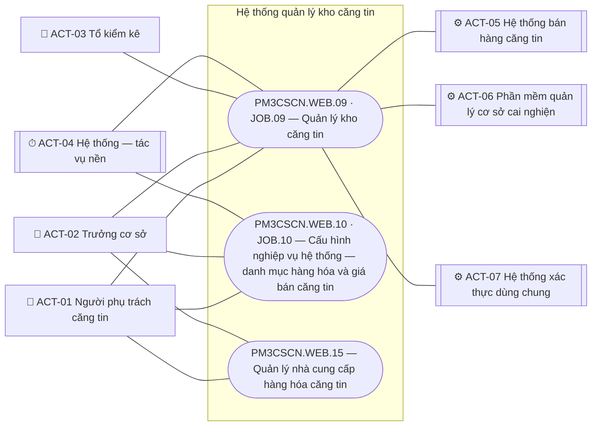

Nối tác nhân với module khi tác nhân có ít nhất một ô khác `—` ở ma trận mục 4 cho use case của module đó; ACT-02 nối `PM3CSCN.WEB.15` qua quyền xem, kết xuất (RQ-183). Module nối hệ thống ngoài: `09` nhận sự kiện trừ tồn từ ACT-05 (PM3CSCN.JOB.09.07.02 Kiểm tồn tối thiểu sau trừ tồn do bán), gửi đồng bộ cho ACT-06 (PM3CSCN.JOB.09.08.01 Đồng bộ dữ liệu kho với phần mềm quản lý cơ sở cai nghiện · **<u>GD-0007</u>**), lấy tài khoản từ ACT-07 (PM3CSCN.WEB.09.05.01 Phân công kho cho người phụ trách căng tin, PM3CSCN.WEB.09.03.08 Giao kiểm kê).

---

## 3. Sơ đồ theo module

Module `09` có 52 use case, `10` có 21 use case (quá 15) nên mỗi chức năng một sơ đồ; module `15` một sơ đồ. Không còn quan hệ «include», «extend»: hộp "Quyết định giá bán" là bước của PM3CSCN.WEB.15.03.01, PM3CSCN.WEB.15.03.03 (RQ-190).

### 3.1. PM3CSCN.WEB.09.01 — Quản lý phiếu nhập hàng kho căng tin

**Quy trình liên quan:** QT-02 · **Máy trạng thái:** SM mục 5, 9

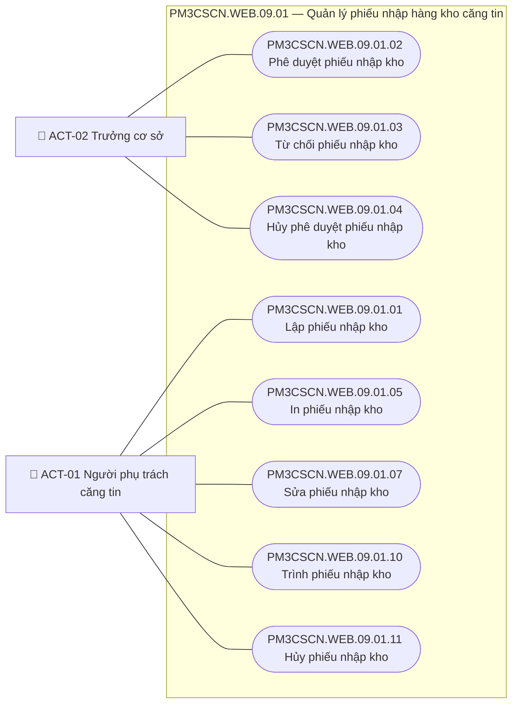

| Use case | Tác nhân chính | Tác nhân phụ | Mức | Quan hệ |
|---|---|---|:-:|---|
| PM3CSCN.WEB.09.01.01 Lập phiếu nhập kho | ACT-01 Người phụ trách căng tin | n/a | 🌊 | — |
| PM3CSCN.WEB.09.01.02 Phê duyệt phiếu nhập kho | ACT-02 Trưởng cơ sở | ACT-01 Người phụ trách căng tin (nhận cảnh báo lô chờ giá — RQ-41) | 🌊 | — |
| PM3CSCN.WEB.09.01.03 Từ chối phiếu nhập kho | ACT-02 Trưởng cơ sở | ACT-01 Người phụ trách căng tin (nhận phiếu trả về — RQ-34) | 🌊 | — |
| PM3CSCN.WEB.09.01.04 Hủy phê duyệt phiếu nhập kho | ACT-02 Trưởng cơ sở | n/a | 🌊 | — |
| PM3CSCN.WEB.09.01.05 In phiếu nhập kho | ACT-01 Người phụ trách căng tin | n/a | 🌊 | — |
| PM3CSCN.WEB.09.01.07 Sửa phiếu nhập kho | ACT-01 Người phụ trách căng tin | n/a | 🌊 | — |
| PM3CSCN.WEB.09.01.10 Trình phiếu nhập kho | ACT-01 Người phụ trách căng tin | n/a | 🌊 | — |
| PM3CSCN.WEB.09.01.11 Hủy phiếu nhập kho | ACT-01 Người phụ trách căng tin | n/a | 🌊 | — |

### 3.2. PM3CSCN.WEB.09.02 — Quản lý phiếu điều chuyển kho căng tin

**Quy trình liên quan:** QT-04 · **Máy trạng thái:** SM mục 7, 9

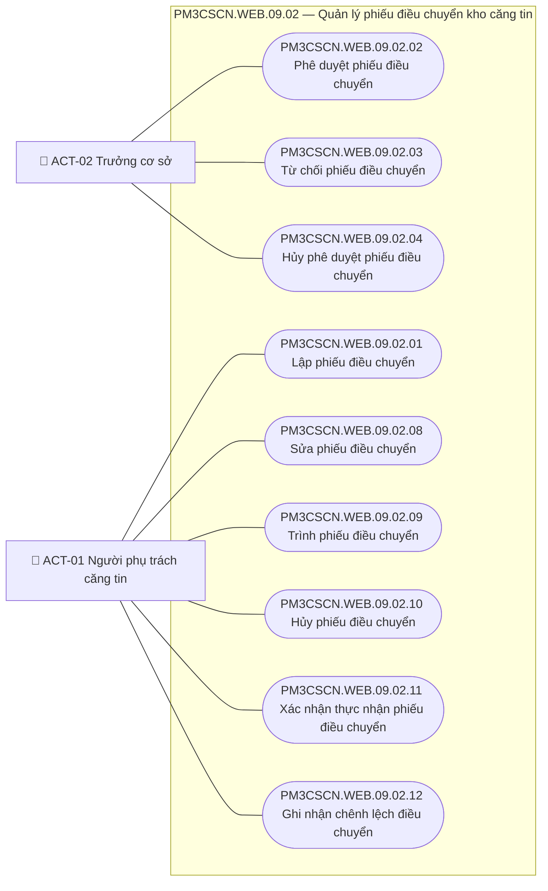

| Use case | Tác nhân chính | Tác nhân phụ | Mức | Quan hệ |
|---|---|---|:-:|---|
| PM3CSCN.WEB.09.02.01 Lập phiếu điều chuyển | ACT-01 Người phụ trách căng tin | n/a | 🌊 | — |
| PM3CSCN.WEB.09.02.02 Phê duyệt phiếu điều chuyển | ACT-02 Trưởng cơ sở | n/a | 🌊 | — |
| PM3CSCN.WEB.09.02.03 Từ chối phiếu điều chuyển | ACT-02 Trưởng cơ sở | ACT-01 Người phụ trách căng tin (nhận phiếu trả về — RQ-34) | 🌊 | — |
| PM3CSCN.WEB.09.02.04 Hủy phê duyệt phiếu điều chuyển | ACT-02 Trưởng cơ sở | n/a | 🌊 | — |
| PM3CSCN.WEB.09.02.08 Sửa phiếu điều chuyển | ACT-01 Người phụ trách căng tin | n/a | 🌊 | — |
| PM3CSCN.WEB.09.02.09 Trình phiếu điều chuyển | ACT-01 Người phụ trách căng tin | n/a | 🌊 | — |
| PM3CSCN.WEB.09.02.10 Hủy phiếu điều chuyển | ACT-01 Người phụ trách căng tin | n/a | 🌊 | — |
| PM3CSCN.WEB.09.02.11 Xác nhận thực nhận phiếu điều chuyển | ACT-01 Người phụ trách căng tin | n/a | 🌊 | — |
| PM3CSCN.WEB.09.02.12 Ghi nhận chênh lệch điều chuyển | ACT-01 Người phụ trách căng tin | n/a | 🌊 | — |

### 3.3. PM3CSCN.WEB.09.03 — Quản lý kiểm kê tồn kho căng tin định kỳ

**Quy trình liên quan:** QT-05 · **Máy trạng thái:** SM mục 8, 9

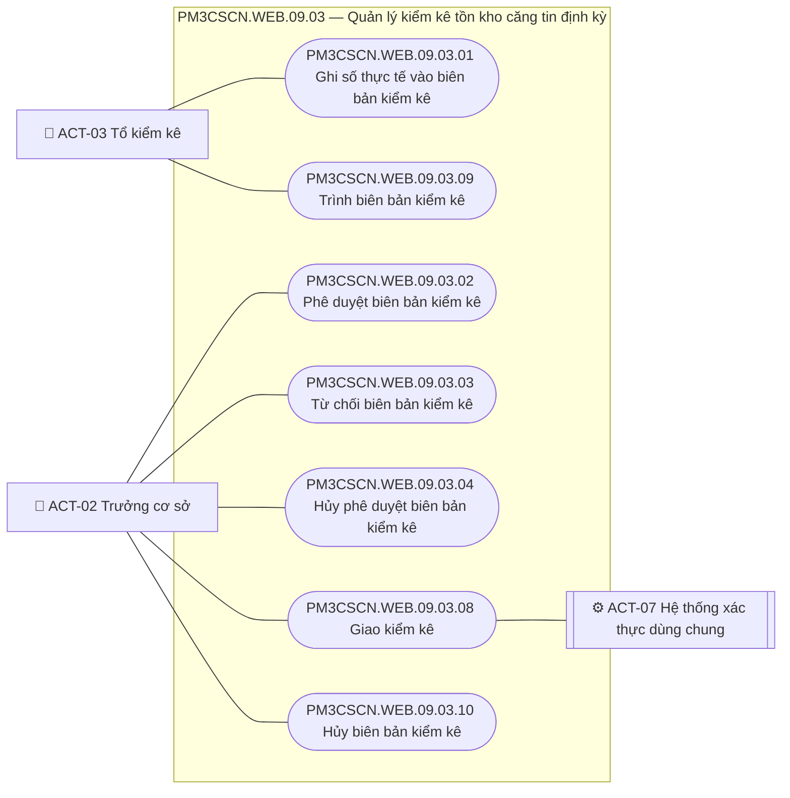

| Use case | Tác nhân chính | Tác nhân phụ | Mức | Quan hệ |
|---|---|---|:-:|---|
| PM3CSCN.WEB.09.03.01 Ghi số thực tế vào biên bản kiểm kê | ACT-03 Tổ kiểm kê | n/a | 🌊 | — |
| PM3CSCN.WEB.09.03.02 Phê duyệt biên bản kiểm kê | ACT-02 Trưởng cơ sở | n/a | 🌊 | — |
| PM3CSCN.WEB.09.03.03 Từ chối biên bản kiểm kê | ACT-02 Trưởng cơ sở | ACT-03 Tổ kiểm kê (đếm lại — BRQ-28) | 🌊 | — |
| PM3CSCN.WEB.09.03.04 Hủy phê duyệt biên bản kiểm kê | ACT-02 Trưởng cơ sở | n/a | 🌊 | — |
| PM3CSCN.WEB.09.03.08 Giao kiểm kê | ACT-02 Trưởng cơ sở | ACT-07 Hệ thống xác thực dùng chung (cung cấp tài khoản — RQ-149; thành viên có tài khoản nếu có — RQ-155) | 🌊 | — |
| PM3CSCN.WEB.09.03.09 Trình biên bản kiểm kê | ACT-03 Tổ kiểm kê | n/a | 🌊 | — |
| PM3CSCN.WEB.09.03.10 Hủy biên bản kiểm kê | ACT-02 Trưởng cơ sở | n/a | 🌊 | — |

### 3.4. PM3CSCN.WEB.09.04 — Quản lý kho

**Quy trình liên quan:** n/a — danh mục, đầu vào QT-02, QT-04, QT-05, QT-06 · **Máy trạng thái:** n/a

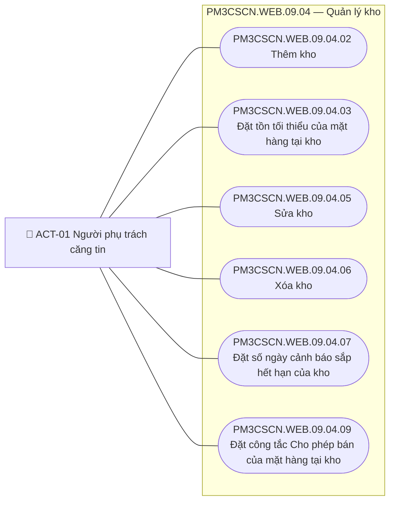

| Use case | Tác nhân chính | Tác nhân phụ | Mức | Quan hệ |
|---|---|---|:-:|---|
| PM3CSCN.WEB.09.04.02 Thêm kho | ACT-01 Người phụ trách căng tin | n/a | 🌊 | — |
| PM3CSCN.WEB.09.04.03 Đặt tồn tối thiểu của mặt hàng tại kho | ACT-01 Người phụ trách căng tin | n/a | 🌊 | — |
| PM3CSCN.WEB.09.04.05 Sửa kho | ACT-01 Người phụ trách căng tin | n/a | 🌊 | — |
| PM3CSCN.WEB.09.04.06 Xóa kho | ACT-01 Người phụ trách căng tin | n/a | 🌊 | — |
| PM3CSCN.WEB.09.04.07 Đặt số ngày cảnh báo sắp hết hạn của kho | ACT-01 Người phụ trách căng tin | n/a | 🌊 | — |
| PM3CSCN.WEB.09.04.09 Đặt công tắc Cho phép bán của mặt hàng tại kho | ACT-01 Người phụ trách căng tin | n/a | 🌊 | — |

### 3.5. PM3CSCN.WEB.09.05 — Quản lý phân công kho

**Quy trình liên quan:** n/a — danh mục · **Máy trạng thái:** n/a

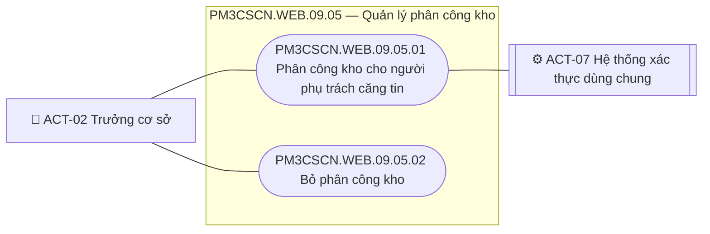

| Use case | Tác nhân chính | Tác nhân phụ | Mức | Quan hệ |
|---|---|---|:-:|---|
| PM3CSCN.WEB.09.05.01 Phân công kho cho người phụ trách căng tin | ACT-02 Trưởng cơ sở | ACT-07 Hệ thống xác thực dùng chung (cung cấp tài khoản — RQ-149) | 🌊 | — |
| PM3CSCN.WEB.09.05.02 Bỏ phân công kho | ACT-02 Trưởng cơ sở | n/a | 🌊 | — |

### 3.6. PM3CSCN.WEB.09.06 — Quản lý cảnh báo

**Quy trình liên quan:** QT-06 · **Máy trạng thái:** SM mục 9

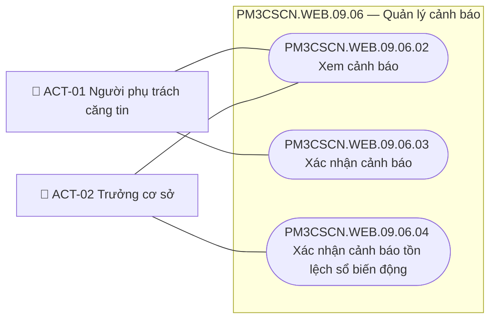

| Use case | Tác nhân chính | Tác nhân phụ | Mức | Quan hệ |
|---|---|---|:-:|---|
| PM3CSCN.WEB.09.06.02 Xem cảnh báo | ACT-01 Người phụ trách căng tin · ACT-02 Trưởng cơ sở | n/a | 🌊 | — |
| PM3CSCN.WEB.09.06.03 Xác nhận cảnh báo | ACT-01 Người phụ trách căng tin | n/a | 🌊 | — |
| PM3CSCN.WEB.09.06.04 Xác nhận cảnh báo tồn lệch sổ biến động | ACT-02 Trưởng cơ sở | n/a | 🌊 | — |

### 3.7. PM3CSCN.JOB.09 — Quản lý kho căng tin — tác vụ nền

**Quy trình liên quan:** QT-06 · N-01 · **<u>GD-0003</u>** · N-02 · **<u>GD-0007</u>** · N-04 · **Máy trạng thái:** SM mục 9, 10

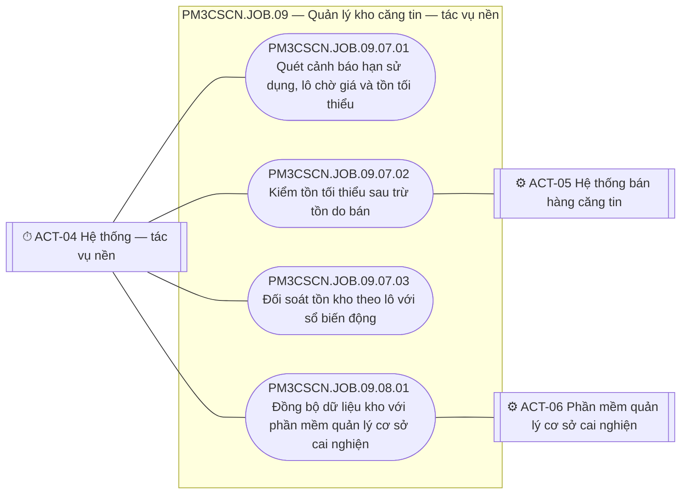

| Use case | Tác nhân chính | Tác nhân phụ | Mức | Quan hệ |
|---|---|---|:-:|---|
| PM3CSCN.JOB.09.07.01 Quét cảnh báo hạn sử dụng, lô chờ giá và tồn tối thiểu | ACT-04 Hệ thống — tác vụ nền | n/a | 🌊 | — |
| PM3CSCN.JOB.09.07.02 Kiểm tồn tối thiểu sau trừ tồn do bán | ACT-04 Hệ thống — tác vụ nền | ACT-05 Hệ thống bán hàng căng tin (ghi trừ tồn kích hoạt — RQ-135) | 🌊 | — |
| PM3CSCN.JOB.09.07.03 Đối soát tồn kho theo lô với sổ biến động | ACT-04 Hệ thống — tác vụ nền | n/a | 🌊 | — |
| PM3CSCN.JOB.09.08.01 Đồng bộ dữ liệu kho với phần mềm quản lý cơ sở cai nghiện | ACT-04 Hệ thống — tác vụ nền | ACT-06 Phần mềm quản lý cơ sở cai nghiện (nhận dữ liệu — RQ-91) | 🌊 | — |

### 3.8. PM3CSCN.WEB.10.01 — Cấu hình danh mục hàng hóa và giá bán căng tin

**Quy trình liên quan:** QT-03 · QT-01 bước 8–11 · QT-02 bước 12–13 · **Máy trạng thái:** SM mục 3, 6

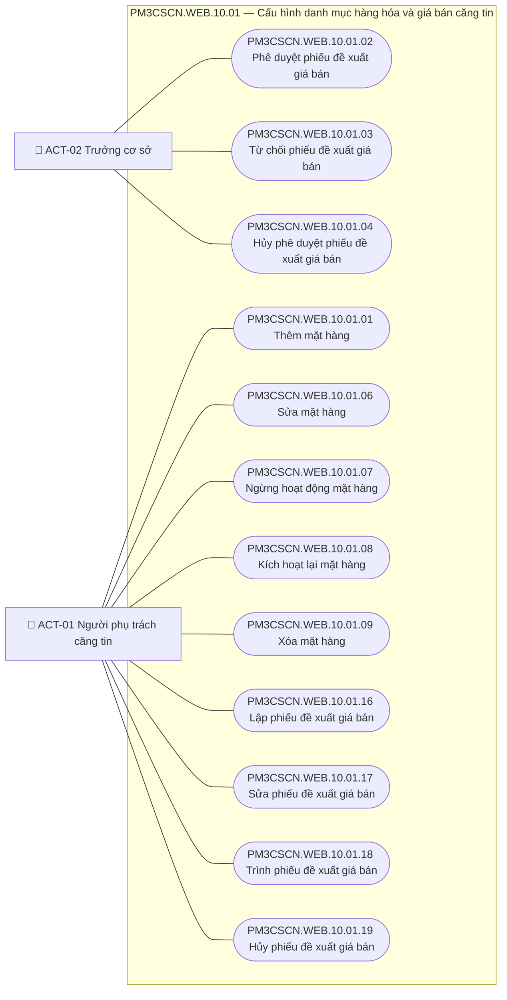

| Use case | Tác nhân chính | Tác nhân phụ | Mức | Quan hệ |
|---|---|---|:-:|---|
| PM3CSCN.WEB.10.01.01 Thêm mặt hàng | ACT-01 Người phụ trách căng tin | n/a | 🌊 | — |
| PM3CSCN.WEB.10.01.02 Phê duyệt phiếu đề xuất giá bán | ACT-02 Trưởng cơ sở | n/a | 🌊 | — |
| PM3CSCN.WEB.10.01.03 Từ chối phiếu đề xuất giá bán | ACT-02 Trưởng cơ sở | ACT-01 Người phụ trách căng tin (nhận phiếu đề xuất trả về — RQ-34) | 🌊 | — |
| PM3CSCN.WEB.10.01.04 Hủy phê duyệt phiếu đề xuất giá bán | ACT-02 Trưởng cơ sở | n/a | 🌊 | — |
| PM3CSCN.WEB.10.01.06 Sửa mặt hàng | ACT-01 Người phụ trách căng tin | n/a | 🌊 | — |
| PM3CSCN.WEB.10.01.07 Ngừng hoạt động mặt hàng | ACT-01 Người phụ trách căng tin | n/a | 🌊 | — |
| PM3CSCN.WEB.10.01.08 Kích hoạt lại mặt hàng | ACT-01 Người phụ trách căng tin | n/a | 🌊 | — |
| PM3CSCN.WEB.10.01.09 Xóa mặt hàng | ACT-01 Người phụ trách căng tin | n/a | 🌊 | — |
| PM3CSCN.WEB.10.01.16 Lập phiếu đề xuất giá bán | ACT-01 Người phụ trách căng tin | n/a | 🌊 | — |
| PM3CSCN.WEB.10.01.17 Sửa phiếu đề xuất giá bán | ACT-01 Người phụ trách căng tin | n/a | 🌊 | — |
| PM3CSCN.WEB.10.01.18 Trình phiếu đề xuất giá bán | ACT-01 Người phụ trách căng tin | n/a | 🌊 | — |
| PM3CSCN.WEB.10.01.19 Hủy phiếu đề xuất giá bán | ACT-01 Người phụ trách căng tin | n/a | 🌊 | — |

### 3.9. PM3CSCN.JOB.10 — Cấu hình nghiệp vụ hệ thống — danh mục hàng hóa và giá bán căng tin — tác vụ nền

**Quy trình liên quan:** QT-03 bước 8 · N-03 · **Máy trạng thái:** SM mục 6

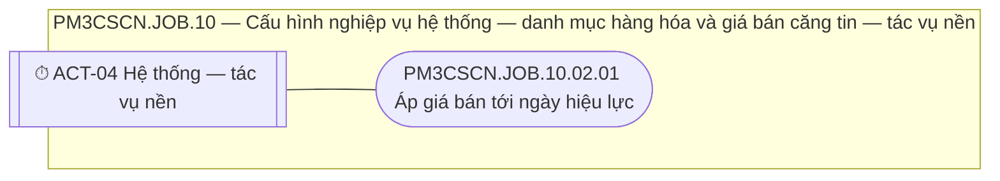

| Use case | Tác nhân chính | Tác nhân phụ | Mức | Quan hệ |
|---|---|---|:-:|---|
| PM3CSCN.JOB.10.02.01 Áp giá bán tới ngày hiệu lực | ACT-04 Hệ thống — tác vụ nền | n/a | 🌊 | — |

### 3.10. PM3CSCN.WEB.15 — Quản lý nhà cung cấp hàng hóa căng tin

**Quy trình liên quan:** QT-01 · **Máy trạng thái:** SM mục 2, 4, 6

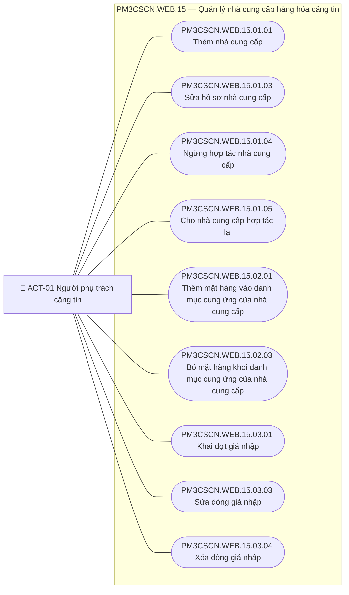

| Use case | Tác nhân chính | Tác nhân phụ | Mức | Quan hệ |
|---|---|---|:-:|---|
| PM3CSCN.WEB.15.01.01 Thêm nhà cung cấp | ACT-01 Người phụ trách căng tin | n/a | 🌊 | — |
| PM3CSCN.WEB.15.01.03 Sửa hồ sơ nhà cung cấp | ACT-01 Người phụ trách căng tin | n/a | 🌊 | — |
| PM3CSCN.WEB.15.01.04 Ngừng hợp tác nhà cung cấp | ACT-01 Người phụ trách căng tin | n/a | 🌊 | — |
| PM3CSCN.WEB.15.01.05 Cho nhà cung cấp hợp tác lại | ACT-01 Người phụ trách căng tin | n/a | 🌊 | — |
| PM3CSCN.WEB.15.02.01 Thêm mặt hàng vào danh mục cung ứng của nhà cung cấp | ACT-01 Người phụ trách căng tin | n/a | 🌊 | — |
| PM3CSCN.WEB.15.02.03 Bỏ mặt hàng khỏi danh mục cung ứng của nhà cung cấp | ACT-01 Người phụ trách căng tin | n/a | 🌊 | — |
| PM3CSCN.WEB.15.03.01 Khai đợt giá nhập | ACT-01 Người phụ trách căng tin | n/a | 🌊 | — |
| PM3CSCN.WEB.15.03.03 Sửa dòng giá nhập | ACT-01 Người phụ trách căng tin | n/a | 🌊 | — |
| PM3CSCN.WEB.15.03.04 Xóa dòng giá nhập | ACT-01 Người phụ trách căng tin | n/a | 🌊 | — |

---

## 4. Ma trận tác nhân × use case

Ma trận không liệt kê hai lá ⊘ (PM3CSCN.WEB.10.01.10, PM3CSCN.WEB.10.01.20). Ký hiệu: C tạo · R xem · U sửa · D xóa · A duyệt · X thao tác khác (từ chối, trình, hủy, hủy phê duyệt, in, kết xuất, xác nhận, chạy tự động) · `—` chắc chắn không được. Phạm vi sau dấu `·`: **kho được phân công** (kho của người phụ trách căng tin theo `Phan_Cong_Kho` — RQ-142); **kho nhập được phân công** (phiếu nhập kho theo kho nhập — BR-I02 Phạm vi kho được phân công, RQ-218); **kho xuất / kho nhận được phân công** (phiếu điều chuyển — RQ-218); **cơ sở mình** (mọi dữ liệu của cơ sở người dùng thuộc về — RQ-152, quy trình mục 9 điểm 30); **biên bản mình là thành viên** (tổ kiểm kê, RQ-155); **toàn hệ thống** (ACT-04, ACT-07: chạy hoặc phục vụ mọi cơ sở); **cơ sở của hệ thống** (ACT-05, ACT-06: hệ thống ngoài của từng cơ sở, chỉ trao đổi dữ liệu của cơ sở đó — RQ-80, RQ-102, RQ-152, NFR-10, **<u>GD-0007</u>**). Ô `—` của ACT-01, ACT-03 ở dòng duyệt, từ chối, hủy phê duyệt theo tách nhiệm mục 1.2; ô `—` khác: QT mục 2 không giao thao tác đó cho vai. Tác nhân phụ chỉ nhận kết quả (ví dụ ACT-01 nhận phiếu bị từ chối trả về) không có quyền thao tác trên use case đó nên ghi `—`. Thứ tự dòng theo `UCL` mục 3.

| Use case | ACT-01 | ACT-02 | ACT-03 | ACT-04 | ACT-05 | ACT-06 | ACT-07 |
|---|:-:|:-:|:-:|:-:|:-:|:-:|:-:|
| PM3CSCN.WEB.09.01.01 Lập phiếu nhập kho | C · kho được phân công | — | — | — | — | — | — |
| PM3CSCN.WEB.09.01.02 Phê duyệt phiếu nhập kho | — | A · cơ sở mình | — | — | — | — | — |
| PM3CSCN.WEB.09.01.03 Từ chối phiếu nhập kho | — | X · cơ sở mình | — | — | — | — | — |
| PM3CSCN.WEB.09.01.04 Hủy phê duyệt phiếu nhập kho | — | X · cơ sở mình | — | — | — | — | — |
| PM3CSCN.WEB.09.01.05 In phiếu nhập kho | X · kho nhập được phân công | — | — | — | — | — | — |
| PM3CSCN.WEB.09.01.06 Tìm kiếm phiếu nhập kho | R · kho nhập được phân công | R · cơ sở mình | — | — | — | — | — |
| PM3CSCN.WEB.09.01.07 Sửa phiếu nhập kho | U · kho được phân công | — | — | — | — | — | — |
| PM3CSCN.WEB.09.01.08 Xem chi tiết phiếu nhập kho | R · kho nhập được phân công | R · cơ sở mình | — | — | — | — | — |
| PM3CSCN.WEB.09.01.09 Kết xuất danh sách phiếu nhập kho | X · kho nhập được phân công | X · cơ sở mình | — | — | — | — | — |
| PM3CSCN.WEB.09.01.10 Trình phiếu nhập kho | X · kho được phân công | — | — | — | — | — | — |
| PM3CSCN.WEB.09.01.11 Hủy phiếu nhập kho | X · kho được phân công | — | — | — | — | — | — |
| PM3CSCN.WEB.09.02.01 Lập phiếu điều chuyển | C · kho xuất được phân công | — | — | — | — | — | — |
| PM3CSCN.WEB.09.02.02 Phê duyệt phiếu điều chuyển | — | A · cơ sở mình | — | — | — | — | — |
| PM3CSCN.WEB.09.02.03 Từ chối phiếu điều chuyển | — | X · cơ sở mình | — | — | — | — | — |
| PM3CSCN.WEB.09.02.04 Hủy phê duyệt phiếu điều chuyển | — | X · cơ sở mình | — | — | — | — | — |
| PM3CSCN.WEB.09.02.05 Tìm kiếm phiếu điều chuyển | R · kho xuất hoặc kho nhận được phân công | R · cơ sở mình | — | — | — | — | — |
| PM3CSCN.WEB.09.02.06 Xem chi tiết phiếu điều chuyển | R · kho xuất hoặc kho nhận được phân công | R · cơ sở mình | — | — | — | — | — |
| PM3CSCN.WEB.09.02.07 Kết xuất danh sách phiếu điều chuyển | X · kho xuất hoặc kho nhận được phân công | X · cơ sở mình | — | — | — | — | — |
| PM3CSCN.WEB.09.02.08 Sửa phiếu điều chuyển | U · kho xuất được phân công | — | — | — | — | — | — |
| PM3CSCN.WEB.09.02.09 Trình phiếu điều chuyển | X · kho xuất được phân công | — | — | — | — | — | — |
| PM3CSCN.WEB.09.02.10 Hủy phiếu điều chuyển | X · kho xuất được phân công | — | — | — | — | — | — |
| PM3CSCN.WEB.09.02.11 Xác nhận thực nhận phiếu điều chuyển | X · kho nhận được phân công | — | — | — | — | — | — |
| PM3CSCN.WEB.09.02.12 Ghi nhận chênh lệch điều chuyển | X · kho xuất được phân công | — | — | — | — | — | — |
| PM3CSCN.WEB.09.03.01 Ghi số thực tế vào biên bản kiểm kê | — | — | U · biên bản mình là thành viên | — | — | — | — |
| PM3CSCN.WEB.09.03.02 Phê duyệt biên bản kiểm kê | — | A · cơ sở mình | — | — | — | — | — |
| PM3CSCN.WEB.09.03.03 Từ chối biên bản kiểm kê | — | X · cơ sở mình | — | — | — | — | — |
| PM3CSCN.WEB.09.03.04 Hủy phê duyệt biên bản kiểm kê | — | X · cơ sở mình | — | — | — | — | — |
| PM3CSCN.WEB.09.03.05 Tìm kiếm biên bản kiểm kê | R · cơ sở mình | R · cơ sở mình | R · biên bản mình là thành viên | — | — | — | — |
| PM3CSCN.WEB.09.03.06 Xem chi tiết biên bản kiểm kê | R · cơ sở mình | R · cơ sở mình | R · biên bản mình là thành viên | — | — | — | — |
| PM3CSCN.WEB.09.03.07 Kết xuất biên bản kiểm kê | X · cơ sở mình | X · cơ sở mình | — | — | — | — | — |
| PM3CSCN.WEB.09.03.08 Giao kiểm kê | — | C · cơ sở mình | — | — | — | — | X · toàn hệ thống |
| PM3CSCN.WEB.09.03.09 Trình biên bản kiểm kê | — | — | X · biên bản mình là thành viên | — | — | — | — |
| PM3CSCN.WEB.09.03.10 Hủy biên bản kiểm kê | — | X · cơ sở mình | — | — | — | — | — |
| PM3CSCN.WEB.09.04.01 Tìm kiếm danh sách kho | R · cơ sở mình | R · cơ sở mình | — | — | — | — | — |
| PM3CSCN.WEB.09.04.02 Thêm kho | C · cơ sở mình | — | — | — | — | — | — |
| PM3CSCN.WEB.09.04.03 Đặt tồn tối thiểu của mặt hàng tại kho | U · kho được phân công | — | — | — | — | — | — |
| PM3CSCN.WEB.09.04.04 Xem lịch sử nhập, điều chuyển của kho | R · cơ sở mình | R · cơ sở mình | — | — | — | — | — |
| PM3CSCN.WEB.09.04.05 Sửa kho | U · kho được phân công | — | — | — | — | — | — |
| PM3CSCN.WEB.09.04.06 Xóa kho | D · cơ sở mình | — | — | — | — | — | — |
| PM3CSCN.WEB.09.04.07 Đặt số ngày cảnh báo sắp hết hạn của kho | U · kho được phân công | — | — | — | — | — | — |
| PM3CSCN.WEB.09.04.08 Xem tồn kho hiện tại | R · cơ sở mình | R · cơ sở mình | — | — | — | — | — |
| PM3CSCN.WEB.09.04.09 Đặt công tắc Cho phép bán của mặt hàng tại kho | U · kho được phân công | — | — | — | — | — | — |
| PM3CSCN.WEB.09.05.01 Phân công kho cho người phụ trách căng tin | — | C · cơ sở mình | — | — | — | — | X · toàn hệ thống |
| PM3CSCN.WEB.09.05.02 Bỏ phân công kho | — | D · cơ sở mình | — | — | — | — | — |
| PM3CSCN.WEB.09.06.01 Tìm kiếm cảnh báo | R · kho được phân công | R · cảnh báo tồn lệch của cơ sở mình | — | — | — | — | — |
| PM3CSCN.WEB.09.06.02 Xem cảnh báo | R · kho được phân công | R · cảnh báo tồn lệch của cơ sở mình | — | — | — | — | — |
| PM3CSCN.WEB.09.06.03 Xác nhận cảnh báo | X · kho được phân công | — | — | — | — | — | — |
| PM3CSCN.WEB.09.06.04 Xác nhận cảnh báo tồn lệch sổ biến động | — | X · cơ sở mình | — | — | — | — | — |
| PM3CSCN.WEB.10.01.01 Thêm mặt hàng | C · cơ sở mình | — | — | — | — | — | — |
| PM3CSCN.WEB.10.01.02 Phê duyệt phiếu đề xuất giá bán | — | A · cơ sở mình | — | — | — | — | — |
| PM3CSCN.WEB.10.01.03 Từ chối phiếu đề xuất giá bán | — | X · cơ sở mình | — | — | — | — | — |
| PM3CSCN.WEB.10.01.04 Hủy phê duyệt phiếu đề xuất giá bán | — | X · cơ sở mình | — | — | — | — | — |
| PM3CSCN.WEB.10.01.05 Tìm kiếm danh mục hàng hóa | R · cơ sở mình | R · cơ sở mình | — | — | — | — | — |
| PM3CSCN.WEB.10.01.06 Sửa mặt hàng | U · cơ sở mình | — | — | — | — | — | — |
| PM3CSCN.WEB.10.01.07 Ngừng hoạt động mặt hàng | X · cơ sở mình | — | — | — | — | — | — |
| PM3CSCN.WEB.10.01.08 Kích hoạt lại mặt hàng | X · cơ sở mình | — | — | — | — | — | — |
| PM3CSCN.WEB.10.01.09 Xóa mặt hàng | D · cơ sở mình | — | — | — | — | — | — |
| PM3CSCN.WEB.10.01.10 ⊘ Quyết định đề xuất giá bán theo giá nhập mới | — | — | — | — | — | — | — |
| PM3CSCN.WEB.10.01.11 Xem chi tiết mặt hàng | R · cơ sở mình | R · cơ sở mình | — | — | — | — | — |
| PM3CSCN.WEB.10.01.12 Kết xuất danh mục hàng hóa | X · cơ sở mình | X · cơ sở mình | — | — | — | — | — |
| PM3CSCN.WEB.10.01.13 Tìm kiếm phiếu đề xuất giá bán | R · cơ sở mình | R · cơ sở mình | — | — | — | — | — |
| PM3CSCN.WEB.10.01.14 Xem chi tiết phiếu đề xuất giá bán | R · cơ sở mình | R · cơ sở mình | — | — | — | — | — |
| PM3CSCN.WEB.10.01.15 Kết xuất danh sách phiếu đề xuất giá bán | X · cơ sở mình | X · cơ sở mình | — | — | — | — | — |
| PM3CSCN.WEB.10.01.16 Lập phiếu đề xuất giá bán | C · cơ sở mình | — | — | — | — | — | — |
| PM3CSCN.WEB.10.01.17 Sửa phiếu đề xuất giá bán | U · cơ sở mình | — | — | — | — | — | — |
| PM3CSCN.WEB.10.01.18 Trình phiếu đề xuất giá bán | X · cơ sở mình | — | — | — | — | — | — |
| PM3CSCN.WEB.10.01.19 Hủy phiếu đề xuất giá bán | X · cơ sở mình | — | — | — | — | — | — |
| PM3CSCN.WEB.10.01.20 ⊘ Chọn đề xuất giá bán mới cho lô | — | — | — | — | — | — | — |
| PM3CSCN.WEB.10.01.21 Xem lịch sử giá bán theo lô | R · cơ sở mình | R · cơ sở mình | — | — | — | — | — |
| PM3CSCN.WEB.10.01.22 Kết xuất lịch sử giá bán theo lô | X · cơ sở mình | X · cơ sở mình | — | — | — | — | — |
| PM3CSCN.WEB.15.01.01 Thêm nhà cung cấp | C · cơ sở mình | — | — | — | — | — | — |
| PM3CSCN.WEB.15.01.02 Tìm kiếm danh sách nhà cung cấp | R · cơ sở mình | R · cơ sở mình | — | — | — | — | — |
| PM3CSCN.WEB.15.01.03 Sửa hồ sơ nhà cung cấp | U · cơ sở mình | — | — | — | — | — | — |
| PM3CSCN.WEB.15.01.04 Ngừng hợp tác nhà cung cấp | X · cơ sở mình | — | — | — | — | — | — |
| PM3CSCN.WEB.15.01.05 Cho nhà cung cấp hợp tác lại | X · cơ sở mình | — | — | — | — | — | — |
| PM3CSCN.WEB.15.01.06 Xem chi tiết nhà cung cấp | R · cơ sở mình | R · cơ sở mình | — | — | — | — | — |
| PM3CSCN.WEB.15.01.07 Kết xuất danh sách nhà cung cấp | X · cơ sở mình | X · cơ sở mình | — | — | — | — | — |
| PM3CSCN.WEB.15.02.01 Thêm mặt hàng vào danh mục cung ứng của nhà cung cấp | C · cơ sở mình | — | — | — | — | — | — |
| PM3CSCN.WEB.15.02.02 Tìm kiếm danh mục hàng hóa theo nhà cung cấp | R · cơ sở mình | R · cơ sở mình | — | — | — | — | — |
| PM3CSCN.WEB.15.02.03 Bỏ mặt hàng khỏi danh mục cung ứng của nhà cung cấp | D · cơ sở mình | — | — | — | — | — | — |
| PM3CSCN.WEB.15.02.04 Kết xuất danh mục hàng hóa theo nhà cung cấp | X · cơ sở mình | X · cơ sở mình | — | — | — | — | — |
| PM3CSCN.WEB.15.03.01 Khai đợt giá nhập | C · cơ sở mình | — | — | — | — | — | — |
| PM3CSCN.WEB.15.03.02 Tìm kiếm lịch sử giá nhập | R · cơ sở mình | R · cơ sở mình | — | — | — | — | — |
| PM3CSCN.WEB.15.03.03 Sửa dòng giá nhập | U · cơ sở mình | — | — | — | — | — | — |
| PM3CSCN.WEB.15.03.04 Xóa dòng giá nhập | D · cơ sở mình | — | — | — | — | — | — |
| PM3CSCN.WEB.15.03.05 Xem chi tiết dòng giá nhập | R · cơ sở mình | R · cơ sở mình | — | — | — | — | — |
| PM3CSCN.WEB.15.03.06 Kết xuất lịch sử giá nhập | X · cơ sở mình | X · cơ sở mình | — | — | — | — | — |
| PM3CSCN.JOB.09.07.01 Quét cảnh báo hạn sử dụng, lô chờ giá và tồn tối thiểu | — | — | — | X · toàn hệ thống | — | — | — |
| PM3CSCN.JOB.09.07.02 Kiểm tồn tối thiểu sau trừ tồn do bán | — | — | — | X · toàn hệ thống | X · cơ sở của hệ thống | — | — |
| PM3CSCN.JOB.09.07.03 Đối soát tồn kho theo lô với sổ biến động | — | — | — | X · toàn hệ thống | — | — | — |
| PM3CSCN.JOB.09.08.01 Đồng bộ dữ liệu kho với phần mềm quản lý cơ sở cai nghiện | — | — | — | X · toàn hệ thống | — | X · cơ sở của hệ thống | — |
| PM3CSCN.JOB.10.02.01 Áp giá bán tới ngày hiệu lực | — | — | — | X · toàn hệ thống | — | — | — |

Đọc theo hàng: mọi use case có ít nhất một ô khác `—`, khớp cột `Actor` của `UCL`. Đọc theo cột: mọi tác nhân có ít nhất một ô khác `—`.

---

## 5. Câu hỏi cần chốt

| Mã | Câu hỏi | Kịch bản | Đề xuất mặc định | Người chốt | Quyết định |
|---|---|---|---|---|---|
| Q-A01 | Trưởng cơ sở có được tìm kiếm, xem chi tiết, kết xuất danh sách nhà cung cấp, danh mục hàng hóa theo nhà cung cấp, lịch sử giá nhập không? | QT mục 2 không giao Trưởng cơ sở thao tác nào ở QT-01; giá nhập của từng lô đã hiện trên đề xuất giá bán (QT-03 bước 2); 8 ô ACT-02 × PM3CSCN.WEB.15.01.02, .06, .07, PM3CSCN.WEB.15.02.02, .04, PM3CSCN.WEB.15.03.02, .05, .06 | Có: R (tìm kiếm, xem chi tiết) và X (kết xuất) · cơ sở mình, để đối chiếu khi duyệt giá bán và khi kiểm tra (BRQ-25) | BA (phongnq12) | ✅ 29/10/2026: RQ-183 — có, R (tìm kiếm, xem chi tiết) và X (kết xuất) · cơ sở mình |
| Q-A02 | Người phụ trách căng tin sửa kho, xóa kho, đặt số ngày cảnh báo sắp hết hạn của kho trong phạm vi nào: kho được phân công hay mọi kho của cơ sở? | RQ-142 chỉ nêu chứng từ, cảnh báo theo kho được phân công và danh mục hàng hóa, nhà cung cấp, giá dùng chung; kho mới thêm chưa có ai được phân công; 3 ô ACT-01 × PM3CSCN.WEB.09.04.05, .06, .07 | Sửa kho, đặt số ngày cảnh báo: kho được phân công (như tồn tối thiểu — ERD `Mat_Hang_Kho`); xóa kho: mọi kho của cơ sở chưa có chứng từ (kho chưa phân công cũng xóa được) | BA (phongnq12) | ✅ 29/10/2026: RQ-184 — sửa kho, đặt số ngày cảnh báo: kho được phân công; thêm, xóa kho: cơ sở mình |
| Q-A03 | Phạm vi xem tồn kho hiện tại và lịch sử nhập, điều chuyển của kho: người phụ trách căng tin xem kho được phân công hay mọi kho của cơ sở; Trưởng cơ sở có xem không? | Người phụ trách kho A cần biết tồn kho B trước khi lập phiếu điều chuyển A → B? Trưởng cơ sở cần xem tồn trước khi hủy phê duyệt phiếu nhập kho (QT-02 bước 17); 4 ô ACT-01, ACT-02 × PM3CSCN.WEB.09.04.04, .08 | ACT-01: R · cơ sở mình (tồn kho không phải chứng từ, RQ-142 không giới hạn); ACT-02: R · cơ sở mình | BA (phongnq12) | ✅ 29/10/2026: RQ-185 — cả hai vai xem mọi kho của cơ sở mình |

---

## 6. Rủi ro còn lại

| Mã | Rủi ro | Căn cứ bị ảnh hưởng | Mức | Biện pháp | Cần khách xác nhận văn bản |
|---|---|---|:-:|---|:-:|
| RK-01 | Đơn vị sở hữu ACT-07 Hệ thống xác thực dùng chung chưa xác định; cách kết nối, phân loại QĐ 671 chưa chốt | ACT-07 · RQ-149 · RQ-200 | T | Xác định cùng kế hoạch triển khai (RQ-200, BRD Q-B37) | Không |
| RK-02 | Người phụ trách căng tin xem tồn kho, lịch sử, biên bản kiểm kê của mọi kho trong cơ sở (RQ-185, RQ-196); cơ sở muốn hạn chế theo kho thì phải sửa ma trận | Q-A03 → RQ-185 · RQ-196 · RQ-142 | T | Ghi rõ phạm vi "cơ sở mình" ở đặc tả UC `/ba-detail` để khách xác nhận khi duyệt | Không |
| RK-03 | Kế toán bắt đầu dùng hệ thống (TH-01) mà ma trận chưa có cột; quyền xem, kết xuất phải cấp lại | SH-07 · RQ-79 · TH-01 | T | Khi mở lại TH-01 thêm tác nhân, cột ma trận, chạy lại lớp 5 | Không |

---

## 7. Điểm tạm hoãn

| Mã | Nội dung | Ngày tạm hoãn | Điều kiện mở lại |
|---|---|---|---|
| TH-01 | Không cấp tác nhân "Bộ phận kế toán": kế toán là người dùng nhưng phạm vi lần này chưa sử dụng; bản in phiếu nhập kho chuyển ngoài hệ thống (RQ-79; BRD mục 15; QT-02 bước 4 🟡). Đóng PH-029 | 29/10/2026 | BRD mở lại điểm tạm hoãn kế toán thao tác trên hệ thống |

---

## 8. Nguồn

| Tài liệu | Dùng cho |
|---|---|
| `../2-business-process/QT_PM3CSCN_QuanLyKhoCangTin_v03.md` mục 2, 5, 5.1, 9 | Tác nhân, tách nhiệm, tác vụ nền, sự kiện từ hệ thống ngoài |
| `../1-brd/BRD_PM3CSCN_QuanLyKhoCangTin_v02.md` mục 3.1, 3.2, 4 | Tên vai người, bên liên quan, hệ thống liên quan |
| `../4-state-machine/SM_PM3CSCN_QuanLyKhoCangTin_v02.md` mục 1.1 (SM-07, SM-09), 2 → 10 | Chuyển 👤 → vai thao tác; tách nhiệm ở cột Điều kiện (R-09 → R-12); phạm vi theo cơ sở, kho |
| `../3-erd/ERD_PM3CSCN_QuanLyKhoCangTin_v03.md` mục 2 (thực thể tham chiếu ngoài `Nguoi_Dung`), `Phan_Cong_Kho`, `Mat_Hang_Kho` | ACT-07, phạm vi kho được phân công |
| `UCL_PM3CSCN_QuanLyKhoCangTin_v01.md` | Danh sách use case, cột `Actor` — chính, phụ |
| `0-inputs/presales/uc/StudyQuanLyKho.xlsx` (danh mục `1-ba-init/0-dau-vao/uc-presales.md`) | Cột Actor trống ở 31 dòng, không có sheet tác nhân (PH-001) — tác nhân theo Q-001; không có phân loại tác nhân QĐ 671 để đối chiếu |
| `../../0-inputs/answers-2026-10-28.md`; `../../0-inputs/answers-2026-10-29.md`; `../../0-inputs/answers-2026-10-30.md` | RQ-01 → RQ-204, gồm RQ-07, RQ-40, RQ-54, RQ-66, RQ-79, RQ-80, RQ-95, RQ-121, RQ-142, RQ-148, RQ-149, RQ-155, RQ-169, RQ-181 |
