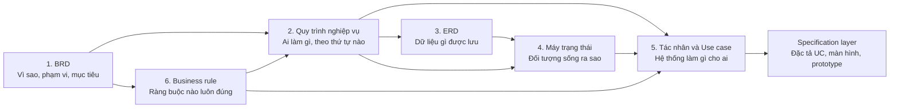

# QUY ƯỚC CHUNG CHO TÀI LIỆU BUSINESS LAYER

> Áp dụng cho **mọi template** trong `2-ba-overview/templates/`. Template từng lớp chỉ ghi phần riêng của lớp đó, phần chung dẫn về đây.
> Chuẩn hóa theo **ISO 9001:2015 mục 7.5** (kiểm soát thông tin dạng văn bản), **ISO/IEC/IEEE 29148:2018** (đặc tả yêu cầu) và **IIBA BABOK v3** (quản lý vòng đời yêu cầu).

---

## 1. Thứ tự lớp và luồng phụ thuộc



**Quy tắc nguồn sự thật** — hai tài liệu nói khác nhau thì:

| Nội dung | Tài liệu là chuẩn |
|---|---|
| Mục tiêu, phạm vi, tiêu chí thành công | BRD |
| Nghiệp vụ — bước, tác nhân, thứ tự, quyết định `D-xx` | Quy trình nghiệp vụ |
| Ràng buộc có căn cứ pháp lý `BR-xnn` | Business rule |
| Tên bảng, tên trường, mã enum | ERD |
| Trạng thái và chuyển trạng thái | Máy trạng thái — mã lấy theo ERD |
| Danh sách chức năng, mã chức năng | Danh sách Use case / WBS |

**Thứ tự viết** ở bước `/ba-overview` là 1 → 2 → 3 → 4 → 5 → 6. Vì business rule viết sau cùng, lớp 2–5 lúc
đầu dẫn thẳng điều khoản; sau lớp 6 có một **lượt điền ngược** gắn mã BR vào các lớp trước — mục 10.
Thứ tự và cổng vào/ra từng lớp: skill [`ba-overview`](../../.claude/skills/ba-overview/SKILL.md).

---

## 2. Đặt tên file

```
{LOẠI}_{MÃ DỰ ÁN}_{PHẠM VI}_v{NN}.md
```

| Lớp | LOẠI | Ví dụ |
|---|---|---|
| 1 | `BRD` | `BRD_DA1_LichHen_v00.md` |
| 2 | `QT` | `QT_DA1_LichHen_v00.md` |
| 3 | `ERD` | `ERD_DA1_LichHen_v00.md` |
| 4 | `SM` | `SM_DA1_LichHen_v00.md` |
| 5 | `UCD` · `UCL` · `TRACE` · `WBS` | `UCL_DA1_LichHen_v00.md` |
| 6 | `BR` | `BR_DA1_LichHen_v00.md` |

`PHẠM VI` viết PascalCase tiếng Việt không dấu. `NN` tăng khi phát hành bản mới có thay đổi được duyệt; sửa lỗi chính tả không tăng.

---

## 3. Khối bắt buộc ở đầu mọi tài liệu

### 3.1. Khối giới thiệu

Ngay dưới tiêu đề, một khối trích dẫn trả lời bốn câu hỏi: tài liệu **chứa gì** — có số đếm, **dựng từ đâu**, **đọc thế nào** — mã, ký hiệu, **không chứa gì** và nằm ở đâu.

### 3.2. Thông tin tài liệu — ISO 9001:2015 mục 7.5.2

| Mục | Nội dung |
|---|---|
| Mã tài liệu | `{LOẠI}_{MÃ DỰ ÁN}_{PHẠM VI}` |
| Dự án · Phân hệ | {{Dự án}} · {{Phân hệ}} |
| Phiên bản · Trạng thái | v{{NN}} · Nháp · Chờ review · Đã duyệt · Hết hiệu lực |
| Người soạn · Người review · Người duyệt | {{Tên — vai trò}} |
| Mức mật | Nội bộ · Hạn chế · Mật |

### 3.3. Version control

Giữ đúng mẫu đang dùng. Dòng phiên bản hiện tại tô xanh, in đậm. Mỗi quyết định của BA ghi dạng **BA chốt dd/mm/yyyy** trong cột Mô tả.

**Ngày:** cột Ngày cập nhật của Version control viết `YYYY-MM-DD`. Mọi ngày khác trong thân tài liệu — ngày ký phê duyệt, ngày chốt câu hỏi, ngày tạm hoãn, "BA chốt" — viết `DD/MM/YYYY`.

**Khi điền ô của tài liệu khác** (mục 10) — kể cả lượt điền ngược: đây là **sửa không đổi nghĩa**, chỉ gồm
thay `chờ lớp n` bằng mã, hoặc **thêm** mã kèm tên ngắn trước căn cứ đang có. Ở mọi trạng thái: thêm một
gạch đầu dòng vào dòng phiên bản hiện tại, ghi *điền từ <tài liệu nguồn>, không đổi nghĩa*; **không** tăng
`vNN`, **không** đổi trạng thái — tài liệu `Đã duyệt` vẫn `Đã duyệt`. Lúc điền mà thấy nội dung phải sửa
(ví dụ BR nói khác câu đang có) thì đó là **thay đổi có nghĩa**: không tự sửa, ghi câu hỏi; khi sửa thật thì
tăng `vNN` và quay về `Chờ review` như mọi thay đổi khác.

```markdown
| Tên version | Ngày cập nhật | PIC | Mô tả |
| :--- | :--- | :--- | :--- |
| v00 | YYYY-MM-DD | {{Tên}} | - Khởi tạo tài liệu. |
| **<span style="color:green">v01<br>(hiện tại)</span>** | **<span style="color:green">YYYY-MM-DD</span>** | <span style="color:green">{{Tên}}</span> | <span style="color:green">- {{Thay đổi 1}}<br>- BA chốt dd/mm/yyyy: {{nội dung}}</span> |
```

### 3.4. Phê duyệt — ISO/IEC/IEEE 29148 mục 6.4 · BABOK 5.5

| Vai trò | Họ tên | Ngày | Ý kiến |
|---|---|---|---|
| BA soạn | | | |
| Product owner / Khách hàng | | | |
| Tech lead | | | |

---

## 4. Hệ mã dẫn chiếu

Mỗi mã **duy nhất trong phạm vi tài liệu** và **không dùng lại** sau khi bỏ. Mã bỏ ghi ở đầu bảng: *Các mã D-04, D-30 đã bỏ, không dùng lại.*

| Mã | Đối tượng | Định nghĩa ở | Ví dụ |
|---|---|---|---|
| `OBJ-nn` | Mục tiêu nghiệp vụ | BRD | OBJ-01 |
| `BRQ-nn` · `SH-nn` | Yêu cầu nghiệp vụ · bên liên quan | BRD | BRQ-05 |
| `NFR-nn` | Yêu cầu phi chức năng mức nghiệp vụ | BRD | NFR-03 |
| `QT-nn` · `{XX}-nn` | Quy trình chung · quy trình theo domain | Quy trình | QT-13 · LH-06B |
| `{XX}-nn bước n` | Bước của quy trình | Quy trình | LH-01 bước 3 |
| `D-nn` | Quyết định thiết kế nghiệp vụ của dự án | Quy trình mục 4 | D-13 |
| `GS-nn` | Quy tắc tính toán, ghi sổ dùng chung | Quy trình mục 3.1 | GS-06 |
| `CH-nn` | Tham số cấu hình | Quy trình mục 6 | CH-11 |
| `N-nn` | Tác vụ nền | Quy trình mục 5 | N-01 |
| `BR-{nhóm}{nn}` | Business rule có căn cứ | Business rule | BR-C01 |
| `R-nn` | Ràng buộc liên bảng, đẳng thức đối soát | ERD mục 5 | R-04 |
| `E-nn` | Điểm ERD khác bản vẽ gốc, chờ xác nhận | ERD mục 7 | E-18 |
| `SM-nn` | Nguyên tắc chung của máy trạng thái — **không** phải mã một máy; dẫn máy theo mục 9 | SM mục 1 | SM-04 |
| `{mã WBS}` | Use case — mã ở cột `No`, **không** tiền tố `UC-`; xem mục 8 | Danh sách Use case | DA1.WEB.03.01.01 |
| `Q-{lớp}nn` | Câu hỏi mở cần chốt. Tiền tố: BRD `Q-B` · Quy trình `Q-P` · ERD `Q-E` · Máy trạng thái `S-` · UCD `Q-A` · UCL `Q-U` · Business rule `Q-BR` | Mục câu hỏi của từng tài liệu | Q-E2 · S-01 · Q-BR03 |
| `RK-nn` | Rủi ro còn lại | Mục rủi ro | RK-01 |
| `TH-nn` | Điểm tạm hoãn | Mục điểm tạm hoãn | TH-01 |
| `GD-xxxx` | Giả định — 4 chữ số; **chỉ người** tạo, AI ghi ❓ `[CẦN BA CHỐT]` | Sổ `2-ba-overview/assumption_log.md` | GD-0047 |

**Cách dẫn:** luôn ghi **mã + tên ngắn** khi người đọc không có tài liệu gốc trước mặt, ví dụ *D-01 Chỉ nhận đặt lịch trực tuyến*. Trong bảng dày đặc của chính tài liệu nguồn thì ghi mã trần.

**Căn cứ pháp lý** ghi theo dạng `{Văn bản viết tắt} Đ{điều}.{khoản}.{điểm}`, ví dụ `QC01 Đ5.1`, `TT01 Đ12.3.a`. Viết tắt khai báo một lần ở mục Nguồn.

---

## 5. Ký hiệu dùng chung

| Ký hiệu | Nghĩa | Dùng ở |
|---|---|---|
| 🔒 | **Chặn cứng** — hệ thống cưỡng chế, không ai vượt, không cấu hình vượt; áp cho cả quy tắc từ luật lẫn từ quyết định `D-xx` đã BA chốt, nguồn xem ở cột Căn cứ | BR, QT |
| ⚙️ | Cấu hình được trong khung luật · hệ thống tự chuyển | BR, SM |
| 🔑 | Chặn mặc định, người có quyền mở ngoại lệ kèm lý do | BR |
| ⚠️ | Cảnh báo, cho đi tiếp, ghi nhật ký | BR |
| ❓ | Cần BA hoặc khách chốt | Mọi lớp |
| 🧪 | Do tài liệu tự đề xuất để hiện thực, nguồn phía trên chưa nêu | ERD, SM |
| 🟡 | Ngoài phạm vi hệ thống, giữ lại để thấy đủ luồng | QT |
| ✳ · ✎ · ⊘ · Giữ | Mới · Sửa · Bỏ · Không đổi — so với bản gốc | ERD, Trace |
| ■ | Trạng thái kết thúc | SM |
| Δ | Dẫn xuất — không lưu, tính khi truy vấn | ERD, SM |
| 👤 · 🔗 | Người thao tác · sự kiện từ hệ thống ngoài | SM |
| ✅ | Đã chốt | Câu hỏi mở |

---

## 6. Khối bắt buộc ở cuối mọi tài liệu

| Khối | Nội dung tối thiểu |
|---|---|
| **Câu hỏi cần chốt** | Mã · câu hỏi · kịch bản cụ thể · đề xuất mặc định · người chốt · quyết định khi đã chốt. Không còn câu mở thì ghi rõ *Không còn câu mở* |
| **Rủi ro còn lại** | Mã · mô tả · căn cứ bị ảnh hưởng · mức · biện pháp · có cần khách xác nhận bằng văn bản không |
| **Điểm tạm hoãn** | Mã · nội dung · ngày tạm hoãn · điều kiện mở lại |
| **Nguồn** | Tài liệu · đường dẫn tương đối · dùng cho phần nào |

Khối không có nội dung vẫn giữ, ghi *Không có* — để người đọc biết đã xét chứ không phải quên.

**Điểm tạm hoãn** là việc **đã rõ, đã hiểu, nhưng cố ý chưa làm** ở phiên bản này, kèm điều kiện để mở lại.
Khác câu hỏi (chưa ai trả lời), giả định (chưa có căn cứ, tạm coi là đúng) và rủi ro (có thể xảy ra).

### 6.1. Vị trí khối cuối trong từng template

| Template | Câu hỏi | Rủi ro | Điểm tạm hoãn | Nguồn |
|---|---|---|---|---|
| BRD | 14 | 13 (mức tách `Khả năng` · `Tác động`) | 15 | 16 |
| Quy trình | 11.3 | 11.1 | 11.2 | 12 |
| ERD | 8 | 10 | 11 | 12 — mục 9 Dữ liệu nhạy cảm giữ số |
| Máy trạng thái | `{{n}}` | `{{n}}` | `{{n}}` | `{{n}}` |
| UCD | 5 | 6 | 7 | 8 |
| UCL | 7 | 8 | 9 | 10 |
| Business rule | `{{n}}` Điểm cần chốt | `{{n}}`, trước Phụ lục A | `{{n}}`, trước Phụ lục A | cuối |

Mục có số sẵn của template không đánh lại, để các lớp dẫn được nhau theo số mục. Bảng bổ sung riêng của
một lớp (ví dụ "Ứng viên đã loại" của BR) đặt ngay trước Phụ lục hoặc Nguồn.

---

## 7. Quy tắc viết — ISO/IEC/IEEE 29148 mục 5.2.5

Mỗi câu yêu cầu, quy tắc, bước quy trình phải đạt:

| Thuộc tính | Kiểm tra |
|---|---|
| **Cần thiết** | Bỏ đi thì thiếu nghiệp vụ hoặc thiếu tuân thủ |
| **Rõ nghĩa** | Chỉ một cách hiểu; thuật ngữ có trong bảng thuật ngữ |
| **Kiểm chứng được** | Viết được testcase đạt hoặc không đạt |
| **Có căn cứ** | Cột Căn cứ không trống, hoặc ghi rõ ❓ |
| **Nhất quán** | Không mâu thuẫn tài liệu khác — nếu mâu thuẫn, ghi vào Câu hỏi cần chốt |
| **Truy vết được** | Có mã, được dẫn ở lớp sau |
| **Không mô tả giải pháp** | BRD, QT, BR không nêu màn hình, nút, API — để specification layer |

**Văn phong:** câu khẳng định, chủ ngữ là tác nhân; dùng **phải · không được · chỉ khi** cho ràng buộc; số liệu cấu hình dẫn mã `CH-xx`, không ghi con số trần; giá trị liệt kê viết **tên tiếng Việt** ở QT, BR và **mã tiếng Anh kèm tên Việt** ở ERD, SM.

---

## 8. Use case — hạt và mã

### 8.1. Một dòng use case to bằng nào (G1)

Mỗi dòng tính năng ở `use_case_list` là **một use case** thỏa năm tính chất của skill
[`create-uc`](../../.claude/skills/create-uc/SKILL.md) mục "UC là gì": **một thao tác**, một tác nhân chính,
một kết quả mong đợi, **một quyền** (permission key), một bước ghi. Thêm, sửa, xóa, xem là bốn dòng. Lớp
5 cấp **dòng**, `create-uc` viết **thân** UC theo cùng hạt này.

Khi sao `use_case_list.md` thành file dự án, **thêm cột `Permission key` làm cột cuối** (sau cột 9 để dán
qua lại Excel không lệch). Giá trị: key thật; `n/a` khi UC không cần quyền; `chưa chốt (<ai>)` khi chưa
đặt. Độ phức tạp theo QĐ 671 vẫn tính ở mục 4 của template — một "giao dịch" của QĐ 671 không phải một UC.

### 8.2. Mã use case (G2)

Mã UC **là chính mã WBS ở cột `No`** của `use_case_list`, **không** tiền tố `UC-`, dạng
`{PHÂN HỆ}.{NỀN TẢNG}.{MODULE}.{CHỨC NĂNG}.{TÍNH NĂNG}`, ví dụ `DA1.WEB.03.01.01`. Trường `id` của file UC
dùng đúng chuỗi này. Cột `Mã UC gốc` chỉ dùng cho mã **dự toán** (`B-II.2 / UC031`).

**Module trải nhiều nền tảng:** mã module giữ nguyên trên mọi nền tảng (`DA1.WEB.03` và `DA1.JOB.03` là
cùng module 03); số chức năng **duy nhất trong module, tính chung mọi nền tảng** — đã có `DA1.WEB.03.01`
thì chức năng chạy nền là `DA1.JOB.03.02`. Khi đếm, một module tính một lần theo mã module.

---

## 9. Cách dẫn chiếu giữa các lớp

| Dẫn gì | Viết thế nào |
|---|---|
| Một máy trạng thái | `SM mục n — <Tên máy>`, ví dụ *SM mục 2 — Lịch hẹn*. Một chuyển: `SM mục 2: PENDING_APPROVAL → APPROVED`. `SM-nn` chỉ dùng cho nguyên tắc ở SM mục 1.1 |
| Một thực thể, một trường | Tên bảng đúng như ERD, trong backtick: `` `Lich_Hen` ``, `` `Lich_Hen.trang_thai` ``. ERD chưa có thì tên nghiệp vụ tiếng Việt kèm ❓ |
| Một trạng thái | Mã enum tiếng Anh đúng ERD, tên Việt đi kèm khi cần — xem mục 7 "Văn phong" |
| Một tác nhân | `ACT-nn <Tên vai trò>` khi lớp 5 đã cấp mã. Trước đó dùng **đúng tên vai** đặt ở BRD mục 4 (cột Bên liên quan); Quy trình mục 2 giữ nguyên chữ đó, lệch nghĩa thì ghi `Q-P`. Tác nhân hệ thống, hệ thống ngoài, tác vụ nền do Quy trình mục 2 đặt tên |
| Một điểm kiểm soát | `<mã tài liệu QT> mục 9 điểm n`, ví dụ `QT_DA1_LichHen mục 9 điểm 2` — mục 9 thuộc **tài liệu**, không thuộc một quy trình. Số điểm không đánh lại sau phát hành |
| Một giả định | `GD-xxxx`, bôi đỏ đậm gạch chân: `<span style="color:red">**<u>GD-0047</u>**</span>` |
| Một mã đứng trên giả định | Dòng định nghĩa của mã có dẫn `GD-xxxx` — ví dụ `D-01` có căn cứ là `GD-0047` — thì mọi chỗ dẫn mã đó **mang theo** GD trên cùng dòng: `D-01 Chỉ nhận đặt lịch trực tuyến · GD-0047` (GD bôi đỏ). Giả định kế thừa như vậy tính vào cổng `Đã duyệt` (mục 12) của tài liệu dẫn. GD chốt xong và nội dung mã đã sửa theo thì bỏ phần mang theo |
| Business rule ở ERD | ERD thể hiện ràng buộc ở **dạng dữ liệu** (bản số, `UK`, `*`, `◐`, `R-xx`) và dẫn **một hoặc nhiều** mã BR ở cột Nguồn, cách nhau `·` — kể cả dòng khóa ngoại mang bản số quan hệ. BR phát biểu nội dung và dẫn ngược bảng, trường, `R-xx` |
| Ô cần thứ mà lớp sau sẽ sinh ra | Ô thuộc bảng mục 10: ghi `chờ lớp n`. Ô khác — lớp sau **có thể không** sinh ra: tên nghiệp vụ kèm ❓ và mã câu hỏi |
| Bước ngoài phạm vi | 🟡 — chỉ ở Quy trình |

---

## 10. Ô điền sau và lượt điền ngược

Vài ô chỉ điền được khi lớp đứng sau đã có. Lúc viết lớp đứng trước, ô đó ghi **`chờ lớp n`** (kèm tên
nghiệp vụ nếu đã biết, ví dụ `Đặt và duyệt lịch hẹn — chờ lớp 2`). Đây là việc đã lên lịch chứ không
phải điều chưa biết: **không** dùng ❓, không sinh câu hỏi, **không chặn** chuyển `Chờ review` hay
`Đã duyệt`. **Lớp đứng sau điền**, trong lúc viết lớp đó, trước khi qua cổng ra của nó.

| Ô | Điền khi | Skill điền |
|---|---|---|
| BRD mục 6.2 cột `Quy trình`, `Tài liệu chi tiết` | Lớp 2 | `create-bp` |
| BRD mục 12 cột `Quy trình` | Lớp 2 | `create-bp` |
| BRD mục 12 cột `Use case` | Lớp 5 | `create-ucl` |
| BRD mục 12 cột `Business rule`, BRD mục 8 | Lớp 6 | `create-br` |
| BRD mục 9 dòng về dữ liệu nhạy cảm | Lớp 3 — đối chiếu ERD mục 9 | `create-erd` |
| Quy trình mục 1.1 cột `Thực thể ERD`; đường dẫn ERD ở khối giới thiệu và bảng Nguồn | Lớp 3 | `create-erd` |
| ERD mục 4 — chỗ mô tả `trang_thai` trỏ `SM mục n` | Lớp 4 | `create-sm` |
| Quy trình mục 10 Quy trình chưa có Use case | Lớp 5 — khi kiểm quy tắc 100%, trước lớp 6 | `create-ucl` |
| Mọi chỗ dẫn thẳng điều khoản mà nay đã có BR — lượt điền ngược | Lớp 6, sau review lớp 6 | `create-br` |

**Lượt điền ngược** — sau khi lớp 6 cấp mã và qua review độc lập: ở lớp 1 (mục 8, 12), lớp 2 (mọi cột Căn
cứ, bảng bước, trường hợp biên, mục 9, dòng BR ở bảng Nguồn), lớp 3 (cột Nguồn của từ điển dữ liệu và của
`R-xx`), lớp 4 (cột Điều kiện), lớp 5 (UCL cột Ghi chú, UCD cột Căn cứ vai trò và bảng tách nhiệm), mỗi chỗ
đang dẫn thẳng điều khoản mà nay đã có BR thì **thêm** mã BR kèm tên ngắn, **giữ** điều khoản:
`BR-A01 Tối đa CH-01 lịch hẹn mỗi tuần · QC01 Đ5.1`. BR còn ❓ chưa điền ngược. Ghi Version control của
tài liệu được điền theo mục 3.3.

---

## 11. Tài liệu được dẫn nhưng chưa có

| Chỗ dẫn | Thực tế | Cách xử lý đến khi có |
|---|---|---|
| `traceability_matrix.md` / `TRACE_*` — dẫn ở `use_case_list.md`, `use_case_diagram.md`, cột `Tầng`, mục 2 file này | Làm ở bước `/ba-init`, đặt ở thư mục gốc repo | Truy vết lớp 1 → 2 → 5 → 6 ghi ở BRD mục 12. Cột `Tầng` của `use_case_list` ghi `chưa chốt (BA)`. Khi có file: sửa đường dẫn, lấy định nghĩa `Tầng` từ đó; mã UC trong ma trận phải là mã dự toán hoặc mã WBS (mục 8.2) |
| File `.drawio` bản vẽ gốc — ERD | Tùy dự án | Không có bản vẽ thì cột `Đổi` ghi ✳ cho mọi trường, mục 7 của ERD ghi *Không có bản vẽ gốc* |

---

## 12. Cổng trạng thái tài liệu

| Chuyển sang | Điều kiện — thiếu một điều thì **không được** chuyển |
|---|---|
| `Chờ review` | Không còn `[CẦN BA CHỐT]`. Đã tự soát theo checklist của skill lớp. Reviewer độc lập đã chạy và phát hiện mức Chặn đã xử lý. Script kiểm không còn lỗi mức Chặn |
| `Đã duyệt` | Không còn ❓, `chưa chốt (<ai>)`, `{{…}}`. **Mọi giả định được dẫn — trực tiếp, hoặc kế thừa qua mã đứng trên giả định (mục 9) — ở trạng thái `Đã chốt` hoặc `Đã cập nhật lớp`** trong sổ `assumption_log.md`, với cột Mức xác nhận đã điền. `chờ lớp n` được phép |

Giả định ở mức `Giả định BA` được tính là đã chốt — BA chịu trách nhiệm và ghi tên, ngày. Dự án muốn chặt
hơn thì đổi điều kiện thành mức `Khách hàng xác nhận` hoặc `Theo VBPL` và ghi lại ở đây.

**Script kiểm** — `python3 .claude/skills/ba-overview/scripts/kiem_business_layer.py 2-ba-overview
[--vbpl QC01=<file văn bản>]` — đọc mọi tài liệu dự án và sổ giả định, in bảng giả định mở theo từng tài
liệu (trực tiếp và kế thừa), và báo lỗi mức Chặn khi vi phạm cổng trên, khi dẫn mã, mã UC, `SM mục n` hay
điều khoản không tồn tại. Cảnh báo: tên ngắn lệch dòng định nghĩa, enum ở máy trạng thái không có trong
ERD, dẫn mã mà không mang theo giả định. Chạy trước mỗi lần chuyển trạng thái; mã thoát 1 khi còn lỗi Chặn.
