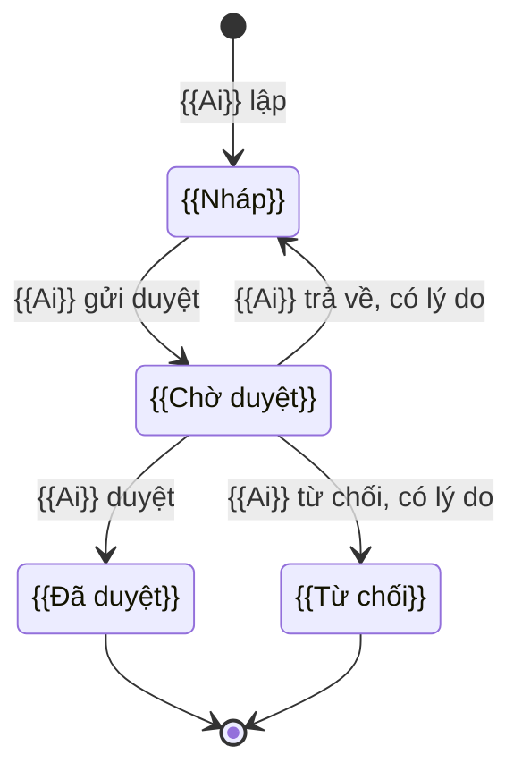

# TEMPLATE — MÁY TRẠNG THÁI

<!--
HƯỚNG DẪN DÙNG TEMPLATE
- Sao thành `SM_{MÃ DỰ ÁN}_{PHẠM VI}_v00.md`. Xóa mọi khối HƯỚNG DẪN trước khi phát hành.
- Quy ước chung: ../00_quy_uoc_chung.md
- Chuẩn tham chiếu:
  · OMG UML 2.5.1 mục 14 State Machines — trạng thái, chuyển trạng thái dạng  sự kiện [điều kiện] / hành động, trạng thái đầu và cuối.
  · Harel Statecharts — trạng thái lồng, khi một đối tượng có trạng thái con.
  · ISO/IEC/IEEE 29119-4:2021 mục 5.2.8 State Transition Testing — bảng chuyển trạng thái và ma trận trạng thái × sự kiện dùng trực tiếp để sinh testcase, gồm cả chuyển không hợp lệ.
- Mã trạng thái lấy ĐÚNG enum ở ERD. Nghiệp vụ lấy ĐÚNG bước quy trình. Không viết lại quy tắc — chỉ dẫn mã.
-->

# MÁY TRẠNG THÁI — {{DỰ ÁN}} {{DOMAIN}}

> Đặc tả **vòng đời của từng đối tượng nghiệp vụ** trong {{domain}}. Mỗi máy gồm:
> - bảng trạng thái — mã enum tiếng Anh theo ERD, tên hiển thị tiếng Việt theo quy trình;
> - sơ đồ Mermaid `stateDiagram-v2`;
> - bảng chuyển trạng thái: sự kiện, ai làm, điều kiện, hệ quả;
> - các chuyển bị cấm.
>
> Không viết lại quy tắc: bước quy trình dẫn `XX-nn bước n`, quyết định dẫn `D-xx`, quy tắc dẫn `GS-xx` — [{{QT}}](../2-business-process/{{file}}). Mã enum, trường, bảng dẫn theo [{{ERD}}](../3-erd/{{file}}). **Hai nơi khác nhau thì quy trình là chuẩn về nghiệp vụ, ERD là chuẩn về mã.**
>
> Tài liệu **không** chứa nội dung quy tắc (business rule), bước quy trình (quy trình nghiệp vụ), thiết kế màn hình và nút (SRS).

## Thông tin tài liệu

| Mục | Nội dung |
|---|---|
| Mã tài liệu | `SM_{{MÃ}}_{{PHẠM VI}}` |
| Dự án · Phân hệ | {{}} · {{}} |
| Phiên bản · Trạng thái | v{{NN}} · {{}} |
| Người soạn · Người review · Người duyệt | {{}} |
| Mức mật | {{Nội bộ · Hạn chế · Mật}} |
| Quy trình nguồn · ERD nguồn | v{{NN}} · v{{NN}} |

## Version control

| Tên version | Ngày cập nhật | PIC | Mô tả |
| :--- | :--- | :--- | :--- |
| **v00 (hiện tại)** | **YYYY-MM-DD** | {{PIC}} | - Dựng theo QT {{}} và ERD {{}}: {{n}} máy trạng thái theo {{n}} nhóm, gồm máy lưu và máy dẫn xuất Δ. |

## Phê duyệt

| Vai trò | Họ tên | Ngày | Ý kiến |
|---|---|---|---|
| BA soạn | | | |
| Product owner / Khách hàng | | | |
| Tech lead | | | |

---

## 1. Quy ước chung

### 1.1. Nguyên tắc

<!-- Các nguyên tắc dưới áp được cho hầu hết hệ thống có chứng từ. Giữ, sửa hoặc bỏ theo dự án. -->

| Mã | Quy ước | Căn cứ |
|---|---|---|
| **SM-01** | Mã trạng thái là **enum tiếng Anh** đúng như ERD. Giao diện chỉ hiện **tên tiếng Việt** ở cột *Hiển thị* | ERD mục 4 |
| **SM-02** | Trạng thái **dẫn xuất** **không lưu cờ**, tính khi truy vấn. Máy dẫn xuất có ký hiệu **Δ** | ERD mục 1 |
| **SM-03** | Mỗi chuyển trạng thái ghi một dòng nhật ký: từ, đến, lý do, người hoặc hệ thống, thời điểm | ERD `{{Nhat_Ky_Thay_Doi}}` |
| **SM-04** | Chuyển bằng **cập nhật có điều kiện** `WHERE trang_thai = :tu` và phiên bản bản ghi. Bản ghi đã đổi thì báo *bản ghi đã được xử lý*, tải lại. Bấm hai lần chỉ ghi một lần | {{GS-xx}} |
| **SM-05** | Trạng thái kết thúc **■** không quay lại; làm lại thì tạo bản ghi mới. Ngoại lệ ghi rõ trong bảng | — |
| **SM-06** | Hủy, từ chối, trả về, mở lại: **bắt buộc lý do**. Ngoại lệ: {{}} | {{QT mục 2}} |
| **SM-07** | Mỗi chuyển do người là **một quyền riêng**; người lập **không tự duyệt** | QT mục 2 tách nhiệm |
| **SM-08** | Chuyển kéo theo ghi sổ khác thì mọi thứ chạy **trong một giao dịch**. Cột *Hệ quả* ghi đủ phần kéo theo | {{GS-xx}} |
| **SM-09** | {{Điều kiện chặn áp cho mọi máy, để bảng chuyển không nhắc lại}} | {{}} |

### 1.2. Ký hiệu

| Ký hiệu | Nghĩa |
|---|---|
| 👤 | Người thao tác, ghi rõ vai trò |
| ⚙️ | Hệ thống tự chuyển — do sự kiện khác trong hệ thống hoặc tác vụ nền `N-xx` |
| 🔗 | Sự kiện từ ngoài hệ thống |
| ■ | Trạng thái kết thúc |
| **Δ** | Máy dẫn xuất — không lưu trạng thái |
| 🧪 | Trạng thái hoặc chuyển do ERD đề xuất, quy trình chưa nêu rõ |

### 1.3. Danh sách máy trạng thái

| # | Máy | Thực thể ERD | Loại | Quy trình |
|---|---|---|---|---|
| **A** | **{{Nhóm}}** | | | |
| 2 | {{Tên máy}} | `{{Bang}}` | Lưu · Δ · Lưu, suy từ bảng con | {{XX-01}} |

**Không có máy trạng thái:** `{{Bang}}` chỉ ghi thêm · `{{Bang}}` lập một lần, không sửa · {{…}}.

---

# NHÓM A — {{TÊN NHÓM}}

<!-- ============ KHỐI LẶP CHO MỖI MÁY ============ -->

## {{n}}. {{Tên máy}} — `{{Ten_Bang}}` {{· Δ nếu dẫn xuất}}

{{Một câu tóm vòng đời; quyết định chính — D-xx, BA chốt dd/mm/yyyy.}}

| Mã | Hiển thị | Nghĩa | Sửa được |
|---|---|---|:-:|
| `{{DRAFT}}` | {{Nháp}} | {{}} | ✅ |
| `{{PENDING_APPROVAL}}` | {{Chờ duyệt}} | {{}} | — |
| `{{APPROVED}}` ■ | {{Đã duyệt}} | {{}} | — |
| `{{REJECTED}}` ■ | {{Từ chối}} | {{}} | — |

<!--
UML trong Mermaid stateDiagram-v2:
  state "Tên Việt" as CODE      — khai báo tên hiển thị
  [*] --> CODE                  — trạng thái đầu
  CODE --> [*]                  — trạng thái cuối
  A --> B : Ai — sự kiện [điều kiện]
  state CODE { ... }            — trạng thái lồng Harel, khi cần
-->

<!--
Cột theo UML: Sự kiện = trigger · Điều kiện = guard · Hệ quả = effect.
Mỗi dòng = ít nhất một testcase hợp lệ; mỗi điều kiện = ít nhất một testcase âm.
-->

| Từ → Đến | Tên trạng thái | Ai — sự kiện | Điều kiện | Hệ quả |
|---|---|---|---|---|
| → `{{DRAFT}}` | → {{Nháp}} | 👤 {{Vai trò}} — {{XX-nn bước n}} | {{}} | {{Không ghi sổ}} |
| `{{DRAFT}}` → `{{PENDING_APPROVAL}}` | {{Nháp → Chờ duyệt}} | 👤 {{}} | {{}} | {{Khóa sửa; thông báo …}} |
| `{{PENDING_APPROVAL}}` → `{{APPROVED}}` | {{}} | 👤 {{}}, khác người lập | **Kiểm lại** điều kiện bước trước | Trong một giao dịch: {{ghi sổ …}} |
| `{{X}}` → `{{Y}}` | {{}} | ⚙️ {{N-xx / sự kiện}} | {{}} | {{}} |

{{Ghi chú chặn hoặc nhắc liên quan — N-xx nhắc khi treo quá CH-xx.}}

**Cấm:** {{chuyển không hợp lệ 1}} · {{người lập tự duyệt}} · {{mở lại trạng thái ■}} · {{…}}.

---

<!-- ============ HẾT KHỐI LẶP ============ -->

<!-- Máy dẫn xuất Δ: thay bảng chuyển bằng bảng "Trạng thái | Công thức suy ra | Đổi khi" và vẫn vẽ sơ đồ. -->

## {{n}}. Sự kiện ngoài và tác vụ nền tác động trạng thái

| Nguồn | Sự kiện | Máy bị tác động | Tác động |
|---|---|---|---|
| 🔗 {{Hệ thống ngoài}} | {{}} | {{mục}} | {{Tự chuyển · Chỉ chặn · Chỉ liệt kê}} |
| ⚙️ {{N-xx}} | {{}} | {{}} | {{Chỉ nhắc, không tự chuyển}} |

**Chuyển do hết thời gian:** {{liệt kê, hoặc ghi *không có*}}.

---

## {{n}}. Ma trận trạng thái × thao tác — {{đối tượng phức tạp nhất}}

<!-- ISO/IEC/IEEE 29119-4 — bảng trạng thái × sự kiện. Ô "—" là chuyển không hợp lệ, phải có testcase âm. -->

Cột là **trạng thái** của {{đối tượng}} — mục {{n}}.

| Thao tác — ai | {{Trạng thái 1}} | {{Trạng thái 2}} | {{Trạng thái 3}} |
|---|:-:|:-:|:-:|
| {{Thao tác — vai trò, XX-nn}} | ✅ {{điều kiện thêm nếu có}} | — | — |

Ô **—** hiện nút vô hiệu kèm lý do, hoặc ẩn — quyết định ở SRS.

---

## {{n}}. Câu hỏi và điểm chưa rõ

**Đã chốt, đã đưa vào thân tài liệu:** {{S-01, S-02 — dd/mm/yyyy}}.

| Mã | Máy | Câu hỏi | Kịch bản | Đề xuất mặc định | Người chốt | Quyết định |
|---|---|---|---|---|---|---|
| S-01 | {{mục}} | {{}} | {{}} | {{}} | {{}} |

---

## {{n}}. Rủi ro còn lại

| Mã | Rủi ro | Căn cứ bị ảnh hưởng | Mức | Biện pháp | Cần khách xác nhận văn bản |
|---|---|---|:-:|---|:-:|
| RK-01 | {{}} | {{}} | C · TB · T | {{}} | Có · Không |

---

## {{n}}. Điểm tạm hoãn

<!-- Việc đã rõ nhưng cố ý chưa làm ở phiên bản này. Không có thì ghi *Không có*. -->

| Mã | Nội dung | Ngày tạm hoãn | Điều kiện mở lại |
|---|---|---|---|
| TH-01 | {{}} | {{DD/MM/YYYY}} | {{}} |

---

## {{n}}. Nguồn

| Tài liệu | Dùng cho |
|---|---|
| [{{QT}}](../2-business-process/{{file}}) | Bước gây chuyển, tác nhân, `N-xx`, `D-xx` |
| [{{ERD}}](../3-erd/{{file}}) | Mã enum, bảng, trường |
