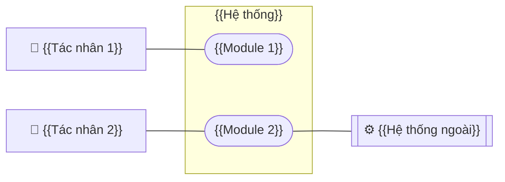
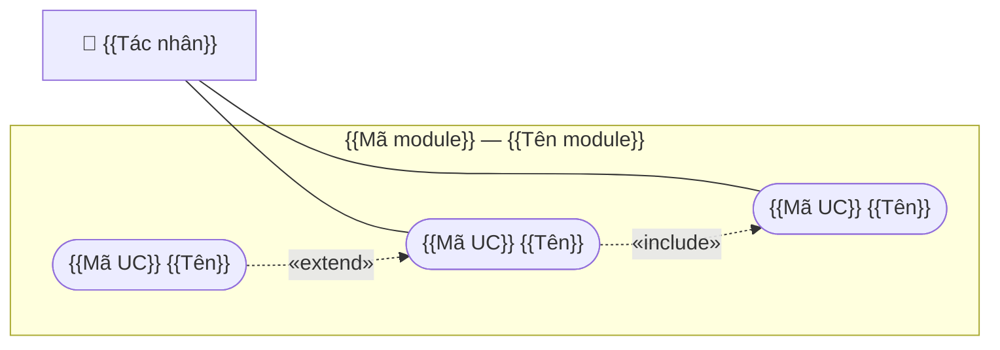

# TEMPLATE — TÁC NHÂN VÀ SƠ ĐỒ USE CASE

<!--
HƯỚNG DẪN DÙNG TEMPLATE
- Sao thành `UCD_{MÃ DỰ ÁN}_{PHẠM VI}_v00.md`. Xóa mọi khối HƯỚNG DẪN trước khi phát hành.
- Quy ước chung: ../00_quy_uoc_chung.md
- Chuẩn tham chiếu:
  · OMG UML 2.5.1 mục 18 Use Cases — tác nhân, use case, ranh giới hệ thống, quan hệ «include», «extend», tổng quát hóa.
  · Alistair Cockburn, Writing Effective Use Cases — mức mục tiêu: Tóm lược ☁ · Mục tiêu người dùng 🌊 · Chức năng con 🐟.
  · Ivar Jacobson, Use-Case 2.0.
  · Quyết định 671/QĐ-BTTTT năm 2024 Phụ lục I và IV — phân loại tác nhân Đơn giản · Trung bình · Phức tạp để tính điểm Use case.
-->

# TÁC NHÂN VÀ SƠ ĐỒ USE CASE — {{DỰ ÁN}} {{PHẠM VI}}

> **{{n}} tác nhân** — {{n}} người, {{n}} hệ thống ngoài — và **{{n}} sơ đồ use case** theo module.
> Tác nhân lấy từ mục 2 của [quy trình](../2-business-process/{{file}}); mã chức năng theo [danh sách use case](use_case_list.md).
> Sơ đồ chỉ vẽ **use case mức mục tiêu người dùng** 🌊. Chức năng con 🐟 — tìm kiếm, xem chi tiết, kết xuất — chỉ liệt kê ở danh sách.
> Tài liệu **không** chứa luồng chi tiết của từng use case (đặc tả UC ở `/ba-detail`) và ma trận quyền chi tiết (SRS).

## Thông tin tài liệu

| Mục | Nội dung |
|---|---|
| Mã tài liệu | `UCD_{{MÃ}}_{{PHẠM VI}}` |
| Dự án · Phân hệ | {{}} · {{}} |
| Phiên bản · Trạng thái | v{{NN}} · {{}} |
| Người soạn · Người review · Người duyệt | {{}} |
| Mức mật | {{Nội bộ · Hạn chế · Mật}} |
| Quy trình nguồn · Dự toán nguồn | v{{NN}} · `{{file dự toán}}` |

## Version control

| Tên version | Ngày cập nhật | PIC | Mô tả |
| :--- | :--- | :--- | :--- |
| **<span style="color:green">v00<br>(hiện tại)</span>** | **<span style="color:green">YYYY-MM-DD</span>** | <span style="color:green">{{PIC}}</span> | <span style="color:green">- Khởi tạo tài liệu.</span> |

## Phê duyệt

| Vai trò | Họ tên | Ngày | Ý kiến |
|---|---|---|---|
| BA soạn | | | |
| Product owner / Khách hàng | | | |
| Tech lead | | | |

---

## 1. Danh mục tác nhân

<!--
Phân loại theo QĐ 671/2024 Phụ lục IV:
  Đơn giản   — hệ thống khác giao tiếp qua API, trọng số 1
  Trung bình — giao tiếp qua giao thức hoặc dòng lệnh, trọng số 2
  Phức tạp   — người dùng qua giao diện đồ họa, trọng số 3
Tên tác nhân là VAI TRÒ, không phải chức danh cá nhân. Một người có thể đóng nhiều vai.
-->

| Mã | Tác nhân | Loại | Thuộc đơn vị | Mô tả — mục tiêu khi dùng hệ thống | Nền tảng | Phân loại QĐ 671 | Căn cứ vai trò |
|---|---|---|---|---|---|---|---|
| ACT-01 | {{*Nhân viên tiếp đón*}} | Người · Chính | {{}} | {{}} | {{Web · App · Kiosk}} | Phức tạp | {{QC01 Đ6.1 · D-01}} |
| ACT-02 | {{*Hệ thống CRM*}} | Hệ thống ngoài · Phụ | {{}} | {{Cung cấp thông tin khách hàng}} | API | Đơn giản | {{}} |
| ACT-03 | **Hệ thống** — tác vụ nền | Thời gian | — | {{Chạy N-xx theo lịch}} | — | — | QT mục 5 |

### 1.1. Tổng quát hóa tác nhân

<!-- Tác nhân con kế thừa mọi use case của tác nhân cha. Bỏ mục này nếu không có. -->

```mermaid
flowchart BT
    A2[{{Tác nhân con}}] -->|là một| A1[{{Tác nhân cha}}]
```

### 1.2. Tách nhiệm giữa tác nhân

| Cặp thao tác không cùng một người | Căn cứ |
|---|---|
| {{Lập phiếu}} ≠ {{duyệt phiếu}} | {{QT mục 2 · R-11}} |

### 1.3. Tổng điểm tác nhân — TAW

| Loại | Trọng số | Số tác nhân | Điểm |
|---|---:|---:|---:|
| Đơn giản | 1 | {{}} | {{}} |
| Trung bình | 2 | {{}} | {{}} |
| Phức tạp | 3 | {{}} | {{}} |
| **TAW** | | **{{}}** | **{{}}** |

---

## 2. Sơ đồ tổng quan

<!--
UML use case trong Mermaid:
  Tác nhân:    A1["👤 Tên"]        hệ thống ngoài: E1[["⚙ Tên"]]
  Use case:    U1(["Tên use case"])
  Ranh giới:   subgraph SYS["Tên hệ thống"] ... end
  Liên kết:    A1 --- U1
  «include»:   U1 -. "«include»" .-> U2     — U1 luôn gọi U2
  «extend»:    U3 -. "«extend»" .-> U1      — U3 mở rộng U1 khi có điều kiện; mũi tên từ use case mở rộng về use case gốc
-->



---

## 3. Sơ đồ theo module

<!-- ============ KHỐI LẶP CHO MỖI MODULE ============ -->

### 3.{{n}}. {{Mã module}} — {{Tên module}}

**Quy trình liên quan:** {{XX-01, XX-02}} · **Máy trạng thái:** SM mục {{}}



| Use case | Tác nhân chính | Tác nhân phụ | Mức | Quan hệ |
|---|---|---|:-:|---|
| {{Mã}} {{Tên}} | {{}} | {{}} | 🌊 | «include» {{Mã}} khi {{}} |

<!-- ============ HẾT KHỐI LẶP ============ -->

---

## 4. Ma trận tác nhân × use case

<!-- C: tạo · R: xem · U: sửa · D: xóa · A: duyệt · X: thực hiện thao tác khác. Là đầu vào cho ma trận quyền ở SRS. -->

| Use case | ACT-01 | ACT-02 | ACT-03 |
|---|:-:|:-:|:-:|
| {{Mã}} {{Tên}} | C R U | A | |

---

## 5. Câu hỏi cần chốt

| Mã | Câu hỏi | Kịch bản | Đề xuất mặc định | Người chốt | Quyết định |
|---|---|---|---|---|---|

---

## 6. Rủi ro còn lại

| Mã | Rủi ro | Căn cứ bị ảnh hưởng | Mức | Biện pháp | Cần khách xác nhận văn bản |
|---|---|---|:-:|---|:-:|
| RK-01 | {{}} | {{}} | C · TB · T | {{}} | Có · Không |

---

## 7. Điểm tạm hoãn

<!-- Việc đã rõ nhưng cố ý chưa làm ở phiên bản này. Không có thì ghi *Không có*. -->

| Mã | Nội dung | Ngày tạm hoãn | Điều kiện mở lại |
|---|---|---|---|
| TH-01 | {{}} | {{DD/MM/YYYY}} | {{}} |

---

## 8. Nguồn

| Tài liệu | Dùng cho |
|---|---|
| `../2-business-process/{{file}}` mục 2 | Tác nhân, tách nhiệm |
| `{{file dự toán}}` sheet `PL1&4.Actors` | Phân loại tác nhân |
